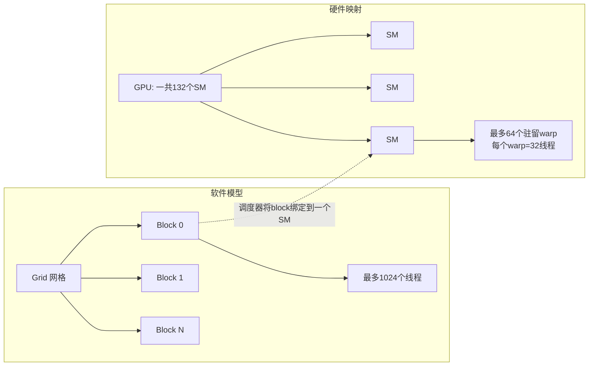

# 解释 CUDA 执行模型如何映射到硬件：网格（grid）、线程块（block）、warp、流式多处理器（SM）

**一句话摘要**
软件层面是由线程块构成网格、线程块由线程组成；硬件层面，GPU 的各个 SM 以 SIMT（单指令多线程）方式执行由32个线程组成的warp（对一个warp只发射一条指令；从Volta架构开始，每个线程还拥有独立的程序计数器）。硬件调度器会把一个线程块固定分配到某一个SM上执行；当warp因为访存阻塞时，调度器可以在最多64个驻留warp之间切换，以此掩盖数百周期的访存延迟。这就是GPU需要同时有成千上万个活跃线程，而不是少量高速线程的原因。

---
## 回答思路
分两部分作答：先讲软件层级（网格grid、线程块block、线程thread），再讲每一层如何映射到硬件（GPU、SM、warp）。面试官考察的核心是：你是否理解GPU主要依靠大规模并行来掩盖延迟；而CPU依赖大容量缓存与分支预测（GPU当然也有缓存，但真正用来填补缓存缺失带来的停顿的是warp切换）。一定要明确说出这一点，这是整套原理的核心。

## 高质量回答
启动一个核函数（kernel）时，你会指定一个由线程块组成的网格，每个线程块最多包含1024个线程。这是软件视角。
硬件上，GPU由大量**流式多处理器（SM）**组成（H100 SXM版本有132个SM；PCIe版本是114个）。硬件调度器会把每一个线程块分配给**唯一的一个SM**，并且这个线程块会固定在这个SM上直到执行完成。
在SM内部，线程块会被切分成若干个warp，每个warp固定32个线程；**warp才是真正的执行单元**：warp调度器在每个可用周期，为warp内全部32条通道以SIMT模式发射一条指令。

### 对应关系图（Mermaid）

有两个非常关键的设计结论：
1. **线程块之间必须相互独立**：线程块之间没有可靠的同步手段；只有同一个block内部的线程可以通过`__syncthreads()`和共享内存完成同步。正是这种独立性，让同一份二进制程序可以无缝缩放：既能在只有20个SM的笔记本GPU上跑，也能在132个SM的数据中心GPU上跑——调度器只需要把线程块分发到当前GPU所有可用的SM上即可。

2. **延迟掩盖（latency hiding）**：一次全局内存加载需要数百个时钟周期。CPU依靠大容量缓存和乱序执行掩盖这个延迟；SM依靠**超订阅（oversubscription）**实现。
一个SM最多可以同时保留64个驻留warp（A100/H100每个SM最多2048个驻留线程；消费级的Ampere、Ada架构上限是48个warp）。只要某个warp因为访存发生阻塞，调度器就可以零开销切换、调度另一个就绪warp执行。
这就是为什么GPU的线程数量要远多于硬件计算核心：H100通常需要同时有十万级别的活跃线程，才能让SM一直处于忙碌状态。这也是**占用率（occupancy）、寄存器压力、分支发散**成为性能热点的根源——它们都限制了调度器可供挑选的warp数量。

寄存器压力是理解“占用率”最直观的切入点：
一个SM拥有65536个32位通用寄存器，驻留线程上限2048。
如果一个核函数每个线程占用64个寄存器：`65536 / 64 = 1024`个线程，也就是32个warp。调度器手里只有一半用来掩盖延迟的“筹码”，甚至还没有执行任何指令。
如果优化到每个线程只用32个寄存器，就能放下全部2048个线程，也就是满额64个warp。
这些数字不会写在你的源代码里，由编译器决定；可以用`-Xptxas -v`参数查看。
这也解释了一个真实场景：**仅仅增加3个局部变量，核函数性能反而下降**——这是真实存在的性能问题。
同时，占用率并不是越高越好：有时候，一个寄存器开销大、不会发生寄存器溢出的核函数，32个warp的性能，反而优于64个warp但是频繁溢出到本地内存的核函数。

举一个矩阵运算的映射实例：4096×4096矩阵运算
启动网格：`128 × 128`个线程块，每个block是`32 × 32`线程；每个block负责计算输出矩阵里的一小块数据，被调度绑定到某个SM上，拆成32个warp运行；调度器在整个GPU上交错调度成千上万个block。

## 面试官接下来常追问的问题
- **为什么一个warp是32个线程？**
这是硬件SIMT的位宽。block的线程数最好是32的整数倍；否则不完整warp里会存在无效通道，你依然要为这些不存在的线程付出开销。
- **Block 5可以等待Block 3吗？**
不行。依赖block之间执行顺序的写法会产生死锁；普通kernel想要全局同步，只能结束本次kernel（协同组cooperative groups有严格限制，属于特例）。
- **GPU什么时候会比CPU慢？**
并行度很低、分支密集、指针追逐类串行代码，或是性能瓶颈在PCIe数据传输的场景。如果无法维持上万的活跃线程，SM就会空闲；这时CPU更高的主频、大容量缓存就会占优。
- **如果我的block需要的寄存器总数超过SM的寄存器上限会发生什么？**
能够驻留的block数量变少，SM占用率下降，延迟掩盖能力变差；编译器还可能把寄存器数据溢出到本地内存（local memory）。

## 常见误区
1. 把GPU线程等同于CPU线程（重量级、独立调度）。**warp才是调度单元**；用单线程的思路去分析分支发散、内存合并访问，一定会出错。
2. 误以为block映射到“CUDA核心（core）”。block映射到SM；厂商宣传的CUDA core只是ALU计算通道，不是独立处理器。
3. 不知道block之间无法同步。面试官经常用这一点区分：是真的调试过kernel的工程师，还是只看过PPT的人。
4. 完全不提延迟掩盖。如果你的讲解从头到尾只讲层级结构，不提warp切换用来掩盖访存停顿，那只是梳理了组织结构，没有解释这套设计的目的。

## 核心要点总结
- Grid/Block/Thread是**软件抽象**；GPU/SM/Warp是**硬件实体**；block绑定到SM、warp作为调度单元，是决定性能的关键。
- GPU依靠warp超订阅实现延迟掩盖（这个作用大于缓存），这就是占用率、寄存器压力重要的根本原因。
- Block设计上天然互相独立；假设block之间可以同步，是经典死锁场景，也是面试高频考点。

面试官用来区分真正调试过kernel的人和只看PPT的人的关键点：block之间不能互相同步；假设block有执行先后顺序会造成死锁。常规kernel想要全局同步只能结束kernel（协同启动是受限特例）。如果你的解释没有提到warp切换掩盖延迟，等于只讲了组织架构，没有解释设计初衷。也要避开“block映射到CUDA core”这个经典错误：block映射到SM；CUDA core只是ALU运算通道，不是独立处理器。

延迟掩盖还有另一半：单线程的指令级并行。所以“少量高速线程”这个说法并不完整。同一个warp，可以在使用加载结果之前，先发起多个相互独立的内存加载（内存级并行），同样可以掩盖延迟。这正是Volkov论文里的结论，解释了为什么一些占用率低、寄存器开销大的核函数依然可以跑得很好。

补充一个量化数字帮助理解延迟掩盖：一次全局内存加载大约需要400–600个周期，而一个warp调度器每个周期最多发射一条指令。因此每个调度器需要差不多同等数量的独立指令/活跃warp，才能覆盖一次访存缺失的等待时间。这就是为什么“少量高速线程”这条路走不通，算力对不上。

可以顺带记住一个推论：一个SM有4个warp调度器。所以要看的指标是**每个调度器的warp数量**，而不是每个SM的warp总数。举个例子，128线程的block（4个warp）刚好分给4个调度器，每个调度器只有1个warp，通常太少，根本掩盖不了延迟。

