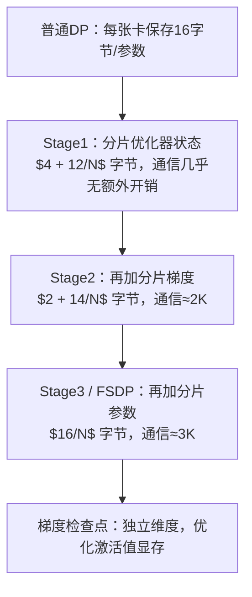

# **ZeRO 和 FSDP 究竟分片了什么？每个阶段能节省多少显存？梯度检查点在其中处于什么位置？**

---
## TL;DR（一句话总结）
混合精度 Adam 优化器，每个参数占用 16 字节（2字节 BF16权重 + 2字节 BF16梯度 + 4+4+4字节 FP32主权重/一阶动量/二阶方差）。ZeRO/FSDP 按照「显存开销大、通信代价小」的优先级依次分片这些张量：
- Stage1：分片优化器状态（通信几乎无开销）
- Stage2：额外分片梯度（通信量约2K）
- Stage3：额外分片参数（通信量约3K，显存接近线性缩放）
梯度检查点是单独针对**激活值**的优化手段：用大约30%的额外重计算开销换取显存节省。

## 思考思路
先搞懂混合精度 Adam 训练的显存构成：经典的「每个参数16字节」。理解这个基础之后，ZeRO 的三个阶段本质就是：**按照“显存开销/通信代价”的比值，依次分片每一部分张量**。同时要掌握每个阶段的通信开销——这是很多候选人会漏掉、但面试官很看重的点。

## 完整标准答案
普通数据并行（Plain DP）下，每一张 GPU 上都会为每个参数保存全套混合精度 Adam 相关张量：
- BF16 权重：2 字节
- BF16 梯度：2 字节
- FP32 主权重：4 字节
- FP32 Adam 一阶动量：4 字节
- FP32 Adam 二阶方差：4 字节
> 合计：**16 字节/每个参数**（激活值是额外开销，不包含在内）

所以一个7B模型，在还没算激活值的情况下，单卡就需要约 112GB 的训练状态，已经超过 80GB H100 的显存上限。在 N 个数据并行卡之间，这些重复存储完全是显存浪费。ZeRO（DeepSpeed）/FSDP（PyTorch）通过分级分片消除冗余：
- **Stage 1：分片优化器状态（12字节的FP32部分）**
  单卡显存开销变为：$4 + 12/N$ 字节/参数。通信量和普通DP保持一致（梯度依旧做all-reduce，底层是 reduce-scatter，优化器更新在分片上本地执行）
- **Stage 2：额外分片梯度**
  单卡显存开销变为：$2 + 14/N$ 字节/参数。单步通信量仍然约2K字节，和DP持平；梯度不再全局all-reduce，而是 reduce-scatter 交给对应归属的卡。
- **Stage3 / 完整FSDP：额外分片参数**
  单卡显存开销变为：$16/N$ 字节/参数。前向传播时，每层权重需要即时 all-gather 取回；反向传播时重新聚合（或保留）权重，梯度做 reduce-scatter。总通信量≈3K，对比DP的2K，通信开销提升1.5倍，换来显存接近线性缩放。FSDP 通过预取（prefetch）把 all-gather 和计算做重叠；在NVLink和高速互联下，通信开销基本被掩盖；但低速互联下开销明显，此时模型规模不大的话Stage2反而效果更好。

### 多阶段对比表
| ZeRO阶段 | 分片对象 | 单参数字节数 | 通信开销 |
| ---- | ---- | ---- | ---- |
| 基线 / DP | 无分片（每张卡保存完整副本） | 16 | ~2K（all-reduce） |
| Stage 1 | 优化器状态 | $4 + 12/N$ | 和DP保持一致 |
| Stage 2 | + 梯度 | $2 + 14/N$ | ~2K（reduce-scatter） |
| Stage3 / FSDP | + 参数 | $16/N$ | ~3K（DP的1.5倍） |

举个直观例子：7B模型，Adam优化、8卡训练。普通DP下单卡112GB（显存放不下）；开启全分片后单卡训练状态仅约14GB。所以在8×A100节点上微调7B模型，显存就不再是瓶颈。

梯度检查点针对另一块显存开销：**激活值**。激活值显存大小正比于 batch × 序列长度 × 网络深度，ZeRO 完全不处理激活值。
它的思路：不再保存每一层的激活值用于反向传播，而是每隔k层保存一个检查点，反向时重新计算中间层激活。显存大致按检查点间隔下降（经典$\sqrt L$方案只保存$O(\sqrt L)$层激活）；代价是增加大约30%计算量（大部分网络要额外跑一次前向）。梯度检查点可以和FSDP组合使用，当序列长度/批次太大导致OOM时是标准方案：算力相对便宜，HBM显存很贵。和FlashAttention思路一致：用FLOPs换显存。

## 选型决策准则
- 模型能放进DP显存：直接用DP
- 显存瓶颈主要来自优化器状态（绝大多数场景）：优先Stage1/Stage2，通信几乎无代价
- 参数本身都放不下：用完整FSDP / Stage3
- 激活值是显存瓶颈：梯度检查点；超长序列再搭配序列并行
- 集群互联带宽不足以支撑Stage3全量通信：用混合分片HSDP（节点内分片，跨节点复制）

## 面试官接下来常追问的问题
1. **为什么Stage1几乎没有通信开销？**
优化器状态只在优化器更新阶段读写，更新本身是本地操作；分片优化器状态不会增加迭代之间的通信开销。16字节里有12字节可以零通信代价分片，所以能用Stage1一定要开。

2. **FSDP 和张量并行TP都对参数分片，二者区别是什么？**
FSDP是临时聚合完整层、本地完成计算（显存优化技术）；TP是把层切分开、多卡共同计算一部分层、全程同步激活（计算划分）。二者通信模式、延迟特性完全不一样。

3. **CPU卸载适合什么场景？**
ZeRO-Offload / Infinity 把优化器状态（或参数）放到主机内存/NVMe。适合微调场景（单步耗时长）；预训练场景会被PCIe带宽卡住，成为速度瓶颈。

4. **怎么在一台8×80GB节点上微调70B模型？**
先算显存账：全量Adam状态是 $70B \times 16 = 1120\mathrm{GB}$，就算8卡均分，单卡也要140GB，远超80GB上限。
方案：降低优化器状态开销，使用LoRA/QLoRA（基础权重冻结、4bit量化）或者轻量化优化器，再加梯度检查点。
QLoRA的显存收益可以定量解释：基础模型4bit量化后总共35GB；可训练的Adapter只占全部参数约1%，这部分用完整Adam，开销是 $0.7B\times16≈11\mathrm{GB}$，整体训练状态约46GB，远小于节点总显存640GB；对比全量微调1120GB，显存缩小24倍。
核心逻辑：**16字节的Adam显存开销，只作用于可训练参数；减少需要训练的参数，效果优于单纯分片参数**。面试重点是先做显存字节核算，再给出方案。

## 常见误区
- 只会背诵Stage1/2/3，讲不清背后的显存字节计算逻辑
- 声称ZeRO-3通信量和DP一样：实际是DP的1.5倍，以太网低速互联下会明显拖慢单步速度
- 混淆FSDP和张量并行TP（都叫“切分模型”，本质完全不同）
- 忽略激活值显存：把参数分片算得清清楚楚，却解释不了为什么分片之后长上下文微调依然OOM

## 核心要点总结
1. 16字节/参数的显存拆解，让三个ZeRO阶段逻辑很清晰：优先分片「显存占用大、通信代价低」的部分
2. Stage1几乎无通信开销；Stage3以1.5倍DP通信开销，换取显存接近线性缩放
3. ZeRO 完全不处理激活值；梯度检查点是独立手段，用约30%重计算换取激活显存

> 这个追问——**“如何在一台 8×80GB 的节点上微调 70B 模型”**，本质考察你是不是先做显存字节核算，再抛出方案：全量 Adam 的训练状态是 70B × 16 = 1120GB；就算做分片，单卡也要分到 140GB，这时就只能用 LoRA/QLoRA，再搭配梯度检查点。
> 说 ZeRO‑3 的通信量“和普通数据并行 DP 一致”是错误的：它大约是 DP 的 1.5 倍，在以太网这类低速互联上，这个差距会明显体现在单步耗时上。
> 一个很典型的认知盲区：忘记激活值本身也要占显存。就算你把每个参数对应的 16 字节参数状态分片做得很漂亮，也没法解释为什么长上下文微调依然会显存溢出（OOM）。

> Stage3有一个容易忽略的坑：all-gather本身的缓冲区也占用显存。FSDP在计算当前层的时候，会预取下一层权重，所以任意时刻，显存里同时保存两层聚合后的参数+分片参数。如果模型有超大层（比如巨大Embedding层或者宽MLP），哪怕稳态分片显存够，瞬时聚合也会OOM。解决办法是把大层单独封装成更小的FSDP单元。

> 分片粒度是很多人踩坑的地方：粒度太粗（整个Transformer块作为一个FSDP单元），单次all-gather数据量巨大，无法被计算掩盖；粒度太细（每个线性层单独一个单元），all-gather启动开销爆炸。合适粒度一般是一个Transformer Block，同时这也是梯度检查点天然的划分边界。

