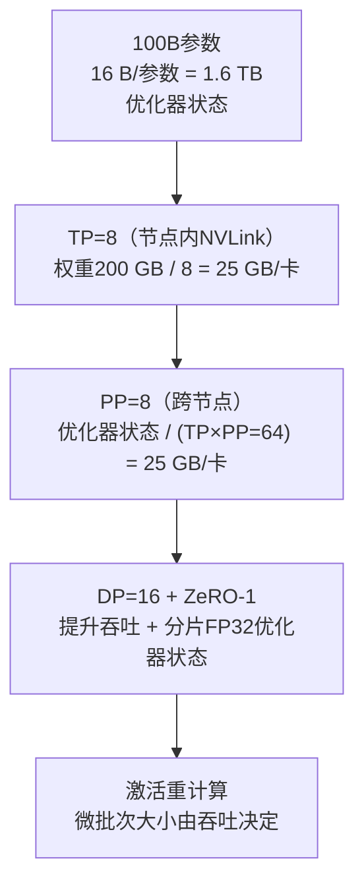

# 题目：我们需要训练一个1000亿参数的模型，该模型无法装入单卡显存。请设计数据并行与模型并行方案。

**一句话摘要（TL;DR）：先算显存预算：100B参数，Adam优化器状态占用16字节/参数，合计1.6TB，已经超过一整个8卡节点的显存容量，因此必须跨节点分片模型状态。整体方案：节点内部采用张量并行TP=8（依托NVLink），节点之间流水线并行PP来把优化器状态切分成64份；最外层叠加数据并行DP提升吞吐，搭配ZeRO-1；再启用激活重计算；最后分析流水线气泡与通信开销，保证方案跑得足够快，而不只是能放下模型。**

## 设计思路
先在白板上完成显存占用计算，再罗列各类技术方案。因为显存大小的硬性约束决定了整体设计，面试考察的就是体现这个因果关系。
先明确三个前提条件：硬件（假设是80GB H100，每个节点8张卡，节点内部NVLink互联，节点间InfiniBand互联）、目标序列长度与batch大小、以及瓶颈是墙上时钟耗时还是GPU卡数。

## 优质回答
### 步骤1：显存预算计算
混合精度Adam优化器，每个参数的优化器状态大约占用16字节。100B参数总状态量就是1.6TB，这还没有算激活值。换算成GPU显存：1.6TB ÷ 80GB，光是存放优化器状态就需要20张卡的显存，还完全没有预留激活值的空间，也还没有开始跑任何token。这个计算是后续所有设计的根本依据；算出这一步，就把一句空泛的“我们需要并行方案”变成了硬性约束下的必然选择。
单卡显存80GB，单个节点总共640GB。哪怕把整个8卡节点全部用上，也放不下1.6TB的优化器状态（1.6TB > 640GB）；**跨节点分片模型状态是必选项，不是可选项**。激活值还会额外占用显存：隐藏维度约12k、80层左右、序列长度4k，就算是很小的微批次，如果不做优化，单卡激活显存也会达到几十GB。

### 步骤2：切分模型状态
三种可以组合使用的并行手段：
- **张量并行 TP=8，在节点内部**：权重是BF16精度，总共200GB；8等分之后单卡25GB。张量并行每一层需要做的all-reduce通信走NVLink，带宽900GB/s，通信开销可控。
- **流水线并行 PP=8，跨节点**：每一个流水线阶段持有1/8的网络层，进一步降低单卡权重占用（降到约3GB）；更关键的是，优化器状态被 `TP × PP = 64` 切分，1.6TB ÷ 64 = 25GB/卡。现在模型状态可以放下，还预留了激活值的显存空间。
- **数据并行，放在剩下的维度上提升吞吐**：总GPU卡数1024张，`DP = 1024 ÷ (8 × 8) = 16`。同时在数据并行维度上用ZeRO-1对FP32优化器状态分片，再次节省显存；ZeRO-1稳态运行几乎不增加通信流量，开销很低。

开启**激活重计算**：只保存阶段边界的激活张量，反向传播时重新计算中间激活，代价是增加大约30%的计算量；这样微批次大小不再受显存OOM限制，由吞吐需求决定。

#### 状态逐层汇总表
| 阶段 | 所需显存 | 经过该步之后单卡占用 |
| ---- | ---- | ---- |
| 100B参数，Adam状态16 B/参数 | 总计1.6TB（>单节点640GB） | 无法放下 |
| 节点内TP=8 | BF16权重200GB /8 | 25GB/卡（权重） |
| 跨节点PP=8 | 1.6TB优化器状态 / (TP×PP=64) | 25GB/卡（优化器状态） |
| DP=16 + ZeRO-1 | FP32优化器状态在16个DP rank之间分片 | 显存可放下，预留激活空间 |

### 步骤3：优化速度，而不只是放下模型
流水线气泡：PP=8时，气泡占比大约是 `7/m`，m是流水线中同时飞行的微批次数量。因此我们设置m≥64，搭配1F1B（1-forward-1-backward）或者虚拟阶段交错执行，把气泡占比压到10%以内。
逐项通信审计：
1. TP的all-reduce：通信量大，但是走NVLink，带宽充足；
2. PP阶段边界激活张量收发：单个微批次边界张量大小≈序列长 × 隐藏维度 × 2字节 ≈ 4k ×12k ×2 ≈100MB，点对点通信，可以和计算重叠，InfiniBand下表现良好；
3. DP的梯度 reduce-scatter / all-reduce：每个参数分片大约2字节，可以和反向计算重叠。
面试里要主动说明：必须核验DP的all-reduce通信耗时，确认它能隐藏在反向计算时间之内。

### 步骤4：备选方案说明
纯FSDP（无TP、无PP）在这个规模下同样可以放下模型，运维更简单；劣势在于：如果硬件网络带宽不足以把逐层all-gather通信隐藏在计算背后，或者完整层激活显存压力太大，FSDP的效率会下降。
我的优先方案：IB网络环境下，默认采用三维并行（TP+PP+DP）；如果团队人手少、运维资源有限，可以退而选用FSDP/HSDP。同时可以提及业界成熟实现：Megatron-LM、DeepSpeed、Megatron+NeMo，而不是自己从零手写。

额外补充要点：
全局batch size、学习率缩放会影响模型效果，约束了数据并行的并行度；必须设计断点续训策略，因为1024卡的训练任务一定会遇到节点故障；正式跑大实验之前，先在1/10规模上验证整套并行布局是否可行。

## 面试官接下来大概率追问的问题
1. **为什么张量并行TP放在节点内部，不跨节点？**
张量并行每一层激活都要做all-reduce，处在关键路径上；NVLink带宽约900GB/s，而单张IB网卡只有约50GB/s，差距接近18倍，这种通信开销很难被计算掩盖。

2. **如果我只给你256张GPU卡呢？**
显存计算逻辑不变，只是DP并行度变小；吞吐近似线性下降，显存分片方案基本不用改动。这个回答体现方案是约束驱动，不是死记硬背固定配方。

3. **序列长度改成32k会带来什么变化？**
激活值和注意力计算成为显存瓶颈；需要引入序列并行/上下文并行，搭配更激进的激活重计算策略；原本的显存计算假设不再成立。

4. **怎么确定微批次大小？**
先选激活重计算之后显存能容纳的最大微批次；再调飞行微批次数量m，权衡流水线气泡开销和all-reduce通信桶效率；这个参数靠实测调优，不是纯公式推导。

## 常见错误
- 上来直接罗列名词，不算显存预算：张口就说“用ZeRO-3+Megatron”，没有显存计算支撑，是最容易被否决的回答；
- 忽略优化器状态（Adam额外12字节/参数的FP32动量方差），误以为模型“差不多能放下”，误差会高达8倍；
- 只设计显存分片方案就结束，不考虑流水线气泡、通信开销、故障容灾，仿佛训练跑起来就不会出问题；
- 提出跨节点TP方案，说明候选人没有跟踪过每一类集合通信在物理网络上的开销。

## 核心要点总结
1. 先算显存预算，再谈技术名词：1.6TB优化器状态决定了必须跨节点分片，这是整套方案的源头约束；
2. 标准布局：节点内NVLink做TP=8，跨节点PP切分，最外层DP+ZeRO-1；
3. 一份完整回答必须包含：流水线气泡计算、每一类集合通信开销分析、故障恢复方案。

---

引入流水线交错策略时，气泡公式要重新核算：设置v个虚拟流水线阶段之后，气泡占比近似为 $\boldsymbol{(PP-1)/(m \times v)}$。但是每增加一个虚拟阶段，都会增加一次点对点通信；相当于用更多网络边界流量，换取更小的流水线气泡。例如PP=8、v=4时，每个微批次的通信流量翻4倍；在InfiniBand网络下通常可以接受，但不能默认交错方案没有代价，必须提前评估通信成本。

