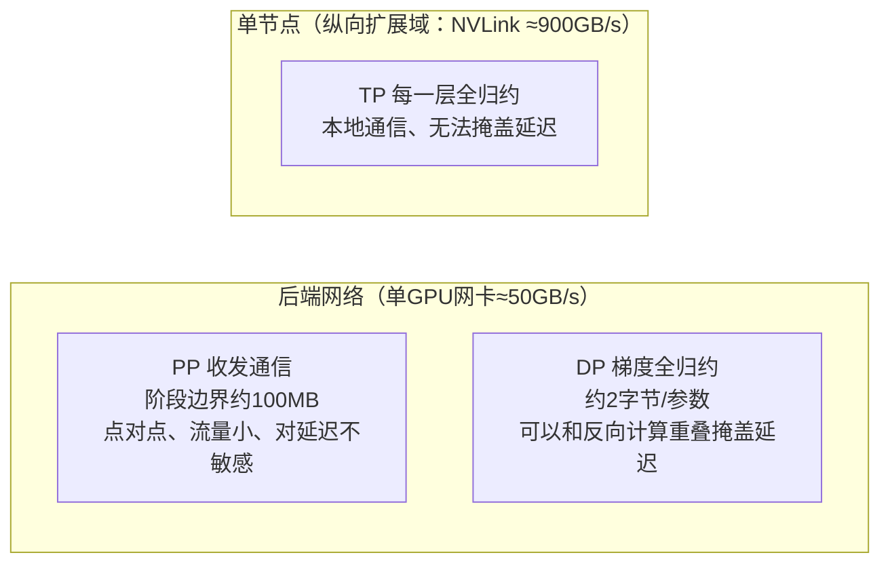

# 12 流水线并行，它是跑在跨节点扩展网络上，还是只在单节点内部？把张量并行（TP）、流水线并行（PP）、数据并行（DP）映射到集群网络结构上。

> TL;DR（一句话总结）：是的，流水线并行**刻意使用跨节点扩展网络**；因为它只在流水线阶段边界传输少量点对点激活张量。这个分配逻辑来自三类流量特征：张量并行每一层都要做全归约，所以必须放在 NVLink 域内（并行度 ≤8）；流水线并行和数据并行都会走后端集群网络（流水线并行是因为流量体量很小；数据并行是因为它的全归约通信可以和反向计算重叠）。

### 答题思路
先直接回答字面问题：是的，流水线并行会主动走跨节点扩展网络；然后再拿原理拿分：**每种并行策略都有自己的流量特征（流量大小 × 通信频率 × 延迟敏感度）**，我们要把它分配到成本最低、又能承载它的网络。同时要厘清术语，“跨节点扩展网络”和“数据中心前端网络”的区分，也是这道题的考察点。

### 高分参考答案
先定义术语：一个GPU集群包含三类完全不同的网络域：
1. **scale-up 域（纵向扩展域）**：单节点内部（或者 NVL72 整机柜）的 NVLink/NVSwitch，大约每块 GPU 900 GB/s；
2. **scale-out（跨节点扩展/后端计算网络）**：InfiniBand 或者 RoCE RDMA，用来连接不同节点做训练通信；典型配置是每块GPU配一张 400 Gb/s（等效50 GB/s）网卡，是为机架流量优化的；
3. **前端数据中心网络**：普通以太网，用于存储、断点续训、集群管理。训练集合通信**绝对不能跑在前端以太网**；真正要抉择的，是 NVLink 域 vs 后端RDMA网络。

接下来是三类并行的流量特征：
- ✅ **张量并行（Tensor parallelism, TP）：仅使用 NVLink**
张量并行在每一层、每个微批次、前向+反向过程里，都要对激活张量做全归约；通信总量巨大，并且处在关键路径上，没有任何计算可以用来掩盖通信延迟。只有纵向扩展域能扛住这个负载。
NVLink（~900 GB/s）到网卡（~50 GB/s）带宽差达到 **18倍**；张量并行的全归约在关键路径上，没有办法隐藏延迟，这18倍的带宽差距会直接体现在单步训练耗时上。举个直观例子：一段在NVLink上耗时1ms的TP全归约，如果TP组跨节点，耗时会直接变成约18ms。
如果一个模型有80层，前向+反向，每个微批次都要做，这个差距直接决定训练是正常跑，还是GPU大部分时间都在等待网络。
所以TP并行度通常 ≤8（NVL72机柜是特例：它把纵向扩展域做得更大，支持更大TP，但底层原则没变）。

- ✅ **流水线并行（Pipeline parallelism, PP）：走跨节点扩展网络，这是合理的**
流水线并行只在相邻阶段的边界，点对点发送激活张量。流量体量适中：比如序列长度4k、隐藏维度8k、BF16精度，单个微批次的激活张量大约64MB；在400Gb/s网卡上传输大约1.3ms，而且天然可以和计算流水线重叠。
流水线并行本身就是为跨节点设计的，它是**对带宽、延迟容忍度最高**的并行维度。

- ✅ **数据并行（Data parallelism, DP）：走跨节点扩展网络**
数据并行的梯度全归约流量很大（每一步每个参数约2字节），但是**每一步只执行一次**，并且可以和反向传播计算重叠。它需要聚合带宽，而不是极低延迟；机架优化的胖树网络正好匹配这个需求；拓扑感知的NCCL会把归约环放在同一个机架通道内，避免抢占核心交换机的带宽。

> 经典部署方案（Megatron风格，1024卡）：TP=8（单节点内NVLink）、PP=16（跨节点，每个阶段放在一个节点）、DP=8（跨后端网络）；调度器会把同一个流水线的节点就近放置，DP归约环对齐机架通道。
> 如果xAI面试官问每种集合通信物理走哪里：TP全归约走NVSwitch；PP收发走网卡（理想情况一跳可达）；DP全归约走网卡，可能跨多级网络。

> 可以直接背诵的一句话总结：**张量并行留在节点内NVLink；流水线并行和数据并行走跨节点后端扩展网络。流水线并行是因为流量小，数据并行是因为通信可以被计算掩盖。**

---
### 面试官接下来大概率追问的问题
1. “为什么不能反过来，DP放节点内NVLink、PP跨节点？”
分配优先级是按**延迟敏感度排序**：张量并行优先级最高，必须独占NVLink纵向扩展域，不能和别的通信共享。一旦TP占了NVLink，PP和DP就只能跑后端网络；PP和DP之间调换的影响相对很小，所以这道题真正的核心考点是TP。

2. “如果PP阶段放在超额订阅的核心交换机两侧，会出什么问题？”
阶段边界的收发报文会被其他租户的流量排队阻塞；流水线的停滞会顺着流水线不断传播，形成**气泡（bubble）**。解决办法是拓扑感知的任务绑定放置，而不是单纯换更大的网卡。

3. **专家并行（Expert parallelism, EP/MoE）的all-to-all通信走哪里？**
走跨节点后端扩展网络；和PP不一样，MoE的all-to-all对延迟敏感、容易产生流量汇聚（incast），MoE才是真正考验后端网络设计的负载。

4. “为什么每块GPU都配一张独立网卡？”
这样每一块GPU的DP/PP流量可以直接送到网络，不会多卡争抢同一张网卡；GPUDirect RDMA可以让网卡和HBM直接传输，绕开主机内存。

---
### 常见错误回答
- 想当然：“流水线并行应该在本地，这样更快”——刚好反了，PP是对网络容忍度最高的并行维度；这个错误非常典型，面试官一眼就能看出来。
- 分不清后端RDMA网络和前端以太网，说训练流量跑在存断点的以太网上面。
- 只对比总字节数，忽略频率、是否可重叠：PP总字节最少；DP流量大但是可以掩盖；TP流量大、**完全无法掩盖**。通信频率、是否可重叠，才是决定网络分配的关键。
- 缺少量化数字：NVLink ~900GB/s vs 网卡 ~50GB/s，18倍带宽差是整个论证的根基；没有这个数字，只是主观断言，不是严谨推理。

---
### 核心要点总结
1. TP必须跑在NVLink；PP、DP走后端RDMA扩展网络，**绝对不走前端以太网**。
2. PP是对网络最宽容的并行维度（少量点对点发送），和很多人的直觉相反。
3. NVLink带宽是网卡的18倍，是这套分配逻辑的核心依据，面试一定要提到这个数字。

> NVL72这个“反例恰恰印证规律”的点值得深挖：当纵向扩展域扩大到72块GPU的时候，TP上限不再是8；大家可以在整机柜NVLink上跑TP和EP。底层原理没变，只是硬件部署形态变了。如果答题直接说“TP永远≤8”，这个说法就停留在Blackwell机柜之前的旧认知了。

