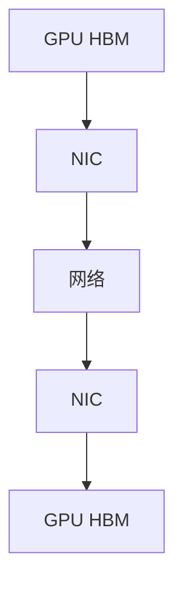
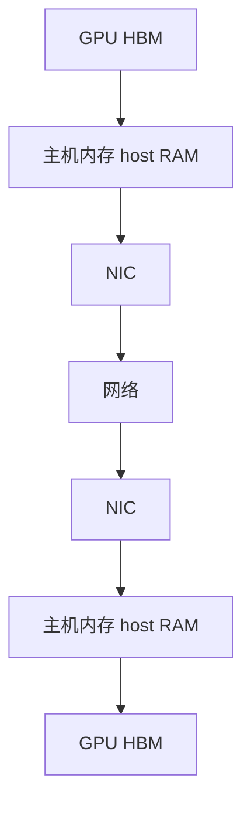

# NCCL 到底做什么？为什么任务是通信受限的时候，GPU 利用率还能读到 100%？

> 一句话总结：NCCL 是感知拓扑的集合通信层（它会探测 NVLink / PCIe / NIC 硬件布局，把数据分块流水线传输，使用 GPUDirect RDMA，让网卡直接 DMA 访问 GPU 的 HBM 高带宽显存）。这里有一个坑：NCCL 的集合通信是以 CUDA Kernel 的形式运行的；所以当一个进程在慢速网络或者掉队卡（straggler）上忙等待时，`nvidia-smi` 里仍然会显示 100% 利用率。你应该去看 MFU（模型浮点利用率）、每一步计算与通信的追踪数据、扩容缩放特征，而不是单纯看 GPU 利用率。

---
## 解题思路
这是一个两部分的问题，第二部分才是容易踩坑的重点。
先解释 NCCL：感知拓扑的集合通信层（它探测什么、数据怎么搬运）；
再拆解利用率这个指标的陷阱：NCCL 的通信逻辑本身就作为 CUDA Kernel 跑在 GPU 上，所以 GPU 只是在等待网络的时候，看起来和 GPU 正在做计算一模一样。同时列出你真正应该信任的指标。

## 标准答案
NCCL 是 NVIDIA 的集合通信库（支持 all-reduce、all-gather、reduce-scatter、all-to-all、broadcast），是 PyTorch DDP / FSDP 底层依赖的通信组件。
它能做到高速通信，有三个核心特性：
1. **拓扑感知**：初始化阶段扫描真实硬件（NVLink 连接、PCIe 交换机位置、NUMA、网卡本地性），在最优路径上构建环、树结构；根据消息大小选择算法和协议：大缓冲区用环算法（追求带宽），小消息用双二叉树（降低延迟）。
2. **流水线**：缓冲区切分成多个小块，GPU 在转发第 k 块数据的同时接收第 k+1 块，让每一条链路都保持满载。
3. **直连数据通路**：节点内部走 NVLink 点对点通信；跨节点使用 GPUDirect RDMA，网卡直接通过 PCIe 对 GPU HBM 做 DMA 读写，**不需要经过主机内存中转，数据通路里不经过 CPU**。

### 图1：GPUDirect RDMA

### 图2：无 GPUDirect（传统路径）

不开启 GPUDirect 的时候，跨节点的每一字节数据，不是一次传输，而是**三次拷贝**：发送端：GPU → 主机内存拷贝；网卡发送；接收端：主机内存 → GPU 拷贝。每次传输额外两次完整内存拷贝，并且 CPU 参与整个数据通路。
对于梯度 all-reduce，每一步要传输 GB 级别的数据，这些中转拷贝不是可以忽略的损耗：它们增加延迟、占用主机内存带宽（这些带宽本来要留给其他任务），并且让实际吞吐上限跑不到网线的线速。
GPUDirect RDMA 去掉了这两次拷贝，网卡直接 DMA 读写 GPU HBM，NCCL 可以接近线速传输，CPU 开销几乎为0。
一个实操判断标准：本该是纯网络传输阶段，主机内存带宽占用异常高、CPU 莫名繁忙，基本就是 GPUDirect 没正常工作。
一个重要的实操细节：这个能力依赖 PCIe 拓扑。网卡和 GPU 最好挂在同一个 PCIe 交换机下。这也是优化型节点设计里，一个 GPU 配一张网卡的原因。在新集群上排查，优先看环境变量 `NCCL_TOPO_DUMP` 和 `NCCL_DEBUG=INFO`。

---
现在来说这个坑：

NCCL 的集合通信逻辑是跑在流式多处理器 SM 上的 CUDA Kernel。当一个进程在等待其他对等进程（网络慢、环路路由到拥塞的主干交换机、或者某一块掉队 GPU 迟迟没有进入集合通信），这些 Kernel 会自旋等待。

`nvidia-smi` 的“GPU 利用率”含义仅仅是：**采样窗口内有 Kernel 驻留在 GPU 上**。所以哪怕任务 60% 的时间都在等网络，利用率依旧显示 100%。
这是分布式训练里最容易误导人的指标，面试经常问这个问题，用来筛真正踩过坑的人。

### 你应该优先查看的指标，按优先级排序
1. 每一步耗时拆解；
2. Profiler 追踪（Nsight Systems、开启 NCCL 事件的 PyTorch Profiler），看清每一步里多少时间是计算、多少时间是 `ncclAllReduce`；
3. **MFU（模型浮点利用率）**：实际模型 FLOPS / 硬件峰值 FLOPS。典型例子：利用率显示100%，MFU 只有18%，就说明是通信受限；
4. 扩容特征：同样单卡 batch size，1节点 和 4节点对比，单步耗时上涨就是通信（或者掉队卡）导致；
5. 网卡和交换设备计数器：IB 端口计数、RoCE 拥塞统计，区分“网络本身慢”和“有进程掉队”；
掉队卡的特征：所有其他进程在集合通信里自旋等待，只有某一个进程还在跑计算；可以用每个进程的时间戳来精准识别。

## 面试官接下来常追问的问题
- **GPUDirect P2P 和 GPUDirect RDMA 的区别？**
P2P 是**节点内** NVLink / PCIe 的 GPU 直连；RDMA 是**跨节点**网卡直接访问 GPU 显存。两者都省去主机内存中转拷贝。
- **NCCL_DEBUG 日志显示通信环路走 PCIe 而不是 NVLink，代表发生了什么？**
点对点访问异常（IOMMU/ACS 配置、容器配置）或者拓扑探测失败；带宽会悄悄损失接近10倍，这个问题只会体现在单步耗时变长，不会直接报错。
- **什么时候需要手动调 NCCL 参数，而不是直接用默认值？**
多租户集群、特殊网络架构：绑定网卡（`NCCL_IB_HCA`、`NCCL_SOCKET_IFNAME`）；小消息延迟占主导时，调整通道数和协议；IB 网络支持交换机内规约时，开启 SHARP。
- **怎么在生产环境持续监控这个问题，而不是事后复盘？**
对每个任务持续监控 MFU、单步耗时 SLO，加上**进程间时间差告警**，而不是只看利用率看板。

## 常见误区
1. 把 100% GPU 利用率当成 GPU 高效工作的证明，正好掉进这个问题考察的误区；
2. 简单把 NCCL 说成“GPU 版 MPI”就结束了；拓扑感知、GPUDirect 直连通路才是它的核心；
3. 不知道通信是跑在 SM 上，于是无法解释为什么这个指标是假的；
4. 一看到通信瓶颈就直接升级网络，没有先检查环路分配、GPUDirect 是否正常、有没有掉队卡。大部分健康网络上的通信受限问题，根源是配置或者路由，不是带宽不够。

## 核心要点
- NCCL = 感知拓扑的集合通信 + GPUDirect RDMA（网卡直接 DMA 访问 HBM），直连通路是核心；
- nvidia-smi 的利用率只统计有没有 Kernel 驻留，NCCL 自旋等待也是 Kernel，所以通信受限任务会虚假显示满负载；
- 可信指标：MFU、每一步计算/通信追踪、1节点对比多节点的扩容特征。

---
### 补充段落
有一个比完整 Profiler 追踪更轻量的检测手段，用来识别这个“100%利用率陷阱”：
NCCL 通过 Profiler 插件暴露每一个集合通信的耗时，PyTorch 的飞行记录器（flight recorder）会记录集合通信进入、退出的时间戳。
**同一个进程进入集合通信和完成集合通信之间的时间差不断拉大，就是通信受限的特征**。你可以持续对这个指标配置告警，而不需要给每一个任务都跑 Nsight 采样。

