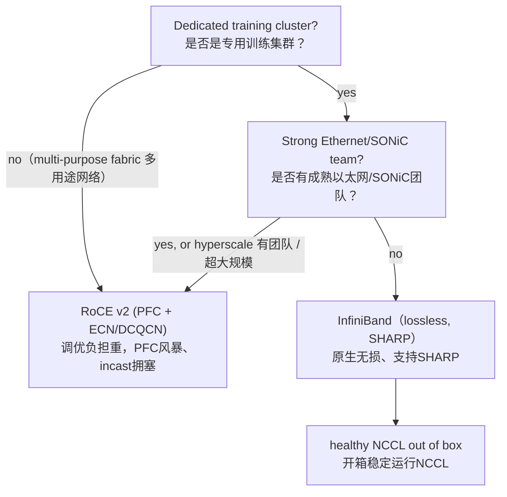

# 14 对于GPU训练集群，该如何选择InfiniBand还是RoCE？

**一句话总结：**
二者都支持400Gb/s的RDMA，所以这不是一个由速率决定的选择；核心差异在于丢包行为、调优工作量，以及运维团队背景。
如果是**专用训练集群**，且没有资深网络工程团队，选InfiniBand：它原生无损、自带SHARP交换机内规约能力，开箱就能稳定跑NCCL。
满足下面场景则选RoCE：你本身就有成熟的以太网运维团队、属于超大规模场景，厂商多样性是优先考量，或者这张网络是多用途共享架构。

## 分析思路
核心认知：两者目标一致（为NCCL构建近似无损的RDMA网络），只是实现路线不同。选型的判断依据是**运维成熟度与生态**，而非原始带宽。回答时要给出明确推荐以及切换条件；这个问题不适合“两者都可以”这种模棱两可的无效回答。可以引用Meta的实践：Meta在24k GPU规模下，Llama 3同时在两套网络上完成训练，这个论据很有说服力。

> 流程图：
> 起点判断：是否是**专用训练集群？**
> ✅是 → 继续判断：是否有成熟以太网/SONiC团队？
> &nbsp;&nbsp;&nbsp;&nbsp;❌没有 → 选 InfiniBand（无损、支持SHARP）→ 开箱即可稳定运行NCCL
> &nbsp;&nbsp;&nbsp;&nbsp;✅有 / 属于超大规模集群 → 选 RoCE v2（PFC + ECN/DCQCN）→ 调优负担重，存在PFC风暴、incast（多对一拥塞）风险
> ❌不是（多用途网络）→ 直接选 RoCE v2（PFC + ECN/DCQCN）→ 调优负担重，存在PFC风暴、incast（多对一拥塞）风险

## 一份高质量面试回答
两者都支持RDMA，单端口都能跑到400Gb/s，配置得当的前提下都可以很好运行NCCL。
区别在于：

InfiniBand是专为HPC/AI设计的专用网络：基于信用的链路级流控，**天生无损**；延迟约1~2微秒；子网管理器集中处理路由；还拥有网络原生增强能力，最典型就是SHARP。SHARP可以直接在交换机内部完成规约计算，能把all-reduce通信流量降低大约一半。面向训练场景，它几乎开箱即用。
代价：生态单一（英伟达/Mellanox），定价与供货周期配套；是一套独立网络，你的网络团队大概率不熟悉，需要专门掌握InfiniBand运维技能。

RoCE v2 是**跑在标准以太网上的RDMA**。它的优势是成本与运维体系：通用商用芯片、多厂商可选，可以复用你现有的以太网工具栈与运维团队。
但痛点在于：RDMA要求无损，而以太网原生设计就是允许丢包的；因此它依靠PFC、ECN/DCQCN去模拟“近似无损”，大规模场景下调优难度极高。
它的经典故障模式广为人知：PFC风暴、线头阻塞——一个拥塞端口就会冻结整网同优先级流量；拥塞控制参数在1k GPU规模可以正常工作，扩展到8k规模就会失效；MoE模型里大量all-to-all通信带来的incast拥塞问题突出。
当然它完全是可用的：Meta的两套24k GPU Llama集群，一套RoCE、一套InfiniBand，专门用来做对照；现在各大超大规模厂商都在搭建巨型RoCE网络（同时Ultra Ethernet也在直面这个问题），但这套方案能跑起来的前提，是有专业的网络工程师持续调优维护。

还有一些会影响实际采购的次要因素：
轨优化拓扑与自适应路由能力（两套网络都支持，但不同交换机厂商的成熟度不一样）、可观测遥测能力（用于定位集合通信慢的问题）、多租户隔离（CoreWeave这类云厂商非常看重），以及你的集合通信流量特征是否能从SHARP交换机内规约中获益。

我的选型建议：
如果是专用训练集群，而团队没有庞大的网络工程人力，优先选InfiniBand。你买到的是确定性，是最快让NCCL稳定跑起来的方案；和集群里GPU的成本对比，网络溢价其实不大（网络成本大概只占集群总成本10–15%；一旦网络故障，剩下85%的GPU都会空转闲置）。
满足下面任意一种情况，就换成RoCE：
你已经有成熟的以太网/SONiC运维团队；属于超大规模场景，厂商多样性、供应链稳定是首要诉求；集群是多用途（同时承载训练、存储、通用东西向流量）；或者采购规则上无法接受单一厂商锁定风险。
Meta和各大公有云大厂就属于这类场景，所以现实中两套方案都有大规模落地。

### 选型对比表
| 维度 | InfiniBand | RoCE |
| ---- | ---- | ---- |
| 流控机制 | 基于信用、链路级流控 | PFC（暂停帧） |
| 无损能力 | 原生架构无损 | 依靠PFC+ECN/DCQCN实现伪无损 |
| 交换机内规约 | SHARP，all-reduce流量减半 | 无 |
| 调优工作量 | 低，开箱NCCL稳定 | 高；存在PFC风暴、incast拥塞，参数随规模容易失效 |
| 成本 | 单一厂商定价，供货周期受限 | 通用商用芯片，成本更低 |
| 厂商绑定 | 仅限英伟达/Mellanox | 多厂商可选 |

## 面试官接下来大概率追问的问题
- **“调优不当的RoCE网络，具体会出什么问题？”**
  PFC暂停帧向上游逐级扩散（PFC风暴）、线头阻塞、DCQCN配置错误引发丢包（NCCL超时、重传雪崩）或者长期带宽利用率偏低；现象就是训练步时抖动、偶发复现困难的慢step。
- **“为什么丢包对RDMA的伤害远大于TCP？”**
  传统RDMA使用回退N帧重传：一个报文丢包，整个滑动窗口都要重传；吞吐量断崖式下跌，而不是像TCP那样平缓降速。新一代网卡支持选择重传，情况有所改善，但相比TCP，RDMA依然对丢包极其敏感。
- **“什么是轨优化拓扑（rail-optimized topology）？”**
  每台节点的第i张网卡连接到第i台叶交换机。这样NCCL里每一组GPU环通信只经过一台叶交换机，不需要经过脊交换机。两套网络都可以用这种拓扑；很多时候，拓扑设计本身，比选IB还是RoCE带来的收益更大。
- **“推理集群的选型会不一样吗？”**
  大多会放宽要求：推理流量主要是南北向流量、KV缓存搬运，不需要上万GPU规模的集合通信；一般标准以太网就够用，只有在预填充/解码KV缓存分离部署场景才需要高性能RDMA网络。

## 常见错误回答
1. 拿带宽对比说“InfiniBand更快”：单端口400Gb/s下二者带宽对等；真正差异在丢包行为、长尾延迟、运维复杂度。
2. 给出模棱两可的中立回答：这个题目是考察你的工程判断，必须结合场景给出明确选择。
3. 说自己懂RoCE，但答不出PFC/ECN/DCQCN：面试官马上就能识别你不懂。
4. 前面分析完网络限制，后面在算容量、并行方案的时候，又默认网络无限快、无成本：面试官会留意你前后逻辑是否自洽。

## 核心要点总结
- 400Gb/s端口下二者带宽持平；真正的决策维度是丢包行为、长尾延迟、运维负担。
- InfiniBand原生无损，自带SHARP交换机内规约；RoCE靠PFC+ECN/DCQCN模拟无损，大规模下调优是难点。
- 专用训练集群默认优先InfiniBand；有成熟以太网团队、看重供应链厂商多元化、多用途共享网络，就选RoCE——这也是Meta两套方案都落地的原因。

---

> 还有一个很少被提起、但真实采购中很关键的因素：
> SHARP的交换机内规约，**只对适配它的集合通信算子生效（all-reduce、broadcast）**。
> 如果你的业务是重度MoE workload，通信以all-to-all为主，SHARP几乎带不来收益。
> 当你的通信主体是all-to-all而不是all-reduce时，IB和RoCE之间的选型重心就变了：
> 变成看谁的自适应路由、拥塞控制做得更好，因为这才是承载incast多对一拥塞流量的关键。