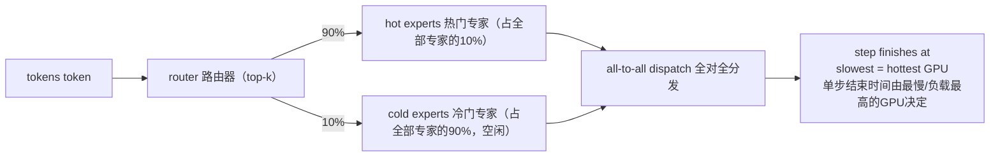

# 你如何处理MoE模型中的专家负载均衡？如果90%的token都路由到10%的专家上，会发生什么？


> 一句话总结（TL;DR）：路由倾斜是自我强化的（热门专家会获得更多梯度，路由器会更加刻意避开冷门专家）；同步训练的单步耗时由负载最高的GPU决定。因此负载均衡必须主动强制约束，不能寄希望于自发均衡。
> 训练阶段方案：使用辅助负载均衡损失、容量系数、或者基于偏置的均衡方案（DeepSeek-V3风格）；
> 推理服务阶段方案：路由权重已经固定，需要对热门专家做副本扩容、在线重均衡。

## 答题思路
先回答这个假设场景，因为它能揭示底层机制：路由倾斜具备自我放大效应，而且它直接决定单步耗时，不只是单纯效率低下。然后分两大块阐述方案：**训练时（损失函数、容量限制）** 和 **推理服务时（副本扩容、重均衡）**，二者解决思路完全不同；面试者如果混为一谈，说明大概率只读过Switch Transformer这一篇论文。



在90/10这种倾斜分布下，利用率直方图极度不均衡：一小部分热门专家的负载远高于均匀分配基准线，绝大多数专家几乎处于空闲状态。
```mermaid
bar
    title 专家负载分布
    x-axis 热门10% | 冷门90%（近乎空闲）
    y-axis 负载
    bar 热门专家1 高
    bar 热门专家2 较高
    bar 其余专家 接近0
    line 均匀分配基准线
```
> 说明：单步耗时由负载最高的GPU决定；剩下大部分GPU集群处于空闲等待状态。

[1](./1.jpeg)

## 一份高质量回答
### 90/10倾斜场景的后果
专家被分片部署在不同GPU上（专家并行），token通过全对全通信，分发到托管对应专家的GPU。如果90%的token流向10%的专家，会同时出现三层问题：
1. **系统层面**：承载热门专家的GPU拿到接近9倍于公平分配份额的token；同步训练必须等最慢的卡完成计算，剩下90%的GPU资源空转浪费。
    我们举个例子方便理解：一共8个专家，均匀部署在8张卡。负载均衡时每张卡处理10%的token，单步耗时以此为准；出现90/10倾斜时，2个热门专家各承载45%流量，热门GPU的计算量是均衡场景的4.5倍。因为是同步执行，**整轮训练的耗时被拉长到均衡情况的4.5倍**。我们投入硬件，预期MoE能达到稠密模型8倍的吞吐，实际只能达到 8/4.5 ≈ 1.8倍，硬件成本一分不少，但实际可用算力大幅缩水（这个是简化算术举例，但底层机制是准确的）。
    这种**理论算力和实际可用算力的巨大缺口**，就是MoE最烧钱的地方。所以负载均衡不是锦上添花的优化，而是预算层面必须考虑的硬性指标。
2. **模型层面**：热门专家拿到绝大多数梯度信号，持续迭代变好；冷门专家几乎得不到更新，效果持续变差。路由器会学到避开这些效果差的冷门专家，路由进一步向少数专家聚集，形成**富者愈富的正反馈螺旋**。所以均衡必须主动施加约束，不能指望路由自己平衡。
3. **质量层面**：如果开启了容量上限，超额的token会直接被丢弃，路由倾斜越严重，丢token越多，模型效果直接受损。

---
### 训练阶段工具箱
- **辅助负载均衡损失（Switch / GShard方案）**：对每个专家的token占比、路由平均概率的乘积施加惩罚，推动路由均匀分发token。权重系数很关键：系数太高，路由会无视token本身语义内容，强行均分；常用系数很小，大约 1e-2。
- **路由z-loss**：约束路由logits数值不要爆炸，稳定softmax输出，间接维持路由均衡。
- **容量系数（capacity factor）**：每个专家每批次最多接收 `容量系数 × token总数 / 专家总数` 个token（训练一般取1.0–1.25，推理评估会取更高值）。超出容量的token，要么直接丢弃（残差连接会保留这部分信息），要么路由到它的第二候选专家。这个机制可以把最坏情况下的单步耗时控制在设计范围内，代价是丢token带来的质量损失。
- **替代路由方案（从根源规避倾斜）**
  - 专家选择路由（expert-choice routing）：由专家主动挑选要处理的top token，天然均衡；缺点是部分token有可能得不到处理。
  - 无辅助损失均衡：为每个专家维护可在线调整的偏置项（DeepSeek-V3方案），不会污染主训练目标损失。

---
### 推理服务阶段工具箱
推理时没有损失函数用来引导路由，路由权重已经冻结；真实线上流量分布倾斜、随时间变化（域偏移会让不同专家在不同时段变热）。所以手段变成**部署放置策略**：
- 给热门专家跨GPU做多副本，同时把多个冷门专家打包放到同一张GPU；
- 根据实时路由统计数据，周期性重新调整专家部署位置（DeepSeek的EPLB是公开参考方案）；
- 把全对全通信和计算做重叠掩盖；
- 把每个专家的token计数作为生产环境一级核心指标：**专家负载倾斜，对于MoE推理来说，就相当于CDN的缓存命中率**。

补充一点：全对全通信本身就是MoE性能痛点的另一半。它对延迟非常敏感，极易造成incast（多对一流量拥塞），依赖跨集群高速互联；稠密模型不会有这么重的网络压力。

## 面试官后续常追问的问题
1. > 如果辅助损失损害主任务效果，为什么不直接删掉它？
    答：完全没有均衡约束时，路由一定会坍缩到少数专家上。现代主流方案是**基于偏置的均衡**，它不会干扰主梯度，而不是直接去掉均衡机制。
2. > 容量系数1.0 和 2.0，二者如何取舍？
    答：权衡点是【丢token率 & 模型质量】 vs 【填充带来的额外计算量、全对全通信流量、最坏延迟】；线上推理一般会用更高的容量系数，避免真实流量下丢token。
3. > 推理均衡和训练均衡有什么本质区别？
    答：训练阶段是**塑造路由器本身**；推理阶段只能调整专家部署放置。路由固定 + 流量倾斜，只能靠副本扩容、在线重均衡；最终有效吞吐取决于对专家访问热度的预测能力。
4. > 专家并行会给网络设计带来什么影响？
    答：每一层MoE都要执行跨节点全对全通信，属于延迟敏感、极易拥塞的通信模式；专用高速互联网络、通信计算重叠不再是可选项，而是刚需。

## 常见错误回答
- 只当成建模问题，只说辅助损失，完全不提：单步耗时由最热GPU决定，这本质是系统工程问题，系统层面的后果才是考点；
- 不知道容量上限下token会被丢弃，意识不到负载失衡不仅影响吞吐，还会破坏模型质量；
- 声称辅助损失可以解决推理侧均衡：做不到，推理时路由已经冻结，推理只能靠部署放置、专家副本；
- 完全不提全对全通信。如果回答里没有提到这个通信模式，面试官会认为你从来没有追踪过MoE耗时真正花在了哪里。

## 核心要点总结
1. 负载失衡同时是**质量bug**和**吞吐bug**：容量上限会丢弃溢出token；同步训练的单步耗时由负载最高的GPU决定。
2. 训练时的手段是改造路由逻辑：辅助损失、容量系数，或是DeepSeek-V3这种无梯度干扰的偏置均衡；推理服务的手段是调整部署：热门专家副本、基于实时统计的重均衡。
3. 全对全通信是MoE另一半的性能难点：高延迟、极易拥塞；专家并行场景下，专用高速互联、通信计算重叠是必备方案。


需要说明容量系数带来的填充开销：把容量系数降到1.0，虽然限制了最坏单步耗时，但每个专家的缓冲区都会按照最大容量预分配填充，**不管实际来了多少token**。哪怕专家是冷门空闲状态，你依然要为这些填充数据承担全对全通信流量、额外计算开销。
这也就是为什么支持不规则批次（无填充）的分组GEMM MoE内核，是独立于路由均衡方案之外、实打实的吞吐提升方案。

