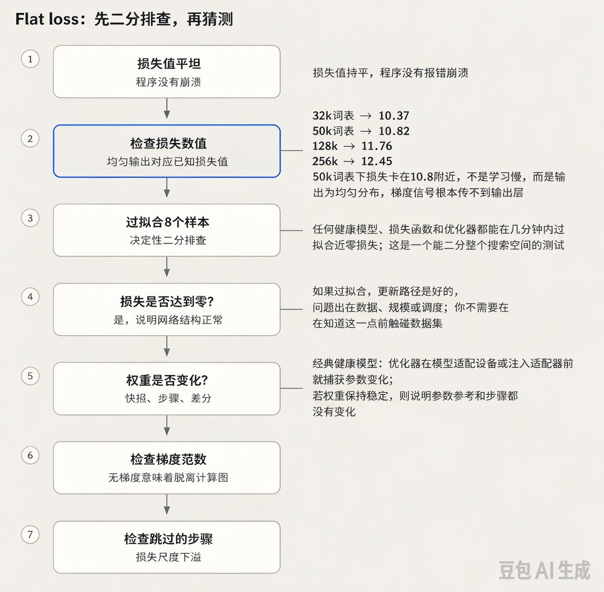

# 你的训练代码可以编译运行，但是损失值一直持平不变。请讲一下你的调试流程。

> 一句话要点：重点考察你的排查思路，而不是罗列bug清单。先用一个决定性实验做二分排查：尝试过拟合仅包含8个样本的单批次数据。
> - 如果损失可以降到接近0：更新链路本身没问题，问题出在数据、规模或者学习率调度策略；
> - 如果损失依旧持平：bug出在计算链路（计算图被断开、参数冻结、AMP损失缩放导致每一步都跳过更新、mask掩码bug）。
> 同时要观察持平的损失数值：如果损失稳定在 $\ln(词表大小)$，说明模型输出是均匀分布，代表前向计算链路有问题。

## 解题思路
面试官考察的是你的**排查流程**：你是有条理地二分定位问题，还是一股脑列出二十种可能bug？
先把问题空间拆分：损失不变，只有三类根源：
1. 没有学习信号传递到权重；
2. 权重根本没有被更新；
3. 数据/标签本身不包含有效信号。
然后按顺序执行一系列成本低、结论明确的验证实验。

> 第二步只需要10秒，就能锁定你属于哪一大类问题；第三步继续二分剩余可能性。如果讲到第五步还没有做这两个验证，说明你只是在瞎猜。



```mermaid
flowchart TD
    A[损失持平不变] --> B{尝试过拟合8个样本？}
    B -->|损失降到接近0| C[链路正常：怀疑数据、shuffle、掩码、学习率规模]
    B -->|损失依旧持平| D{权重是否发生变化？}
    D -->|否| E[优化器失效 / requires_grad=False / 学习率=0]
    D -->|是| F{梯度范数检查}
    F -->|梯度全为None| G[计算图被断开：.item() / .detach() / torch.no_grad()]
    F -->|梯度极小、频繁跳过更新| H[AMP损失缩放下溢，跳过优化步骤]
```

## 高分回答
首先先做一个关键判断：损失持平在一个可疑数值吗？
如果模型对词表输出均匀概率分布，交叉熵损失的值恰好等于 $\ln(词表大小)$，这个值要记下来，对应常见词表：
- 32k词表：10.37
- 50k词表：10.82
- 128k词表：11.76
- 256k词表：12.45

所以一个50k词表的模型，损失卡在约10.8，这不叫“学得慢”，这是模型一直在输出均匀分布，代表信号根本没有传到输出层，bug是计算链路的问题，不是数据的问题。
如果持平在更小的值（比如4.2），说明模型学到了一部分东西之后卡住了，是完全另一套排查思路，指向学习率调度、学习率归零、进入损失平台期。
在改动任何代码之前，先算出这个均匀预测对应的理论损失，这个10秒的测试就能直接改变你的排查方向，告诉你落在流程图的哪一侧。

接下来按顺序做验证，优先做成本最低、结论最强的实验：
1. **过拟合单一批次数据**：取8个样本，反复在这个批次上训练。正常的模型+损失函数+优化器，几分钟内损失就能降到接近0。这个实验直接二分整个问题空间：
    - 如果可以过拟合：模型结构、优化更新链路没问题，问题出在数据、训练规模、调度策略；
    - 如果无法过拟合：bug在更新链路，暂时不用去动数据集。
    > 补充：做这个单批次过拟合测试时，**关闭dropout和所有数据增强**。过高的dropout或者激进的数据增强，会让链路正常的模型也没法把8个样本的损失降到接近0，导致你误判成计算链路损坏。测试过拟合时使用eval模式，验证通过之后再切回train模式。
2. **检查权重是否真的发生变化**：保存几层参数的范数，对比前后step的差值。这个检查可以捕获很多经典问题：
    - 优化器是在模型迁移到设备之前、或者LoRA注入之前初始化的（优化器持有的是过时/空的参数引用）
    - 冻结主干网络的实验遗留代码，部分参数`requires_grad=False`
    - 调度器配置错误导致学习率变成0
    - 预热（warmup）配置按epoch而不是step计数，这是高频踩坑点
3. **检查梯度是否正常流动**：打印每一层的梯度范数，示例代码：
```python
for n, p in model.named_parameters():
    if p.requires_grad:
        g = p.grad.norm().item() if p.grad is not None else None
        print(n, g)
```
    - 所有参数梯度都是`None`：计算图被断开（前向路径中使用了`.detach()`、`.item()`、`torch.no_grad()`，或者损失是由非张量计算得到）
    - 只有浅层梯度是0：梯度消失，或者模块被冻结
    - 所有梯度都极小：检查AMP。损失缩放下溢/NaN会静默跳过每一轮优化更新，这是损失持平的知名元凶；GradScaler可以打印被跳过的step日志。
4. **核验损失计算逻辑**：掩码相关bug是重灾区：
    - `ignore_index`把所有token都覆盖了（padding掩码写反）
    - 因果LM没有移位标签（预测当前token，损失一开始很低然后持平）
    - 掩码区域大小为0，损失在空掩码上做平均
    - reshape之后logits和标签错位
5. **核验数据本身**：肉眼看解码后的批次样本：
    - shuffle失效（每一个batch都一模一样）
    - 标签固定不变，或者标签和输入错位打乱
    - collator静默把答案截断丢掉
    如果标签和输入之间不存在互信息，这个损失值就是理论最优值，模型已经收敛到这个最优值了。
6. **最后才去调超参**：学习率太高/太低（学习率太高经常表现为先掉一点损失然后持平）、BN层/初始化异常、从checkpoint恢复训练时优化器状态不匹配。

分布式训练额外排查项：
- 所有进程读取完全一样的数据（随机种子bug，实际有效batch只有标称值的1/N）
- 梯度同步静默失效（DDP没有包裹模型）
- `find_unused_parameters`掩盖了真实的计算图断开问题
- 只有rank0打印损失日志，其他rank的模型已经跑偏

> 面试叙述建议：把前3步描述成一次20分钟的排查流程；面试官更青睐方案有终止条件的候选人。

## 面试官后续常追问的问题
- 问：单批次可以过拟合，但是全量数据集训练损失持平，接下来怎么办？
  答：更新链路没问题，怀疑数据（标签噪声、没有有效信号、shuffle异常）、模型容量、学习率规模；拿一个极小的干净子集+小模型继续验证。
- 问：线上训练，不是本地调试，你怎么监控AMP跳过更新这个故障？
  答：监控告警：优化器step跳过率、更新范数/权重范数比值（正常训练一般在1e-3附近）；梯度范数持平是最早的信号。
- 问：以后所有训练任务，你会增加哪一行日志？
  答：每一步同时打印梯度范数、学习率、损失。这三个指标组合，绝大多数损失持平的问题都可以直接在看板上定位。
- 问：只有从checkpoint恢复之后损失才持平，是什么原因？
  答：优化器/调度器状态没有保存恢复、学习率预热重新从0开始、加载权重时`strict=False`静默丢掉不匹配的参数键。

## 常见错误
1. 不分主次罗列故障：随机列举二十个bug，代表你会漫无目的排查一整天；先做单批次过拟合测试，代表你可以快速定位。
2. 一上来就调学习率：候选人最本能的操作，但**完美持平的损失几乎从来都不是学习率的问题**。
3. 从来不用肉眼看数据：现实里一半的损失持平bug，看一次解码后的batch就能发现标签/掩码问题。
4. 漏掉AMP损失缩放跳过更新、优化器绑定无效参数这两类问题：这两类故障的特征就是代码正常编译运行、指标日志看起来正常，但是模型完全不学习。

## 核心要点
- 单批次过拟合测试，几分钟就能二分整个排查空间；**优先跑这个，而不是先去检查数据集**
- 读懂持平的损失值：$\ln(词表大小)$ 代表均匀输出，链路损坏，不是调参问题
- 日志同时记录每一步梯度范数、学习率、损失；三者结合，大部分损失持平问题直接看板定位


补充一点关于**单批次过拟合测试**：做该测试时，请关闭 dropout 和所有数据增强。因为高 dropout 率或者强度过高的数据增强，哪怕模型本身链路没问题，也会导致它无法把这8个样本的损失压到接近0；这时你就会误判，以为网络结构出了问题。做这个过拟合检查时用评估模式（eval），测试通过之后再切回训练模式（train）。

