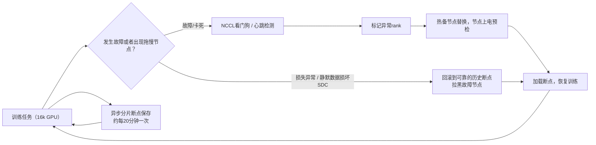

# 如何在硬件故障和拖慢节点（straggler）的情况下，保障持续数周的训练任务稳定运行？

> **一句话摘要（TL;DR）**：在16000张GPU规模下，同步训练任务每隔几小时就会遭遇一次故障。因此要把故障当成常态来设计系统，而不是当成意外情况。整套方案有三大支柱：
> 1. 依靠高频异步分片断点续存机制，减少已经完成的训练工作丢失（Young/Daly公式给出最优间隔大约是 $\sqrt{2 \times \text{平均无故障时间} \times \text{断点开销}}$，通常约15–20分钟）；
> 2. 通过自动故障检测、热备节点以及NCCL看门狗超时机制，缩短停机时间；
> 3. 通过驱逐拖慢节点、损失异常回滚机制，避免性能悄无声息地劣化。
> 用**有效产出（goodput：有效训练时长 / 总墙上时钟时长）**作为指标，目标做到90%–95%。

## 实现思路
先从故障量化计算入手：这个计算会把问题从“如何处理错误”转变为“把每隔几小时出现一次故障当成常态来设计”。之后介绍三大支柱：减少训练损失（断点续存）、缩短停机时间（自动检测与重启）、规避隐性劣化（拖慢节点与静默数据损坏SDC）。公开大规模训练任务里的实测数据，会让这套方案更有说服力。

---

## 一份高质量回答
集群规模决定了故障发生率，做一遍故障量化计算很有必要，计算结果往往比直觉更触目惊心。
单张GPU的平均无故障时间（MTBF）如果是2年，听起来很可靠；但如果你同时跑16000张GPU：
$16000 \div (2 \times 365) \approx 22$ 次GPU故障/天，**仅GPU本身**就差不多每65分钟出一次故障，这还没算高带宽显存HBM错误、网卡NIC、光模块（故障高发部件）以及存储带来的问题。
Meta公开的Llama 3数据：54天里一共中断466次（约每天8.6次，78%和硬件相关）。这个数据其实比单纯只算GPU的估算要好——因为他们的实际平均无故障时间更高，并且有防护机制拦截了一部分故障。但核心量级是明确的：在这个规模下，总有部件处于损坏状态。如果一套系统把故障当成特例，那它大部分时间都会处于不可用状态。

同步训练任务相当于一根巨大的单点故障链：任意一个进程rank挂掉，全体都会卡住。所以设计目标不是“杜绝故障”，而是**缩短故障恢复时间MTTR，并且尽量减少已经完成的训练工作量丢失**。

断点续存是最核心的手段。经典的Young/Daly近似公式：最优断点间隔 $\approx \sqrt{2 \times \text{平均无故障时间MTBF} \times \text{断点开销}}$。
举个例子：集群整体平均无故障时间3小时，一次断点保存耗时1分钟，算出来最优间隔大约19分钟——断点保存的频率远高于大家凭直觉会选择的频率。
因此，降低断点本身的开销本身就是一项核心工程目标：采用**异步分片断点**：每个进程把自己负责的参数分片快照写入本地NVMe固态盘，耗时仅数秒（训练可以立刻继续），后台进程再把数据副本同步到对象存储。
断点里必须保存优化器状态、学习率调度器、随机数生成器RNG状态，还有最容易被遗忘的**数据加载器读取位置**；否则每次重启之后，会在不知不觉间重复训练一部分近期数据。
成本概算：每次断点节省1分钟，每20分钟执行一次，16000张GPU的规模下，这笔开销成本很高；断点+重启+重复训练带来的总开销控制在墙上时钟时长的5%，是一个合理、可接受的目标。

故障检测与重启必须全自动化。如果每几个小时就出一次故障，持续两个月的训练任务，靠人工值守是不现实的。你需要：
- NCCL看门狗超时：把进程卡死hang转换成可快速定位的故障（卡死比直接崩溃更麻烦，16k GPU集体原地自旋等待，监控面板看起来100%利用率）；
- 每个rank独立心跳、单步耗时遥测：定位到底是哪一个进程出问题；
- 经过健康预检的热备节点：调度器直接替换故障节点、拉起任务，不用排队等待资源；
- 节点重新加入集群之前，先做上线预检（矩阵乘法GEMM + NCCL连通性测试）：不稳定的节点很容易反复故障。

### 拖慢节点与静默数据损坏SDC
有些节点没有崩溃，但性能已经劣化：降频、HBM存储单元出错触发ECC重试、网卡频繁闪断协商降速。在同步训练里，最慢的rank决定整体步速：一个rank慢5%，全体16000张GPU都要跟着慢5%。
检测方式：统计每个rank的计算耗时分布（计算型拖慢节点表现为单rank核函数耗时变长；其他所有进程在集合通信里等待），一旦识别要果断驱逐。

另外还有静默数据损坏：极少数GPU计算结果出错，但不会抛出报错，表现为无法解释的loss飙升或者出现NaN。
防护手段：损失异常检测，自动回滚到确认无误的历史断点；定期用基准批次做确定性重放校验；多次出问题的节点直接拉黑。

还要考虑恢复时间的长尾：重启流程包含调度耗时、大规模下NCCL重新初始化（如果方案简陋会耗时数分钟）、断点加载、流水线预热。团队会专门优化这条链路（缓存拓扑、并行读取断点），因为当每天故障一次时，**重启延迟**是决定有效吞吐（goodput）的核心因素。

## 面试官接下来大概率追问的问题
- **为什么不用异步/弹性训练，而选择同步训练+重启？**
  在前沿超大模型规模下，异步SGD会让收敛变得很难控制；行业主流方案是同步训练，搭配低成本断点、快速重启；部分场景下，在数据并行DP组粒度上引入弹性能力。

- **断点存在哪里？读写链路速度怎么样？**
  先写入本地NVMe（秒级完成），再异步分发复制到对象存储。一个100B参数模型完整状态大约1.6TB，每隔20分钟同步写入S3这类对象存储，完全不可行。

- **怎么区分是网络拖慢节点，还是计算拖慢节点？**
  按rank拆解耗时：计算拖慢节点表现为单个rank核函数耗时久；网络问题表现为所有rank卡在集合通信等待，同时可以从网络指标（重传、PFC暂停）定位到链路故障。

- **有效产出goodput指标怎么定义？**
  有效训练时长 ÷ 总墙上时钟时长；目标≥90%–95%。这个指标把断点开销、重复训练、重启延迟全部合并成一个指标，方便管理层跟踪。

## 常见错误回答
1. 只说“定期保存断点”，不做间隔计算，不提断点开销；Young/Daly权衡关系才是这个问题的核心。
2. 忘记保存数据加载器状态和RNG随机状态，会导致重启之后训练不可复现、数据分布悄悄偏移。
3. 把卡死当成普通崩溃处理，缺少NCCL超时和单rank定位：一张故障网卡，就能让16k GPU自旋等待数小时才被发现。
4. 缺少自动化方案：每天故障一次的规模下，如果重启流程依赖值班人员，那真实故障恢复时间等于“人多久能醒过来”，头部实验室的面试官很看重这一点。

## 核心要点总结
- 设计目标是**缩短故障恢复时间MTTR、减少训练损失**，而不是消灭故障；Meta在16k GPU规模观测到54天466次中断，约78%由硬件引发。
- Young/Daly公式决定断点保存频率；降低断点开销（异步、分片、本地NVMe），才能支持高频断点。
- 卡死hang比崩溃更棘手：依靠NCCL看门狗超时 + 单步耗时遥测，才能把看似满载的自旋卡死，转换成可快速定位的故障。

Young/Daly间隔公式假设断点开销就是写入耗时，但在超大集群规模下，真正的开销往往来自重启过程，而非保存动作：在数千个进程rank上重新初始化NCCL通信、调度器资源分配、流水线预热，这些才是开销大头。

举个例子：断点写入只要30秒，但重启需要10分钟。这种情况下，单次故障带来的实际开销就是重启耗时；要优化的重点应该是通过缓存拓扑、热备节点来压低重启耗时，而不是单纯追求更快的写入速度。