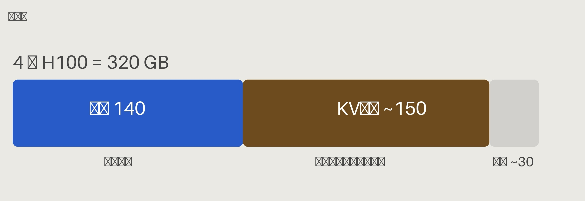
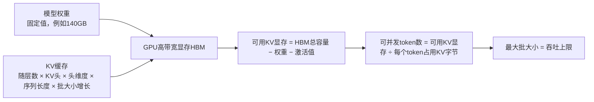

# 什么是KV缓存？为什么它会占用推理服务的绝大部分显存？如何估算它的大小？针对70B模型做演算。


> 一句话速览：每个token占用的KV字节数 = 2 × 层数 × KV头数量 × 头维度大小 × 数据类型字节数。
> 以Llama-70B规格模型举例（80层，8个GQA的KV头，头维度128，FP16精度），每个token大约需要320KB；一条8k上下文的序列就要约2.6GB缓存。在大规模部署场景下，**KV缓存而不是模型权重，才是占满GPU显存的元凶**。KV缓存优化本质就是吞吐效率优化：解码阶段是显存带宽受限场景，每省下一字节显存，就能多支持一个批处理槽位。

## 答题思路
先用一句话解释原理（避免每生成一个新token时，对整个前缀重复计算注意力），然后直接给出计算公式+完整演算示例。这个问题本质是披着概念外衣的计算题，面试官希望你当场给出严谨可验算的数值。最后按收益从高到低列出优化手段。





---

## 高分完整回答
自回归解码的每一步，都需要对前面所有已经生成的token做注意力计算。如果没有缓存机制，每生成一个新token，都要对整条前缀序列，在每一层重新计算Key和Value，计算量接近二次方增长，浪费巨大。
所以我们按**每个token、每一层**保存Key与Value；每新增一个token时，读取这份缓存，再追加一组新的K/V条目。这相当于用显存开销换取计算量下降：KV缓存显存占用会随着**序列长度、批大小线性上涨**，而模型权重大小是固定不变的。这就是为什么在大规模上线时，填满GPU显存的往往是KV缓存，而不是模型本身。

面试一定要写下来的公式：
```
每个token的KV占用字节 = 2（K 和 V两份） × 层数 × KV头数量 × 头维度 × 数据类型单元素字节数
```

以Llama2-70B规格模型演算：80层，GQA分组查询注意力，只有8个KV头，头维度128，FP16（每个数值占2字节）
$2 × 80 × 8 × 128 × 2 = 327680$ 字节 ≈ **320 KB / token**

那么一条8k上下文长度的序列，KV缓存就要占用约2.6GB。如果批里同时跑32条这样的序列，仅KV缓存就需要84GB，已经超过单张H100的显存容量。
这里可以直观看到GQA带来的收益：如果是传统多头注意力，一共64个KV头，占用会达到2.6MB/token，开销直接翻8倍；反观7B无GQA的模型（32层、32KV头），每个token甚至要占用约512KB，**单token开销比70B模型还要高**。模型架构选型对显存开销的影响极大。

容量规划逻辑由此而来：以4张H100（总显存320GB）部署FP16精度70B模型为例：权重占用140GB，剩下约140GB，再预留激活值、额外开销，大约150GB可以分给KV缓存。
$150\mathrm{GB} ÷ 320\mathrm{KB/token} ≈ 450000$ 个可缓存token，等价于大约55条并发的8k上下文序列。
这个数字就是你的最大批大小；而在带宽瓶颈的解码阶段，最大批大小直接决定吞吐上限。
这条链路：**单token KV显存 → 可并发token数 → 批大小 → 吞吐能力**，是所有推理服务容量规划问题的核心主线。

```mermaid
flowchart LR
    subgraph 4张H100 总显存=320GB
        W[权重 140GB<br/>固定不变]
        KV[KV缓存 ~150GB<br/>随批大小×序列长度增长]
        F[剩余空闲 ~30GB]
    end
```

### 优化手段（按收益从高到低排序）
- **模型架构层面**：GQA/MQA分组/多查询注意力（降低4~8倍KV头）、MLA（DeepSeek风格隐向量压缩），收益巨大，在训练阶段就确定，推理部署零额外开销。
- **PagedAttention（vLLM核心）**：按需以小块分配缓存，不再提前按最大序列长度连续预分配，消除朴素分配器60%~80%的显存碎片浪费。
- **KV量化**：FP8量化直接减半显存；INT4量化缩减到1/4；会带来一定的质量损失，多数场景可接受。
- **前缀共享/前缀缓存**：相同前缀（系统提示词、few-shot样例、Agent固定模板）只存一份，使用写时复制；在对话、Agent workload下收益极高。
- **淘汰策略**：滑动窗口注意力、StreamingLLM的Sink Token锚点机制，支持近乎无限长对话，存在效果取舍，用于超长上下文场景。

---

## 面试官后续常追问的问题
- 问：为什么KV缓存更大，带来的是吞吐提升，而不只是显存占用变大？
> 解码阶段是显存带宽瓶颈；吞吐随批大小上升，直到显存耗尽。每节省1字节KV显存，就可以新增一个批处理槽位。KV缓存利用率，直接等价于吞吐能力。

- 问：用户要支持128k上下文，会对集群产生什么影响？
> 70B模型下，单条128k上下文序列：$128k × 320KB ≈ 41\mathrm{GB/序列}$。
> 在之前150GB的KV预算下：8k上下文可以跑约55条并发；换成128k上下文，只能跑3条并发。上下文长度扩大16倍，并发量线性下降16倍。
> 一条128k请求消耗的资源 ≈ 16条普通8k请求。超长上下文流量不能和普通流量混池调度，需要独立资源池、更高的按token定价、接入准入控制；开启128k不是改一行配置，是集群资源规划层面的决策。

- 问：在Prefill/Decode解耦分离部署架构中，KV缓存存在哪里？
> KV在Prefill卡上生成，通过RDMA/NVLink/NIXL这类共享内存传输到Decode推理卡；KV缓存的传输带宽，变成核心设计约束。

- 问：你如何衡量KV缓存的浪费程度？
> 对比已分配缓存块和实际使用的缓存块；在vLLM这类分页缓存方案普及前，老架构大部分显存浪费，来自“按最大序列长度预分配，但实际生成长度远小于上限”。

### 常见踩坑误区
1. 记不住公式，只会模糊说“占用几个GB”。面试官期待你当场推导出单token字节数，再做乘法计算。
2. 忽略GQA，直接用总注意力头数代替KV头数，结果会放大8倍，说明知识还停留在2022年的老资料。
3. 误以为KV缓存是和权重一样的固定开销，没有意识到它随批大小、序列长度线性膨胀——而这正是容量规划的核心。
4. 只罗列优化方案，不提取舍代价：KV量化、滑动窗口都会带来输出质量的权衡，回答里需要说明“需要在业务 workload 上做效果评估”。

## 核心总结
1. 熟记公式：$2 × 层数 × KV头数 × 头维度 × 单元素字节数$；先算出单token开销，再乘序列长度、批大小。
2. 一定要用`n_kv_heads`而不是总注意力头；GQA已经帮我们把开销降低数倍，写错这个参数会暴露知识过时。
3. 整条链路：**单token KV显存 → 并发token上限 → 最大批 → 吞吐上限**，是所有推理容量题的主线；GQA/MLA、分页缓存、KV量化、前缀缓存，全部都是在这条链路上做优化。

有一项缓解方案，清单里低估了它的效果：**多头潜在注意力（MLA）不只是又一个大幅降低显存占用的优化手段，它改变了缓存的内容**。DeepSeek 这类隐式注意力方案，每个 token 只存一份压缩后的隐向量，而不是按注意力头分别存储 K 和 V；因此每个 token 的占用字节数，大致是按注意力头数来缩减，而非一个固定倍率。


这也是为什么它属于训练阶段就要确定的架构设计，而不是推理服务时可调的开关——你没法事后把它加装到一个 GQA 模型上。

