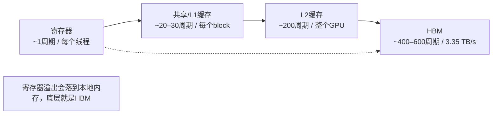

# 带你梳理GPU存储层次：寄存器、共享内存、L2缓存、HBM。数据分别存在哪里，以及背后的原因是什么？

> **一句话摘要**：寄存器、共享内存、L2缓存、HBM，是在容量和访问速度之间做取舍，访问延迟大致从1个周期到600个周期不等。高性能算子内核之所以快，是因为它们会把数据预加载到这些容量更小、速度更快的存储层级中，每一份从HBM读出的字节都会被反复复用很多次（分块矩阵乘法、FlashAttention都是这个思路）。H100的BF16算力大约1000 TFLOPS，但HBM带宽只有约3.35 TB/s，如果每一个操作数都要从全局内存读取，算力单元会因为等数据而饥饿。

## 答题思路
先快速列出各个存储层级，然后重点讲解决定性能的两个层级：共享内存和HBM，附上大致的指标数值。NVIDIA的面试官听过无数人说“寄存器很快、全局内存很慢”；能拉开差距的，是你清楚它们大致有多快，以及在真实算子（比如分块矩阵乘法）里，你会把什么样的数据放在哪一层。

## 高分回答
从最快到最慢，以现代数据中心GPU（H100级别）为例，所有数值均为近似值：

| 层级 | 作用域 | 容量 | 延迟 | 备注 |
| ---- | ---- | ---- | ---- | ---- |
| 寄存器 | 每个线程独立 | 每个SM最多64K个32位寄存器 | ~1周期 | 由编译器分配管理 |
| 共享内存（和L1是同一块SRAM） | 每个线程块(block) | 每个SM最高228KB | ~20–30周期 | 由程序员手动管理，属于暂存器(scratchpad) |
| L2缓存 | 整个GPU共享 | ~50MB | ~200周期 | 所有SM共用 |
| HBM（全局内存） | 整个GPU共享 | 80GB | ~400–600周期 | H100带宽约3.35 TB/s |

另外还有两块特殊存储空间：
- 常量内存：容量很小、带缓存、针对广播读取做了优化；适合所有线程读取同一个值的场景。
- 本地内存：是一个容易踩坑的概念。寄存器溢出的数据就存在这里；虽然名字叫“本地”，但底层介质就是设备内存（HBM）；访问有可能命中L1/L2缓存，缓存不命中就会直达HBM。

这套存储层次之所以重要：H100在BF16下算力大约1000 TFLOPS，但HBM带宽只有约3.35 TB/s。如果每一个操作数都从HBM读取，实际有效算力只能达到几百个GFLOPS，比芯片峰值算力低好几个数量级。高性能内核的核心思路，就是把数据预加载到共享内存、寄存器中，让每一份从HBM读取出来的数据被反复复用。

把上面两个核心数字相除，就能理解整套优化逻辑：1000 TFLOPS 对比 3.35 TB/s，意味着一个算子想要喂饱计算单元，**每从HBM读取1字节数据，大约要执行300次浮点运算**。
我们拿BF16向量加法来对照这个标准：每个元素需要两次读、一次写，一共6字节的数据搬运，只换来1次浮点运算，算术强度只有0.17。在3.35TB/s带宽下，它的上限算力只有0.56 TFLOPS，仅为芯片峰值的0.06%。无论调度怎么优化都改变不了这个结果，因为这个运算完全没有数据复用。
这就是屋顶线模型（roofline model），同时也解释了算子融合：把逐元素算子融合到生成它输入的矩阵乘法里，几乎不会增加计算开销，还省去了每一个元素往返HBM的一次读写。

最经典的例子就是**分块矩阵乘法（tiled matmul）**：每个线程块把A矩阵的一块子块、B矩阵的一块子块，从HBM加载进共享内存一次，做线程同步之后，所有线程都可以在共享内存的高速暂存区反复读取这两块子块几十次，在寄存器里累加结果。同一份数据，每次复用的访问开销都低一个数量级（几十周期，而不是几百周期）。
FlashAttention也是一模一样的思想，只不过用在注意力计算上：它不会把完整的注意力矩阵全部存到HBM里，而是在共享内存中分块计算；这就是为什么FlashAttention虽然总FLOPS数量更高（反向传播时会重算），速度却更快。

这套存储层级也衍生出面试官常考察的性能故障场景：
- 每个线程占用寄存器太多 → 单个SM上能同时驻留的warp变少（占用率下降），或者数据溢出到属于HBM的本地内存；
- 共享内存有32个bank，冲突访问会把并行访问串行化；
- 未合并（uncoalesced）的全局内存读取，会浪费绝大部分内存事务的带宽。

下面再汇总四层存储的速度与作用域（H100级别，近似值）：

| 层级 | 延迟 | 带宽 | 作用域 |
| ---- | ---- | ---- | ---- |
| 寄存器 | ~1周期 | 未标注 | 每个线程 |
| L1 / 共享内存 | ~20–30周期 | 聚合带宽可达TB/s级，程序员可控暂存区 | 每个block |
| L2缓存 | ~200周期 | 未标注 | 整个GPU |
| HBM（全局内存） | ~400–600周期 | ~3.35 TB/s | 整个GPU |

## 面试官接下来常追问的问题
- “我给每个线程加了一个小数组之后，内核反而变慢了，为什么？”
  大概率编译器没法把动态索引的数组放在寄存器里，数据溢出到本地内存；每次访问都会新增内存流量，缓存失效时就会直达HBM。
- “什么时候会用常量内存？”
  所有线程读取完全相同的值时（卷积滤波系数、标量超参等）；它的广播缓存可以一次给整个warp提供数据。
- “大语言模型推理时，KV Cache存在哪里？”
  HBM。这也正是解码阶段是**内存带宽受限**的原因：每生成一个token，权重和KV缓存都需要从HBM持续读取。
- Hopper架构有什么变化？
  合并后的L1/共享内存容量更大（最高228KB）；加入TMA单元，支持异步批量把全局内存数据拷贝到共享内存；支持线程块集群（thread-block clusters），让相邻SM上的block之间可以互相访问共享内存。

## 常见误区
- 只说结论不带数字：只说“共享内存比全局内存快”，却不说“共享内存几十周期、HBM几百周期，共享内存聚合带宽能到TB/s”，听起来就只是死记硬背。
- 误以为本地内存很快：名字带“本地”很容易误导人；寄存器溢出是典型的隐形性能杀手，可以用 `-Xptxas -v` 或者Nsight工具查看本地内存流量。
- 把共享内存当成透明缓存：共享内存需要程序员手动管理；除非你的代码（或者底层库内核）主动往里面写数据，否则数据不会自动进共享内存。
- 只背诵存储层级，不和真实算子关联：至少要能讲清楚分块矩阵乘法的逻辑；如果还能提到FlashAttention利用共享内存分块，说明你理解硬件和大厂实际ML负载之间的联系。

## 核心要点
1. 记住大致延迟：1周期 / 几十周期 / 几百周期，以及H100 HBM ~3.35 TB/s这个关键数字；数值本身就是答案。
2. 高性能的本质：每一份从HBM读出的字节，要尽可能多次复用；分块矩阵乘法、FlashAttention都是把数据预存到共享内存实现复用。
3. 本地内存底层是HBM；寄存器溢出是隐形性能杀手，可以用 `-Xptxas -v` 或者Nsight定位。

> **编者注**：本地内存是一个陷阱术语，听起来私有、速度快，但底层介质是HBM。如果增加每个线程的小数组之后内核变慢，几乎都是寄存器溢出，可以用 `-Xptxas -v` 或者Nsight排查。不要把共享内存描述成透明缓存：它由程序员手动管理，数据不会自动放进去。高分回答不能只罗列周期，要把硬件架构和实际业务负载结合，讲清楚分块矩阵乘法的数据复用逻辑，如果能提到FlashAttention的共享内存分块思路会更好。

Hopper的TMA值得额外补充一句，它改变了数据预加载的方式：硬件描述符支持从全局内存异步批量拷贝数据到共享内存，传输过程不会占用寄存器、消耗warp发射槽。这才让warp专用流水线（一部分warp负责拷贝、一部分warp负责计算）可以把HBM的长延迟掩盖掉，不用像旧方案那样为了双缓冲承受巨大的寄存器压力。

