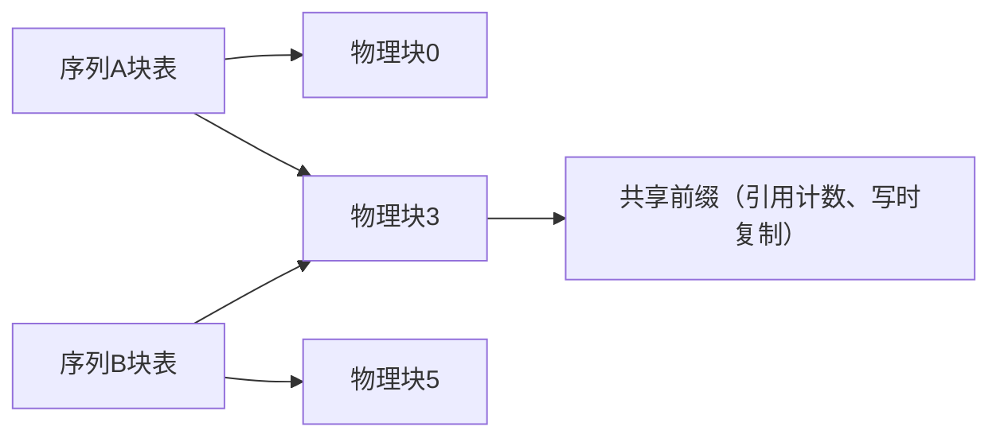

# vLLM 的 PagedAttention 是如何工作的？它实际解决了什么问题？

> **一句话摘要（TL;DR）**
> 在 vLLM 之前的服务框架中，会为每一个请求预先分配一块连续的、大小等于 `max_seq_len` 的内存块来存放KV缓存。这导致KV缓存里只有大约20%~40%存着真实数据；剩下的全是内存碎片。被浪费的KV缓存空间，直接等价于能跑的批大小变小、吞吐下降。
> PagedAttention 把操作系统的虚拟内存思想用到KV缓存上：固定大小的块（默认16个token一块）、每个序列维护一张块表、按需分配内存。内存浪费降到百分之几以内，还支持写时复制（copy-on-write）的前缀共享；代价是 gather 核函数会慢大约20%，但扩大批带来的收益远超这点开销。

---

## 思考思路（How to approach it）
先精准定义问题，再讲机制：
vLLM 之前的系统，大部分KV缓存都被内存碎片浪费了；而被浪费的KV内存 = 更小的批大小 = 更低的吞吐。
它的核心机制一句话概括：**给KV缓存实现虚拟内存**。
深度体现在它带来的结果：几乎归零的内存浪费、基于写时复制的前缀共享，以及它的代价（间接寻址、自定义CUDA核）。

---

---

## 优质回答正文（A strong answer）
### 问题本身
KV缓存是逐个token不断增长的，但请求到来的时候，我们不知道这个请求最终会生成多长的序列。
在 PagedAttention 之前的服务框架（FasterTransformer 时代、Orca这类），会为每一条请求分配一块**连续内存，大小直接按最大序列长度 max_seq_len 预留**。
这会造成三类浪费：
1. **内部碎片**：预留了2048 token的空间，但最后只生成180个token，剩下空间闲置；
2. **预分配浪费**：为还没有生成出来的token提前占住内存；
3. **外部碎片**：大小不一的连续内存块分配释放之后，留下很多没法再利用的内存空隙。

举个直观例子：预留一块2048 token的内存，最终只生成180 token，整个生命周期里这块内存只有8.8%存了有效数据，91.2%都闲置浪费。

放大到全部并发请求：vLLM论文里测得，这类传统方案中，KV缓存里只有大约 20%~40% 存放真实KV数据。

分页分配改变了这点：同样生成180 token，最多只会浪费最后一个不满的16-token块。单条序列的浪费不到9%，整体聚合后只有百分之几。因为内存是**随着token生成、按需一块块发放**，而不是预先按一个很少能跑到的上限提前占死。

解码阶段的吞吐是随批大小线性提升的，直到内存耗尽。把之前60%~80%被浪费的KV内存回收回来，就能支持更大批大小，也就是更高吞吐。这就是常说的吞吐提升2~4倍的根本原因。

### 工作机制：复用虚拟内存思想
把KV缓存切分成**固定大小的块**（vLLM默认每块存16个token）。
一条序列的缓存由若干**不连续的物理块**组成，由该序列独有的**块表（block table）**记录映射关系，和操作系统的页表完全一样。

只有当当前块写满之后，才分配新块；序列结束后，块立刻归还到内存池，作为统一的固定大小单元复用。
- 内部碎片压缩到每条序列最多浪费一个块（约16 token），工程上整体只有百分之几；
- 按需分配消除了预分配浪费；
- 统一固定块大小，从根源上杜绝外部碎片。

Attention核函数被重新实现：它不再假设KV是连续内存，而是通过块表去Gather（聚集读取）K、V。这个专门实现的自定义核，就是 **PagedAttention**。

页表这套思路还带来两个额外红利：
1. **共享能力**：相同的前缀（比如几百用户共用的1000 token系统提示词、Few-shot头部、束搜索/并行采样里的公共前缀分支），可以映射到同一份物理块，搭配引用计数；当分支内容要发生修改时触发**写时复制（copy-on-write）**。这种前缀缓存既省内存，也省去了重复做Prefill计算。
2. **调度灵活性**：块都是统一规格，内存紧张时调度器可以抢占某个序列，把它的块交换到CPU内存，或者后续重算；以此实现**连续批处理（continuous batching）**，让GPU可以安全跑到接近内存满负载。

### 代价（天下没有免费的午餐）
通过块表间接寻址增加了核函数的复杂度与开销：原始论文测得，相比连续内存方案，attention核本身会慢约20%；但批大小提升带来的收益，远远盖过这个损耗。
另外，每一种新的Attention变体，都需要单独实现分页版本，带来不小的工程负担。
块大小本身也是权衡：块越小，碎片越少；但块表更大、Gather寻址开销更高。

TensorRT-LLM、SGLang，以及现在几乎所有主流推理框架都采用了分页KV。这已经是行业标配，面试里答出这点代表你了解最新现状。

---

## 面试官接下来常会追问的问题（What interviewers probe next）
- **“为什么省下来的内存会直接变成吞吐，而不只是富余空间？”**
解码阶段是**内存带宽受限（memory-bandwidth-bound）**；token/s ≈ 批大小 × 单步生成速度，而批大小的上限就是KV缓存容量。内存利用率和吞吐是同一个维度的指标。

- **“这和直接设置更小的max长度有什么区别？”**
我们没法提前预测序列长度；如果估短了，生成中途就会溢出，要么杀掉请求、要么中途重分配内存。分页机制完全不需要提前预测长度。

- **“在它之上的基数树/前缀缓存（radix/prefix caching）是什么？”**
SGLang风格的块基数树，把前缀共享能力拓展到**跨不同时间的不同请求**，而不只是同一时刻并发的请求；对于Agent场景（反复发送不断变长的对话前缀）收益很大。

- **“什么时候 PagedAttention 几乎没有收益？”**
长度固定且预先已知的任务（批量Embedding、固定输入长度的评测基准），这类场景下连续预分配本来就没有多少碎片；收益大小和序列长度的方差正相关。

---

## 常见错误回答（Common mistakes）
- 只背诵一句“它类似虚拟内存”，但不说清楚之前到底是什么资源被浪费了。这个问题的核心重点就是60~80%的碎片率，以及碎片如何影响吞吐。
- 误以为 PagedAttention 让 Attention 本身的数学计算变快。核本身反而略慢；系统整体变快是因为能跑更大批。如果答不出这个因果关系，就没抓住考点。
- 不懂写时复制的前缀共享——这是真实聊天、Agent流量里价值最高的特性。
- 在2026年还把它说成是 vLLM 独有的黑科技：它现在是行业标准技术；各家的差异化已经在上层（调度器、内存解耦、缓存策略）。

---

## 核心要点总结（Key takeaways）
1. 它解决的核心是碎片问题：之前有60%~80%的KV内存被浪费；省出来的KV内存直接转化为更大批大小、更高吞吐。
2. Attention核本身会稍微变慢（页表Gather带来开销）；系统整体变快是批规模扩大带来的。搞反这个因果，就答错了。
3. 写时复制前缀共享，是真实对话、Agent场景里最重要的特性；基数树/前缀缓存把这个能力拓展到跨时间的请求。

可以补充说明为什么块大小恰好选16：更小的块能减少内部碎片，但PagedAttention内核需要按块来聚合读取K/V。如果块太小，就意味着更多次的间接寻址，会降低attention内核本身的内存访问效率。16是经过调优后的平衡点；而在长上下文、高吞吐的部署配置里，人们会把块大小调到32，以此减少聚合读取的开销，代价是碎片浪费会稍微变多一点。