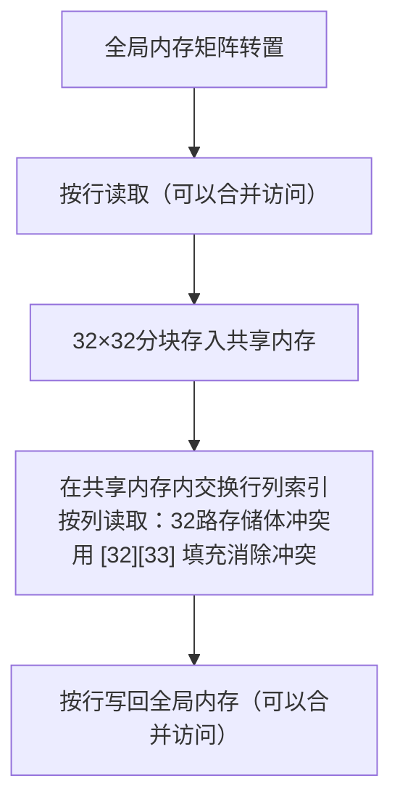

# 解释内存合并访问（memory coalescing）与共享内存体冲突（shared-memory bank conflicts）。如果一个CUDA核函数同时存在这两个问题，该如何修复？

> 摘要速览：合并访问指一个warp里32个全局内存地址是否落在少数连续扇区里（快），还是分散成最多32次独立内存事务（同样多的有效数据，但是传输字节变成8倍）；体冲突指一个warp的32个共享内存地址是否分到32个不同存储体，或是访问同一个存储体而被串行化，产生k路冲突。矩阵转置场景会同时触发这两个问题，经典修复方案是用带填充的tile[32][33]做暂存，让按列访问时地址分散到不同存储体上。

## 解题思路
这是存储层次中两个同源但层级不同的问题：**合并访问描述warp访问全局内存（HBM）的行为，存储体冲突描述warp访问共享内存的行为**。分别说明二者产生的底层原因，记住标准参数：一个warp包含32个线程、共享内存一共32个存储体；再以矩阵转置这个经典案例展开，它同时存在两类问题，并且有一个非常知名的两行式修复方案。

## 高质量回答
### 内存合并访问（Coalescing）
当一个warp发起加载请求时，硬件会尽量把32个线程的内存地址合并成尽可能少的内存事务。
如果线程`i`读取 `data[base + i]`，也就是32个连续的4字节浮点数，对齐的情况下一共128字节，分布在4个32字节的内存扇区，带宽利用率接近理论最大值。
但如果线程是跨步访问 `data[i * 1024]`（行优先矩阵里按列读取就是这种场景），每个线程访问的数据落在不同扇区，这个warp最多会触发32次独立内存事务，来读取同样128字节的有效数据：总共要搬运32个扇区、合计1024字节的数据。
相当于DRAM跑在全速，但绝大部分读出来的数据直接丢弃；有效带宽可以下降一个数量级。
这也是**数组结构体（AoS）不如结构体数组（SoA）**的核心论据：使用AoS布局时，warp读取`particles[i].x`，每次加载都会跳过y、z、质量等其他字段，无法合并访问。

### 共享内存体冲突（Bank conflicts）
共享内存被划分为32个存储体，每个存储体位宽4字节，地址交错分配到各个存储体。
每个存储体在一个周期内只能服务一次访问。
如果一个warp的32个线程刚好访问32个不同存储体（或者所有线程读取**同一个地址**——这种是广播机制，无开销），这次访问可以一次性完成，没有额外串行等待（加载本身依然有共享内存固有延迟）。
如果有`k`个线程访问**同一个存储体内的不同地址**，这次访问就会拆分成`k`次串行请求。
经典触发场景：二维共享数组`tile[32][32]`按列访问：`tile[threadIdx.x][col]`，地址间隔32个浮点数，所有地址全部映射到同一个存储体，产生32路冲突。



### 矩阵转置案例
朴素的矩阵转置实现是按行读、按列写：读或者写全局内存总有一边无法合并访问。
标准优化方式是借助共享内存做中转：
按行读取一个32×32的分块（读操作可合并），在共享内存内部完成行列交换，再按行写出转置后的分块（写操作同样可合并）。
但**共享内存内部的按列读取操作，正好会触发32路存储体冲突**。
修复方案只需要改一个数字：
```cuda
__shared__ float tile[32][33]; // 是33，不是32；填充让列地址分散到不同存储体
```
多加的这一列填充，会让每一行数据映射到存储体的偏移错开1位，于是按列访问的时候，32个地址落在全部32个不同存储体上。

用模运算简单证明：
元素`tile[r][c]`的线性地址 = `r * 宽度 + c`，它所属存储体编号 = 线性地址 `mod 32`
- 宽度=32时：存储体编号 = `(r*32 + c) mod 32 = c`；固定列c、r从0到31遍历，所有线程映射到同一个存储体c → 32路冲突
- 宽度=33时：存储体编号 = `(r*33 + c) mod 32 = (r + c) mod 32`（因为33 mod 32 = 1）；同一列的访问，r变化时存储体编号跟着遍历全部32个存储体，无冲突

补充说明：只要宽度和32**互质**都可以达到这个效果，33只是额外浪费空间最小的选择，只给每个分块多存32个浮点数。
朴素转置 → 分块中转转置 → 填充消除冲突，是带宽受限转置算子的完整优化路线。

> 工程排查顺序：先用Nsight Compute查看全局内存效率（请求字节 vs 实际传输字节）判断合并访问问题，再看共享内存存储体冲突计数器。**优先修复全局合并访问问题**，HBM的一次内存事务开销是数百周期，而存储体冲突重放只需要几十个周期，全局访问浪费的代价高得多。

---

## 面试官后续追问清单
- 问：为什么用33，而不是34或者64？
  答：只要填充后的宽度和32互质，就能打破对齐；只填充1个元素是空间开销最小的方案。宽度34和32有公因数2，按列访问只会落在16个存储体上，产生2路冲突；宽度64又会变回32路冲突。
- 问：存储体冲突会发生在全局内存上吗？
  答：不会。存储体是共享内存独有的概念；全局内存对应的类似概念是内存扇区、合并访问。把二者混为一谈是典型认知错误。
- 问：如果数据访问天生就是跨步的，该怎么办？
  答：做中转：先执行一次可合并访问的pass，把数据重排成对硬件友好的布局（或者每个分块借助共享内存），之后再做计算，分摊重排开销；也可以用shuffle指令。
- 问：现代注意力算子是怎么规避这两类问题的？
  答：FlashAttention系列算子，基于可合并访问的分块加载、无冲突的共享内存布局；Hopper架构上更喜欢用地址置换（swizzling）而不是填充，因为TMA（异步张量内存访问）偏好无填充的规整分块。

## 常见错误
1. 概念混淆：说“全局内存存在存储体冲突”、“共享内存需要合并访问”，说明没有分清存储层级。
2. 遗忘广播机制：32个线程读取同一个共享内存地址属于广播，**没有冲突**，不是32路冲突；不了解这点的候选人在规约求和时会做多余的复杂优化。
3. 只会背`[32][33]`这个写法，说不清楚填充的原理：填充本质是改变每一行地址到存储体的映射关系。
4. 顺序搞反：全局内存访问本身无法合并的前提下，优先去优化共享内存冲突。全局内存的带宽浪费才是性能瓶颈。

## 核心要点总结
1. 合并访问属于**全局内存**（扇区机制）；存储体冲突属于**共享内存**（32个存储体），不要混用术语。
2. 矩阵转置需要两步优化：用共享内存分块解决全局内存合并访问问题，用`[32][33]`填充解决共享内存存储体冲突。
3. 多个线程读取同一个共享内存地址属于广播，无开销；**先修复全局合并访问，再去处理存储体冲突**。

---

> 一句话误区提醒：说“全局内存有存储体冲突”或者“共享内存做合并访问”，直接说明候选人对存储层级理解有误；存储体只属于共享内存，全局内存对应的是扇区。广播机制是另一个高频易错点：全部32线程读同一个共享地址是免费广播，不是32路冲突，不了解这点会让规约代码过度复杂。如果你写了`[32][33]`这个转置修复，要准备好解释填充的原理：它的核心作用是错开每一行地址到存储体的映射。


补充广播细节：冲突计数是按照32bit存储体、访问位宽来统计的。双精度、float2类型的访问会跨两个存储体位置；所以`double tile[32][32]`按列读取，哪怕float版本没有冲突，双精度版本依然会产生冲突。
前面提到Hopper架构偏好swizzling置换而不是填充，根本原因就是TMA单元需要无填充的规整分块，swizzling是通过改变访问索引模式完成存储体重映射，而不是修改数组形状加padding。


宽度原理也解释了为什么有时候只填充1列（33）不一定够用：如果访问向量化成float4，单元素填充不一定能打散32条访存通道的对齐。填充后，数组总宽度（向量化之后）要和32互质，不是永远只多加1个元素就可以。
