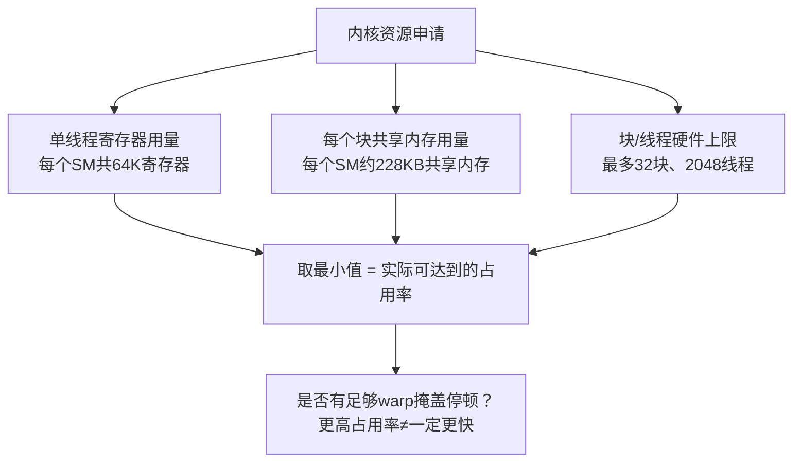

# 问题：什么是占用率（occupancy）？在选择块大小的时候，如何权衡它与寄存器、共享内存的使用？

**一句话总结：**
占用率 = 一个流式多处理器（SM）上常驻的warp数量 ÷ 硬件最大上限（每个SM最多64个warp / 2048个线程）。
它由寄存器、共享内存、块数量限制这三者里最先触达上限的那一个决定。
占用率只是**延迟隐藏**的手段，不是最终目标：一个寄存器密集的矩阵乘法（GEMM）内核，哪怕只有25%占用率，性能经常优于强行拉高到75%占用率的同一个内核。所以你要先分析流水线停顿原因，再去调参。

---
## 答题思路
先精准定义占用率，列出限制占用率的三类资源；然后体现更深层理解：占用率只是手段，用来隐藏延迟，不是目标。
能说出**低占用率反而更快**的场景，才是和课本标准答案拉开差距、体现工程经验的回答。

## 优秀回答原文
占用率，是单个SM上活跃warp数量，除以硬件上限（在近期数据中心GPU上，上限是64个warp，也就是2048个线程）。
占用率之所以重要：GPU SM依靠warp来隐藏延迟。当一个warp因为HBM加载操作卡住（比如400个周期的延迟），调度器就切换执行别的warp。如果常驻warp太少，SM在warp停顿期间就会空转浪费算力。

有三类资源，共同限制一个SM上最多能放多少线程块，**瓶颈资源决定上限，取最小值**：
- **寄存器**：一个SM有64K个32位寄存器。如果每个线程占用32个寄存器，最多可以放下2048个线程（100%占用率）；如果每个线程要128个寄存器，就只能放下512个线程（25%占用率）。
- **共享内存**：根据配置，每个SM大约100~228KB共享内存。如果一个块申请48KB共享内存，那么最多同时驻留2~4个块。
- **每个SM的线程/块硬限制**：硬件固定上限（2048线程、最多32个块）。这就是为什么32线程的小块永远跑不满占用率：32块 × 32线程 = 1024线程，天然被卡在50%上限。

> 口诀：**短板决定上限**，也就是取最小值。你最好可以现场演算。
举个例子：某个内核编译后每个线程使用96个寄存器，启动256线程的块，每个块使用32KB共享内存。
- 寄存器上限：65536 ÷ 96 = 682 线程，只能放下2个完整的256线程块，合计512线程
- 共享内存上限：228 ÷ 32 = 7个块
- 线程硬上限：2048 ÷ 256 = 8个块
三者最小值是寄存器限制：只能放2个块，512常驻线程，占用率25%。剩下共享内存、线程上限都是富余资源，不起约束作用。
这里关键结论：这个内核的占用率只受寄存器压力约束。此时减少共享内存、修改块大小都无法提升占用率。
剖析器要回答的问题变成：这16个warp能不能掩盖该内核的停顿？或者，在不发生寄存器溢出的前提下，减少寄存器占用是否划算？
能定位到**瓶颈资源**，而不是只看占用率百分比，才能把计算结果变成调优决策。

### 块大小选择指导
块大小永远是32的倍数（不完整warp会浪费计算通道）；工程上默认一般选128~256线程。
这个大小的好处：每个块有足够warp，同步效率高；同时块足够小，调度器可以在一个SM上放多个块，避免一个块执行到末尾时，SM算力空着。
1024线程的超大块通常是糟糕选择：单个资源开销巨大的大块，会让“波次调度”（wave quantization）很差。

---
接下来是面试官真正区分候选人的考点：**更高占用率不一定跑得更快**。
占用率的价值只在于隐藏延迟；当你已经有足够warp覆盖当前的停顿模式之后，再多warp不会带来收益，甚至会变慢。
因为更多常驻线程会争抢同一组L1/L2缓存，加剧缓存颠簸。
与此同时，寄存器是芯片上速度最快的存储。一个把64元素累加瓦片放在寄存器里的内核，哪怕只有25%占用率，性能通常强于同一个内核、强行限制每个线程只用64寄存器、拉高到75%占用率的版本。
原因是：单线程内部的指令级并行（ILP）同样可以隐藏延迟（也就是Volkov经典结论，也是CUTLASS矩阵乘法的设计思路：寄存器充分利用、适度占用率）。
用 `-maxrregcount` 或者 `__launch_bounds__` 强行压低寄存器使用，有可能起反效果：多余变量会溢出到本地内存（也就是HBM显存），反而变慢。

### 实际调优流程
**先剖析，再调参**。Nsight Compute可以告诉你实际占用率，更重要的是，它能告诉你warp停顿的原因：是内存延迟、数据依赖，还是指令发射瓶颈。
- 如果内核是内存延迟受限、且占用率很低：可以降低寄存器/共享内存开销，或者缩小块大小。
- 如果内核已经打满带宽或者算力：占用率根本不是你该调的旋钮。
先用占用率计算器（或者`cudaOccupancyMaxPotentialBlockSize`）拿到初始参考值，然后遍历测试块大小；经验上128、256、512这几个值测试成本很低。

---
## 面试官接下来常追问的问题
1. 你的内核占用率只有30%，是不是有问题？
> 只有当剖析结果显示是**延迟型停顿**时才需要担心。一个寄存器密集、算力受限的GEMM内核，30%占用率也可以跑到峰值算力。先看停顿原因，再动手调。

2. 如果我强制限制每个线程使用更少寄存器，会发生什么？
> 占用率会上升；但超过编译器承受范围后，多余变量会溢出到本地内存，你等于把高速寄存器换成慢速HBM显存，往往得不偿失，性能下降。

3. 32是warp的大小，为什么32线程的块经常不好？
> 每个SM有块数量上限，会限制总线程数；而且每个块都会带来调度开销。是32的倍数 ≠ 直接用32。

4. 共享内存分块（tiling）和占用率是什么关系？
> 更大的分块，意味着每个HBM字节可以被更多次复用，算术强度更高；但代价是单个块占用更多共享内存，SM上能同时驻留的块变少。
> 本质是在**算术强度**和**延迟隐藏能力**之间做权衡，最优值一般靠遍历测试，而不是公式直接算出来。

## 常见错误
- 把“最大化占用率”当成调优目标。NVIDIA面试官专门准备了低占用率反例，用来考察踩这个坑的候选人。
- 记不住硬件资源数值（64K寄存器、每个SM 2048线程），只会泛泛而谈。这个问题是算术题，必须能演算。
- 忽略寄存器溢出：推荐`-maxrregcount`，却不提它可能溢出到本地内存，这是减分项。
- 迷信固定块大小：张口就说“我们永远用256”，不提剖析、遍历测试。256是很好的默认值，但当成铁律就说明是凭经验玄学调参。

## 核心要点总结
1. 占用率 = 三类资源上限取最小值；牢记64K寄存器、2048线程/SM这两个硬件参数。
2. 占用率只用来隐藏延迟；超过“足够warp”之后，更高占用率会因为缓存压力损害性能。
3. 寄存器丰富、占用率偏低的GEMM内核（CUTLASS、Volkov方案）是有意设计，不是bug。调参前先看停顿原因。

> NVIDIA面试官专门准备低占用率反例，用来对付张口就说“要最大化占用率”的候选人。一个寄存器密集的GEMM，25%占用率也可以跑到峰值FLOPS，背后原理是指令级并行同样隐藏延迟（Volkov结论，CUTLASS的设计思路）。推荐`-maxrregcount`却不提它会溢出到HBM本地内存，是明显的扣分项。把256当成金科玉律，而不是一个经过剖析验证的默认值，说明你是靠玄学调参。

还值得补充**尾部效应**：这个问题和占用率是独立的坑。
如果你的网格一共140个块，GPU单次最多同时跑132个块，最后一波只跑8个块，8个SM在干活，剩下124个SM空等。你要花完整一个块的执行时间，只算6%的任务量。
对于短内核，让网格总块数等于单次可驻留块数的整数倍（波次对齐），收益经常比多几个百分点的占用率更高。

