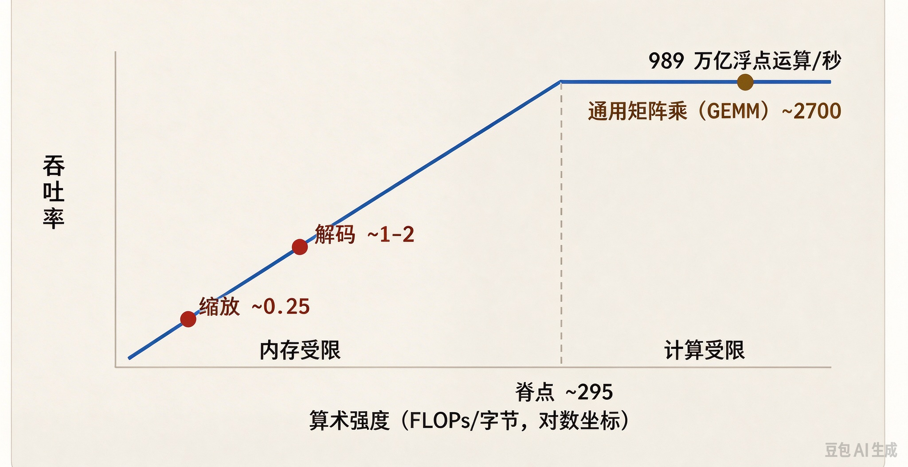
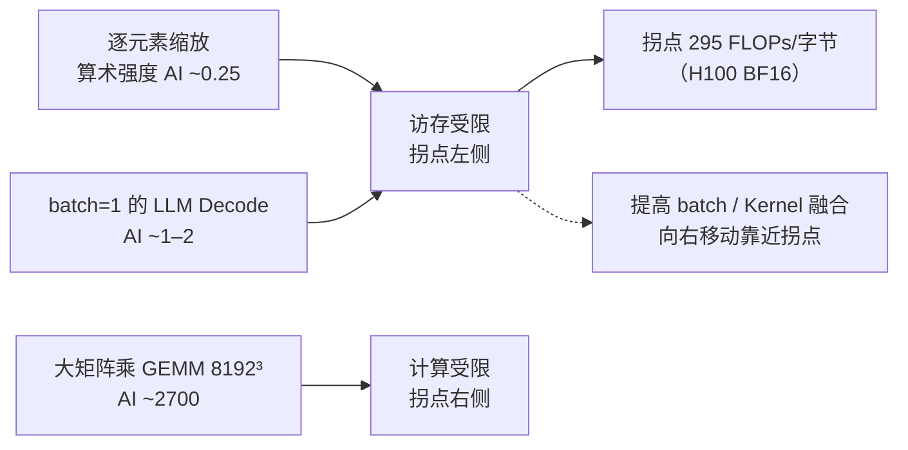

# 问题：如何判断一个 Kernel 是**访存受限（memory-bound）**还是**计算受限（compute-bound）**？

**一句话摘要（TL;DR）**：
计算这个 Kernel 的**算术强度（arithmetic intensity，每字节 HBM 流量对应的 FLOP 数）**，再和硬件拐点（ridge point）对比。H100 的 BF16 稠密算力下拐点大约是 295 FLOPs/字节（989 TFLOPS 稠密 BF16 ÷ 3.35 TB/s）。
算术强度低于这个值 → 访存受限；高于这个值 → 计算受限。
如果 DRAM 和 SM 利用率同时都很低，则是第三种状态：**延迟受限（latency-bound）**，屋顶线（roofline）模型此时不再适用。

---
## 分析思路
要同时使用**理论分析法（屋顶线模型：算术强度 vs 硬件算力带宽比值）**和**实测分析法（性能探针计数器）**。
理论模型告诉你**上限能到多少**，性能探针告诉你**实际发生了什么**。
然后套用到机器学习里典型的 Kernel 上；LLM 解码（decode）就是这些公司面试官最关心的例子。

## 高分回答版本
先从硬件均衡点说起。
一块 H100 SXM 卡稠密 BF16 算力约 989 TFLOPS（标注“稠密”；数据表上经常会给出 2倍稀疏算力数值），HBM 带宽约 3.35 TB/s。
拐点 = 989e12 ÷ 3.35e12 ≈ **295 FLOPs/字节**。
如果一个 Kernel 的算术强度（每字节 HBM 流量完成多少浮点运算）低于 ~295，它受硬件构造限制，永远跑不满峰值算力，属于**访存受限**；高于 295，则是**计算受限**。
（如果是 FP32 用 CUDA Core 运算，拐点要低得多，大约 20；精度对这个分类至关重要。）





> 在对数坐标轴的屋顶线图上绘制：所有访存受限的 Kernel 都落在拐点左侧、代表带宽上限的斜线上；只有大 GEMM 能到达平坦的算力上限：
```mermaid
xychart-beta
    title "屋顶线 Roofline (H100 BF16)"
    x-axis "算术强度 FLOPs/byte (对数轴)" [0.25, 1, 295, 2700]
    y-axis "吞吐 Throughput TFLOP/s"
    line "屋顶上限" [0.25, 1, 295, 295]
    point "scale ~0.25" [0.25, 0.25]
    point "decode ~1–2" [1, 1]
    point "GEMM ~2700" [2700, 295]
    text "访存受限区" --> x=1, y=0.5
    text "计算受限区" --> x=500, y=290
    text "ridge 拐点≈295" --> x=295, y=295
```

接下来，对 Kernel 手动计算算术强度。几个需要记住的经典例子：
- **逐元素算子（BF16 下标量缩放 y = a * x）**：每移动 4 字节（一次读、一次写）对应 1 次浮点运算，强度≈0.25。
  双输入向量加法要读取两个数组，每 6 字节一次浮点运算，强度≈0.17。
  就连 GELU，它的 tanh 近似每个元素大约 10 次浮点运算，强度也只有 ~2.5。
  这类算子基本都是访存受限；唯一的解法是算子融合，让多个算子只访问一次显存。
- **大 GEMM（M=N=K=8192）**：总运算量 $2\cdot8192^3$ FLOPs，总访存 $3\cdot8192^2\cdot2$ 字节，强度≈2700。
  典型计算受限，这也是训练任务经常能拿到很高 MFU（模型浮点利用率）的原因。
- **batch=1 的 LLM Decode**：每生成一个 token，都要读取全部权重（外加 KV Cache），大约每读取 1–2 字节权重对应 2 次浮点运算，强度≈1–2。
  比拐点低两个数量级，访存受限。token/s ≈ 显存带宽 ÷ 模型总字节数。
  增大 batch 会近似线性拉高算术强度，需要把 batch 拉到几百级别，Decode 的算术强度才会靠近拐点；这也是大模型在线服务背后的核心经济学逻辑。

Decode 这条线还可以进一步用来预测 token 吞吐，让屋顶线变成一个预测工具：
一个 30B 参数 BF16 模型，权重一共 60 GB，可以放进一张 80GB H100，剩余空间放 KV Cache；batch=1 时每生成一个 token 都要流式读取全部权重。
理论上限 = 带宽 ÷ 总字节 = 3.35 TB/s ÷ 60 GB ≈ **56 token/s**（还没算 KV 流量、额外开销，浮点计算已经核验）。
70B BF16 权重 140GB，单卡放不下，要先做多卡切分才能预测。
如果你实测跑出来 45 token/s，就说明已经跑到物理上限的 80%；再怎么魔改 Kernel 也很难翻倍，只有减小权重尺寸才可以：FP8 权重减半分母，吞吐大约翻倍；INT4 理论上再翻一倍。
能从数据表数字先预估服务基准、再解释实测和理论的差距，正是面试官想考察的能力；也是在客户会议里快速核验厂商吞吐宣传是否合理的最快方法。

然后用 Nsight Compute 做实测验证：在“光速（Speed-of-Light）”面板里查看 SM 吞吐、DRAM 吞吐占峰值的百分比。
- DRAM 利用率 80–90%、SM 利用率低 → 访存受限
- SM 利用率高、DRAM 利用率低 → 计算受限
- 两者都低 → 都不是，属于**延迟受限**（占有率太低、分支发散、同步阻塞），屋顶线模型不再生效，很多人在这里踩坑。
在训练任务这个更大粒度上，对应的指标是 MFU（模型浮点利用率）：实际有效浮点 ÷ 峰值浮点；大规模训练任务 40–50% MFU 已经是很不错的水平。

不同瓶颈对应的优化方向完全不同：
- 访存受限：算子融合、用共享内存分块（tiling）、优化访存合并（coalescing）、换更小的数据类型（FP8/INT8，直接提升等效带宽）
- 计算受限：用好 Tensor Core、降低精度；或者接受已经接近最优、不用再调
- 延迟受限：优先调流式多处理器占有率、解决分支发散

## 面试官后续经常追问的问题
1. “FlashAttention 的 FLOP 反而更多，为什么速度还更快？”
Attention 在 HBM 读写 N×N 矩阵的时候是访存受限；FlashAttention 用额外的重计算（代价很低），省去大量昂贵的 HBM 读写，把算术强度抬到屋顶线更高位置。只要在拐点左侧，**重计算优于反复读写显存**。

2. “权重量化到 FP8，Decode 速度翻倍；但换成 INT4，速度没有到 4 倍，为什么？”
小 batch 场景是带宽瓶颈，权重字节减半 ≈ 速度 ×2；再往下，反量化开销、KV Cache 流量、Kernel 本身的质量，都会吃掉理论增益。

3. “DRAM 和 SM 利用率都只有 40%，该怎么办？”
延迟受限。去查实际的流式多处理器占有率、阻塞原因；也有可能是 launch 瓶颈（大量很小的 Kernel 频繁启动），可以用 CUDA Graph 或者算子融合修复。

4. “换到 B200 或者下一代卡，结论会怎么变？”
算力峰值、带宽峰值都会变，重新计算拐点即可；**这套分析方法是通用的，具体数字会变**。

## 常见误区
- 上来直接说“跑性能分析工具”，没有先做理论估算。大部分 Kernel 在草稿纸上就能定性分类，面试官想看的就是这个草稿纸上的推导。
- 拿 `nvidia-smi` 的 GPU 利用率当成计算受限的证据。这个指标只代表有 Kernel 在 GPU 上驻留，**不代表 ALU 一直在干活**；100% 的 GPU 利用率也可能全程阻塞等待。
- 漏掉第三种状态：延迟受限。然后对着延迟瓶颈的 Kernel 死命调带宽，完全走错方向。
- Tensor Core 的任务，却用 FP32 峰值算力算拐点，误差可达 ~15 倍，直接把结论搞反。

## 核心要点
- H100 BF16 稠密算力的拐点大约 **295 FLOPs/字节**；低于拐点访存受限，高于拐点计算受限。
- 小 batch 的 Decode 算术强度只有 1~2，比拐点低两个数量级；增大 batch 是最核心的调节手段，一句话概括 LLM 服务的性能逻辑。
- DRAM、SM 利用率同时偏低就是延迟受限，此时调带宽是无效操作；优先修复占有率问题。

---


第三个状态最容易被大多数人忽略：当 DRAM（动态内存）和流式多处理器（SM）利用率双双偏低时，系统属于**延迟受限（latency-bound）**场景，此时屋顶线模型（roofline）甚至还不适用，因此“去优化带宽”是走错了方向。

把 `nvidia-smi` 读出的 GPU 利用率拿来当作**计算受限（compute-bound）**的依据，是一个典型误区：这个指标只代表核函数（kernel）已经驻留在GPU上，**并不代表算术逻辑单元（ALU）正在满负荷运算**。另外，如果针对张量核（Tensor Core） workload，还用 FP32 理论峰值算力去计算脊线（ridge point），算出的结果大约会偏差15倍，得出的结论也会完全反过来。


> 一个实操补充：屋顶线一般针对**单个 Kernel**绘制；一次训练 step 包含几十个算术强度各不相同的 Kernel。step 层面的 MFU 是加权混合值。一个 45% MFU 的训练 step，里面可能藏着一个严重访存受限的 Kernel，拖慢了一堆计算受限的 Kernel。
> **屋顶线按单个 Kernel 看，MFU 按整个 step 看。**


> 拐点的一个细化说明：屋顶线假设你能打满峰值带宽；但就算访存合并做到完美，真实 DRAM 效率上限通常只有 80–85%。
> 所以工程上 Kernel 实际要参考的有效拐点更接近 250 FLOPs/字节，而不是 295。
> 拿实测算术强度和教科书理论拐点对比，会误判一个访存受限的 Kernel 还有优化空间，而实际上已经到顶了。

> 还有一点：算术强度本身会因为 Cache 命中发生变化。屋顶线统计的是 **HBM 流量字节**。
> 如果 Kernel 的工作集可以全部放进 50MB 的 L2 Cache，它的**实际有效算术强度**会比从代码上估算出来的高很多。
> DRAM 吞吐计数器，才是判断它实际处于哪一种瓶颈区间的依据。

