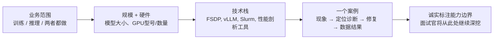

# 你做过机器学习GPU负载相关的工作吗？

> 一句话摘要（TL;DR）：回答顺序：**业务范围 → 规模 → 技术栈**，然后讲一个带量化数据的优化案例；主动诚实地标出自己熟悉能力的边界，面试官一定会在你止步的地方，再往深追问一层。面试官记住的是这个故事（现象、排查手段、修复方案、量化结果）；夸大项目规模，是在后续追问里翻车最快的方式。

## 回答思路
这个问题是一个分叉题：你的回答，决定面试官接下来会问你什么。面试官一定会在你停下的位置，再深挖一层。
所以你的回答结构固定为：**业务范围 → 规模+硬件 → 技术栈 → 带数字的优化故事**，并且主动、诚实标出自己能力上限。千万不要夸大。
这个面试场景里，最容易戳破吹牛的问题就是：**用的什么GPU，你是怎么做性能 profiling（性能剖析）的？**

---

## 一份优秀的回答
一份高质量回答，大概90秒，覆盖四点：
1.  **业务范围**：训练、推理，还是两者都做，以及你的职责。
    ✅ “我全权负责推理服务链路” 和 “我只是往共享集群提交训练任务”，给人的感受完全不同；两种经历都没问题，忌讳含糊不清。
2.  **规模与硬件**：模型大小、GPU型号、GPU数量，单机还是分布式。
    ✅ 例子：“在一台8卡A100-80GB的机器上微调7B~13B模型，用L4卡做线上部署推理”，这种表述非常具体，面试官会以此为基准，调整后续对话深度。
3.  **技术栈**：说出真实用到的组件。
    例如：PyTorch + FSDP / DeepSpeed；推理侧vLLM、TensorRT-LLM；自己手写Triton核函数；调度用Slurm或者K8s；实验追踪Weights & Biases。
    说出调度编排工具、性能剖析工具，和框架本身同样重要。
4.  **一个带量化数据的故事**：这是面试官印象最深的部分。固定结构：**现象 → 诊断排查方法 → 修复手段 → 量化结果**
    > 示例：我们微调任务看起来是GPU瓶颈，但用Nsight Systems分析后发现，GPU在40%的训练步长时间里，都在等待数据加载器；我们把分词（tokenization）改成离线预处理，样本吞吐从大约180样例/秒提升到310样例/秒，训练时长从11小时缩短到6小时。
    > 重点在于**诊断方法**，这个细节才能证明你真的上手做过。

如果你的项目经验比较有限，直接如实说明，把重心放在**单卡深度**而不是堆GPU数量：
> “我没有做多机分布式训练，但我做过完整的单机GPU工作：内存剖析、混合精度调优、不断调整batch size来解决OOM显存溢出；同时我通过X资料，理解多机场景下常见的故障模式。”
CoreWeave、Together AI这类公司招人的标准：候选人要清晰知道自己真实能力的边界；如果候选人吹出来的项目经验，两轮追问就露馅，直接淘汰。

如果面试官邀请你补充，你可以再讲一次踩坑/故障经历：一次排查OOM显存溢出、一次loss变成NaN的调试、一次CUDA版本不匹配导致整个集群服务异常。这些一线踩坑经历，才是这个问题真正想考察的资历。

---

## 面试官接下来通常会深挖哪些问题
- 「你用什么工具做性能剖析，发现了什么问题？」
  准备好真实工具（Nsight Systems / Nsight Compute、PyTorch Profiler、nvidia-smi、dmon），配上真实发现；只说“我们看了GPU利用率”，代表只是浅尝辄止。
- 「你的GPU显存预算是多少，显存都被什么占用了？」
  训练场景：模型参数、梯度、优化器状态、激活值；
  推理场景：模型权重 + KV缓存。
  你要会拆解显存占用，这是很强的加分项。以13B模型、混合精度Adam优化器为例：BF16参数占26GB、BF16梯度26GB、FP32主权重52GB、Adam的两个FP32动量项104GB，合计208GB，也就是常说的**每个参数约16字节**，这还没算激活值。
  这一段话，可以一次性回答三个追问：为什么13B模型不用分片就塞不进80GB卡；ZeRO/FSDP到底在分片什么（大多是优化器状态）；为什么同样模型推理只需要26GB权重再加KV缓存。
  如果你能主动说出你项目对应的显存拆解，面试官就不会继续纠结项目规模，转而和你深入聊工程实现。
- 「为什么选这套硬件？」
  从成本、可用性、显存需求角度解释，例如：“选A100-80GB，是因为带Adam优化器状态的13B模型，不分片的话40GB卡放不下”。这代表你做过选型决策，而不是别人给什么卡你就用什么。
- 「出过什么故障？」
  面试官想听一线排障经历；优先选你找到根本原因的案例，而不是“直接重启就好了”这种故事。

## 常见错误
- **夸大规模**：声称自己有分布式训练经验，结果只是简单用 `device_map="auto"` 在两张卡上跑模型，面试基本到此结束。这些追问，就是专门用来筛这种情况的。
- **只罗列框架，没有落地故事**：单纯报一堆工具名字，没有「现象→修复→数据」的完整故事，和简历上堆砌关键词没有区别。
- **全程没有任何数字**：吞吐、显存、成本、训练时长，GPU相关工程一定是量化的，完全没有数字，听起来就是道听途说。
- **忽略成本考量**：资深工程师会主动提到成本，例如：“这次训练大概要花2000美元算力，所以我们先用1B小模型验证方案”。一句话就能体现你是项目负责人，而不只是一个使用者。

## 核心要点总结
1.  回答结构固定：业务范围 → 规模 → 技术栈 → 量化故事；带数据的案例是回答的核心。
2.  主动标出自己能力的上限，面试官一定会在你标注的边界继续往下深挖。
3.  主动讲算力成本、讲你的排查诊断手段；这两点，是区分“真正负责项目的人”和“只是用工具的人”最简单的办法。

> 重点补充：这个方向面试里，最容易拆穿假话的提问就是「用的什么GPU，怎么做性能剖析？」。
> 如果你说自己做过分布式训练，但实际只是两张卡上跑 `device_map="auto"`，对话很快就会结束。
> 让故事有说服力的关键，是**排查诊断方法**，而不是修复方案本身。
> 说「Nsight Systems显示GPU有40%时间在等数据加载器」，能证明你真的动手分析过；单纯罗列工具名字，只会像简历关键词堆砌。
> 主动带上成本计算（“这次训练大概2000美元，所以我们先用1B小模型验证”），是最简单的方式，让面试官觉得你是项目负责人，而不是单纯使用者。

> 在这类面试里，最干净利落体现你真实深度的信号，就是**主动拆解显存预算**。
> 谁都可以说“我们遇到OOM显存溢出了”；但如果候选人能说出：参数、梯度、优化器状态、激活值，而且是Adam优化器的状态，导致13B模型在40GB卡上放不下，那就说明他真的跑过、剖析过真实任务。
> 面试官会在你停下的地方继续深挖，所以把你能力的真实上限，放在量化结果之后，而不是放在前面。

