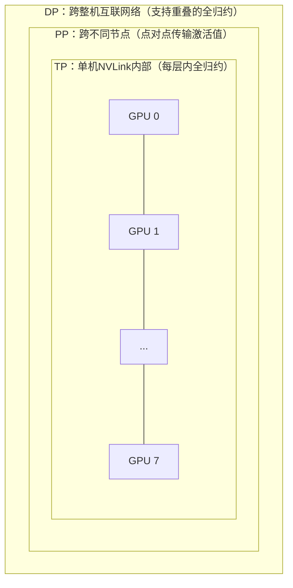

# 对比数据并行、张量并行、流水线并行；分别什么时候使用？它们如何组合成3D并行？

**一句话摘要（TL;DR）**：按照每种策略的通信内容和通信频率来梳理对比：
- 数据并行（DP）：每一步执行一次梯度全归约（可以和计算重叠，可扩展到数千卡）
- 张量并行（TP）：在每一层内部做激活值全归约（通信量大、处在关键路径上，所以一般局限在NVLink域内，并行度2~8）
- 流水线并行（PP）：只在流水线阶段边界传输激活值（通信开销低、对网络延迟不敏感，但是会产生流水线气泡）
前沿大模型训练把三者组合起来，按照这套通信约束构成**3D并行**。

## 答题思路
不要孤立背诵定义。围绕两个维度组织对比：**拆分的对象是什么**，以及**通信内容是什么（通信量、通信频率、对延迟是否敏感）**。
通信这个维度决定了三种并行如何映射到真实硬件；面试官靠这个区分：是只读过Megatron论文，还是真正跑过这套训练框架。

## 高分回答
### 数据并行（DP, Data Parallelism）
每张GPU上复制一份完整模型；每个进程处理不同的数据批次，每一步做一次梯度全归约。
**通信**：每一步对全部梯度做一次全归约（BF16精度下大约每个参数2字节），可以和反向传播计算重叠。
✅ 使用场景：模型能放进单张GPU显存时，默认优先选DP；可以扩展到上千个进程；它的分片变体（ZeRO / FSDP）突破“模型放进单卡”的显存限制。

### 张量并行（TP, Tensor Parallelism）
Megatron风格：把单层、每个GEMM的权重矩阵拆分到多张GPU上（先按列拆分、再按行拆分，所以每个MLP块、每个Attention块各有一次全归约）。
**通信**：每一层、每个微批次，前向和反向过程都要对激活值做全归约。
通信总量非常大，而且处在计算的关键路径上，无法隐藏延迟。所以TP一般在单机NVLink（带宽约900GB/s）内部运行，几乎不会跨InfiniBand网络。
✅ 使用场景：单层/整个模型太大、单卡放不下；或者想要降低单卡计算延迟；典型并行度2~8，匹配NVLink的GPU域大小。

### 流水线并行（PP, Pipeline Parallelism）
按照模型深度拆分：连续的若干层组成一个流水线阶段，放到不同节点上；微批次像流水线装配线一样依次流过各个阶段。
**通信**：只在阶段边界点对点传输激活值；数据量适中，对延迟容忍度高。
它的开销不在带宽，而在于**流水线气泡（bubble）**：流水线填满、排空的时候，部分阶段GPU空闲。
气泡开销近似公式：
> 相对于有效计算时间：$\text{overhead} \approx \dfrac{\text{阶段数}-1}{\text{微批次数量}}$
> 相对于总墙钟时间：$\text{overhead} \approx \dfrac{\text{阶段数}-1}{\text{微批次数量}+\text{阶段数}-1}$

因此需要同时跑很多微批次；1F1B调度、交错虚拟阶段可以进一步降低气泡开销。

## 并行嵌套层级图示（Mermaid）

## 3D并行（3D Parallelism）
3D并行是按照通信需求的约束顺序组合三者：
**TP在最内层（8卡NVLink岛内），PP跨节点（在集群网络上做低成本点对点通信），DP在最外层（同样跨集群网络、梯度全归约可和反向计算重叠）**。
举个Llama 405B规模的例子：TP=8，PP=16，DP根据剩余卡数设置，例如 $8\times16\times16=2048$ 张GPU。

**选型决策流程**
1. 模型能放进单卡显存：只用纯DP
2. 放不下：优先FSDP（最简单）；如果FSDP通信或者显存表现不好，再上TP（最多到8）
3. 显存依然不够、或者DP并行度已经拉满：再叠加PP
4. 最后设置微批次数量，控制气泡开销在 ~10%以内

这个选型逻辑，用真实模型规模验算才更可信。有一条经验规则：**训练状态每个参数占16字节**，可以用来预先估算显存。
> 例：Llama-70B，跑在64张H100（80GB）：
> $70\mathrm{B} \times 16\mathrm{byte}=1120\mathrm{GB}$，参数、梯度、优化器状态总量，用FSDP分到64卡，单卡约17.5GB，还留了充足空间存激活值，直接FSDP就很合适，不需要复杂布局。

> 同集群跑405B模型：
> 总训练状态 $6480\mathrm{GB}$，分到64卡，单卡仅状态就需要101GB，超过卡容量，还没算激活值；TP+PP只是重新分配这6480GB，不会减少总量，64卡总容量只有5120GB，根本放不下。
> 所以方案完全不同：
> 至少81张卡才能放下训练状态；128卡的话单卡分到50.6GB，才有空间放激活；或者用8bit优化器、CPU卸载压缩状态；再选择布局：岛内TP + 跨节点PP，也就是405B这类大模型的主流方案。

面试重点：“选哪一种并行”不是凭喜好，在碰集群之前就可以通过算术算出来；能把这个计算过程讲清楚，才不是死记布局。

补充一句话：MoE的专家并行（All-to-All路由）、长序列的上下文并行，是现代框架里的第4、第5维并行。

## 对比汇总表
| 策略 | 拆分对象 | 通信量 | 通信频率 | 典型并行度 | 运行位置 |
| ---- | ---- | ---- | ---- | ---- | ---- |
| 数据并行 DP | 拆分批次，模型完整复制多份 | 梯度全归约，约2字节/参数 | 每步一次（可重叠） | 数千 | 跨整机高速互联网络 |
| 张量并行 TP | 拆分每个GEMM的权重矩阵 | 激活值全归约，通信量大 | 每一层、每个微批次，前向+反向 | 2~8 | 单机内部NVLink |
| 流水线并行 PP | 按模型深度分层，组成阶段 | 阶段边界激活值，点对点 | 仅阶段边界处 | 和节点数量匹配 | 跨不同节点 |

## 面试官常追问的后续问题
- 问：为什么TP跑在NVLink里，DP却可以跨网络？
  答：看「通信频率 + 是否可以重叠」，不只是看字节数。TP每层都要在关键路径上做激活全归约，没法隐藏延迟；DP每步只同步一次梯度，通信可以藏在反向传播计算后面。
- 问：8个流水线阶段、32个微批次，气泡开销是多少？
  答：单纯看有效计算的开销：$(8-1)/32 \approx 22\%$；看总墙钟时间空闲占比：$7/(32+8-1)\approx18\%$。这是朴素调度的结果，所以会加大微批次数量、或者用虚拟阶段交错调度降低气泡。
- 问：为什么不全部直接上FSDP？
  答：规模到一定程度，单卡分片太小，all-gather延迟占主导；而且超大层的激活显存依然会爆掉。大概几百卡、100B参数以上规模，混合分片 / TP+PP 效果更好。
- 问：推理阶段用哪一种？
  答：主要是TP（超大模型有时再加PP）；DP只是多副本扩容吞吐。推理目标是延迟、KV缓存显存，不需要梯度同步，和训练不一样。

## 常见错误
1. 能正确背定义，但答不出**什么时候该用**——这才是原题真正想问的。最简判断链条：单卡放下→DP；单层太大→TP；模型太深跨节点→PP。
2. 忽略通信频率：只对比传输字节，误以为PP很贵；实际上在线路上，PP反而是三者里通信最便宜的。
3. 误以为PP节省计算量：PP只节省显存；会引入气泡开销；它的价值是支撑更大模型、更大批次，从而提升吞吐。
4. 不提三者可以组合：前沿训练都是3D并行（MoE则是4D）；把三者当成互斥选项，是2019年之前的旧认知。

## 核心要点总结
按通信特性排序：
DP：一步一次同步，通信可重叠；
TP：每层都同步，延迟无法隐藏；
PP：只在阶段边界通信，通信成本低。

TP必须局限在NVLink域（并行度2~8）；PP和DP是跨集群网络的两个维度。
3D并行的嵌套顺序：**TP嵌套在PP里面，PP嵌套在DP里面**；这个布局是由每一种集合通信能承受的硬件约束决定的。

---

区分“读过Megatron论文”和“真正跑过”候选人的经典问题：**为什么TP跑NVLink，DP却可以跨网络？**
答案核心：**通信频率 × 是否可重叠**。TP每层激活全归约在关键路径上；DP梯度全归约一步一次，可以藏在反向计算后面。
很多候选人只看传输字节，误以为流水线并行开销很高；但PP在线路上其实是三者最便宜的。把三种并行当成互斥选项，而不是组合成3D并行（加MoE就是4D），说明知识已经过时。

通信优先的这套框架有一点低估了上下文并行（Sequence Parallelism）的重要性：当序列长度超过约16k之后，激活显存、Attention里的全归约会成为瓶颈，TP和SP经常在同一个NVLink域一起使用。原本简洁的「TP在PP内、PP在DP内」的三维图景，会多出第四个维度，和集群扩展的网络资源产生竞争。
