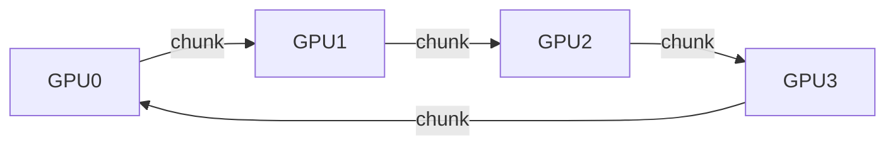

# 环形全归约（Ring All-Reduce）原理说明以及通信代价推导
> 面试题：解释环形全归约如何工作，并推导它的通信代价


**一句话总结（TL;DR）**：
环形全归约分为两个阶段：**分散归约（scatter-reduce）** + **全收集（all-gather）**；两个阶段各需要 $N-1$ 轮迭代。数据缓冲区被切分成大小为 $K/N$ 的数据块。每个GPU总共传输 $2(N-1)K/N \approx 2K$ 字节的数据，这个数值几乎和GPU总数 $N$ 无关。
这个**带宽项几乎不随GPU数量增长**，正是数据并行可以高效扩展的核心原因；但短板是**延迟项 $2(N-1)\cdot\alpha$，它随GPU数量线性增长**，因此对于小消息场景，NCCL会改用树形算法。

---
## 答题思路
先用小规模GPU集群（小N）把两个阶段完整走一遍，然后推导单块GPU的数据传输量，说出核心结论：**每块GPU移动的数据字节数几乎和集群规模无关**，这才是数据并行能够扩展的根本原因。最后补充延迟项的分析，因为懂得**什么时候环形全归约不适合使用**，才是这道面试题拔高得分的关键点。

## 高分标准答案
全归约（all-reduce）需求：每一块GPU一开始都持有自己的K字节梯度数据；最终**每一块GPU都要拿到所有GPU梯度逐元素相加之后的总和**。
环形全归约把 $N$ 块GPU组织成一个逻辑环，并且把整块大小为 $K$ 的缓冲区切分为 $N$ 个数据块（chunk）。

### 示意图（Mermaid）


> 图说明：GPU0 → GPU1 → GPU2 → GPU3 → GPU0 构成逻辑环形，每一步沿着环传递一个数据块

---
### 阶段1：分散归约 scatter-reduce（共 $N-1$ 步）
每一步里，**所有GPU同时把一个数据块发给自己右侧的邻居，同时从左侧邻居接收一个数据块，并且把收到的数据块加到本地对应位置上**。
数据块沿着环传递、不断累加部分和；经过 $N-1$ 步之后，**每一块GPU刚好持有其中一个数据块的完整归约总和**。
举 $N=4$ 的例子：GPU0最终持有1号块的全局总和，GPU1持有2号块的全局总和，以此类推。

累加过程理解起来可以定性描述，但最好亲手追踪一遍。下面是4卡GPU分散归约过程的模拟表格：单元格数字代表该数据块已经聚合了多少块GPU的数据。

|  | chunk 0 | chunk 1 | chunk 2 | chunk 3 |
| ---- | ---- | ---- | ---- | ---- |
| GPU0（3步后） | 1 | 4 | 3 | 2 |
| GPU1（3步后） | 2 | 1 | 4 | 3 |
| GPU2（3步后） | 3 | 2 | 1 | 4 |
| GPU3（3步后） | 4 | 3 | 2 | 1 |

加粗对角线就是阶段1的结果：**每一块GPU刚好拥有一个已经完成全局归约的数据块；每一个数据块只在唯一一块GPU上完成全部累加**。原理是：数据块沿着环走完一圈，每经过一跳就收集一份新的梯度贡献；起始GPU本身自带一份，因此经过 $N-1$ 跳之后集齐全部 $N$ 份数据。
你可以在白板上手推这个表格，理解之后公式 $2(N-1)K/N$ 就不用死记硬背了。

### 阶段2：全收集 all-gather（共 $N-1$ 步）
已经算好总和的数据块继续沿着环同样的方式流转，**这一步不再做加法运算，只做数据转发**；再经过 $N-1$ 步之后，所有GPU都集齐全部 $N$ 个已经归约完成的数据块。

### 代价推导
每一步，每块GPU发送（同时接收）大小为 $K/N$ 的一个数据块；一共执行 $2(N-1)$ 步（分散归约 $N-1$ + 全收集 $N-1$）：
```
单块GPU发送总字节 = 2(N-1) · K / N
当N很大时，≈ 2K

通信总耗时 ≈ 2(N-1)/N · K/B + 2(N-1)·α
B = 链路带宽，α = 单次通信启动延迟（单步延迟）
```

有两个重点：
1. 带宽项几乎不随N变化：从8卡扩到512卡，单GPU需要传输的数据量几乎不变；并且每一条链路在每一步都满载，不存在热点链路。$2(N-1)K/N$ 同时也是所有全归约算法中单GPU流量的理论下界，因此环形算法是**带宽最优**的。
2. 延迟项随N线性增长：一共 $2(N-1)$ 串行走步。对于大梯度缓冲区，延迟项影响很小；但是在大集群下传输小消息、或者跨机房高延迟链路时，延迟项会成为瓶颈。这就是NCCL同时实现树形等其他算法、根据消息大小和拓扑自动选择算法的原因。双二叉树可以做到 $O(\log N)$ 的延迟，同时几乎保留满带宽。

### 随着GPU数量N增大，单GPU传输字节（$2(N-1)K/N$）变化表
| GPU数量 N | 单GPU移动字节 | 备注 |
| ---- | ---- | ---- |
| 4 | 1.5K | $2\cdot(3/4)\cdot K$ |
| 8 | 1.75K | $2\cdot(7/8)\cdot K$ |
| 64 | ≈1.969K | $2\cdot(63/64)\cdot K$ |
| 512 | ≈1.996K | $2\cdot(511/512)\cdot K$，近似2K |

> 面试常考的计算示例：7B参数量模型，BF16精度，则总大小 $K=14\ \text{GB}$。8卡训练时，每块GPU发送 $2\cdot(7/8)\cdot14 \approx 24.5\ \text{GB}$。
> 在NVLink有效带宽约400 GB/s下，耗时大约60ms；如果走单条400Gb/s（等价50GB/s）网卡，则大约500ms。
> 这就是为什么要把全归约通信和反向传播计算做重叠（PyTorch DDP的分桶梯度策略），也解释了为什么训练节点上会配备数量看起来很多的网卡。

---
## 面试官接下来常追问的问题
- **问：为什么一定要切分成小块？直接把整个缓冲区在环上传递不行吗？**
朴素环形方案（每一跳发送完整K字节）的代价是单GPU传输 $(N-1)\cdot K$；参数服务器方案也会让某一个节点接收 $(N-1)\cdot K$ 的数据。两种方式都无法让所有链路一直满载。**分块的作用是流水线化通信**，让每一条链路在每一步都传输有效数据。

- **问：NCCL什么时候不选用环形算法？**
小消息场景（延迟受限，优先选树型算法）；以及支持SHARP / InfiniBand交换机内归约的拓扑，交换机可以在网络硬件内部完成加法，直接减半通信流量。

- **问：通信如何和计算重叠？**
梯度会被分桶（例如PyTorch DDP默认25MB一个桶），只要某一层反向传播计算完成，立刻启动这个桶的全归约。正常稳定训练时，绝大部分通信开销都被反向计算掩盖了。
如果扩规模之后单步时间反而变长，说明通信计算重叠失效；排查要用NCCL追踪日志，不能只看 nvidia-smi。

- **问：单独全收集（比如FSDP里用到）的代价是多少？**
单独all-gather：单GPU流量 $(N-1)K/N$，只有全归约的一半；FSDP在前向、反向都要做全收集，还要搭配reduce-scatter，所以FSDP整体通信代价大约是3K，而数据并行DP是2K。

## 常见错误
1. 只会背公式 $2(N-1)K/N$，但是没法解释推导过程。面试官专门分两个阶段提问，就是筛掉只会死记公式的候选人。
2. 完全丢掉延迟项，被问到“为什么NCCL要有树算法”时答不上来。
3. 说环形全归约因为可以计算通信重叠，所以通信开销等于免费。重叠只是掩盖开销，当通信耗时超过反向计算耗时之后，就会成为瓶颈，这个临界点就是大规模扩展失效的根源。
4. 用参数数量直接计算字节数，忘记精度带来的倍数：BF16一个参数占2字节，FP32占4字节，这类题目对数值精度要求很高，很容易差2倍。

## 核心要点总结
1. 单GPU通信流量：$\boldsymbol{2(N-1)K/N \approx 2K}$，几乎和GPU数量无关，这就是数据并行能够扩展的根本原因。
2. 延迟项：$\boldsymbol{2(N-1)\cdot\alpha}$，随GPU数量线性增长；小消息场景下NCCL切换到树形算法就是为了解决这个问题。
3. 计算代价一定要换算成字节，而不是参数个数；一定要尽量让全归约和反向传播计算重叠，否则扩卡之后性能会掉速。

面试官要求你一步步精确讲解这两个阶段，正是为了筛出只会死记硬背公式 $2(N-1)K/N$、却说不出推导逻辑的候选人。
如果完全忽略延迟项，当被问到“为什么NCCL还要提供树形算法？”时，你就答不上来——而这个问题才是区分高阶候选人的关键。

还有一个计算上容易踩的坑：用**参数量**直接算而不是换算成字节；BF16 每个参数占2字节，忘了乘这个2，最后结果直接差一倍。这类问题对数值计算的准确性要求很高，一步错全盘偏差。


有一个总线带宽的坑值得明确说明：8卡NVLink环标注的400GB/s，是**单块GPU双向总线带宽**，而不是单条单向链路速率；环形算法同时使用两个传输方向。
很多人用单向链路带宽去计算，得到2倍偏保守的耗时；虽然从稳妥角度看结果偏大还算安全，但背后的原理理解是错的，进而导致重叠分析出错。
