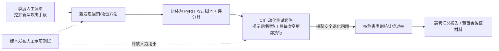

# 持续化AI红队项目设计：团队、危害分类、执行节奏，以及优先用PyRIT自动化的内容
这是“如何对聊天机器人开展红队测试”的成熟进阶版本。微软式的循环方案要求设计一套**常态化项目机制**，而不是只做一次渗透测试。需要明确团队构成、危害分类体系、迭代节奏，以及第一天就要编写脚本实现的攻击类型。

> 一句话概要：这不是单次渗透测试，而是一套常态化项目。小型混合团队（安全、机器学习、领域专家、善意误用模拟角色）；在测试前和法务共同敲定一套危害分类体系；按触发条件设置测试节奏（CI流水线自动化套件、版本发布配套人工迭代、季度开放式探索测试）；搭建基于PyRIT的自动化层，把每一次人工发现的漏洞都写成回归测试脚本。这套飞轮机制，再搭配每个危害类别的绕过率指标，才能把红队工作从成本项，变成可提交给董事会的可信佐证材料。

## 设计思路
答题的误区，是把它答成一次性的测试任务。题目里“项目（program）”一词代表着长期固定能力：专职人员、危害分类体系、和版本触发绑定的测试节奏，以及可以持续积累迭代的自动化层。这里隐含的评分参考是微软公开的红队测试指南；该体系下的面试官，看重团队组成和迭代闭环，而不是单纯罗列越狱提示词。

## 高分参考答案
### 团队配置
刻意组建小型混合核心团队：2–3名安全工程师，擅长梳理攻击链路；1名机器学习工程师，熟悉模型与评估体系；还有很多候选人容易忽略的角色——**领域专家**和**善意模拟角色**：面向医疗部署场景就配临床医师，金融场景配备欺诈分析师；再安排测试人员，模拟普通用户的无心误用场景，而不是只模拟专业攻击者。因为现实中的伤害往往来自无心的不当使用，而非恶意黑客。

每个周期轮换产品工程师加入，扩散安全能力，缩短漏洞修复闭环。

### 危害分类体系（必须在任何测试前先确定）
只说“找出坏问题”无法保障测试覆盖度。采用双轴设计：
1. 通用风险大类：提示注入、数据泄露、有害内容输出、隐私侵犯、过度自主权限/工具滥用、可用性与资源成本滥用；
2. 业务专属风险：从客户真实风险台账提取。例如银行场景：违规金融建议输出、账号枚举、监管话术违规。

每个分类格子，**在测试前就和法务、产品共同定义严重等级**，这样漏洞研判时不用每次重新协商定级。

### 测试节奏：按触发条件驱动，而非固定日历周期
- 自动化套件：每次提示词/模型/工具发生变更时，在CI流水线自动执行（耗时数分钟）
- 人工主导迭代测试：每一次重大版本更新、新增功能时启动（耗时数日）
- 季度开放式探索测试：挖掘全新攻击手段；新挖到的攻击方式会沉淀到自动化脚本中，形成飞轮效应：每一个人工新发现，都会变成脚本化回归用例。自动化用例库持续扩充，让人力可以持续聚焦前沿新型攻击。

| 测试节奏 | 触发条件 | 耗时范围 | 捕获目标 |
| ---- | ---- | ---- | ---- |
| CI自动化套件 | 提示词、模型、工具发生任何变更 | 数分钟 | 提示词修改引发的漏洞回归 |
| 人工迭代测试 | 重大版本发布 / 新增能力 | 数日 | 新上线功能自带的安全缺陷 |
| 开放式探索测试 | 按季度开展 | 前沿挖掘 | 新型攻击手法；成果后续转入自动化库 |

### 使用PyRIT（或同类工具）实现自动化，以及这套架构的设计意义

| 英文 | 中文 |
| ---- | ---- |
| Quarterly human exercise novel techniques | 季度人工演练，挖掘新型攻击手段 |
| Per-release human sprint | 版本发布人工专项测试 |
| New finding | 新发现漏洞/攻击方法 |
| Scripted as PyRIT attack + scorer | 封装为 PyRIT 攻击脚本 + 评分器 |
| Automated suite in CI every prompt/model/tool change | CI自动化测试套件，提示词/模型/工具每次变更都执行 |
| catches regressions | 捕获安全退化问题 |
| Bypass-rate per harm category | 按危害类别统计绕过率 |
| Executive rollup / board evidence | 高管汇总报告 / 董事会佐证材料 |
| frees humans for | 释放人力用于 |

PyRIT类工具的核心价值，是把**攻击策略**（编排逻辑，包含Crescendo这类多轮递进攻击）、**载荷转换器**（Base64编码、翻译、字母替换、角色包装等）、**打分器**（分类模型、LLM裁判模型）三者解耦。
一份原始攻击种子，可以低成本衍生出上百种变体；这种批量衍生能力，是这套方案具备投入价值的核心逻辑。
50条原始攻击种子，搭配8种转换器，就能得到400个基础变体；再叠加5套多轮编排策略，就变成2000个独立攻击用例；每个用例重复跑20次来估算成功率，总运行次数可达数万次。
一名人工红队人员一天大概能精心执行50次攻击；2000个变体的一轮扫描，相当于40人天的人工工作量，自动化只需要几分钟就能在CI构建时跑完。
这种巨大效率差，说明这种关注点分离的设计不只是为了代码整洁：它决定了你是只能每季度有空时扫一遍已知攻击面，还是**每一次提示词微调都自动复测**——只有后者，才能捕捉这类回归问题：仅仅改了一句提示词，上个月修好的越狱漏洞就再次复现。

**优先编写自动化脚本的顺序：**
1. 已知越狱提示词集合，经过全部转换器批量变形。纯覆盖类任务，捕获提示词编辑带来的回归漏洞；
2. 系统提示词提取模式，搭配蜜罐字符串打分器。误报极低，可以直接阻断CI流程；
3. 间接注入载荷：预置在测试文档、邮件内，用于RAG/工具调用场景，对企业智能Agent属于现实危害最高的一类；
4. 多轮递进攻击编排脚本：因为普通单轮自动化测试普遍会低估这类风险。

运行次数要求：每个攻击用例在每次构建时至少跑20次以上，估算成功概率。因为在大规模线上场景，5%的绕过概率就足以演变成线上安全事件，不能直接判定为通过。

## 闭环上报机制
漏洞产出工单，明确责任人与严重等级对应的SLA（一级严重漏洞阻断版本发布）；持续跟踪每个危害类别的**绕过率指标**；向上输出高管汇总报表。这条趋势曲线，就是让红队工作从成本中心，变成CISO在董事会汇报时可以引用的佐证依据。

## 面试官后续常追问的问题
1. 问：自动化攻击的结果，不依靠人工逐条阅读上万条对话，要怎么判定攻击是否成功？

答：分层打分机制：确定性规则（蜜罐字符串、正则表达式）做硬拦截；经过校准打分标准的LLM裁判模型处理其余样本；人工每周抽样复核裁判结果（每次抽查50–100条对话），以及每次调整判定阈值时都复核，因为裁判模型会出现判定漂移。

2. 问：这套方案成本如何？

答：核心闭环大概消耗1–2个全职人力当量；大规模夜间批量跑测试的推理成本，每月几千美元级别。对比一次数据泄露安全事故造成的损失，成本就很容易评估。

3. 问：团队自建还是外包第三方？

答：核心能力自建（上下文知识会持续积累，自动化脚本也需要长期维护）；每年引入外部第三方独立测试，带来新视角，产出满足审计要求的独立报告；很多企业采购流程本身就要求第三方审计。

## 常见错误
1. 只描述加了几步操作的渗透测试方案：缺少持续节奏、回归套件、量化指标。题目关键词是**常态化项目（program）**，不是单次测试。

2. 团队全部由安全工程师构成：微软指南里明确要求加入善意误用模拟角色和领域专家，缺少这两类角色会被扣分。

3. 在危害分类体系定义完成前就先做自动化：攻击数量看着很多，但安全覆盖度无法衡量。

4. 只上报零散个案（“我们成功让模型泄露一次信息”），而不统计重复试验下的成功率。这是区分“表演式红队”和工程化可信信号的关键点。

> 飞轮机制有一个容易被忽略的衰减问题：脚本回归用例只能捕捉完全一致的已知攻击；只要换个说法改写一句提示，往往就能绕过这个固化的检测特征。
> 因此需要评估：每一条自动化攻击脚本，是否还能捕获变体改写后的攻击，而不是只能命中原始版本。否则用例数量越来越多，实际覆盖能力却停滞不前。

