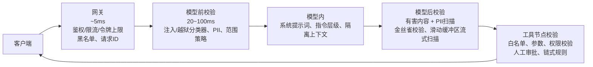

> 术语说明：
> guardrails：安全护栏/安全校验关卡
> jailbreak：越狱提示（提示词越狱）
> PII：个人身份敏感信息
> canary-string：金丝雀字符串（埋点水印串，用来检测系统提示词泄露）
> defense-in-depth：纵深防御
> holdback：文本暂存（流式输出里先缓存一小段token再做安全扫描）
> FDE = Forward Deployed Engineer，前线部署工程师

# 将安全护栏设计到大模型服务系统的请求流程中：它们放在链路的哪个位置，各自拦截什么风险？

一段 Anthropic 风格的系统设计方向：架构化安全。回答用文字描述流水线框图，包含5个校验节点、每个节点拦截的风险类型、每个节点带来的延迟开销，以及绝大多数面试候选人都会忽略的流式输出带来的复杂问题。

**将安全护栏设计到大模型服务系统的请求流程中：它们放在链路的哪个位置，各自拦截什么风险？**

> 一句话摘要：把安全看作流水线本身的固有特性，而不是外挂追加的过滤器。一共5个校验节点（网关、模型前、模型内、模型后、工具节点），每个节点拦截一类不同风险，延迟开销各不相同；只有工具节点是通过代码强制校验，其余都属于概率性识别。必须专门处理流式输出：采用滑动缓冲区扫描+少量token暂存的方案，并且每一处校验都要区分【标记告警】和【直接阻断】。

### 作答思路
这是一道披着安全外壳的系统设计题，因此要按照系统设计题的思路作答：用文字梳理请求流转路径，在每个阶段放置校验节点，并且对每一个校验节点，说明它拦截什么、会漏掉什么、带来多少延迟开销。

在 Anthropic 的面试评价标准里，拉开差距的关键点，也就是所谓「架构安全」这个考察维度：把安全当成流水线原生能力，而不是外挂过滤器；并且显式处理流式输出这个难题。

### 高质量参考答案
请求路径：客户端 → 网关 → 预处理 → 模型 → 后处理 →（智能体场景下）工具执行 → 返回客户端。一共5个校验节点。

> 图里标阴影的工具节点，是真正具备强约束能力的关卡；它上游所有校验都属于概率性识别。但是当多层校验相互独立时，概率叠加会带来更好防护效果，这就是纵深防御优于单一完美过滤器的原因。
> 举个例子：假设5个校验节点，针对某一类攻击的漏检率分别是30%、25%、40%、20%、10%；只有所有层同时漏检，攻击才能穿透：
> 0.30 × 0.25 × 0.40 × 0.20 × 0.10 ≈ 0.06% 的综合漏检率。
> 没有任何单层防护足够可靠，哪怕表现最好的一层，10次攻击里依然会漏掉1次；但是多层叠加之后，可以拦截99.94%的攻击。

这里的关键前提是**独立性**：如果多层校验只是同一个分类器的多个版本（失效模式完全一样），它们只会放大同一个盲区，而不是降低漏检率。

所以这5个校验节点会刻意采用完全不同的机制：确定性规则、分类模型、指令层级约束、输出扫描、代码强制的工具策略，而不是5套一样的东西。

其中两层校验可以并行执行，而不是串行；模型前的多个校验并行执行时，耗时取最大值 `max(50,60,40)=60ms`，而不是简单相加得到150ms，这也是合理规划校验位置的另一个原因。

1. **网关层（亚毫秒 ~ 约10ms）**

鉴权、基于用户/密钥的限流、token配额管控、低成本确定性筛查、输入长度上限、已知恶意模式黑名单、格式校验。
拦截：海量洪泛攻击、最简单粗暴的攻击；
短板：无法识别语义层面的风险。
同时在这里生成请求ID，下游所有日志都和这个ID关联，是事故溯源必不可少的一环。

2. **模型前校验（20–100ms）**
语义输入侧校验：提示注入/越狱分类器（小型微调模型，或者类似 Prompt-Shields 的服务）、按策略检测并脱敏PII、业务范围策略（例如这个保险机器人只能讨论保单相关内容）。

这些校验**并行执行，不是串行**。并且每条校验要区分：阻断 或 仅标记告警。高置信度越狱直接阻断；中置信度只标记+留日志。

原因：客服机器人如果误阻断率达到2%，一周就会引发大量用户投诉。

3. **模型内校验**

系统提示词本身、经过指令层级训练的模型，本身就是一层安全护栏；开销最低，但是单独使用防护能力最弱。
还有架构层面的选择：检索回来的外部内容做分隔标记、工具按任务粒度开放而不是全局开放。

4. **模型后校验**
输出侧校验：有害内容分类器、输出PII扫描（模型有可能泄露输入扫描没有捕获到的训练数据或者上下文信息）、金丝雀字符串检查（检测系统提示词被原样吐出）、格式/结构校验、RAG场景下的引文完整性校验。

> 拉开资深候选人差距的难点：流式输出。
> 你不能在模型还没生成完回复的时候就做完整分类，而用户又要求首token延迟控制在1秒以内。可行方案是：对已经吐出的文本做增量滑动缓冲区扫描，设置一小段token暂存（例如50–100个token），随着文本不断累积打分；一旦触发告警阈值，可以在流式输出中途停止、撤回或者替换返回内容。
> 要客观承认：有准备的攻击者可以跑赢扫描器；流式场景下的安全护栏只能降低风险，无法彻底杜绝风险。

5. **工具节点校验（智能体流程）**

在工具调用**执行之前**校验策略：当前任务可用工具白名单、参数结构校验、校验终端用户实际权限范围、不可逆/对外操作需要人工确认闸门、链式规则（禁止【读取私有数据】之后紧接着【对外写入】这类组合动作）。

这是约束力最强的关卡；上游所有校验都是概率识别，这一层是代码强制强制执行。

### 跨链路通用设计
每一个校验节点都输出结构化事件，归入同一条追踪链路（请求ID、判定结果、置信分数、延迟）；阈值配置和代码解耦（可以针对不同客户、不同安全事件动态调整，不需要重新部署）；每一层都有明确的可接受漏检率指标。纵深防御的核心就是：每层拦截率叠加计算，面试时你要能把这个乘法逻辑讲清楚。

### 面试官接下来大概率追问的问题

> 纵深防御意味着每层90%拦截率会叠加生效，你要能说出这个乘法逻辑。

### 面试官接下来会追问的方向
- **总延迟预算？**
网关 ~5ms；模型前并行校验 ~50–80ms；模型后流式扫描分摊后感知延迟几乎可以忽略；工具校验 ~10ms。
对于本身就要数秒耗时的LLM调用，整体额外开销大约100ms，这个是业务可接受的；如果串行执行带来400ms开销就不可接受。

- **安全护栏放在网关侧、产品侧还是业务应用侧？**
通用校验（PII、越狱检测、限流）放在网关统一实现，保证所有应用行为一致；业务专属策略（业务范围、工具规则）放在拥有上下文的业务应用里。二者拆分，不要二选一。

- **如何调优阈值？**
线下用标注好的线上流量回放测试候选阈值；每周统计每一项校验的假阳性、假阴性；每一次安全事件、红队测试发现的漏洞，都作为标注样本。阈值是持续校准迭代的，不是上线一次性定死。

### 常见错误
- 只在模型前面放一个巨型过滤器，后面完全没有校验；输出侧信息泄露、工具滥用才是代价最高的故障场景。
- 忽略流式输出，然后一本正经说等全部回复生成完再分类。面试官基本一定会追问这个点，最好主动提前考虑到。
- 校验全部串行，带来300ms以上延迟；说不出各环节延迟数字，说明没有线上落地经验。
- 不会区分【标记告警】和【阻断】，把所有检测都做成硬阻断；线上环境里这个做法会炸掉客服工单，最后导致安全护栏被直接关掉，这是最坏的安全结果。

流式输出里的文本暂存给了你一个扫描窗口，但是它和工具调用会产生棘手冲突：

如果模型在流式输出中途发出工具调用指令，这个工具动作有可能在模型后扫描还没完成之前就执行了。

对于智能体流程，工具节点校验必须独立管控，不能依赖流式文本扫描器；否则，你虽然拦住了文本内容，但是高危动作已经提前执行完成。

