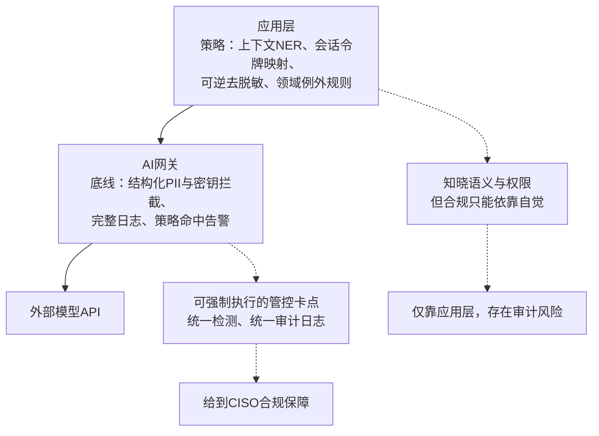

# 个人身份信息（PII）脱敏处理，应该放在AI网关层，还是应用层？请论述两者的取舍权衡。

这是一道架构题，有站得住脚的标准答案；面试官已经听腻了“看情况”这种回答。
下面这套方案，既能满足平台团队对一致性的诉求，也能回应应用团队对业务上下文的诉求。

---
## 15 题：个人身份信息（PII）脱敏处理，应该放在AI网关层，还是应用层？论述取舍权衡

**一句话总结（TL;DR）：分层拆分实现。网关设置底线防护（高置信度的结构化PII与密钥在全组织范围拦截、留日志、可审计）；应用层执行业务策略（基于上下文命名实体识别的脱敏、统一token映射、可逆去脱敏、文档化的领域特例放行）。如果只能二选一，决定因素是谁需要向审计方保证策略合规：受强监管、多团队协作的场景优先网关；单一垂直领域产品优先应用层。**

---
### 答题思路
要有明确立场。稳妥的方案是分层拆分：网关做基线强制防护，应用层做感知上下文的脱敏。但你必须说明**为什么每一层承担对应的工作**，讲清楚完全只靠其中一层会有什么失效场景，并且给出决策判断依据：组织里由谁负责向审计方承诺策略合规。只说“看情况”却没有判断依据，就是本题的失分答案。

### 高分回答
#### 支持放在网关的理由：网关是唯一能保证全覆盖的位置
二十个团队各自开发LLM功能；网关是流量唯一收束点。信息安全负责人（CISO）可以对外承诺：**社保号（SSN）绝对不会抵达外部模型API，全组织统一强制生效、全程留日志**，把隐私策略做成基础设施，而不是只写在文档备忘录里。统一检测意味着只需要维护一套检测器，而不是二十套各不相同的版本；只有一份审计日志；监管法规更新时，只需要在一处更新策略。

这也是平台厂商（Kong类网关、LiteLM代理、Azure API管理策略）纷纷内置PII清洗功能的原因：企业采购的就是这个流量卡点管控能力。

网关的短板：**它没有上下文理解能力**。它只能看到传输中的文本，看不懂语义。

它无法知道：多轮对话里 `<PERSON_1>` 必须保持一致，模型才能基于这个“客户”继续推理；

它无法识别某一个字段就是本次业务流程的核心对象（比如病历摘要工具，把患者姓名脱敏之后，摘要直接失去使用价值）；

它无法对授权用户做输出侧的可逆去脱敏，因为权限上下文保存在应用里。

网关一刀切式的强脱敏，会造成隐蔽的灾难性后果，其中的负面激励机制需要明确点出来：网关的规则是强制的，但一旦它无视上下文的脱敏逻辑破坏了业务团队的功能（病历摘要工具里患者姓名全部被替换成`<PERSON_1>`，摘要彻底无法使用），这个团队最理性的选择就是**绕开网关路由流量**。而网关只能管控经过它的流量，那些被它弄坏功能的业务，恰恰会脱离管控。收紧管控反而会**降低覆盖范围**：原本100%可控的流量，变成80%受控流量，外加20%的影子流量，这些流量完全没有脱敏，直接发给外部API。

这个反向效应，正是分层方案的核心论据：网关只设置底线规则——任何正常业务都不需要明文传输原始社保号、密钥这类数据，这样就不会倒逼业务团队绕开网关；而那些依赖上下文、处理不当就会破坏业务的脱敏策略，放在应用层。应用层拥有足够上下文，可以精准、有选择性地脱敏。

#### 支持放在应用层的理由，与之对应：
应用知道数据含义、用户权限、业务流程真正需要哪些字段；可以生成保留格式的令牌映射，为单一会话维护对照表，支持后续去脱敏。

但**只靠应用层脱敏，意味着合规保障依赖“所有团队永远都正确实现”**——这不是保障，只是一种期望。一旦有人快速上线一个临时Demo功能，审计就会出问题。

- NER：命名实体识别
- reversible de-redaction：可逆去脱敏（可以还原脱敏内容）
- choke point：管控卡点/拦截点
- CISO：首席信息安全官

### 分层方案拆解
- **应用层：业务策略**：上下文命名实体识别NER、会话令牌映射、可逆去脱敏、领域特例放行
  ✅ 优势：理解语义+权限；⚠️ 风险：如果只有这一层，审计存在风险
- **AI网关：底线防护**：结构化PII、密钥拦截，全流量日志，策略命中告警
  ✅ 优势：强制收束流量，统一检测器、统一审计日志；✅ 价值：支撑CISO对外合规承诺
- 流量流向：应用 → AI网关 → 外部模型API

---
所以分层方案的具体分工：

网关守住底线：高置信结构化PII（社保号、银行卡号、基于信息熵识别的密钥）无条件拦截或掩码，全流量日志，触发策略时告警；

应用层实现业务策略：基于上下文NER脱敏、一致的令牌映射、可逆脱敏、经过正式审批、有文档记录的领域豁免（病历应用的豁免必须书面归档，不能临时口头放行）。

如果被迫二选一，判断标准：

受监管行业、多团队组织 → **优先网关**：审计面前，可强制执行比业务优雅性更重要；

单一产品、深度垂直领域、PII处理逻辑复杂 → **优先应用层**，后续组织壮大之后再补网关。

一个可以直接引用的数据：网关侧检测大约增加20–80毫秒延迟（正则、熵检测开销很低，NER才是主要耗时项）。对于一次2秒的LLM调用，这个延迟几乎感知不到；可以在别人拿延迟来反驳你之前主动抛出这点。

### 面试官后续常追问的问题
1. 业务团队反馈网关脱敏破坏功能，想要豁免怎么办？

> 豁免本身也要作为策略条目：书面存档、限定字段与路由、经过安全审批、设置过期时间。相比豁免，更糟的情况是团队私下绕过网关。

2. 多轮对话的一致性，能不能在网关里实现？
> 很难干净地实现：需要基于会话ID保存对话范围的令牌映射，这会给无状态的网关引入状态存储。这恰恰是上下文脱敏应该放在应用层的理由；说出这点，代表你真正理解了边界，而不是只会背诵答案。

3. 模型输出里带出PII怎么办？
> 同样两层配合：网关扫描模型返回结果，拦截结构化信息泄露（比如模型输出银行卡号）；应用层处理授权场景下的去脱敏。忽略模型返回侧，是真实落地里最常见的漏洞。

### 常见错误
- 只笼统说“看情况”，没有架构方案、没有判断依据：本题就是要你拿出明确立场；
- 只说全部交给网关，无视绕开管控这个问题：过度拦截会催生影子流量，这是管控最弱的场景；
- 只说全部交给应用层，无法回答审计灵魂拷问：你怎么保证所有团队都一定合规？
- 完全不提去脱敏/可逆脱敏：这个能力，是脱敏方案和需要继续使用原始数据的业务兼容的关键；不提这点，代表只有纸上谈兵的经验。

---
### 补充评论
分层思路本身没问题，但这套框架漏掉了第三个参与方：模型服务商自身的日志留存。就算网关和应用的脱敏都做到完美，如果服务商为了风控监控留存提示词，任何从两层防护里漏过去的未脱敏PII，都会进入服务商30天的存储窗口。脱敏方案的可靠程度，取决于这三处留存环节里最弱的一环。

