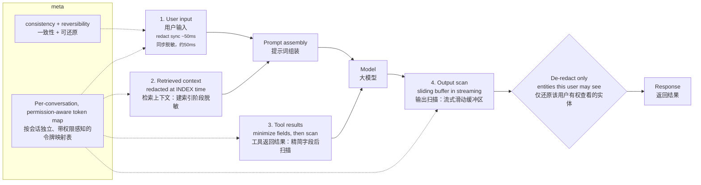

# 为大语言模型流水线设计一套个人身份信息（PII）脱敏系统
个人身份信息会从用户输入、检索上下文、工具返回结果、模型输出这四处流入系统，需要对这四个入口全部做防护。

这套四点式脱敏方案正逐步成为面向受管制数据环境（FDE）隐私方案的标准。大部分求职者只会加固用户输入这个入口，却忽略另外三处风险点。下面是完整设计，包含**去脱敏映射表**——它是保障系统可用的核心。

> 一句话总结：给四个入口配置差异化的管控策略，而不是简单复制同一份过滤器；对用户输入做同步脱敏，对检索到的上下文在建立索引阶段脱敏，在对话中途扫描工具返回结果（先做字段级数据最小化处理），在输出阶段结合权限感知做去脱敏操作。整套方案的核心是**单会话独立、权限绑定的Token映射表**：它保证实体标识在对话里保持一致，同时支持在授权流程中恢复原始内容；如果没有它，你做出来的隐私功能会直接废掉产品本身。

## 设计思路
题干已经给出了四大数据入口的架构，你可以直接沿用；但资深方案的亮点，是抓住两个决定性设计选择：

1. 在**每个入口分别执行检测，使用各自独立策略**，而不是把同一个过滤器复制四份到处使用；

2. 脱敏必须支持**授权场景下可逆恢复**，否则产品完全没法使用，客户会直接弃用这套系统。

你可以选定一个落地场景来阐述（例如面向金融客户的智能客服助手），这样你的策略选择就有明确依据。

## 一份高质量作答方案
### 共用底层组件
搭建一套检测服务：正则表达式+卢恩算法（Luhn）识别结构化PII；利用信息熵识别密钥/密码类敏感信息；自研命名实体识别（NER）模型识别人名、地址；在强监管部署场景里，不能调用外部数据防泄漏（DLP）接口——调用外部接口本身就会泄露我们正要保护的数据。检测输出带置信度的实体类型。

脱敏采用**保留格式的占位符替换**，例如`<人名_1>`、`<社保号_1>`；同时在加密存储中维护一份**单会话映射表**，绑定当前对话，设置超时销毁（TTL），所有访问都会留下日志。
这份映射表是整套方案的关键：它保证同一个实体在多轮对话里标识统一，模型可以正常推理（比如理解“<人名_1>两次致电咨询<账户_1>相关问题”）；同时，它支持在下游环节，给拥有权限的用户还原原始内容。**缺少它，你的隐私功能会毁掉整个产品**。

---
### 四个入口 + 会话Token映射表（流程图说明）
**四道PII流入关口**
1. 关口1：用户输入 → 在组装提示词之前完成脱敏
2. 关口2：检索文本 → **建立索引时就脱敏**（最容易被忽略的关口，收益也最直观）
    > 举例：一段高频文本块，一天会被一万次查询调用。如果等到查询时才扫描，就要扫描一万次；索引阶段扫描，只需要扫描一次。
3. 关口3：工具返回结果 → 先精简返回字段，再扫描脱敏
    > 如果智能代理只需要查询余额和状态，但工具直接返回完整客户档案，风险从源头就已经产生
4. 提示词组装 → 所有内容都已经脱敏完毕
5. 大模型 → 基于占位标识进行推理
6. 关口4：模型输出 → 流式输出时使用滑动缓冲区扫描
7. 选择性去脱敏还原 → **只还原当前用户有权查看的实体**

> 映射表本身加密、绑定会话、超时自动销毁、所有访问留痕。这让“还原原始信息”变成一项权限判定动作，而不只是一个方便功能。

---
### 四道关口，四套独立策略
直接复制一套过滤器给四个入口，是典型失败方案；尤其关口2风险极高：检索内容里包含第三方人员的PII，这些第三方根本没有同意数据被这样处理。

[pii](./pii.png)

1. **关口1：用户输入**

在提示词组装前同步脱敏（耗时约20–80毫秒）。

策略：高置信度的结构化PII、密钥一律脱敏；人名采用上下文判定策略。举个客服场景例子：代理经常需要合法称呼客户姓名，所以人名脱敏策略要遵循和客户约定的数据分级规则，不是一味全部脱敏。

2. **关口2：检索上下文（最容易漏掉的关口）**

文档里会包含**其他人的PII**，这些第三方并未授权本次数据处理。

👉 **在索引阶段脱敏，不要等到查询时再脱敏**。

**第2点：检索上下文，是绝大多数方案都会遗漏的关口**
文档中会包含**其他人的个人身份信息（PII）**，也就是那些并未同意本次数据处理的第三方。
要**在建索引阶段脱敏，而不是查询时才脱敏**，背后的代价差异可以直接量化：一段高频使用的文本片段，如果一天会被10000次查询拉取，若采用查询时脱敏的方案，就要执行10000次命名实体识别（NER）扫描；而在建索引阶段脱敏，只需要扫描一次。
也就是说，相同的检测开销会被重复付出一万次。更严重的是：这个检测操作会落在**对延迟高度敏感的请求链路**上，给每一次查询增加几十毫秒耗时；而如果放到离线索引任务里执行，是没有用户在等待的。

在对文档做向量化（embedding）的时候，一次性完成扫描；向量库中只保存脱敏后的文本片段，原始文档存放在可信源系统中，由独立的访问控制列表（ACL）保护。
建索引阶段脱敏还能从根源上不让PII进入向量存储，这点至关重要：**未脱敏文本生成的向量嵌入本身就可以还原出PII，并且继承原始数据的敏感分级**。

3. **关口3：工具返回结果**

智能代理调用API拿到客户档案后，新的PII会在对话中途流入——而用户输入的过滤器早已执行完毕。

所有工具返回结果，都要经过检测服务，使用同一份会话Token映射表保证标识一致。

并且优先执行**字段级数据最小化**：如果流程只需要余额、状态，工具适配器就不该返回整条完整客户记录。**少拿数据，优于事后脱敏**。

4. **关口4：模型输出（兜底关卡）**

模型可能输出PII：来自训练记忆、从零散上下文拼接还原，或是前面三道过滤器漏掉的内容。

需要扫描模型返回内容；流式输出场景，采用滑动缓冲区，缓存50–100个token再扫描。

之后执行去脱敏：**只把当前用户有权查看的占位符，还原成原始内容**。

输出环节，是脱敏系统和权限体系对接的地方；这也是为什么映射表是绑定单会话、关联权限，而不是一份全局通用词典。

### 跨模块通用管控要求
- 不可篡改审计日志：记录每一次检测、去脱敏事件（实体类型、操作类型、操作用户、请求ID），满足GDPR、HIPAA审计留证要求，也可以适配NIST AI风险管理框架；
- 分实体类型统计指标：使用预埋的“诱饵PII（canary PII）”在测试流量里测算**召回率**；
- 按客户、按数据分类，配置可灵活调整的策略。

---
## 面试官接下来常会追问的问题
- “你的检测召回率是多少，如何验证？”
持续在测试环境注入合成的诱饵PII，统计识别效果，分类型上报指标（社保号召回率99%以上；人名现实合理区间85%–95%）。直接跟信息安全负责人（CISO）宣称100%召回，会立刻失去可信度；坦诚数据、加上多层防护，才是稳妥的方案。
- “四个环节加起来的延迟预算？”
用户输入：约50ms同步耗时；检索上下文：查询阶段无开销（成本前置到索引）；工具调用：单次约30ms；输出流式扫描开销分摊。在多秒级的对话调用里，用户感知总延迟大约100ms。
- “为什么不直接拦截包含PII的请求？”
检测到就直接拦截，会让面向客户的业务流程完全无法使用；「脱敏→模型处理→授权后还原」的模式才能保留业务价值。只有密钥、明文卡号这类不存在合法使用场景的内容，才直接拦截。

## 常见踩坑
1. 只做用户输入过滤，就认为任务完成；题干特意列出四点，就是因为真实系统里，另外三处都会造成泄露；
2. 在查询阶段对检索文本脱敏（成本、延迟灾难）；更糟的做法：直接拿未脱敏文本做向量嵌入，还宣称向量库已经匿名化；
3. 全程采用不可逆脱敏：一旦需要代理给客户发邮件这类场景，方案直接失效；
4. 缺少审计链路：在强监管项目里，**脱敏操作的证明留痕，本身就是硬性要求**；设计日志，不能只设计过滤器。

**在建索引阶段对检索上下文做脱敏，存在版本陷阱：**
当你升级优化检测模型之后，所有用旧版检测器完成索引的文档，都会出现脱敏不充分的问题；而对全部语料重新建索引的成本极高。
解决方案：给每一个文本分片打上**所用检测器的版本标记**。这样你就可以只针对存在漏洞的分片重新扫描，而不用全部重建索引，也不必接受这种过时、不足的脱敏覆盖效果。

### 关键词注释（面试理解）
1. **versioning trap 版本陷阱**：索引阶段脱敏方案的经典缺陷——脱敏逻辑固化在索引产物里，检测器升级后存量索引自动失效
2. **under-redacted 脱敏不足 / 漏脱敏**：新版检测器能识别出旧版漏掉的PII，旧分片里这些敏感信息没有被抹除
3. **corpus 语料库**：全部文档集合
4. **stamp 打标记、加盖版本戳**
5. **target re-scans at the gap**：定向对有缺口（漏脱敏）的分片重扫，增量修复，而不是全量重跑
6. **stale coverage**：过时的识别覆盖度，安全策略跟不上检测器新版本

