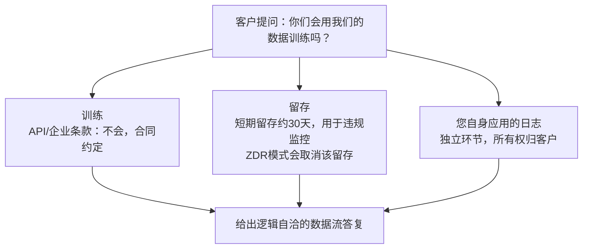

# 客户提问：“你们会用我们的数据训练模型吗？”
给出精准答复，并解释**零数据留存（zero-data-retention，ZDR）**

这是每一笔企业AI交易里最常被问到的问题，回答的精准度直接决定成败：合同层面的答复、ZDR究竟带来哪些变化、以及留存规则里那些区分前线部署工程师（FDE）和演示工程师的细微差别。

## 18 客户问：“你们会用我们的数据训练模型吗？”请给出精准回答，并解释零数据留存。

> 一句话摘要（TL;DR）：答复分为三个精确层面：训练层面（企业版/API服务的合同条款明确禁止，和消费版不同）；数据留存层面（不用于训练≠不存储；默认会短期留存大约30天，用于违规行为监控）；升级方案（零数据留存ZDR，需要单独协商，不会持久保存任何数据）。高分回答的技巧是主动提出ZDR方案，绝不随口猜测数字；一个自信但错误的留存时长数字，就会让整个交易停滞。

## 作答思路
这个问题要从三层来回答：合同承诺、默认数据流、可选升级方案（ZDR），核心考核点是**精准度**。首席信息安全官（CISO）已经听过四十个供应商说“你的数据很安全”；真正能建立信任的，是逐环节的细节说明，同时对于不确定的内容，严谨地说明“我会以书面文件向你确认”。面试官模拟这个场景，正是因为一句不严谨的表述，就可能让真实商业订单停滞数月。

### 一份高质量答复
关于训练问题，要以合同约定的口吻表述，而不是空泛的保证：
> “根据企业版/API服务条款，您的数据不会被用来训练模型，这是协议里的合同承诺，不是一个开关选项，也不是可以随时变更的政策页面内容。”

截至2026年，主流服务商的商业版本都遵循这条默认规则，这个区分至关重要：消费端产品以往默认会使用对话内容训练，除非用户主动选择退出——这正是CISO印象里担心的风险点。主动点明这个区别：**“您可能想到的是消费级产品；API服务的条款不一样，这里是对应的合同条款原文”**，从根源打消对方顾虑。

有三块内容很容易被混为一谈，一定要分开说明：

橙色节点（客户自有日志）是很多候选人会漏掉的点，这点需要重点强调：很多时候回答本身没问题，却栽在这里，丢掉订单。想象这个对话场景：你准确说明“服务商不会拿您的数据训练，并且支持ZDR，不会持久保存任何内容”，CISO放下心来；但三周之后，他们的安全审核人员追问：那这些提示词最后去哪里了？
结果发现：**在客户自己的可观测平台里，客户自己的SaaS系统记录保存了每一条提示词和返回结果，留存13个月，完全独立于你刚才承诺的所有内容**。你关于服务商的回答句句属实，却忽略了己方日志环节，最终因为信任问题导致订单卡住。
核心结论：“你们会用我们的数据训练吗？”其实是伪装成同一个问题的三个独立问题：服务商是否拿数据训练、服务商的数据留存策略、**你们自己这边的日志记录**。最后一项由客户自己管控，也是客户需要承担责任的部分。如果只回答服务商相关的两点，答案看起来专业，但在审计环节会被认定存在疏漏。

接下来讲留存逻辑：**“不用于训练”不等于“不做存储”**，把两者混为一谈是最损害可信度的错误。主流服务商API的默认规则：提示词与模型输出内容，会短期留存，通常最长约30天，用于违规监控和安全事件排查，到期删除。
而**客户自己应用的日志**，属于另一套独立留存体系，服务商的承诺不覆盖这部分内容，专业的安全审核人员会同时核查这两块。你需要清楚掌握两部分各自的留存时长。

**零数据留存（ZDR）就是对应的升级方案**：签署ZDR协议之后，符合条件的API请求流量，在请求处理完成后完全不持久化存储；没有内容留给违规审查、不会收到传票调取数据、不存在对应数据泄露的风险。
代价：ZDR是需要单独协商签署的协议，不是简单勾选开关；部分依赖数据持久存储的功能会被限制，同时违规监控的责任会转移到客户方。前线部署工程师的加分操作是主动提出方案：
> “结合您的数据分级要求，我们可以在本次试点同步启动ZDR协议流程”
这句话会把你的身份，从一个被动解释默认规则的供应商，转变为为客户安全约束做方案设计的工程师。

收尾要配套交付材料：数据流图（哪些数据流出租户、流向哪里、哪些内容在哪里留存、留存多久）、数据处理协议（DPA），以及对应的专属条款，不等对方索要就主动以书面形式提供。
这个场景里毁掉订单的回答是一句模糊的“我们非常重视隐私保护”；让订单卡住的回答，是自信地报出一个错误的留存时长数字——三周之后供应商复核时，这个数字会被翻出来，并且关联到你的名字。

## 面试官后续常追问的问题
- 问：“‘不用于训练’这条，是否包含我们自己做的微调？”
  答：包含，需要清晰说明：客户自己的微调数据归客户所有，不会用来更新基座大模型。同时单独提示：微调后的模型本身已经嵌入了客户数据，需要配套独立的访问控制策略。
- 问：“那我们提交的反馈、点踩差评、粘贴了提示词的支持工单怎么算？”
  答：这个问题比看上去更严格：主动提交的反馈，适用条款常常和普通API流量不一样；粘贴在工单里的提示词是一条真实的数据泄露路径。处理方式：核对具体条款，并且建议客户团队不要把原始数据粘贴进支持工单。
- 问：“如果留存周期是30天，这个窗口期内谁有权访问这些数据？”
  答：仅限服务商管控下、有访问权限控制的违规/安全审核人员。如果客户需要精准答案，要说明：需要向服务商提交书面问询确认，不能自行猜测。

## 常见错误
1. 把训练、留存、日志混在一起，笼统说“我们不会保存您的数据”；三者是三件独立的事，要分开答复。
2. 不了解ZDR，或者把ZDR当成特殊增值功能；对于受监管行业客户来说，ZDR是基础必备选项，客户期待你主动提起。
3. 随口猜测数字。“应该是30天吧”，这种说法，远不如“我明天给你书面的准确时长”。
4. 忽略自身侧的日志风险：只把问题全部推给模型服务商，而自己应用的调试存储桶里，日志没有设置留存策略。安全审查一定会查到这个存储桶。

## 需要主动提前说明的一处细节
有一个必须提前告知的取舍：ZDR通常会直接禁用所有依赖持久存储的功能，例如服务端会话上下文、异步批量接口，还有部分违规防护能力，这部分风控责任会转交给客户。
如果承诺了ZDR，却不告诉客户会损失哪些功能，会在落地实施阶段爆出意外问题；在发起协议流程的同一周，就要同步说明这个取舍。