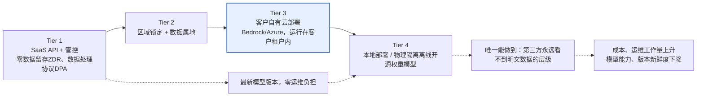

# 原文完整翻译（无遗漏、无省略）
客户说：“我们的数据不能离开我们的环境。”请给我梳理一下部署方案，以及每种方案实际能达成什么效果。

“不能离开我们的环境”这句话，对四个不同的相关方来说，会有四种完全不一样的含义。前沿部署工程师（FDE）的核心能力，就是把这个笼统诉求拆解成真实需求，并且清楚每一条真实需求究竟对应哪一级部署层级。

---
### 19 题目
客户说：“我们的数据不能离开我们的环境。”请给我梳理一下部署方案，以及每种方案实际能达成什么效果。

**一句话摘要：**
把“数据不能离开我们的环境”拆解为四类诉求：数据属地要求、租户隔离要求、网络边界要求、服务商可信要求；再把真实需求匹配到下面四层方案里成本最低的那一档：带管控能力的SaaS接口、区域锁定部署、客户自有云环境部署、本地部署/物理隔离离线部署。要先问清楚这条要求是哪条法规或者合同条款驱动的：GDPR场景下，通常只要二级方案加上数据处理协议（DPA）就能满足；但如果是《国际武器贸易条例》（ITAR）或者涉密业务，则必须用到四级方案。要按数据分级，而不是一刀切决定部署模式，并且要把成本明明白白讲出来。

---
## 思考思路
不要只看字面意思就接受这句话，要做拆解。“数据不能外流”可能代表：
- 数据属地（限定司法管辖区域）
- 租户隔离（不能和其他客户共用基础设施）
- 网络边界（不允许数据从公网流出）
- 服务商可信（任何第三方都永远不能看到明文数据）

每一类诉求对应不同的部署层级，成本、能力损耗差异巨大。前沿部署工程师的工作，就是把真实需求（大多来自监管要求，有时只是管理层的风险偏好）匹配到**成本最低、同时满足要求**的部署层级。

## 高分回答思路
先铺展出完整方案谱系，再和客户协商确定合适的位置。

> 示意图说明：
> 一级：带管控能力的SaaS接口 → 二级：区域锁定+数据属地 → 三级：客户自有云环境（Bedrock/Azure，跑在客户自己租户内） → 四级：本地/物理隔离离线部署、开源权重模型
> 越往右：成本、运维工作量上升；模型能力、版本新鲜度下降
> 三级（蓝色高亮）是银行、医疗行业最常用主力方案：属于“租户归我们、密钥归我们、不走公网”，同时还能用上接近前沿水平的大模型。

这几层方案在成本和能力上差距很大，一定要具象化说明。只有讲清楚客户想要的方案和**实际必需**的方案之间的成本差，这次拆解才有价值。
- 一级方案：单次调用成本仅几美分，模型上线当天就能用，零运维负担
- 四级方案：跑70B参数级别的模型，需要几十万美金的GPU硬件，还要额外组建MLOps团队；模型能力相比最新前沿API落后6–12个月；单位工作量的成本，很容易高出2～3个数量级，同时模型能力明显更弱。

正是因为差距这么大，我们才要拆解需求：

如果“数据不能离开环境”本质只是GDPR的数据属地要求，二级方案搭配一份数据处理协议（DPA）就可以满足，成本接近一级方案；如果不动脑直接上四级方案，会白白耗费一年时间、巨额预算，过度满足一个本来靠区域标识和协议就能满足的要求。

反过来，如果需求源头是ITAR或者涉密业务，那就只有四级方案合法，一级方案再省钱也不能考虑。

把每一层方案的成本摆在台面上，就把“我们想要哪种方案”这种主观偏好，转化成客户可以理性决策的工程问题。

### 一级：带管控能力的SaaS接口
企业级协议（禁止服务商拿客户数据做训练）、传输全程TLS加密、静态数据加密、可选开启零数据留存。可以拿到最新模型，完全不需要客户承担基础设施负担。只要把数据流图讲清楚，大多只是心里有顾虑的客户，这个方案就能让他们放心。

### 二级：区域锁定处理
推理运算和数据存储锁定在指定司法辖区（欧盟节点、区域内云部署），实现数据属地管控。

验证这个方案是否真的有效的关键问题：其他辖区的支持、运维人员能不能访问数据？一份存放在法兰克福的静态数据，如果加州的工程师可以读取，这就构成了数据跨境传输，严谨的数据处理协议（DPO）会识别出这个风险。一定要拿到服务商的书面答复。

### 三级：客户自有云环境部署
模型服务跑在客户自己的云租户内，例如Azure OpenAI部署在客户自己的订阅、通过Bedrock在客户AWS账号里跑Claude，或者GCP Vertex的同类方案。提示词不会流经服务商基础设施，流量走私有连接（类似PrivateLink专线）。

这是银行、医疗行业的主力方案：满足“不走公网、租户独享、密钥归我方”，同时模型能力接近业界前沿。

代价：模型新版本上线会比服务商原生API滞后；容量规划变成客户自己的责任；运维复杂度明显上升。

### 四级：本地部署 / 物理隔离离线开源权重模型
在客户完全管控的硬件上部署模型（Llama这类开源模型，或是授权的接近前沿能力的模型），无任何外部网络连通。
这是唯一真正做到“任何第三方永远看不到明文数据”的方案。

要坦诚说明它的真实成本：一套70B级别部署，意味着几十万美金的GPU集群（或者预留同等容量资源）、一支原本不存在的MLOps团队；模型能力相比前沿API滞后6–12个月；安全更新、评估、漏洞补丁全都要自己负责；物理隔离离线环境下，安全补丁只能走人工流程更新，不能自动拉取。

然后是谈判里很有用的一招：**对数据分级，而不是一刀切对部署分级**。

可以并行推进两件事：用二级或者三级方案跑非敏感内部文档的试点；同时针对敏感数据开展架构评审。绝大多数“数据绝对不能外流，没得商量”的立场，在把需求拆解清楚、对接上真正负责合规审核的人之后，态度都会松动。

尽早抛出直击核心的问题：“这条要求是哪条法规或者合同条款提出的？”

如果答案是GDPR，二级方案加DPA通常足够；如果是ITAR或者涉密工作，那就只能上四级方案，不必浪费时间试别的路径。

---
## 面试官接下来大概率追问的问题
- 客户要求上四级方案，但他们没有机器学习团队，你接这个单子吗？
如实告知全部成本，提议先上三级方案，同时在合同里保留后续升级到四级的通道；瞒着风险接下订单，等到第四个月，他们没人维护的运维问题，最后会变成你的事故。这个角色扮演题，考察点就是能不能坦诚提示交易风险。
- 层级越往后面走，哪些功能会受损？
模型质量、模型新鲜度、托管安全护栏能力、用量分析、弹性扩缩容能力都会下降。敲定方案前，一定要用三级、四级的模型重新跑一遍客户的评估集；能力差距是可以量化衡量的。
- 在三级方案里，向量嵌入和日志存在哪里？
和原始数据保持同一个安全边界。向量库、应用日志同样要遵守数据属地规则；只锁定推理流量、却把日志传到美国的可观测性SaaS平台，这种设计过不了合规审查。

## 常见踩坑错误
1. 听到一句“数据不能外流”直接报本地部署方案：单纯因为客户主观顾虑就过度设计，浪费6个月时间，最后经常因为成本太高项目黄掉。
2. 另一个极端：直接无视需求，随口说“大家都在用SaaS接口”不去拆解；如果需求来自强制法规，画再多架构图都没用。
3. 忽略附属数据流：日志、向量嵌入、评估流量、客服工单，绝大多数数据属地合规方案，漏洞都出在这些地方。
4. 只报部署层级，不提成本和能力损失。能主动把取舍利弊讲出来的工程师，更容易说服首席信息安全官（CISO）。

---

三级方案有一个绝大多数设计都会漏掉的属地泄露点：控制面。模型推理虽然跑在客户租户里，但遥测数据、自动扩缩信号，有时候编排层本身，会回传到服务商的区域。“推理跑在我们云里”不等于“任何数据都不会离开我们的云”，严谨的审核方一定会问管理面会向外回传什么信息。

我亲眼见过一个方案栽在这里，印象很深：推理确实跑在客户租户内，但模型网关会把每条请求的元数据，发送到美国的分析接口。必须把可观测性数据、控制面外流量一并锁定，不然三级方案在元数据层面，其实和一级方案没有区别。

