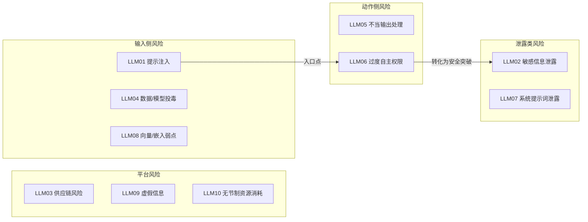

# 给我讲解OWASP大语言模型十大风险，如果面向企业智能代理部署，你会优先关注其中哪两项风险？

单纯背出全部十条，只能证明你记住了内容，但会在判断能力这一项失分。这道题本质是一道风险优先级排序题。下面给出对应智能代理真实被入侵场景的双风险答案，同时说明藏在“给我讲解”这句话里的陷阱。

### 一句话摘要：在三十秒内说出2025版清单并做好归类，然后针对企业智能代理，优先选择LLM01（提示注入）和LLM06（过度自主权限）。因为注入是攻击入口，而过度自主权限会把攻击转化为真正的安全突破。必须明确说明：优先级会随架构发生变化（重度检索增强生成架构要提高LLM08、LLM02的优先级；使用用户数据微调模型则要提高LLM04的优先级）。

### 作答思路
“给我讲解”是一个诱饵，引诱你花十分钟逐条背诵。不要掉进这个圈套。快速、三十秒内、归类说出清单内容，然后把时间放在这道题真正的核心上：面向智能代理优先选哪两项，以及为什么部署形态不同答案会随之改变。面试官考察的是威胁建模判断能力，不是死记硬背卡片。

### 高质量回答
2025版清单，按类别梳理（体现你理解而不是死记硬背）：输入侧风险（LLM01提示注入、LLM04数据与模型投毒、LLM08向量与嵌入弱点），信息泄露风险（LLM02敏感信息泄露、LLM07系统提示词泄露），动作侧风险（LLM05不当输出处理、LLM06过度自主权限），平台风险（LLM03供应链风险、LLM09虚假信息、LLM10无节制资源消耗）。

两个标底色的条目就是我针对智能代理优先提出的两项风险，二者之间的箭头就是整套论证逻辑。

对于企业智能代理——这类可以调用工具、能够访问邮件、工单或者内部应用程序接口的代理，我优先关注LLM01（提示注入）和LLM06（过度自主权限），并且我认为二者本质上是一套组合威胁。提示注入是攻击者的入口；过度自主权限，则会让事件从“模型说了奇怪的话”演变成“模型把我们的客户名单发给攻击者”。一个能够读取外部传入内容、同时持有可写入权限工具的智能代理，就是典型的致命组合。具体来说：每一份检索出来的文档、邮件以及工具返回结果，都是不可信输入；每一次工具调用，都是一次权限决策。

对应的管控措施：给每个用户、每个工具分配限定范围、短期有效的凭证（不要在代理运行时里放置万能令牌）；为每项任务设置工具白名单；对不可逆或者对外暴露的操作设置人工确认关卡；并且把工具返回结果视作另一条注入途径，而不仅仅只把用户输入当成注入源。

下方测试探针生成的权限审计表值得展示出来，因为“枚举每一个工具以及它最坏情况下的危害”听起来只是流程工作，但是当你为一个真实客服代理填完四行内容之后，含义就完全不一样了：

|工具|权限范围|注入场景下最坏情况|结论|
| ---- | ---- | ---- | ---- |
|search_tickets|读取权限，限定到发起请求的用户|攻击者的诱导内容在摘要中展示|允许|
|update_ticket_status|写入权限，内部操作，可撤销|工单被错误关闭；造成麻烦，但可以恢复|允许，留存日志|
|send_email|以企业身份对外发送邮件|成为数据外泄通道，从本域名大规模发起钓鱼攻击|人工审核关卡|
|issue_refund|涉及资金流转，操作不可逆|被投毒的工单文本触发真实退款|人工审核关卡 + 单日额度上限|

两行直接放行，两行设置审核关卡，这就是核心：这份审计是风险分级处置，不是全盘锁死。每一行的判断标准都是：被篡改的输入最多能让这个工具做出什么事，这件事能不能撤销？一份部署评审如果产出这样一张表，代表LLM06的管控已经落地；而一份只写着“代理遵循最小权限原则”的政策文档，不算落地。

值得一提的备选风险（让优先级选择显得经过审慎思考）：LLM05不当输出处理。如果代理输出会被渲染成网页超文本标记语言，或者直接作为代码执行，模型会再次引入跨站脚本攻击和命令注入漏洞。它没能进入前二，仅仅是因为对应的修复手段属于常规方案（编码、沙箱隔离、校验），大部分团队现有的应用安全经验都可以覆盖这类问题。

接下来是能够拿到高分的进阶论述：优先级会跟着架构变化。没有工具、重度依赖检索增强生成的部署场景：LLM08和LLM02风险上升，被投毒或者会泄露权限的检索内容是高危导火索。基于用户提交的数据做客户侧微调？LLM04风险陡增。面向公众、无需身份验证的聊天机器人？LLM10无节制资源消耗会最先成为成本问题、造成服务资源耗尽。

### 面试官接下来常追问的问题
- “为什么不把敏感信息泄露放在第一位？这是我们首席信息安全官最关心的问题。”
智能代理造成的信息泄露，几乎都要经过提示注入 + 超权限访问这条路径；优先管控LLM01和LLM06，是从根源治理，同时在检索环节做按用户权限控制，就能顺带解决大部分LLM02带来的问题。
- “正式上线之前，你要怎么测试这两个优先风险？”
给每一条不可信输入通道准备脚本化的注入测试用例集，再做权限审计：枚举所有工具、它的权限范围、最坏操作；任何不可逆操作，如果没有人工审核关卡，评审不予通过。
- “十条里面哪一项风险被高估了？”
稳妥回答：系统提示词泄露，前提是你已经遵守规则——提示词里面不存放任何秘密信息。这个回答说明你把这份清单当成思考工具，而不是必须死守的教条。

### 常见错误
- 完整逐条背诵。五分钟过去，只能证明你会背，完全看不出判断能力，面试官已经不想继续听了。
- 选出两项风险，但是不和题目给出的部署场景绑定（题目特意写了“企业智能代理”，是有原因的）。
- 把这份清单当成合规检查清单，想着“我们要缓解全部十条风险”，而不是把它当成优先级判断框架。没有团队可以对十条风险做到同等力度防护；谎称可以做到，说明你从来没有负责过上线项目。
- 不清楚2025版清单的改动点：向量/嵌入弱点、系统提示词泄露、无节制资源消耗是新增重点内容，能够说出这些改动，代表你的知识是最新的，而不是看的2023年的旧文章。

### 编者按
“给我梳理一遍”这类提问，是在引导你花五分钟逐条背诵，只能体现记忆力，看不出你的判断能力。你可以先用30秒报出清单条目，再把时间重点放在你会优先处理的两项风险上，说明它们如何随架构发生变化。
如果把这份清单当成合规检查清单（比如“我们要缓解全部10项风险”），而不是建立优先级框架，会让人觉得你从来没有实际上线落地过系统——现实里没有人能对10项风险做到同等程度的防护。
提到2025年新增的风险项（向量/嵌入漏洞、系统提示词泄露、无节制资源消耗），能证明你掌握的是最新知识，而不是还停留在2023年的博客内容。

### 讨论 

> 分享你的应对思路、面试官后续追问你的问题，或是真实面试场景里的实际情况……

有一点是优先级方案容易忽略的：**LLM10（无节制资源消耗）** 对智能体（Agent）场景尤其值得调高优先级，而不只是针对公开对话机器人。
一旦恶意指令注入到工具调用循环里，智能体会以机器速度疯狂消耗token、调用外部API，这既是**钱包拒绝服务攻击（denial-of-wallet）**，还会放大LLM06漏洞带来的所有危害。

同意，循环调用这个场景风险很棘手：递归调用工具的智能体如果没有步骤上限，在人工审核拦截之前，就已经产生高额开销。
任务最大步骤限制、单任务最高成本限额，应该和自主权限管控放在同一个优先级层级。

