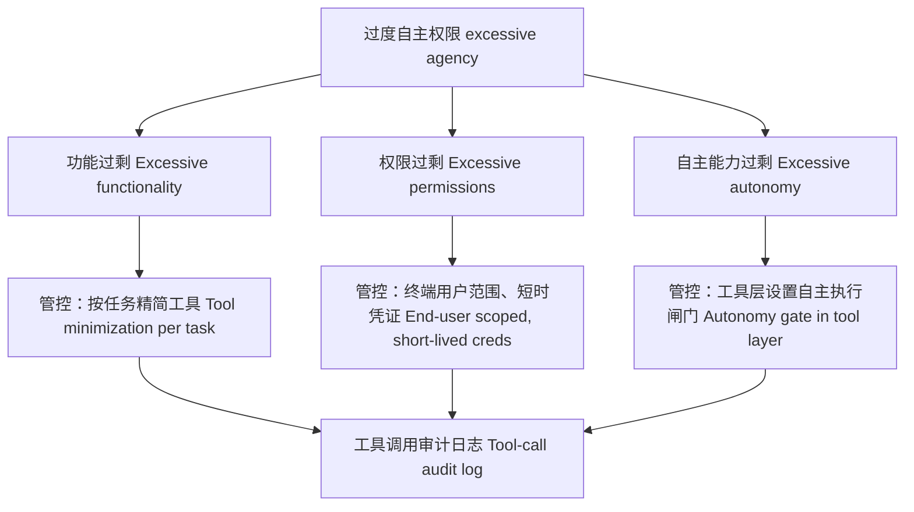

# 原文翻译（严格对应原文内容）
## 标题
在智能代理系统中，**过度自主权限（excessive agency）**指什么？有哪些管控手段可以限制它？

> OWASP LLM06 标志着AI安全不再是新奇问题，而转变为一个**最小权限（least-privilege）**问题，这也正是面试官喜欢考察它的原因。管控清单并不长；能否分清优先使用哪项管控措施，就是这场考核的核心。

---
### 一句话摘要（TL;DR）
过度自主权限，指智能代理能够执行超出其任务范围的操作。它分为三类：功能过剩、权限过剩、自主能力过剩。对应的管控原则是最小权限：按任务精简工具、代理使用终端用户的短时、限定范围凭证（而非至高无上的服务账号）、在工具层强制设置自主执行闸门、控制爆炸半径，同时对所有工具调用完整审计。

### 答题思路
先用一句话定义它，拆分成三种类型（功能过剩、权限过剩、自主能力过剩），然后重点讲管控方案，重点讲凭证模型。面试官是在考察你能否把这个问题映射到最小权限原则——安全团队本就熟悉这套治理思路，而不是把智能代理当成无法捉摸的黑盒。

### 一份优质回答
过度自主权限，是指由大语言模型驱动的系统，可以执行超出任务所需的操作，一旦系统被操控或者单纯自身出错，这些操作就会超出安全边界。OWASP 将它分为三类，这个划分很实用：
- **功能过剩（excessive functionality）**：代理拥有它不需要的工具。例如一个摘要工具，同时还具备发送邮件的能力；
- **权限过剩（excessive permissions）**：工具本身是需要的，但权限范围过宽。例如一个工单读取工具，携带了管理员令牌，还可以删除工单；
- **自主能力过剩（excessive autonomy）**：对会产生重大后果的操作没有人工审核闸门。比如代理直接完成退款，而不是仅生成退款草稿。

### 管控手段（按落地实施顺序）
1. **按任务精简工具**：代理只拿到当前工作流明确枚举需要的工具，而不是通过一个MCP服务端暴露组织全部API接口。每多一个工具，攻击面就扩大一分；抱着“以后可能会用到”的想法，就是摘要工具最后被赋予发邮件权限的源头。
2. **凭证身份与范围限定（和客户沟通时我优先讲这条）**：代理以终端用户的身份、沿用用户权限执行操作，使用短时、窄范围的令牌（代表用户授权的OAuth，而不是服务账号）。这是价值最高的管控手段：最坏情况也只是该用户本身就可以做的操作，风险边界可控、可审计，CISO能够接受。共享的、大范围权限的服务账号，是安全评审一定会否决的设计。
3. **自主执行闸门**：对操作分级：可撤销/内部操作（自动执行：检索、起草、读取）；不可撤销/对外操作（人工确认：发送、支付、删除、上线部署）。闸门必须在**工具层强制生效**，而不是写在提示词里；提示词里一句“发送前务必询问”只是建议，不属于安全管控。
4. **爆炸半径限制**：给每个代理、每个工具设置速率限制（一个代理绝不应该一分钟发送500封邮件）、设置金额上限、代码工具在沙箱内执行；并且**完整审计每一次工具调用**，带上调用参数，保证安全事件可以回溯还原。

> “审计日志”要满足要求，前提是清楚每条日志包含什么字段、要回答什么问题，需要明确写清楚。一条可用于事件回溯的工具调用记录包含：
> 时间戳、代理运行ID（同一个任务下所有调用可以串起来）、代理代为操作的终端用户、工具名称和调用参数（如果参数包含个人敏感信息PII，则保存哈希值+脱敏副本）、本次调用使用的凭证权限范围、闸门判定结果（自动执行 / 人工审批，以及审批人）、触发上下文引用——也就是模型决定调用工具时，正在处理的消息或者文档。
> 最后这个字段最容易被团队忽略，但它是事件响应的关键：当CRM发生批量更新事故时，我们不只需要知道**代理做了什么**（工具调用记录几分钟就能查清），更要知道**是什么导致它这么做**；上下文引用可以帮我们追溯到那封投毒邮件，而不是面对黑盒束手无策。
> 一套代理平台，如果能依靠日志回答这两个问题，就把可怕的安全事故变成常规事件；能理解这一点，比单纯说出任意一项管控手段更重要。

### 三类风险和管控手段可以清晰对应：

### 面试官接下来常追问的问题
- **“人工介入（Human-in-the-loop）会损害产品价值，自动化的意义本来就在这里，该怎么办？”**
  分级管控：低影响阈值之下自动执行（比如50美元以内退款、仅内部操作）；超过阈值必须确认。随着错误率持续稳定，可以放宽阈值。审批疲劳是真实存在的，所以我们只对那5%、承载95%风险的操作设置闸门。
- **“权限校验放在哪里？”**
  在工具/API层，使用用户真实凭证校验。大模型永远不能作为强制校验点，它只可以作为发起请求的一方。
- **“举一个真实的过度自主权限事故场景。”**
  间接注入：一封收到的邮件，诱导拥有CRM写入权限的客服代理批量修改客户记录；或者一个拥有代码仓库权限令牌的代理，提交PR，利用CI流程窃取密钥。这两类案例，根源都是权限范围设计失效，而不是单纯的模型问题。

### 常见错误
1. 只依靠提示词方案：告诉代理“要小心谨慎”。这个风险分类之所以存在，就是因为提示词指令不属于安全管控手段。
2. 为了省事，设计一个至高权限服务账号。这是现实里最常见的方案，也是面试和客户安全评审里最容易直接淘汰的方案。
3. 把人工介入做成非黑即白的开关，而不是分级管控——这会说明你从来没有和产品负责人权衡过用户体验。
4. 漏掉审计日志。面试官会预留追问：“你怎么知道这件事发生了？”只有你一开始就把工具调用审计写进方案里，这个回答才成立。

> 整个风险分类存在的根本原因：提示词指令不等于管控；只靠提示词（告诉代理小心）的方案一攻就破。强制校验点必须放在工具层、使用用户真实凭证，而不是交给模型。你要准备好应对产品层面的矛盾追问：人工审核会破坏自动化价值，高阶回答是按照影响程度分级，而不是把审批做成二元开关。同时备好审计相关的答案，因为“你如何发现事故”是面试官藏好的问题，你需要一开始就把工具调用审计放进方案。

---
### 评论区内容

分级管控的思路是正确的，但是阈值会慢慢失效：上线时设置50美元自动退款上限，一旦攻击者发现可以串联多次低于阈值的操作，这个上限就失去意义。**针对每个操作主体、每个时间窗口的累计上限**，和单次上限同等重要，否则攻击者依靠大量调用绕开闸门，而不是单次大额调用突破。

---
### 术语对照表（便于对照）
- excessive agency：过度自主权限（AI Agent安全领域OWASP LLM06标准术语）
- least-privilege：最小权限
- excessive functionality：功能过剩
- excessive permissions：权限过剩
- excessive autonomy：自主能力过剩
- autonomy gate：自主执行闸门
- blast-radius：爆炸半径（安全术语，事故影响范围）
- short-lived credentials：短时凭证
- service account：服务账号
- human-in-the-loop：人工介入/人在回路
- indirect injection：间接注入
- PII：个人敏感信息
- MCP server：MCP服务端（Model Context Protocol）
- materiality tiering：按影响程度分级
