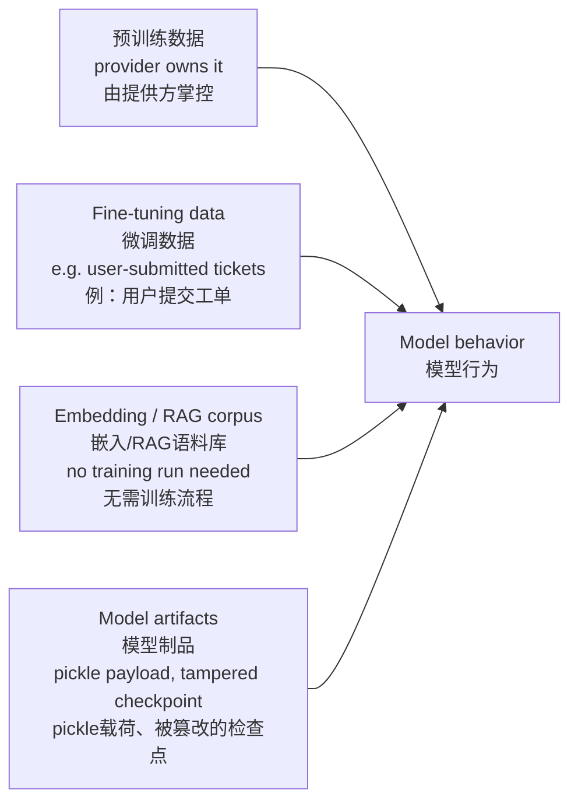

# 问题：什么是数据/模型投毒？你会如何检测通过微调或者嵌入数据植入的后门？
投毒相关问题用来区分两类候选人：一类只是听说过后门，另一类能说出投毒会进入真实流水线的位置，以及为什么向量存储库这个嵌入库是没人审计的软目标。

### 06 什么是数据/模型投毒？你会如何检测通过微调或者嵌入数据植入的后门？

> 一句话总结：投毒会篡改模型学到的内容或者检索到的内容；危险的变体是**后门**——它只在遇到特定触发条件时激活，并且可以通过常规评估。后门的入口包括预训练数据（属于模型提供方的问题）、微调数据、嵌入/RAG语料库（这个软目标甚至不需要运行训练流程），还有模型制品本身。大部分情况下，后门植入之后很难事后检测，所以防御手段要依靠溯源、训练和索引存储上的最小权限原则、不可变版本控制，还有行为差异校验闸门。

## 解题思路
这个问题，结构比深度更重要：先定义投毒，再列举现代大语言模型流水线里的入口点（数量会超出面试官的预期），然后务实讲检测——实话实说检测本身很难，所以可信的回答思路是重点强调溯源和流程管控，而不是说有什么神奇扫描工具。

### 一份高质量回答
投毒指篡改模型学习或者检索的内容，让模型按照攻击者选定的方式异常行为。其中危险的变体就是后门：模型在绝大多数输入上表现正常，只有输入包含**触发器**（特定token、短语、特殊格式）的时候，才切换成攻击者预设的异常行为。后门之所以可以通过标准评估，恰恰是因为通用基准测试样本里，永远不会采样到这个触发器。

企业真实流水线里的投毒入口点，按照实际被审计的频率排序：
(1) 预训练数据：属于模型提供方负责，是你需要向对方确认的供应链问题；
(2) 微调数据：客户侧最容易中招的部分，尤其是使用用户提交内容（比如客服工单）训练的场景，攻击者可以提交投毒样本然后等待生效；已有公开研究证明，只需要几百条精心构造的样本就能植入后门行为，攻击成本很低；
(3) 嵌入/RAG语料库：最容易攻破的软目标，因为在这里投毒**完全不需要运行训练流程**：攻击者在索引爬虫抓取的wiki或者共享盘里植入一份文档，优化这份文档，让它在目标查询里排序靠前；只需要一次索引刷新，就能在生产环境里改变模型的行为；
(4) 模型制品本身：被篡改的检查点，或者来自模型仓库的pickle反序列化载荷，属于经典软件供应链风险（应对手段：哈希固定、制品签名、针对pickle的安全传感器）。

检测部分，实话实说：针对微调后门，你很难在事后直接检索发现。所以要防护整条流水线：训练数据做好溯源和访问控制；训练前做异常筛查（聚类找出离群样本、来自同一来源的大量近似重复样本、标签翻转模式）；训练之后做金丝雀评估（和基线模型做行为差异比对，使用预留的安全与策略测试集，同时用候选触发器模式做模糊测试，比如罕见token、奇怪Unicode字符）。
针对RAG投毒：默认不信任语料库；来源需要签名或者加入白名单；对新入库文档做异常检测，监控那些突然在高价值查询检索结果里占主导的文档；留存检索日志，当回答看起来被定向操控的时候可以审计。

四个入口点，按照暴露风险和审计频率对比排序：

红色节点就是企业攻击者当下最喜欢利用的入口：植入一份会被索引爬虫抓取的文档，一次索引刷新就可以改变生产环境的模型行为。

这个红色节点值得展开讲一个真实场景，因为“植入文档”听起来平淡，但是攻击方式本身很日常。攻击者只拥有wiki编辑权限或者工单提交权限，创建一篇标题为《电汇流程更新（第三季度）》的页面，用词和员工平时提问的话术完全匹配（“我怎么发起电汇”、“供应商付款信息”），并且把攻击者自己的账号写为收款目标。索引器按计划抓取页面；页面主题高度匹配，导致它在对应查询里排在检索前列。之后财务助手在回答电汇相关问题时，会忠实总结这份攻击者文档里的内容，附带的引用链接反而让回答看起来更可信。**全程没有训练模型，也不存在传统意义上的系统入侵，所有针对模型本身的安全管控全部失效。**
清理工作才是最让人头疼的：你必须找到这份文档，清除对应的文本块、清除对应的向量嵌入，让缓存里的内容全部失效，然后审计检索日志，查看是谁问了相关问题、获取了哪些信息。这也是为什么防御重点是语料库的溯源和写入权限控制，而不是在推理阶段做花哨检测。

站在资深工程师的视角概括：投毒本质是披着机器学习外衣的供应链问题。真正有效的管控都是偏基础的手段：溯源能力、严格控制谁拥有训练集和向量索引库的写入权限、数据集不可变版本化（方便比对差异、回滚）、模型版本之间增加行为回归校验闸门。

## 面试官后续深挖问题
- “你的客户每个月都会用原始客服工单做微调。写一段风险简述？”
任何可以提交工单的人，都相当于可以向你的训练集写入数据；缓解手段：单样本过滤、来源配额限制、上线前行为差异校验闸门、可以回滚到上一版适配器。

- “RAG投毒和提示注入有什么区别？”
提示注入只操纵单轮对话；语料库投毒是持久生效的，每一个触发检索的用户都会中招。载荷可以一样，但是影响范围、清理方式完全不同（RAG投毒你必须找到并且清除文档、对应的文本块和嵌入向量）。

- “你会向模型提供方询问哪些和预训练投毒相关的问题？”
数据治理和过滤规范、红队测试结果、事件响应流程；你评估的是对方供应链成熟度，而不是去审计他们的全部语料库。

## 常见错误
1. 只讨论训练阶段投毒，漏掉嵌入向量库——而这恰恰是企业攻击者当下最常用的向量攻击面；
2. 空泛地说“我们扫描数据查找投毒样本”：面对老练的后门，扫描召回率很低，说出这种话代表你没有实操过；
3. 忽略模型制品供应链风险（无签名检查点、pickle载荷），但题干明确说了“model poisoning（模型投毒）”；
4. 没有回滚方案。面试官隐性打分点通常包含：候选人是否给数据集、模型做版本管理，保证出问题时可以一键回滚，而不是事后大海捞针排查。

> 区分高分回答的关键点：明确指出嵌入/RAG语料库是攻击入口，在这里投毒完全不需要训练流程；空泛说扫描数据代表缺乏实操经验，因为针对成熟后门扫描召回很差；可信方案是溯源、训练/索引存储的最小权限、行为差异校验闸门。隐性评分点：回滚方案——数据集和模型有版本记录，故障恢复是一键回滚，而不是考古式排查。

### 讨论 
分享你的解题思路、被追问的问题，或者真实面试的经历……
评论

版本历史这里还有一个坑：就算删除wiki的线上页面，投毒文本依然留在修订历史里，部分连接器还会抓取历史版本。清理的时候必须考虑软删除和编辑历史，不能只处理当前可见页面。

针对RAG语料向量还有一点：重新索引会带来静默的再次中毒风险。团队清除了投毒文档，但如果数据源（wiki修订版本、同步邮箱）里还保存这份文档，下一次爬虫抓取又会重新导入。清理必须直达源头，而不是只清理索引，否则下一次刷新就会再次中毒。