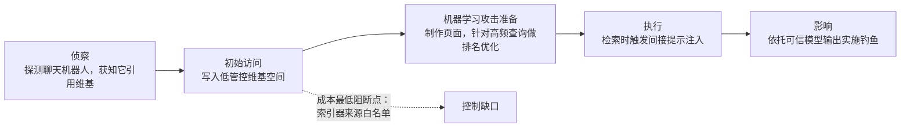

# 解释 MITRE ATLAS。你会如何将一起观测到的针对AI系统的攻击映射到它的战术和技术上？

ATLAS 相关考题用来筛选候选人：区分只能说出框架名字的人，和能够依托框架处置事件的人。这种映射演练——选取一次真实攻击，沿着杀伤链分阶段拆解，才是面试官真正想听的内容。

**07 解释 MITRE ATLAS。你会如何将一起观测到的针对AI系统的攻击映射到它的战术和技术上？**

> 一句话摘要：ATLAS 就是适用于AI系统的ATT&CK：一套记载攻击者针对机器学习实施攻击的战术、技术知识库，素材来自真实安全事件。回答的思路是拿一次观测到的攻击，从头到尾（侦察到影响）分阶段映射，之后说明你会切断链条里的哪一环，以及为什么这是成本最低的方式。

### 作答思路
先用两句话说明ATLAS是什么、存在的意义，紧接着给出一个完整的示例，选定一次攻击，口头走完所有战术阶段。面试官见过很多候选人只会解释ATLAS，之后就卡壳；这份落地映射案例才是拉开差距的关键。结尾要说明这套映射在实际运维里能带来什么价值——不能辅助决策的框架没有实际意义。

### 高分回答
MITRE ATLAS 是 ATT&CK 在AI领域的姊妹框架：一套专门针对机器学习攻击行为的攻击者战术、技术知识库，素材来源于真实安全事件与红队演练案例，而非凭空假想。它沿用安全团队已经熟悉的杀伤链结构（从侦察到最终影响），新增AI专属战术，例如机器学习模型访问、机器学习攻击准备；包含的攻击技术有提示注入、模型规避、训练数据投毒、模型提取、推理阶段滥用等。统一术语的意义在于：你的安全运营中心（SOC）可以沿用处理普通安全事件的思路，来分析AI安全事件。

**映射实操部分（得分重点）**
假设我们观测到如下攻击：客户维基站点里一条被投毒的页面，导致他们的RAG智能助手引导用户跳转到攻击者的链接去“验证凭据”。

映射内容：

侦察阶段：攻击者探测公开聊天机器人，确认该机器人会引用维基内容（检索应用资源 / 目标发现）。

初始访问阶段：在索引器会抓取的低管控维基空间写入内容。机器学习攻击准备阶段：制作页面，使其在高流量查询下优先被检索（制作对抗数据）。

执行阶段：页面进入上下文之后触发间接提示注入（大语言模型提示注入，AML.T0051）。

影响阶段：借助模型输出实施钓鱼；助手本身的可信度就是被利用的资产。

一共五个阶段，五个可以部署安全控制措施、切断攻击链的位置。这就是映射带来的运维收益：它把模糊的“AI出问题了”转化为清晰结论——初始访问发生在维基写入环节，因此给索引器配置来源白名单，就是成本最低的阻断点。

**带阻断标记的攻击链**

五个阶段，五个能够切断攻击链的控制点。落地价值就是明确：维基写入这个初始访问环节，是成本最低的阻断位置。

> “挑选8到10项相关技术，为每一项技术定义检测方式”本身也值得展示，交付成果是一张简易表格，不是一段程序。对于RAG智能代理，前六行如下：

| 技术 | 检测信号 | 日志来源 |
| ---- | ---- | ---- |
| 直接提示注入 | 单用户触发注入模式分类器告警；单个IP告警量突增 | 网关请求日志 |
| 间接提示注入 | 待检索的文本块，在进入上下文前被同一个分类器标记 | 检索流水线日志 |
| 语料库投毒 | 新增文档在高价值查询的检索结果里突然占据主导位置 | 索引差异 + 检索频次 |
| 系统提示提取 | 任意输出内容中出现蜜罐字符串Canary string  | 响应过滤器 |
| 模型提取 / 模型蒸馏 | 来自同一个主体的大批量、有规律的查询行为 | 网关速率指标 |
| 钱包耗尽攻击 | 单个主体的令牌消耗量和基线相比出现异常 | 账单 / 使用遥测数据 |

这张表能够在安全运营中心落地，有两点关键特性：所有检测逻辑，都可以从这套部署环境已经产出的日志中计算得到（不需要新增机器学习模型）；一旦告警带上技术编号，每一行都可以直接复用现有的应急预案。这就是“统一术语”的实际含义：AI系统不再变成安全运营中心难以研判的特殊异类，而只是他们现有矩阵里新增的6行内容。

运维层面，ATLAS 的价值体现在三个方面：事件响应（梳理时间线，找到控制缺口）、红队规划（生成覆盖矩阵，确认我们针对这套部署实际测试过哪些技术），以及面向首席信息安全官的沟通（把缓解措施映射到MITRE框架，把空泛的“请相信我们”转化为他们团队可以审计的差距分析）。当安全评审问“你如何看待AI威胁”，拿出一份基于ATLAS映射的威胁模型，能直接结束一场原本还要持续四周的会议。

### 面试官后续常会追问的问题
- “ATLAS 和 OWASP 大语言模型十大风险，分别什么时候使用？”
OWASP 是面向开发人员、用于应用设计阶段的优先级风险清单；ATLAS 是面向运维人员、用于检测、事件响应、红队覆盖的攻击者行为模型。设计评审阶段用十大风险，安全运营中心里使用ATLAS，二者搭配使用。
- “ATLAS 的短板在哪里？”
前沿场景覆盖不足：智能代理、多步骤工具滥用攻击链属于较新的内容，相关资料相比传统的规避、投毒技术更少。不要让框架限制你的思路，框架是底线，不是上限。
- “你会如何把它落地给客户的安全运营中心使用？”
挑选适配这套部署环境的8~10项技术，为每项技术定义检测或者缓解方案；把AI网关、检索日志接入他们的安全信息与事件管理平台，给告警打上技术编号，让事件研判可以复用已有应急预案。

### 常见失分错误
1. 只解释框架，完全不做攻击映射。题目明确说了“一次观测到的攻击”；面试官会考察你能不能产出一条完整攻击链。
2. 混淆 ATLAS 和 ATT&CK，或者声称 ATLAS 可以替代 ATT&CK。AI攻击经常伴随传统入侵行为，两个框架需要搭配使用。
3. 将“全覆盖”当成目标（我们要映射所有攻击），而不是聚焦决策。高级岗位考察的重点是：说出攻击链里你会在哪一环阻断，以及为什么这个方案成本最低。
4. 完全不了解任意一项具体技术。你不需要背诵编号，但是连提示注入、模型提取、数据投毒这些ATLAS覆盖的技术都说不出来，会让面试官觉得你只是背关键词。

题目特意写了“观测到的攻击”；只解释框架、不给出分阶段攻击链，是最常见的失分方式。面试官考察的不是覆盖范围（我们映射全部内容），而是**决策能力**：指出攻击链中的阻断点，并且说明为什么它的成本最低。提前准备好回答“ATLAS对比OWASP十大风险”，简洁标准答案是：OWASP给设计阶段的开发人员使用，ATLAS给安全运营中心里的运维人员使用，二者配合使用，不能互相替代。

### 讨论 · 1
分享你的作答思路、你被问到的跟进问题，或者真实面试的情况……

有一点需要着重说明：ATLAS 的技术编号会在版本迭代中变动，所以在安全信息与事件管理平台里，检测规则需要绑定一个固定的ATLAS版本。那些硬编码编号、后续不重新映射的团队，会在框架更新之后，出现覆盖矩阵悄悄失效的问题。

