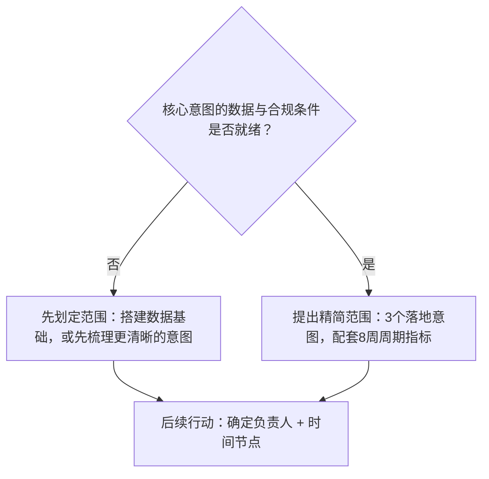

# 角色扮演：我是一家地区性银行的副总裁，我想要一个“聊天机器人”，你来主持需求调研会议。
这是面向FDE客户沟通环节的标准开场场景。绝大多数工程师在前90秒就会踩坑，一上来就大谈架构。下面这套提问序列可以拿到高分，还有藏在“聊天机器人”这个词背后的陷阱。

## 11 角色扮演：我是一家地区性银行的副总裁，我想要一个“聊天机器人”，你来主持需求调研会议。

一句话核心要点：把“聊天机器人”看作表象症状，而不是需求规格。会议前三分之二的时间用来做调研提问（触发动因、用户群体、当前基线、银行业特有约束、数据情况、成功指标），之后复述确认需求，收敛成可衡量的首个落地范围，最后敲定后续行动，明确责任人与截止日期。

---
## 怎么做
这个是客户沟通环节的经典开场，里面藏着一个陷阱：“聊天机器人”本身是一种解决方案，而这位副总裁跳过了背后真正的业务问题。工程师最常见的失败，就是接受客户这个预设，两分钟之内就开始聊RAG检索增强架构。评分标准要求**先调研，再提案**；面试官会计时，看你在提出任何方案前，花了多久提问。角色扮演的前三分之二时间都要用来调研，把“聊天机器人”当成待诊断的表象。

### 高分回答示例
开场，温和地深挖需求背后的原因：
> “好的，在讨论具体搭建方案之前，我想先了解下是什么促使您考虑这件事。是什么情况，让您本季度把聊天机器人纳入了待办议程？”

接着循序渐进推进调研漏斗，大致按这个顺序提问：
- **业务问题与触发动因**：“如果这个项目完美落地，一年之后会有什么不一样？现在这件事给您带来哪些成本压力？比如来电数量、单次处理时长、净推荐值NPS、流失的销售机会？”（客户真实答案经常是“董事会要求我们拿出AI战略”，这会彻底改变项目范围规划。）
- **用户与使用场景**：“使用者是谁？是查询余额的客户，还是需要快速调取答案的坐席？和我说说按咨询量排名，前三的客户咨询诉求是什么。”
- **当前现状基线**：“现在这类咨询是怎么处理的？哪个环节最容易出问题？”
- **约束条件，主动提前问到银行业特有要求**：“这套系统有哪些绝对不能做的事？我猜想面向客户的功能都需要合规审核，存在硬性红线：要区分金融建议和普通信息、KYC客户身份核验、数据属地留存要求。谁来负责最终签字确认？”
- **数据与系统**：“现在相关的答案信息存在哪里？知识库、核心银行API，还是只存在员工脑子里？这些资料更新频率如何，数据干净吗？”
- **成功标准与相关干系人**：“您怎么判断项目成功？有没有可以放进运营复盘里的量化指标？除您之外，还有哪些负责人需要认可这个成果？”

重点在于，每一条客户回答，都会改变项目搭建方案。下面是调研漏斗搭配副总裁可能给出的回复演示：

> 问：是什么让您把聊天机器人提上议程？
> 答：董事会要求我们拿出AI战略
> → 重新界定目标：真正交付物是一个看得见、能改善指标的成果，而不只是做个演示。

> 问：按咨询量，排名前三的客户诉求是什么？
> 答：重置密码、卡片争议、网点营业时间
> → 这三类诉求占咨询量约60%，而且都属于低风险场景：v1版本范围就锁定这三项。

> 问：这套系统有哪些绝对不能做的事？
> 答：绝对不能给出金融建议；KYC相关内容严格受限
> → 明确硬性合规边界：系统只能提供信息，不能做理财建议，同时要预留人工转接入口。

> 问：相关信息存在哪里？
> 答：一半在知识库，一半在员工卡伦的脑子里
> → “存在员工脑子里的知识”，是隐藏在聊天机器人项目之下的数据整理工程。

最后两组问题，决定项目是8周试点，还是长达6个月的数据治理项目；只有主动提问，你才能拿到这些信息。注意：这些问题没有一条在聊技术架构，但放在一起，已经精准定义了项目范围、风险模型、隐藏依赖项，远比争论RAG和微调哪个更好更有效。

之后复述确认，收敛范围：
> “我整理一下刚刚听到的信息：60%咨询量来自密码重置、卡片争议、网点营业时间；核心指标是处理时长；面向客户的任何功能都必须经过合规部门审批。我的建议是，我们不要一上来就做全能机器人。先从这三类最高频咨询意图入手，基于你们已审批的内容做检索兜底，每条回答都能溯源到官方资料，同时做好顺畅的人工转接通道，8周内就可以用客户转人工率和客户满意度CSAT来衡量效果。如果数据验证可行，我们再逐个新增咨询意图。”

收尾，敲定下一步（这是得分点）：
> “要给出具体方案，我需要三样材料：咨询诉求的流量数据、和合规负责人开一次沟通会、抽一小时和两位资深客服坐席交流。这几项我们本周可以安排进日程吗？”

### 沟通全流程（从客户提出需求，到锁定项目范围）

[liaotianjiqiren](./liaotianjiqiren.png)

流程图逻辑：
1. 客户：我想要一个聊天机器人
    备注：这是解决方案，不是业务问题
2. 核心问题：触发动因是什么？
    备注：客户坦诚的答案往往是董事会施压，或是真实业务痛点；这个答案会完全改变首个落地范围的规划
3. 使用者是谁？客户，还是内部坐席？
4. 按咨询量，排名前三的咨询诉求是什么（不能只凭记忆估算）
5. 当前流程哪里存在短板？也就是我们要超越的现有基线
6. 约束条件，主动提前询问
    备注：提前问到合规、数据属地、签字责任人，能体现你有行业落地经验；银行业里，区分建议与普通信息是硬性红线，必须明确谁负责签字确认
7. 信息保存在哪里？知识库，还是只存在员工脑中？
    备注：如果知识只存在员工脑子里，首要项目是搭建数据底座，而不是开发聊天机器人。尽早点明这一点，价值远超一场产品演示。
8. 复述确认需求，然后收敛范围
    备注：锁定3个咨询意图，8周试点。
> 沟通前三分之二时间完成步骤2到7。第8步输出的方案之所以可信，是因为所有范围收缩的依据，都来自客户自己给出的回答。

流程图分支：

副总裁说：我想要聊天机器人
↓
判断：触发动因是什么？
分支① 董事会要求输出AI战略 → 重新界定目标：选取可视化、能体现指标改善的小范围落地场景
分支② 真实运营痛点 → 直接进入下一步
↓
提取排名前三的高频咨询诉求
↓
判断：针对这三类诉求，数据与合规准备就绪了吗？
→ 否：优先做数据底座，或者挑选更简单的咨询场景先行落地
→ 是：提出小范围试点方案：锁定3个咨询意图、资料检索兜底、8周试点，配套量化指标
↓
统一输出下一步行动：明确责任人 + 截止日期

### 面试官接下来会抛出的考验
扮演副总裁的面试官会抛出突发难题：
- “我们CEO看了演示，想要一个GPT全能大模型。”（先认可诉求，再把话题拉回量化指标）
- “6周内能上线吗？”（可以，这个小范围试点能够做到）
- “我们2019年试过机器人，客户非常反感。”（追问当时具体失败点，这对项目范围规划是极关键信息）

面试官也会切换对话层级测试你：“我们工程负责人加入会议，请往更深技术层面聊。”这时你要自然切换话题，聊内容溯源、评估体系、人工转接设计。

### 常见错误
- 前五分钟就开始宣讲技术架构，典型失分错误。
- 审问式提问，缺少温度、缺少复述确认，不会说“再多讲讲”；调研是对话，不是填表单。
- 全盘接受“一个机器人解决所有问题”的宽泛范围，没有收敛成可衡量的首个落地切片。
- 收尾没有明确下一步行动、责任人、截止日期。草草收尾是普通供应商的做法；主动推动闭环，才是前线部署工程师FDE该做到的。

> 补充评论：
> 当触发动因是“董事会要求我们拿出AI战略”时，不要觉得这个答案不如业务痛点。它改变了项目目标：成功标准变成给董事会提供看得见、站得住脚的成果故事。这种情况下，一个体量小、有亮点、真实可落地的试点，比最高投资回报率但看不到成果的项目更合适。识别客户真正约束是叙事汇报需求，而不只是业务指标，这是需求调研和审问式提问的本质区别。
>
> 另一个很多人忽略的点是沟通温度。这套漏斗框架没问题，但要当成对话，中间穿插复述确认和“再多讲讲”，而不是按清单审问。如果副总裁感觉自己在被盘问，就不会主动随口说出关键细节——比如2019年失败的机器人、没人主动提起的合规负责人，这些信息往往是整场会议最有价值的内容。