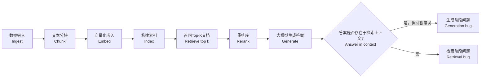

# 带你完整走一遍RAG流水线，讲讲它通常会在哪些环节出错

这道热身题能筛掉只懂教程水平的候选人。面试官不会评判你画的流程图好坏，他们考察的是：你是否清楚真实流水线里三处常见故障点，以及你该如何定位故障。

---

### 简要总结：
梳理完整流程（数据接入→文本分块→向量化嵌入→建立索引→检索→重排序→生成回答），再体现高级工程师的思路：绝大多数故障发生在**文本分块**和检索环节。有一个核心诊断问题：**“答案是否存在于检索返回的上下文当中？”**，靠这个问题就能区分是检索故障，还是生成故障。

### 答题思路
很多候选人会犯急于动手的错误：客户反馈答案出错，立刻就去改写提示词。但正确做法是先拆解故障类型。**正确的文档块根本没被检索出来**，和**文档块已经被检索出来但大模型无视了它**，这两种情况完全不一样，解决其中一类问题的手段，对另一类毫无作用。

不要照搬博客教程。一口气把完整流程梳理清楚：数据接入、文本分块、向量化嵌入、建立索引、检索、组装上下文、生成回答、效果评估。然后点明故障高发点：**绝大多数故障出在文本分块和检索，而非生成环节，我会优先排查这两块。**

先抛出一个澄清问题（“这个系统是面向聊天机器人，还是批处理工作流？延迟预算是多少？”），就能把你和一上来就聊向量数据库的候选人拉开差距。

### 高质量回答
#### 【一次性执行：文档入库阶段】
数据接入：从各类数据源（云盘、知识库、工单系统）读取文档，统一转换为文本格式，同时保存元数据：来源、时间戳、访问控制列表、文档ID。
文本分块：把文档切分为可供检索的单元，一般200‑800个token，分块重叠率10‑20%。理想情况下要尊重文档结构（标题、段落），而不是粗暴按字符长度切割。
向量化嵌入：每一个文本块使用嵌入模型（例如text‑embedding‑3、Cohere嵌入模型）转为向量。
建立索引：向量存入向量索引（pgvector、Pinecone、支持稠密向量的Elasticsearch）；同时构建关键词/BM25索引，用于混合检索。

> 图解说明：RAG流水线，入库阶段只执行一次，查询阶段每次提问都会完整执行
> 上方虚线框【仅执行一次：文档入库】：数据源系统 → 文本标准化 → 文本分块 → 向量化嵌入 → 建立索引
> 下方虚线框【每一次用户查询都会执行】：收到查询请求 → 查询向量化 → 检索top‑k结果 → 重排序 → 组装提示词上下文 → 大模型生成回答

[rag流水线](./ragliushuixain.png)

#### 【每次用户提问都会执行：查询阶段】
1. 用户查询到达，用**同一个嵌入模型**把用户问题转为向量
2. 检索：取出相似度最高的top‑k块，k一般取20‑50。**大部分故障就在这里：正确的文档块确实存在，但没有被检索出来。排查故障时，先看20条失败案例，检查top‑k结果，再去动提示词。**
3. 重排序：使用交叉编码器重排序，过滤精简到3‑8个高质量文本块
4. 组装提示词：把检索得到的块拼入prompt，带上约束指令：**仅基于给出的上下文作答，标注引用来源**。拒绝幻觉的核心手段就是这套约束指令。
5. 生成回答：大模型基于上下文输出带引用来源的回答。
6. 日志留存：一定要记录用户提问、检索到的全部文本块、模型输出的答案。这些日志就是你的评估数据集。

> 故障诊断流程图逻辑：拿到错误回答 → 判断：答案是否存在检索返回的上下文？
> → 如果【是】：属于**生成故障**；
> → 如果【否】：属于**检索/数据接入故障**。

两个阶段要分清：上方入库流程，文档到来时只跑一遍；下方查询流程，每一次用户提问都完整跑一遍。
所以成本、延迟问题集中在查询阶段；而内容质量隐患集中在入库阶段。

诊断逻辑核心就这一个是非题：**“答案是否存在于检索返回的上下文中？”**
答“是”，问题出在生成环节；答“否”，问题出在检索或者数据接入环节。两类故障的修复手段完全不能互通。

#### 按发生频率排序，三大故障类型
1. **检索缺失：正确文档真实存在，但检索拿不到**
常见诱因：词汇语义错位；分块边界切割，把完整答案拆分到不同块。
> 举例：HR手册写的是“年度休假权益”，员工提问“我有多少带薪休假PTO？”。两者字面没有重合，精确关键词检索失效。混合检索（稠密向量+BM25关键词）、同义词/缩写扩展（PTO展开为带薪休假、年假）可以解决。纯向量也会翻车。
> 分块边界故障：某条资格规则标题在一页，三条例外规则在下一页。分块刚好切在分页处。检索拿到的块只写“员工符合资格”，例外规则在另一个没有被召回的块。模型拿着残缺的文档，自信输出错误答案。这不是代码bug，是分块策略的质量问题。

2. **数据接入劣化（入库老化）**
文档已经过期、删除，但旧块还留在索引；文档同步连接器丢数据；PDF表格解析丢失表格内容。旧的失效内容依然被检索返回。需要增量同步、墓碑标记（删除标记）、数据源校验审计。

3. **生成环节出错**
已经拿到正确上下文，但模型无视上下文，混用模型自身的内部知识，输出幻觉、矛盾内容。
修复手段：强化提示词接地约束、强制引用来源、缩减送入模型的上下文，同时优化分块质量。

|故障类别|日志表现|优先尝试修复方案|
| ---- | ---- | ---- |
|检索缺失|正确段落不在top‑k检索结果中|混合检索、优化分块边界、查询改写|
|数据接入劣化|拿到的块本身已经过时、失效|增量同步、删除墓碑标记、数据源校验审计|
|生成错误|正确段落已经给到模型，但输出无视/违背上下文|强接地提示约束、强制引用来源、精简输入块、优化分块|

> ❌ 很多新手踩坑：一出问题就改prompt。如果根本没把正确材料拿给模型，再怎么改提示词都没用。

# RAG常见误区对照表
|人们常说的做法|为什么行不通|更合适的说法/做法|
| ---- | ---- | ---- |
|答案出错时就去**重写提示词**|如果正确的文本片段根本没有进入上下文，再怎么改提示词也救不回来|“先找出20条失败案例，优先对照top‑k检索结果核查原文片段”|
|**每500个token一刀切分割文本**|会把资格判定规则和它的例外条款切分开；模型只能读到一半政策内容就作答|“依据文档结构做分块，设置10%‑20%的重叠”|
|**只用向量搜索就足够了**|零件编号、代号这类专有信息，通用嵌入模型捕捉不到语义|“混合检索：BM25稠密检索，结果合并”|
|**哪个向量数据库最好？**|向量数据库厂商几乎决定不了最终效果；真正起作用的是文本分块与检索策略|“先说明这点，然后重点讨论黄金测试集”|

---

> 收尾要点：做好指标衡量。构建一个小型**黄金测试集**（50‑100道真实问题，每道题都对应已知来源文档），这样你就可以把**检索召回率recall@k**和答案质量分开评估，精准定位需要修复的环节。

### 面试官高频追问
1. 用户反馈答案错误，你优先检查哪一步？
> 优先排查检索。拿20个失败样本，检查正确参考段落有没有出现在top‑k检索结果。在确认这点之前修改提示词，都是做无用功。

2. 为什么要用混合检索，而不是只用向量检索？
> 通用嵌入模型很难学好内部术语、零件编号、专有代号。这些专有词汇向量相似度匹配会失效。BM25关键词检索擅长精确匹配专有名词、代号；向量擅长语义理解。企业生产环境两者同时运行再合并结果，单独靠任意一个都不够可靠。

3. 如何保证索引内容和源文档保持同步新鲜？
> 优先监听源系统变更事件做增量同步；给删除文档增加墓碑标记，确保被删除的文档从索引彻底移除，而不是残留在库中。评估集里保留一批会变更内容的测试问题，自动检测内容老化，不要等到客户投诉才发现问题。

> 面试官所有追问，都是甄别你是只会背教程，还是懂真实线上运维。

### 常见面试扣分误区
花大量时间讲向量嵌入底层数学原理，几乎不提故障模式；把文本分块当成简单预处理，随便按500token粗暴切割；完全不提日志、评估集。在AI实验室面试标准中：**主动提及评估，是非常重要的加分项。** 过度纠结选择哪一款向量数据库产品，向量数据库选型几乎不是核心矛盾。

### 生产环境实操要点
1. 从项目第一天就记录日志：用户提问、全部检索返回块、模型输出，日志直接作为评估数据集。
2. 基于真实业务流量构建黄金测试集，50‑100条，每条问题附带标准答案来源段落。
3. **分开两个指标独立评测：检索召回率recall@k，和最终答案正确性。**
4. 用户报答案错误，先拿失败样本检查：标准答案段落有没有出现在top‑k检索结果，再动提示词。
5. 默认启用混合检索；分块优先基于文档结构；向量库选型放到最后再考虑。

### 核心要点总结
1. 完整复述RAG全流程，立刻点明故障高发区：**文本分块、检索环节**。
2. 掌握核心故障诊断提问：**“答案是否存在检索返回的上下文？”**，这是体现工程实操经验，而不是背诵教程的关键点。
3. 主动提到黄金测试集、recall@k召回指标；向量数据库选型是优先级最低的决策。

---

面试中自然会被追问：答案返回错误，你优先怀疑哪个环节？高级工程师做法：**先区分是检索故障，还是生成故障，不要上来就改东西。**
“文档块完全没被检索到” vs “文档块已经给到模型但是被无视”，两者的修复思路毫无关系。候选人就算能画出漂亮流程图，但说不出看哪一行日志区分故障，只会被判定为只懂教程。

### 评论区
> 绝大多数候选人只会描述理想正常流程。真正加分的是讲清楚哪里会坏：检索召回失败、分块把一份答案切成两半、模型无视已经给到的上下文，并且讲清楚如何测量定位每一类故障。
> 补充一点，线上最常见故障不是“没有答案”，而是模型拿着看似合理但错误的文档块，自信输出错误回答。这类问题比检索为空更难发现。所以仅仅看recall@k召回率还不够，还需要做内容真实性校验。先说明评估方案，再讲架构设计。如果你无法阐述如何对检索效果与回答质量开展离线打分，那其余内容都只是主观臆测；优秀的面试官恰恰会在这一点上追问深挖。

