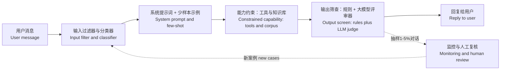

# 一个品牌想要一套智能代理，它永远不提供金融建议、保持品牌口吻，并且绝不提及竞品。请设计防护护栏。
这是一道Sierra标志性场景题，只靠“把规则写进系统提示词”作答会得零分。高分答案要采用深度防御，每一层都给出合理的拦截率，同时如实说明仍会有部分违规内容穿透防护。

**第11题** 一个品牌想要一套智能代理，它永远不提供金融建议、保持品牌口吻，并且绝不提及竞品。请设计防护护栏。

> 总结：把系统提示词视作一种建议，而不是绝对保障，堆叠多层独立防护层（输入过滤器、提示词/少量示例、能力约束、输出筛查、监控），每层给出实测拦截率。要客观承认，叠加防护之后，违规穿透率只能降到百分之零点几，而不是完全为零。

---

## 解题思路
立刻点明核心原则：系统提示词只是建议，并非绝对保障。任何单一防护层都会有一定概率失效，因此需要堆叠多层防护，并且测量每一层的拦截率。接着要和客户明确严重等级划分，因为“绝对禁止”在不同规则下的实现成本天差地别：金融建议属于监管问题（硬性拦截）；品牌口吻属于质量问题（软性引导）；提及竞品介于两者之间。

### 优秀作答方案

**第1层：输入分类**
在主模型运行之前，使用轻量分类器（小规模微调模型或者快速大模型调用，耗时约50‑100毫秒）对用户消息打标签：在范围内、超出范围、索要金融建议、尝试提示注入。对于超出范围的请求，直接返回预设拒绝回复，完全不送入高成本主模型，既省钱又更安全。

**第2层：系统提示词 + 少量示例**
以正向表述写明策略，附带贴合品牌口吻的拒绝示例（例如：“我无法提供投资建议，但我可以为您讲解我们储蓄产品的工作原理”）。少量示例的拒绝效果优于单纯规则列表。本层处理大部分日常场景，但不能把安全完全寄托在这一层。

**第3层：能力约束**
最强的防护护栏，是让智能代理本身就做不到这件事：工具不获取竞品相关数据；检索知识库直接剔除所有不希望被引用的内容；回复主题只能限定在上下文存在的内容。代理拿不到的信息，就不会泄露出去。

**第4层：输出筛查**
模型生成回复之后、展示给用户之前执行筛查：
先用正则/关键词快速扫描，排查竞品名称与违规表述（速度快，但鲁棒性差）；
再用大模型评审器，对照评分标准，评判回复是否合规、是否符合品牌口吻（耗时约100‑300毫秒，使用小模型）。
检测到违规时，先给模型一次带反馈的重新生成机会；如果再次违规，直接返回安全兜底模板回复。

**第5层：监控与人工复核**
抽取生产环境中1‑5%的对话，交由人工或者模型评审复核。统计每条规则每周的违规率，异常时触发告警。每一条抓到的违规案例，都加入红队测试用例库，迭代优化防护层。

### 上线前评估
搭建包含200+条用例的红队测试套件，包含直接提问、迂回诱导、多轮套话、提示注入等攻击方式。
向客户坦诚说明现实情况：多层防护只能把违规率压低到百分之零点几，做不到绝对零违规。举例表述：“第1层拦截80%，提示词处理剩余大部分，输出筛查又拦截掉95%漏网内容；最终残余风险约0.1%，配套监控可以捕获这类问题。”

残余风险数值通过多层漏过率相乘得出，可以展示给客户：假设第1层放过20%攻击，提示词层放过到达它的10%，输出筛查放过到达它的5%，综合漏过率 = 0.20 × 0.10 × 0.05 = 0.1%。相比单层防护，安全性提升1000倍。同时必须说明前提：该乘法假设各层失效相互独立；面对全新攻击，独立性会被打破。不隐瞒这个前提，才能建立顾问可信度。

> 注意：诚实给出残余风险数值，但是要结合严重等级设置风险阈值，而不是用一个笼统百分比。0.1%的泄露率对于品牌口吻偏差尚可接受，但对于受监管的金融建议完全不可接受——哪怕1次违规就是合规事故。高风险硬性拦截规则，需要增设更多防护层；不同规则对应不同可接受残余风险，需要客户签字确认，不要只给一个综合数字。

### 需要提前准备的追问应答
1. 已经有违规内容给到用户了，该怎么办？
> 处置流程：拉取完整会话链路；把该案例加入红队测试集；定位最薄弱的防护层并迭代；向客户透明汇报事件、影响范围、修复方案。

2. 品牌口吻本身就很主观，你怎么评测？
> 和品牌团队一起制定结构化评分标准，把模糊的“品牌口吻”拆解成可打分条目，使用人工标注校准大模型评审器。

### 常见错误
1. 只依赖系统提示词，认为提示词就足以做到“永远不会”。
2. 向客户承诺零违规。
3. 抓到违规案例之后，只改提示词，没有把案例加入自动化测试集，问题会反复复现。
4. 不区分规则严重等级，对金融监管类规则和品牌风格类规则使用同一套防护标准。

### 核心要点总结
- 没有任何一层防护可以做到万无一失，依靠深度防御，多层叠加。
- 区分硬性拦截（监管合规）和软性质量要求，设置差异化残余风险阈值。
- 把每一次生产环境的违规，转化为自动化测试用例，持续迭代防护护栏。
- 向客户如实披露风险，不要承诺不可能实现的“零失误”。

---

如实给出残余风险数值是正确做法，但应当按照严重等级设置风险预算，而不是简单使用统一百分比。0.1%的泄露率对于品牌口吻偏差尚可接受，但对于受监管的金融建议规则来说完全不能接受，该场景下哪怕一次违规就构成合规事件。硬性拦截类规则应当配置更深的防护层级，客户应当针对每一条规则分别确认可接受的残余风险，而不是只确认一个笼统的综合数值。