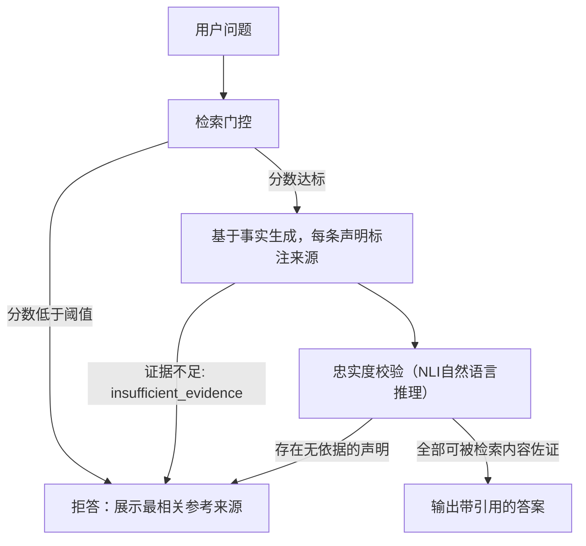

# 构建医疗领域文档问答系统：错误答案比不作答更糟。如何让系统可靠输出“我不知道”？
**经过校准的拒答是一种系统能力，而不是一行提示词。了解四类拒答信号、“覆盖率下的精确率”评估框架，以及为什么仅仅告诉模型“说我不知道”的方案无法通过面试。**

## 13 构建医疗领域文档问答系统：错误答案比不作答更糟。如何让系统可靠输出“我不知道”？
> TL;DR（总结）：经过校准的拒答是系统层面的能力，而不是一行提示词。叠加四层独立信号（检索门控、基于上下文的生成、忠实度校验、可选的自一致性校验）；在包含不可回答问题、错误前提问题的评测集上，衡量**覆盖率下的精确率**；并且为拒答提供可用的兜底方案，保证客户愿意保留该功能。

---

## 解题思路
明确目标：这是一个精确率‑召回率权衡问题，核心要求是**优先保证精确率**。系统仅当有充分依据时才回答，其余情况选择拒答。需要先厘清使用者是谁：是临床医生，还是普通患者？拒答之后的兜底路径是什么？拒答不能直接终止用户流程。

### 高质量答题思路：叠加四层拒答信号，每层拦截一类失败场景

1. **检索质量门控**
如果重排序模型给出的最高分低于阈值，直接不执行生成；回复“我无法在文档中找到该内容”，同时附上相似度最高的文档链接。
在包含大量**不可回答问题**的黄金评测集上校准阈值。这一步在模型开始编造内容之前，就拦截“答案不在知识库”这类场景。

2. **基于事实约束的生成**
提示词约定：**仅能基于给定上下文作答**，每条观点必须标注对应的原文片段。当上下文不足以回答问题时，输出结构化字段`insufficient_evidence`（证据不足）。
温度参数设置为0。多给几组拒答的少样本示例远比单纯文字指令重要：模型会模仿样例行为，而不是死板服从指令。

3. **后置忠实度校验**
使用自然语言推理(NLI)模型或者大模型裁判做第二轮校验：逐条检查生成答案里的每一句话，是否能够被检索到的上下文所佐证。
一旦检测到没有原文支撑的表述，要么删除该部分，要么降级输出：“以下是文档原文摘录”，只输出引用文本。
这是针对高风险场景最重要的防御手段：专门拦截模型做流畅、但超出原文范围的推理。

4. **一致性/不确定性信号（可选，用于最高安全等级场景）**
对同一个问题采样生成3‑5次答案；多次生成结果之间出现分歧，就标记为低置信度（自一致性）。
该方案算力开销提升3‑5倍，只用于风险最高的一类提问。

### 明确衡量权衡指标：覆盖率下的精确率
举例：**回答70%的问题，精确率98%；剩余30%选择拒答。**
把不同工作点交给客户做选择。评测集必须包含三类题目：
1. 可回答问题：评估答案正确性、引用忠实度
2. 知识库无法回答的问题：评估拒答能力，**错误输出答案的比例是核心安全指标**
3. 前提错误的迷惑问题，例如：“请给出药物X用于病症Y的儿科剂量”，但药物X根本不允许用于病症Y。系统此时要指出前提错误，而不是顺着提问生成答案。

| 工作模式 | 可回答问题占比 | 答案精确率 | 使用方 |
| ---- | ---- | ---- | ---- |
| 宽松模式 | 85% | 94% | 医疗领域不适用，每100个回答就有6个错误 |
| 均衡模式 | 70% | 98% | 面向临床医生，医生可以识别剩余2%错误 |
| 严格模式 | 50% | 99.5% | 面向普通患者，下游无人复核输出 |

> 表格是和客户沟通的载体，数字仅作示意。核心逻辑：客户选定工作点，写进需求规格。后续用户抱怨“回答太少”，不是简单下调阈值；而是分析拒答日志，补齐知识库内容，在保持精确率不变的前提下提升可回答覆盖率。

### 用户体验完成闭环：拒答必须有用
拒答不能只输出一句“我不知道”。需要展示相似度最高的参考文档；提供人工介入的入口；把该问题记录成知识库缺口，交给文档团队迭代。
如果拒答之后直接卡死用户流程，客户就会直接关掉拒答功能，系统重新回到高风险状态。

## 面试官接下来常追问的问题
1. **阈值从哪里得到？**
在黄金评测集绘制校准曲线；知识库文档更新之后，每季度重新校准一次。
2. **这样会不会让产品看起来很笨？**
展示覆盖率‑精确率曲线；知识库补全可以在不牺牲精确率前提下提高覆盖率；拒答收集的日志直接转化为产品迭代路线。
3. **遇到文档互相冲突怎么办？**
直接把冲突原文连同版本、时间元数据一并展示，不要私自选择某一方观点。医疗场景中文档版本、发布日期直接决定什么是正确表述。

## 常见错误方案
- 只在提示词写一句“不确定就说我不知道”。模型对自身不确定性校准很差，这在面试中属于扣分项。
- 评测集没有专门的“不可回答问题”子集，因此根本没有真正测量拒答能力。
- 忽略拒答的用户体验设计。
- 完全不处理前提错误类问题；这恰恰是高风险系统代价最高的失效场景。

> 补充说明：自一致性采样这个不确定性信号，在医疗领域存在已知盲区：
> 针对前提错误的问题，模型多次采样会一致输出错误答案。全部3‑5次采样都给出相同错误结果，方差信号会判定“高置信度”，放行错误输出。
> 所以前提错误检测需要一套独立的专项校验，不能只依靠一致性。

## 核心要点
- 拒答依靠多层信号串联（检索门控、事实约束生成、忠实度校验，可选自一致性），**不是单靠一句提示词**。
- 使用**覆盖率下的精确率**指标，让业务方选择系统工作点。
- 评测数据集必须包含不可回答问题、前提错误问题，否则无法真正衡量拒答能力。
- 拒答要设计可用的兜底UX，不然该安全功能会被业务关掉。

