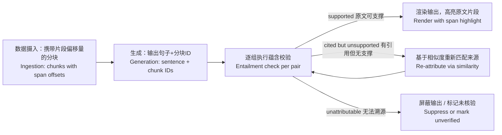

# 模型输出的每一句话都必须关联到原文片段：设计引用系统
引用是企业级RAG的可信交互接口，同时也是最容易被草率伪造的部分。本文涵盖行内引用生成、原文片段校验，以及面试官真正关心的校验率指标。

**第14题 模型输出的每一句话都必须关联到原文片段：设计引用系统。**

> 太长不看版：引用是一项可核验的断言，即“某一句话的内容可由某一段原文片段作为依据支撑”。因此需要搭建两套子系统：一套用于生成输出行内引用标记，另一套为生成后执行的蕴含校验，对每一处引用的原文片段做核验（或重新匹配正确来源）。分开统计引用覆盖率与引用准确率，两项指标目标均需高于95%。

---

## 解题思路
首先明确需求边界：引用不是装饰，而是一条**可核验的断言**——“这句话由这一段原文片段提供支撑”。这意味着需要两套子系统：让模型输出引用标记，以及核验引用是否真的成立。大部分面试者只设计前者，直接丢分。同时和业务方明确粒度：文档级链接实现简单，但可信度很低；片段级引用，才是律师、审计人员真正需要的粒度。

## 优秀参考答案
### 基础底层：分块与片段偏移信息
数据摄入阶段，每个分块都需要保存稳定ID，同时记录该片段在原始文档内的偏移信息：文档ID、页码、字符起止位置。
如果摄入阶段没有做好片段偏移记录，后续根本无法实现片段级引用。这点要放在前面说明：这属于数据摄入阶段的硬性设计约束，而不是生成阶段的小技巧。

### 生成子系统：输出行内引用标记
将检索得到的分块带上编号放入提示词上下文，指示模型**每输出一句事实性语句，就要追加对应的引用标记[1][2]**。
可以使用少样本提示，给出示例，同时规定：找不到来源支撑的内容，要标记无来源，禁止编造引用。
优先使用结构化输出（JSON，句子+对应分块ID数组），相比自由文本，解析可靠性更高。
> ⚠️注意：模型输出引用，只是模型自己声称“这句话来自该片段”，不等于事实。模型会虚构引用、张冠李戴，这是幻觉的常见形式。

### 核验子系统（关键，绝大多数人漏掉）：生成之后做校验
模型生成完成后，对每一组「输出句子 — 被引用原文片段」做**蕴含校验**。
可以使用NLI自然语言推理模型，或者轻量大模型裁判，提问：**该原文片段是否能够支撑这句话的全部内容？**

会得到三类结果：
1. ✅**支撑成立**：保留该引用，前端渲染可跳转的引用标记。点击引用时，打开原始文档，并且高亮对应的原文片段。
2. ⚠️**标注了引用，但原文并不支撑**：进入重新归因流程。
    在已检索回来的分块集合内，用向量相似度召回候选片段，再执行蕴含校验，寻找真正可以支撑这句话的原文片段。找到就替换引用来源。
3. ❌**完全找不到可支撑的原文片段**：要么把这句话直接删除不输出，要么在界面明确标记该句「未核验，无来源支撑」。

> 举一个真实故障案例：
模型输出：“终止协议需要提前90天书面通知对方[3]”。
但是校验读取分块[3]，发现该片段讲的是续约通知，不是终止协议。属于典型幻觉：模型只是因为这一段落在上下文附近，就错误挂上引用。
重新归因检索，在分块[7]找到原文“任意一方发起终止，需提前90天书面告知另一方”。校验通过，系统静默把引用修正为[7]，用户看到正确回答和正确来源链接。
**这些修正行为本身要记录日志：模型原始引用错误率，是非常重要的观测指标。**

> 补充边界场景：一句话由**多个不同分块共同综合推导得到**。
如果重新归因逻辑只去找**单个最优片段**，会出现失效：
句子信息一半来自A片段，一半来自B片段，找不到任意一个单独片段可以完整支撑整句话。此时单片段匹配会勉强匹配一个“部分匹配”的片段，造成引用只覆盖一半事实，形成隐性错误。
解决方案：**多片段联合蕴含校验**：把多个候选片段内容合并，校验合并后的全部文本，是否能够完整支撑整句话。允许一句话带上多个引用标记[2][5]。

### 用户交互UX
点击引用标记，跳转原始文档，并且高亮对应的原文片段。高亮是建立信任的关键，审核人员核验只需要2秒，而不是翻文档花两分钟。
展示文档标题、更新日期、版本号。在法务、合同场景，文档版本是核心信息，旧版本文档不能用来支撑现行条款。

### 评估指标（面试重点，要分开统计两个指标）
1. **引用覆盖率 Citation Coverage**：所有事实性输出句子当中，带有引用标记的占比。
2. **引用准确率 Citation Accuracy**：抽样人工审核，或者用校准后的LLM裁判批量评估：带有引用标记的句子里，引用的原文片段确实完整支撑该句子的占比。
> 指标目标：两项都要≥95%。
> 复合估算：95%覆盖率 ×95%准确率 ≈90%的事实句子做到“有引用，且引用正确”。面对法务客户汇报，需要把这个联合结果讲清楚，不要只单独报一个指标。
> 将这两项指标接入CI持续集成流水线，只要修改提示词、更换模型、调整检索逻辑，都必须跑这套评估，监控指标下跌。

## 面试官高频追问
1. **一句话由两个分块综合得到怎么处理？**
允许多个引用标记，执行多片段联合蕴含校验，校验多个片段合并后的整体内容，而不是强行寻找单个完美片段。

2. **增加校验层会不会让延迟变高？**
可以批量执行NLI蕴含推理；也可以流式输出回答，先返回文本内容，引用标记异步在后台完成校验，前端后续把核验完成的标记动态渲染出来。

3. **主观推理类句子要不要加引用？**
区分事实陈述与主观推理：只有客观事实类语句强制绑定引用；模型自己的分析推理可以不加引用，但是需要明确区分排版，让用户能分清哪部分是文档原文事实，哪部分是模型总结推理。

## 常见踩坑（面试扣分点）
1. 只做“让模型输出引用”，完全没有事后核验层。模型会编造引用，在企业法务场景完全不可信。
2. 只做到文档级链接，没有精细到字符片段偏移，审核人员还是要手动翻找原文。
3. 只统计单一指标，混淆覆盖率和准确率。高覆盖率不代表引用内容是对的，模型可以给每句话都乱标引用，覆盖率100%但是准确率极低。
4. 重新归因只做单片段匹配，不处理多片段综合得到的句子，造成半对的虚假引用。

## 核心要点总结
1. 引用本质是一条**可核验断言**，不是排版装饰，分为生成、校验两大子系统。
2. 摄入阶段就必须保存分块在原始文档的字符偏移，才能做到片段级高亮。
3. 校验不能省略：NLI/LLM裁判做句子‑原文片段的蕴含校验，支持重新归因修正错误引用。
4. 评估要分开统计**覆盖率、准确率**两个指标，都要≥95%。
5. UX关键：点击直接跳转并且高亮原文片段，附带文档版本、时间元数据。
6. 处理合成句子：支持一句话多个来源，做多片段联合蕴含校验，避免单片段匹配带来的隐性错误。

把引用视作一项**可核验的断言**，不能只做生成模块，还必须搭建核验子系统。

**原文片段偏移量必须在数据摄入阶段就采集；否则后续根本无法实现片段级引用。**

对不被原文支撑的引用，先尝试重新匹配正确来源，再考虑屏蔽输出；所有无法核验的内容都要显式标记。

将**引用覆盖率**与**引用准确率**作为两项独立指标输出，两项指标都接入CI流水线持续监控。

> 补充故障模式说明：
重新归因步骤存在一类失效场景。如果一句话的内容真正来自两份不同原文片段的信息综合。此时系统如果只去寻找单个最优原文片段，就会找到一个只能部分匹配的片段，挂上引用。最终产出的引用，只能支撑一半的陈述。
**多片段联合蕴含校验（把全部被引用片段合并，校验合并后的文本整体是否可以支撑该句话）**可以拦截这个错误。如果只做单片段最优匹配的重新归因，会悄无声息把多源合成的输出，变成错误归因的输出。