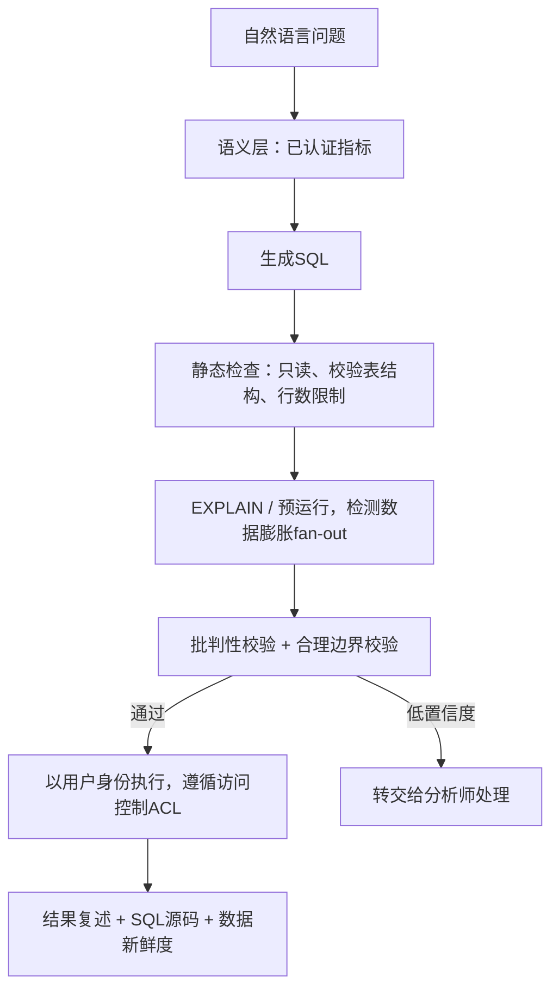

# 为高管设计文本转SQL系统：绝不能让看似合理但错误的查询误导任何人
文本转SQL最可怕的不是语法报错，而是**可以正常执行、返回一个看起来可信的数字，但结果本身是隐性错误**的查询。解决方案是搭建语义层，搭配高透明度的用户界面。下面是完整设计方案。

## 15. 为高管设计文本转SQL系统：绝不能让看似合理但错误的查询误导任何人


> 一句话摘要：真正的风险不是语法错误，而是那些能输出干净数字、最后被放进董事会汇报PPT里的“看似正确实则错误”的查询。应对方案：搭建**语义层**，一次性定义好指标；搭建只读执行沙箱，分层校验（静态检查、EXPLAIN执行计划、批判性校验、合理边界校验）；搭配纯自然语言复述界面，让高管能发现逻辑错误。

---

## 解题思路
开篇先点明真实风险：语法错误会直接暴露出来，但**看似合理实则错误**的查询（例如关联查询产生数据膨胀、重复统计收入；缺少`is_deleted`过滤条件；财年日历逻辑错误）会输出一个干净数字，高管会直接放到董事会PPT里。
设计目标不是“生成质量更好的SQL”，而是**让错误答案变少、更容易被发现、低成本排查**。

## 一套优质回答


### 用语义层缩小问题范围
不要让大模型直接对接800张原始数据表。
数据团队提前整理、维护经过认证的视图/指标层（类似dbt metrics、Looker、Cube的定义方式）：`revenue`收入、`active_customer`活跃客户、财年周期这些指标**由数据团队一次性定义完成**，关联逻辑预先解析完毕。模型只去组合这些受管控的基础模块，而不是重新推导业务逻辑。仅这一步，就能消除绝大多数“看似合理但错误”的故障（数据膨胀、错误过滤条件、指标漂移）。
在提示词中放入schema上下文：表和字段描述、枚举值，每张表附带2~3条经过验证的示例查询对；对相似历史查询做少量样本检索（few-shot），效果很好。

举一个“看似正确但错误”的案例，直观体现语义层的价值：高管提问：**Q3的收入是多少？**
如果直接在原始表上查询，模型写出一段语法完美的SQL：
```sql
SELECT SUM(o.amount) FROM orders o
JOIN shipments s ON s.order_id = o.order_id -- 数据膨胀：多包裹订单会重复计数
WHERE o.order_date BETWEEN '2026-07-01' AND '2026-09-30';
```
这段SQL可以解析、正常运行，返回的数字比真实值高出20%——因为一个订单如果分多个包裹发货，就会被重复统计。输出结果本身看不出任何异常。

但在语义层之上，模型只能写出这样的查询：
```sql
SELECT revenue FROM certified_metrics WHERE fiscal_quarter = 'FY26-Q3'
```
这里的数据膨胀问题，已经由数据团队在视图定义中一次性解决；财年日历（上面原始查询还搞错了财年：该公司Q3不是7-9月）也内置在定义里。
再配上自然语言复述，闭环校验：**“净收入，采用认证口径，26财年Q3（5月-7月），已剔除退款”**，高管4秒就能核对这句话是否符合自己的本意，而SQL代码本身做不到这点。

### 约束执行环境
只读角色、行数上限、查询超时、查询成本上限，并且透传访问控制列表ACL。模型以**当前用户身份**执行查询，行级安全机制保证高管只能看到权限内的数据，防止模型泄露其他区域的数据。

### 展示结果前的多层校验
四层校验：
1. 静态检查：确认SQL语法可解析，仅访问白名单内的表，不存在无主键的笛卡尔积关联；
2. 预运行 / EXPLAIN执行计划：检测查询开销和数据膨胀风险（多表关联后行数爆炸）；
3. 批判性校验：第二个模型复核用户问题、SQL、返回结果，检查是否存在不匹配（例如用户要Q3数据，但查询过滤条件写的是Q2）；
4. 合理边界校验：标记偏离历史区间过大的结果（例如收入是上月的40倍）。

### 透明化用户界面（保护高管的关键）
每一条回答都展示生成的SQL（可折叠）、**对实际计算内容的纯英文复述**（例如：“从认证视图X中统计净收入net_revenue，26财年Q3，剔除退款”）、数据新鲜度时间戳，以及置信等级。
复述文本比SQL代码更重要：高管不会读SQL，但能一眼注意到“剔除退款”——如果他本意是想包含退款，就能立刻发现问题。
对于低置信度、新颖查询场景：不直接给出答案，转为**提交给分析师复核**。

### 评估方案
由数据团队构建包含100+真实业务问题的基准数据集，附带核验过的标准答案。
评估指标采用**执行准确率**（结果是否匹配，不是比对SQL字符串，因为实现同一个目标可以有多条正确SQL）。
按难度拆分评估：单表查询（目标准确率≥95%）、多表用户分群查询（约70%，发布时限定只开放达标场景）。
每一条分析师修正后的查询，都会新增为评估用例，同时作为少量样本示例，形成持续迭代的正向循环。

---

## 面试官后续追问方向
1. **达到什么准确率才可以上线？**
> 按场景分片管控，不要只用一个总准确率数字；单表查询可以直接上线，复杂用户分群分析必须经过分析师审核。
2. **用户询问一个不存在的指标怎么办？**
> 不强行编造指标定义，直接拒绝回答，转交给数据团队处理。
3. **这个系统和BI工具有什么区别？**
> 它是**受管控BI层之上的前端入口**，定位是数据团队认可、而非对抗的工具。

## 常见错误
- 直接让模型对接原始数据表，一味调优提示词；
- 比对SQL字符串相似度，而不是评估**执行结果准确率**；
- 缺少复述界面，直接返回光秃秃的数字；
- 忽略权限控制，上线后第一次真实客户使用就发生数据泄露事故。

## 核心要点
- 语义层是最高收益的设计决策：一次性定义指标，能消除绝大多数“看似合理但错误”的故障；
- 在结果给到用户之前，分层校验（静态检查、EXPLAIN、批判性校验、合理边界校验）；
- 纯自然语言复述比原始SQL更能保护高管；
- 按场景难度分级上线，评估指标用执行准确率，而不是字符串匹配。

---

> 补充段落：自然语言复述这个思路本身没问题，但**复述必须基于最终执行的SQL生成，不能基于用户提问或者模型的意图**。
> 如果复述的内容是模型“想要做什么”，而不是查询**实际做了什么**，就等于新增一层幻觉，和第一层错误互相印证。
> 要解析最终SQL生成复述文本：只有当WHERE子句**确实**剔除退款时，复述文案里才写“剔除退款”。