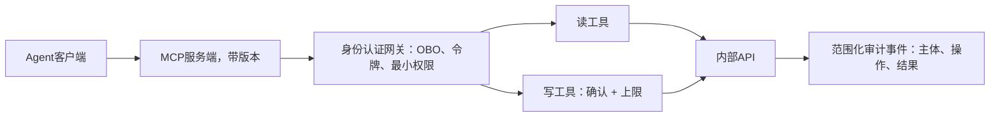

# 客户希望通过MCP将内部API暴露给模型。安全设计：身份认证、最小权限、版本管理。

这是一道Anthropic风格的面试题。隐藏评分要点：工具是经过精选的产品接口，不是OpenAPI规范的代理；同时身份认证模型和“混淆代理”陷阱是大部分候选人会踩坑的地方。

## 16 客户希望通过MCP将内部API暴露给模型。安全设计：身份认证、最小权限、版本管理。

> TL;DR：暴露一套精简的、面向任务的工具集；在服务端和后端强制执行请求主体的权限。验证凭据的目标受众，必要时使用受支持的下游委托；上线前测试访问拒绝、模式变更以及不确定的写入结果。

---

## 如何着手
自动生成的端点目录并不能决定模型应当执行哪些客户任务。在暴露接口之前，评估它的上下文开销、可选方案重叠度以及可访问权限。后端权限可以限制端点，但工具描述仍需要说明允许的使用场景。首先厘清实际工作流：智能体需要完成什么任务、为哪个主体执行、允许产生哪些影响？
暴露能够覆盖该工作的最小任务型工具集。5到15个是用于评估的参考起始范围，不是协议限制，也不是普适最优值。

## 优质回答

假设一个示例上下文开销：每次请求附带全部200个模式定义，每个模式平均300令牌。也就是在用户请求或者检索证据之前，定义部分就要占用60000令牌。如果拆分成12个等大小的模式，只需要3600令牌。在把这些估算计入成本前，需要测量实际主机序列化、缓存和工具发现行为。主机可以只暴露一部分工具，缓存会改变开销，但不一定减少上下文占用。这个计算只是给出了一个可能的输入成本，不是通用工具数量阈值或者测量得到的选择准确率。在代表性请求上测试任务完成度、错误工具选择以及被拒绝的操作。

该图展示了一种委托用户部署方案。其他合规设计可以使用带有显式应用级资源策略的服务主体。核心要求是：经过身份验证、范围受限的操作；MCP本身、OAuth令牌本身都无法保证该特性。

**工具设计**。精选任务级工具：不要用 `GET /orders`、`GET /orders/{id}/items`、`GET /shipments`，而是用 `lookup_order(order_id)`，返回状态、订单项以及发货摘要。一个工具，服务端组合，只返回任务所需内容（不是4KB原始JSON，而是附带可下钻ID的令牌高效摘要）。工具描述就是模型读取的API文档：包含适用场景、不适用场景、参数格式以及错误语义。返回可执行的结构化错误（例如"日期必须为ISO-8601格式"），因为模型会基于这些错误重试。

**身份认证**，区分候选人水平的核心部分。对入站请求做身份认证，验证令牌的目标受众和所需声明，将得到的主体绑定到允许的工具操作和资源。然后确定后端如何认证并强制执行相同的权限范围。委托用户访问场景，可以采用受支持的令牌交换或者on-behalf-of（代表）流程；不是所有部署场景都需要这个流程。无人值守负载则需要自身显式授权的服务范围。委托失败时，绝不替换成管理员凭据。

MCP安全规范禁止在没有恰当受众验证的情况下接收并转发令牌。通过合规设计保留主体身份，而不是把任意Bearer令牌转发给其他服务。测试：操作员A不能通过直接ID、搜索、缓存结果或者内部调用其他API的工具来获取操作员B的数据。共享凭据必须有管控机制，防止服务端变成混淆代理。

**最小权限与爆炸半径管控**。默认为只读；写入操作拆分为独立工具，带有确认步骤语义（先预览，再确认）以及单工具上限（退款最多$X，每个用户/会话速率限制）。按使用场景限定工具范围：支持智能体的MCP服务端不挂载财务工具。记录范围适当收紧的审计事件，包含主体、操作、授权资源引用以及结果；不要把密钥或者不必要的敏感参数写入日志。仅结果哈希无法说明操作是否生效。同时把来自外部内容的工具输出当作不可信输入处理（检索数据可能带回注入攻击，因此做清洗和标记；写入权限必须由代码管控，不能由提示词管控）。

**版本与生命周期**。工具模式是一份契约：新增可选字段可以保持结构兼容，但新增默认值、修改描述或者输出含义仍然会改变行为。重命名和删除操作需要为现有客户端制定迁移方案。对服务端做版本管理，设置重叠过渡期来标记弃用。运行契约评估：在CI中针对工具接口运行一套黄金任务测试集，这样“模式变更是否破坏智能体行为”是测试结果，而不是客户上报的故障。按工具维度监控：调用频次、错误率、重试循环（重复错误调用可能说明描述、模式、上下文或者模型存在问题，需要追踪排查）。

### 面试官接下来会追问的问题
“多少个工具算太多？”（这里没有通用固定阈值。针对实际主机和模型测量选择准确率和任务成功率；如果能提升测量指标，可以按任务划分或者发现工具。）
“通过工具结果产生提示注入？”（将所有检索内容视作数据；最小权限限制损害范围；绝不允许不可信内容触发写入工具，除非人工确认。）
“为什么用MCP，而不是自定义函数调用？”（标准化客户端与服务端，可以跨主机复用：编写一次，就可以接入Claude、IDE或者内部应用。这是它的核心价值。）

分析一个真实故障案例。这个模拟测试场景：操作员仅可读取账户A。`lookup_order`接收账户字段，但后端凭据可以读取A和B。请求账户B的订单返回合法JSON和正确记录。这个工具技术上执行成功，但授权校验失败。需要从经过身份验证的身份推导出允许的账户范围，在返回受保护数据之前拒绝B的请求；同时验证，账户B的授权用户生成的缓存条目不能被账户A复用。

现在修改一个写入工具场景：客户端发送替换请求之后超时。空响应不等于操作未发生。保留操作标识，核对后端结果；仅在文档说明的幂等契约下重试。一次确认点击代表批准某个特定操作，持久化的服务端结果代表操作是否被接受。分开保存这两条记录。

## 常见错误
直接从OpenAPI规范自动生成工具就认为完工。使用万能权限服务账号。没有弃用方案，导致模式静默变更，线上智能体故障。工具层完全不做评估，而工具调用成功率恰恰是智能体平台最有诊断价值的指标。

## 核心要点
- 设计面向任务的工具接口，测量实际上下文开销与选择成本。
- 对主体做身份认证，在工具服务端和后端强制执行其授权范围。
- 默认只读；写入操作需要确认机制与单工具上限管控。
- 对模式和行为做版本管理；在CI中通过契约评估测试兼容性与拒绝访问场景。

混淆代理（confused‑deputy）问题是这一设计的核心，这里有一条值得说明的推论：**只有当下游API真正执行用户权限校验时，OBO（代表）令牌交换机制才能起到防护作用**。

大量内部API在设计时，默认调用方已经完成了授权校验（authz），因此它们会信任任意已认证的服务。在这种情况下，OBO机制起不到任何防护效果，你只是额外增加了步骤，却依然引入了混淆代理漏洞。

务必审计后端是否会重新校验权限，不要想当然认为后端会做这件事。