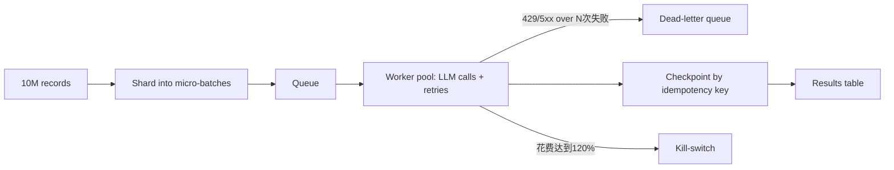

# 运行LLM每晚处理1000万条记录，控制在预算内。设计批处理流水线
这道朴实的设计题，能分辨出谁真正在生产环境跑过LLM。批量API可享受五折优惠、幂等键、毒记录、花费熔断开关：这是面试官会重点考察的完整检查清单。

## 17 运行LLM每晚处理1000万条记录，控制在预算内。设计批处理流水线

> 精简摘要：口头完成token用量测算，选择能够通过评测的最小模型，使用服务商批量API获取折扣。构建队列驱动的流水线，使用幂等键；为毒记录设置死信队列；配置硬性花费熔断开关；第一晚运行完成后，后续只处理增量变更数据。

---

## 如何着手解答
先明确三个决定整体设计的关键数值：截止时间（“每晚”是否代表8小时处理窗口？）、预算（单条记录的成本）、容错能力（99.5%完成率是否满足，还是必须全部记录都处理完成？）。
然后现场做粗略估算，面试官会明确考察token算术能力。举例：1000万条记录，每条输入约1500个token、输出200个token，合计大约150亿输入token；使用小模型批量定价，每晚仅需几千美元；如果使用前沿模型的交互式API定价，成本会高出20‑50倍。**成本测算就是整个设计的核心驱动力**。

测算揭示出的优化杠杆，按影响力排序：

| 优化杠杆 | 对成本的影响 |
|---|---|
| 模型选型 | 选用可以通过评测的最小模型；前沿模型交互式API成本是小模型批量API的20‑50倍 |
| 批量API | 24小时窗口内可获得约50%折扣 |
| Prompt缓存 | 复用共享的指令前缀 |
| 缩短提示词 | 每条减少300个token，每晚可节省约30亿token |
| 输入去重 | 在计费前跳过完全相同的记录 |
| 只处理增量数据 | 第二晚只处理发生变更的行；成本可以下降10‑100倍 |

---

## 一份优秀的参考答案

[流程图](./yiwantiao.png)

### 流程图
**每晚处理一千万条记录，控制预算**
1. 1000万条记录（夜间输入数据源）
2. 小规模对照测试（1000条样本）：大模型 vs 小模型 vs 微调后的小模型
> 备注：在做任何基础设施优化之前，先基于黄金测试集，选出能够通过评测的最小模型。
3. 分片：拆分为100‑1000条的微批次
4. 队列：存放工作任务项，而非原始行
5. 工作线程池：服务商批量API
> 备注：大约半价，24小时完成窗口，无需应对速率限制；遇到429、5xx错误使用带抖动的退避重试。
6. 幂等键：记录ID + 提示词版本 + 模型版本
> 备注：重试与重跑不会重复处理、不会重复计费。
7. 结果表：以该幂等键作为主键写入
8. 对账：对比预期处理数量和实际落库数量
> 备注：一条毒记录多次失败后进入死信队列，避免阻塞剩余千万条记录；花费超出预算触发熔断开关。

> 沿着幂等键这条主线：第6步生成，第7步写入，第8步校验。正是这套机制，让千万级任务在中途重启也能安全运行。

> 先确定模型与API层级，再考虑基础设施。
> 对千万条记录做分类或信息抽取任务，优先选择可以通过评测的最小模型。先拿1000条样本做对照测试（大模型、小模型、微调小模型），对照黄金测试集，再去做其他优化。
> 之后使用服务商的批量API（Anthropic Message Batches、OpenAI Batch）：大约50%折扣，24小时完成窗口，不用处理速率限制。
> 如果夜间时间窗口很紧张，批量API的服务等级协议无法满足，则回退到普通流式API，搭配token桶限流，根据你的速率上限调参。
> 举个例子：200万每分钟token吞吐量（TPM），单密钥处理150亿token需要约125小时（15B ÷ 2M = 7500分钟）。所以夜间窗口内完成任务，需要大量并行密钥、多区域，或者直接使用批量API；面试时要把这部分计算清晰地讲出来。

### 流水线架构：队列驱动
记录被切分为工作任务项（微批次，100‑1000条），工作线程处理任务，结果写入数据表。每个任务项携带**幂等键（记录ID + 提示词版本 + 模型版本）**，结果以该键作为主键写入。这样重跑、重试不会重复处理、不会重复计费。
重试使用**带抖动的指数退避策略**，针对429、5xx错误，设置重试上限；一条记录多次失败后进入**死信队列**，而不是拖垮整个任务。畸形记录绝对不能阻塞剩下千万条记录。
任务结束执行对账流程：对比预期数量与实际落库数量，输出完成报告。

### 成本与花费管控
在这个规模下，提示词工程也是成本杠杆：每条提示词删减300个模板冗余token，每晚可以节省约30亿token。对共享指令前缀开启**提示词缓存**。
硬性花费管控：预算到达80%触发告警，花费达到预算120%触发熔断开关。失控的重试会产生高额账单，这是真实生产环境踩过的坑。

### 大规模下的质量保障
千万条输出结果不能靠肉眼检查：对每一条响应做Schema校验（结构化输出模式）；解析失败自动重试一次；每轮任务抽样约0.1%样本，使用LLM裁判或者人工QA对照黄金测试集。
把每轮任务的质量指标和吞吐量放在一起监控；模型或提示词版本变更带来的质量下降，应当在次日早晨的报告中暴露，而不是等到客户投诉。

### 默认采用增量处理
第二晚应当只处理增量数据（新增/变更记录，通过更新时间水印或者CDC变更数据捕获），而不是全部1000万条全部重跑。
简单测算就能看出这是整个设计里影响最大的部分（基于小模型批量的真实参考费率）：
150亿输入token，单价$0.15/M，合计$2250；20亿输出token，单价$0.60/M，合计$1200；合计约**$3450每晚**。
如果无脑全部重跑，每月成本约$103k。
现实场景每日数据变更率2%，增量处理每晚仅需约**$69**。
全量重跑流水线和增量流水线产出完全一样的结果表，但成本相差50倍。
无论是模型选型、缓存、折扣，都达不到这个量级的成本优化。所以“自上次运行以来哪些数据发生变化”是架构首要问题，而不是后期的优化项。

### 面试官会继续追问的问题
1. “批量API到早上只返回92%结果，该怎么办？”
> 将剩余任务重新入队，走交互式API路径；设计下游消费者可以接受部分数据未更新的状态。
2. “结果存放在哪里？”
> 带版本的结果表，主键为记录ID+提示词版本；下游可以固定使用某个版本或者做迁移。
3. “如何把成本降低10倍？”
> 使用更小/微调后的模型、开启缓存、缩短提示词、输入去重、只处理增量数据。

### 常见错误
1. 不做token用量测算：本题会直接判定不合格。
2. 忽略批量API和幂等键。
3. 一条毒记录阻塞整个任务。
4. 跳过输出校验；早上才发现千万行里4%记录JSON解析失败。

### 核心要点总结
- Token用量计算是设计的核心；现场把计算讲出来，以此确定模型与API层级。
- 在时间窗口允许的前提下，批量API可以削减大约一半成本。
- 幂等键 + 死信队列，保证任务重跑安全，毒记录不会破坏整体任务。
- 设置硬性花费熔断开关；首次运行完成后，只处理增量变更数据。

---

### 补充注解
幂等键的设计（记录ID + 提示词版本 + 模型版本）本身是正确的，但需要注意背后的影响：**只要提示词或者模型版本发生更新，全部历史结果都会失效，触发千万条记录全部重跑，直接抵消增量处理带来的成本节省。**

对于非关键字段，通常可以保留旧结果，只有当记录内容本身发生变化的时候才重新处理；接受数据集内部混杂不同提示词版本生成的结果。是否可以接受这种情况，属于产品决策，而这套设计方案会迫使你直面这个问题。
