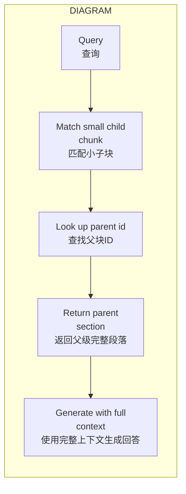

# 文档分块检索：如何对文档做检索分块，如何判断分块效果好坏？

**要点速览**：把分块看作检索召回问题：先搭建可量化的固定大小分块基线，再升级为**感知文档结构分块+父子检索（对子块做向量化嵌入，最终返回父级完整段落）**；所有改动都要基于标注好的黄金测试集，用`recall@k`指标验证效果。

## 解题思路
要把分块理解成**检索召回问题**，而不只是文本切割问题：分块单元既是系统检索的最小单元，也是大模型读取的文本单元。需要先看文档本身类型：200页合同、Slack聊天会话、Wiki百科页面，处理方式各不相同；同时要考虑用户实际提问，分块大小应当大致匹配答案本身的篇幅。

## 高分回答
先搭建基线方案：**固定大小分块**，300‑800 token，设置10‑20%重叠，尽量在句子边界切割。该方案简单粗暴，但可以量化对比；任何优化都要能说明相比基线提升了多少。

之后可以做进阶优化：
1. **感知文档结构分块（Structure‑aware chunking）**：依据标题、章节等文档结构切出语义完整单元。HTML、Markdown文档几乎零成本实现；PDF文档需要布局解析工具（unstructured.io、Docling），同时提取表格，避免表格从中间被截断，造成信息丢失。
2. **语义分块（Semantic chunking）**：连续句子之间嵌入相似度出现明显下降时，在此处切分，适合无固定格式的自由散文文本。
3. **父子检索（小分块→大父段 Parent‑child retrieval）**：通常是工程实践里收益最大的方案：对**100‑300token的小子块做向量嵌入，用于精准匹配检索；但是把对应的父级大段落（1000‑2000token）返回给大模型做生成**。解决“检索要小块保证精准，生成要大块保证上下文完整”两者互相冲突的痛点。
4. **上下文信息增补**：每个分块开头附加文档标题、章节路径、日期（例如：`ACME MSA 2024 > Termination > 11.2`），或者用大模型生成本分块摘要。解决经典问题：单独一块文本写着“费用为2%”，却看不出是哪一份合同的哪一条款。

要能解释分块token数值选择逻辑（面试官高频追问：为什么选500token，不是200也不是1500？），三个约束条件：
- 查询粒度：分块大小尽量匹配用户典型问题答案的长度，绝大多数事实类问题答案是一个段落，而非一整页。
- 嵌入向量稀释：一个向量代表整个分块，如果1500token分块包含4个不同主题，向量对每一个主题的匹配强度都会被削弱。
- Prompt预算：检索返回k个分块，总token不能超过指令+答案的窗口配额。

小分块：检索匹配精度高，但上下文容易缺失；大分块：上下文完整，但检索精度变差。大多数语料的最优平衡点在300‑800token，同时结合文档结构边界。父子检索就是专门用来打破这个取舍矛盾。

> 边界切分错误带来的召回失败实例：
> 合同原文：`11.2 任何一方可提前30日通知终止本协议；但首年度内终止需提前90日并支付违约金。`
> 如果简单固定token切割，刚好在分号处切断，一块只有“提前30天终止”，另一块才放例外条款。用户提问“首年终止需要多久？”检索不到例外条款，模型给出错误答案。感知结构的分块会把整条子句完整保存在同一个块内。

## 如何评判分块效果好不好？
构建**黄金测试集(golden set)**：50‑100条真实业务用户问题，标注好答案来源文档，最好精确到对应的原文片段。
固定其他全部变量不变，只更换分块策略，计算**recall@k、MRR**指标。
线下A/B测试成本很低：重新分块、重新生成向量、跑一遍评测即可。优秀面试者会给出真实指标变化，说明数值来源。
对于异构混合文档，从简单固定分块升级到「感知文档结构+父子检索」，`recall@10`通常可以提升10‑20个百分点。注意这是预期区间，不是保证达成的结果，实际取决于原始文档质量。

### 四种策略对比表
|策略|召回提升|额外开销|适用场景|
| ---- | ---- | ---- | ---- |
|固定大小分块|基线基准|低|可量化对比的起步方案|
|感知文档结构分块|较高|HTML/Markdown几乎无开销；PDF需要布局解析|带标题、章节、表格的结构化文档（合同、wiki）|
|语义分块|较高|中等开销，需要句子嵌入计算|无格式自由散文、叙事文本|
|父子检索|通常实际收益最高|中等开销，存储小块与父块映射关系|希望同时兼顾检索精度+完整上下文生成，绝大多数RAG系统推荐|

## 面试官高频追问&参考答案
- **PDF表格怎么处理？**
单独提取表格，序列化为Markdown格式或者逐行转成文本句子，保留表格标题。
- **Slack聊天会话怎么分块？**
语义单元是完整会话线程，不是单条消息；按会话线程切分，保留发言人标签。
- **重叠(overlap)真的有用吗？**
有有限收益；用来防止事实刚好落在两个分块切割边界上丢失。但是父子检索可以更干净地解决同类边界问题。
- **长上下文嵌入模型是不是就可以用超大分块？**
嵌入模型支持更长输入，但不能消除向量稀释问题；大块向量依然会多主题互相干扰，小块依然对检索精度有价值。

## 常见踩坑
1. 只报一个数字“512token”，讲不出理由，也没有评测方案。
2. 完全无视文档结构，合同条款从中间硬生生切断，这是召回率第一大杀手。
3. 丢掉元数据，检索到的文本片段内容正确，但是无法溯源引用出处。
4. 凭主观感觉调参：如果你说不出“黄金测试集上recall@10从62%提升到78%”，那就是在猜。注重评测的公司面试会直接指出这点。

## 核心要点总结
- 分块单元同时承担两件事：检索单元、模型阅读单元；分块大小要匹配答案本身，而不是选一个好看的整数。
- **父子检索是收益最高的升级方案：小块做检索匹配，父级大块给模型生成答案。**
- 任何分块策略改动，都要有黄金测试集上`recall@k`指标变化，否则就是主观猜测。

> 编者注：
> 甄别背诵网上资料的追问就是：为什么选500token，不用200或1500？如果你不能把这个数值和嵌入模型输入特性、真实用户查询粒度关联，就说明只是照搬博客。大多数人忽略更深层道理：重叠只是“保险手段”，用来防止事实落在切分边界；优先调参的应该是**切分边界位置**，而不是分块token大小。

### 讨论区

直白讲：不存在普适最优分块大小；诚实回答是“在你自己的评测数据集上实测检索质量”。提到重叠、尊重文档结构（标题、表格、代码块），就能说明你实际调过这套系统。

