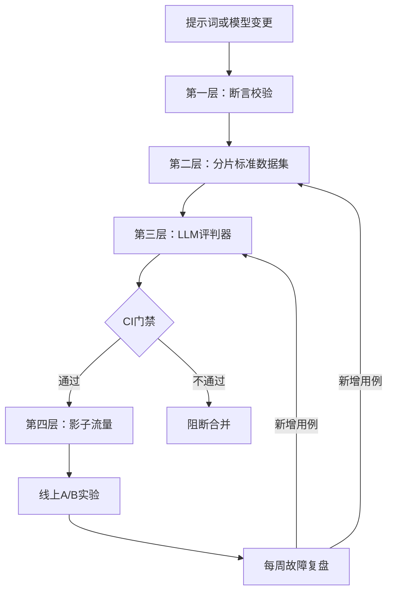

# 为大语言模型产品设计完整评估框架：离线标准集、LLM评判器、线上A/B实验、CI门禁
这是员工级别的「评估先行」方案。四层结构，每层都有对应的任务、成本与盲区，附带评判器校准指标，以及把线上生产故障回流到CI的数据飞轮。

## 19 为大语言模型产品设计完整评估框架：离线标准集、LLM评判器、线上A/B实验、CI门禁

> 一句话总结：按照保真度与成本由低到高搭建四层评估体系：每次代码提交都执行确定性断言；每次提示词变更运行分片离线标准数据集；使用经过校准的LLM评判器评估模糊主观指标；线上影子流量+A/B实验作为唯一真实基准。CI门禁在出现性能退化时阻断代码合并；每周执行数据飞轮，将线上生产故障转化为新的标准用例。

---

## 如何作答
把评估体系呈现为**保真度-成本金字塔**，和软件测试金字塔逻辑一致：低成本的确定性校验持续运行，高成本、基于人工标注的校验少量执行；同时搭建数据飞轮，把线上故障回流到底层评估集。
要先明确评估对象：是单次RAG问答，还是多轮智能体执行链路。二者评估框架不一样：问答评估输出结果；智能体评估执行路径（工具选择、步骤数量、副作用）。

## 高分回答

### 第一层：确定性断言（每次代码提交，秒级执行，几乎无成本）
校验内容：模式合法性、必要引用是否存在、违禁内容正则匹配、工具调用参数合法性、延迟与token预算。可以瞬间捕获20%明显的性能退化问题。

### 第二层：离线标准数据集（每次提示词/模型变更，分钟级执行，有一定成本）
100–500条来自真实流量的样本，标注真实标准答案，并按照用户意图、难度、语言、对抗样例/拒绝回答样例做分片。因为单一综合分数会掩盖分片内的退化问题。
针对智能体场景：带有模拟用户与mock工具的标准任务，评估任务成功率、执行链路效率（步骤数量、错误工具调用率）以及副作用正确性。
统计严谨性很重要，面试时可以直接写出这一段验算（已验证）：
样本量100，真实通过率接近80%，标准误差 = √(0.8 × 0.2 / 100) = 4个百分点，所以每次运行出现±8个百分点波动属于正常采样噪声；仅仅3个百分点的“退化”就阻断合并，很可能只是噪声。
想要把标准误差降到接近2个百分点，大约需要400条样本，评估集规模要扩大4倍。很多团队要等到踩坑、回滚之后，才发现这个问题。
实操方案：根据你需要检测的指标变化幅度来设定标准集大小；对边界结果重复运行；把CI阈值设置在计算得到的噪声区间之外，而不是随便取一个整数。

### 第三层：LLM作为评判器（用来扩展第二层，评估模糊主观指标）
评判模型依据一套书面评分标准+少量标注锚定样例，对**忠实度、有用性、语气风格**打分。
硬性要求：用50–100条人工标注样本做校准，报告一致性（二元评分目标一致性>85%-90%），达标后才可信；当评分标准或评判模型发生变更时，必须重新校准。
缓解评判器的固有偏差：顺序偏差（成对对比时随机调换A/B的顺序）、冗长偏好偏差、自偏好（条件允许的话，选用和被测系统不同系列的模型作为评判器）。

### 第四层：线上评估（唯一的真实基准）
先影子模式：新版本在真实流量上静默运行，评判器对输出做成对对比，在零用户风险的前提下捕获离线数据集无法发现的分布偏移。
之后开启A/B实验，观测产品指标：问题解决率/问题抑制率、点踩率、人工升级率、留存率。
设置防护指标，一旦超标自动终止实验：违规率、错误率。

### 四层评估汇总表
| 评估层 | 成本 | 保真度 | 捕获问题类型 |
| ---- | ---- | ---- | ---- |
| 确定性断言 | 几乎免费，秒级 | 低 | 模式、引用、工具参数、预算；20%明显低级问题 |
| 离线标准数据集 | 少量费用，分钟级 | 中 | 按意图、难度、语言、对抗样本分片的退化 |
| LLM评判器 | 较高 | 中-高，需要校准 | 模糊指标：忠实度、有用性、语气风格 |
| 线上影子流量 + A/B实验 | 最高 | 真实基准 | 分布偏移、产品指标、防护指标退化 |

### CI门禁（工程落地的关键）
提示词、检索配置、模型版本都作为版本化工件。任何变更都会自动运行第一层、第二层以及第三层评估；一旦退化超出阈值，**阻断合并**，例如规则：任意分片指标下降不能超过3个百分点。
这是工程文化层面的核心价值：提示词变更和代码变更执行同等严格的质量管控。

### 数据飞轮
每周对生产故障（点踩、人工升级、流量审计1–5%样本中被评判器标记的样本）做复盘，确认的故障样本会新增为标准用例。项目早期评估集大约每周新增10–20条用例；静态不变的评估集一个季度就会失效，会错误放行性能退化。

## 面试官后续追问方向
- “如何评估多轮对话？”（使用带目标的模拟用户角色；评估目标完成度+评判器打分的对话质量；接受这类评估噪声更高）
- “谁来评判评判器？”（定期人工审计评判结果，监控一致性漂移）
- “接手一个客户项目，从零起步，第一周要搭建什么？”（从客户真实工单提取50条标准用例、第一层断言校验、电子表格：优先保证保真度，再搭建基础设施）

## 常见错误
1. 只用单一汇总准确率，不做分片分析
2. 使用未校准的评判器，当成绝对真值
3. 评估集完全由开发团队编写，之后永久冻结
4. 没有接入CI流程——需要人手动运行的评估，最终一定会没人跑
5. 跳过影子流量，直接从离线评估上线面向用户的A/B实验

## 核心要点
- 评估体系按保真度与成本排序：断言校验、分片标准数据集、经过校准的评判器，最后线上评估。
- 评判器必须在同一份评分标准上达到与人工标注>85%-90%的一致性，才具备可信度。
- CI门禁 + 每周故障回流到标准集的飞轮，保证评估体系不会失效。

关于噪声底限这一点：在100个样本、二元指标的场景下，±5个百分点并不是对称、固定不变的；这是**威尔逊区间（Wilson interval）**：在50%附近区间最宽，在极值附近区间会变窄。

在100个样本上，指标从92%提升到95%，即便看起来是明显的正向收益，也有可能仍然落在噪声范围内。
如果团队硬编码把「±5个百分点」作为门禁阈值，在基准值很高的场景就会被误导；应当针对你当前的分数，计算对应的真实区间。