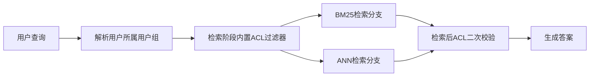

# 设计支持千万级文档、带用户权限控制的RAG：用户绝对不能看到无权访问的数据
这是Glean标志性的系统设计面试题。存在两大陷阱：**后过滤（post-filtering）** 会耗尽Top-K候选池；以及通过生成答案造成的数据泄露。最优架构是**在检索阶段就做权限过滤**，下面讲解如何在大规模数据下实现。

> **20 设计支持千万级文档、带用户权限控制的RAG：用户绝对不能看到无权访问的数据**

>
> **一句话摘要(TL;DR)：**
> 在检索阶段执行鉴权，把访问控制列表（ACL）过滤器同时注入BM25与ANN两条检索分支，保证禁止访问的文本块永远不会进入上下文。权限同步独立于内容同步，采用短TTL缓存权限集合，搭配事件驱动失效机制；同时增加检索后的二次校验，在CI流程中增加权限校验评估。

## 解题思路
首先明确安全不变量，将其作为绝对准则：**鉴权必须在检索阶段执行，在任何文本进入大模型之前完成**。一旦无权访问的文本块进入上下文，大模型就会对其进行转述；此时“答案泄露了涉密内容”和“安全漏洞”之间没有区别。
理清权限体系：有多少个数据源？数据源是否共用一套身份提供商（IdP）？权限撤销需要多快生效？

### 高质量参考答案

#### 文档摄入阶段（Ingestion）
ACL是一等元数据。每一份文档，以及文档拆分后的每一个文本块，都附带访问控制列表（允许访问的用户/用户组），跨多个数据源做标准化处理，映射到身份提供商（Okta或者AD）。
维护两套同步循环：**内容同步**，以及**速度更快的权限同步**。因为ACL变更（尤其是权限撤销）属于安全关键链路，目标延迟是分钟级，而不是夜间全量爬虫同步。

#### 查询链路：检索内过滤，而不是检索后过滤
查询时，先解析用户的用户组隶属关系，得到该用户的权限集合，**然后把ACL过滤器推入两条检索分支（BM25 和 ANN；Vespa、Elasticsearch、Qdrant这类现代引擎都支持带过滤的HNSW）**。

必须明确指出反面模式：**先检索Top50，再做后置过滤**。这个方案有两个致命缺陷：
1. 权限受限用户的Top50候选经过过滤后，可能结果为空，即**召回坍塌（recall collapse）**；
2. 排序阶段的分数本身就可能泄露无权文档的存在。

举个召回坍塌的例子：一名承包商仅能访问2%的语料库。采用后置过滤，Top50检索结果里，预期只有 `50 × 0.02 = 1` 个可读文本块。模型只能基于这一个文本块回答或者拒绝回答。索引里明明存着数百份他无权阅读的文档，系统对外表现却没有故障。
这种问题非常隐蔽：权限范围广的高管能拿到很好的答案，权限受限的普通用户返回结果质量很差，问题反馈只会是“我老板能用，我不能用”，没人会把它定位成鉴权架构Bug。

**在检索内部做过滤**，同一个Top50候选池，只会从该用户可读的文档集合里抽取。每个用户都从属于自己的语料切片中获取50个候选。
**用户组展开（Group expansion）** 是扩容的关键技巧。一个用户一般属于10~1000个用户组。我们给文本块索引打上用户组ID，查询时基于用户的用户组集合做过滤，而不是在每个文本块上维护用户列表。

#### 难点子问题：权限解析的延迟 vs 权限新鲜度
每次查询实时解析嵌套AD用户组，速度太慢；把用户-用户组关系缓存数小时，权限撤销就会失效。
行业通用折中方案：**用户-用户组映射采用短TTL缓存（约5~15分钟），同时在身份提供商支持的场景下，使用事件驱动缓存失效**。和安全团队明确约定权限撤销的SLO（服务等级目标），写进文档。例如“权限撤销在≤15分钟内生效”，这是一份需要接受安全团队测试的契约。

#### 深度防御（Defense in depth）
增加冗余的**检索后校验**：在组装Prompt之前，廉价地再次校验每个文本块的ACL与用户权限，捕获索引陈旧带来的漏洞。
**禁止跨用户共享检索结果或生成答案缓存**，除非缓存key带上完整权限集合。共享语义缓存是典型的泄露途径。
留存审计日志，记录哪些文本块被哪个用户调用，同时用作事件溯源取证工具。
增加红队评估：构建权限黄金测试集，用户A提问，该问题只能由他无权查看的文档来回答，系统应当拒绝回答。像其他评估一样，在CI流水线中运行这套测试。权限回退属于一级严重故障，而不是简单的质量问题。

#### 大规模部署要点
1000万文档大约会拆分为5000万~1亿个文本块。在这个规模下带过滤的ANN检索方案已经很成熟。瓶颈通常不是向量计算，而是**跨40个异构数据源的ACL标准化**，以及保证用户组展开信息的新鲜度。

### 面试官接下来常追问的问题
> 问：聚合类问题，例如“有多少个未成交订单？”，用户只能看到部分子集的数据怎么办？
> 答：**只在用户可见子集内做统计，并且在答案中说明这一点，绝对不能返回全局总数。**

> 问：文档存在性会不会通过类似“我找到了一些你看不到的内容”这种话术泄露？
> 答：会。所以系统要表现得如同这些文档根本不存在。

> 问：大模型服务商能看到全部上下文怎么办？
> 答：划分独立信任边界：服务商处理单次请求上下文时，受DPA/ZDR协议约束。**用户鉴权是我们的责任，不是大模型服务商的责任。**

### 常见错误
1. 后置过滤（Post-filtering）
2. 在Prompt层面做约束（“指示模型不要泄露信息”）——这个方案直接判定不合格
3. 忽略缓存作为泄露路径
4. 没有权限撤销SLO
5. 完全不设计权限评估，直到客户渗透测试才发现安全缺陷

### 核心要点
- 在检索内部基于ACL过滤；**永远不要后置过滤，永远不要依赖Prompt约束模型保密**
- 独立于内容同步，运行高时效的权限同步，并且文档化权限撤销SLO
- 将权限逻辑回退视作一级故障，在CI流水线中使用金丝雀评估（canary evals）做门禁

---

> 用户组展开是有效的扩容手段，但**拒绝规则（deny rules）**才是棘手的难点。很多企业ACL模型存在显式拒绝规则，拒绝规则优先级高于用户组授予权限（例如：你属于这个用户组，但被明确排除访问该文件夹）。
> 只依靠“按用户的用户组集合过滤”的索引无法表达这种逻辑，除非把单文档拒绝规则实体化。
> 如果源系统使用拒绝规则，你必须在文档摄入阶段，就把拒绝规则解析，生成**实际允许访问集合**，否则过滤器会静默地返回超出权限的内容。

