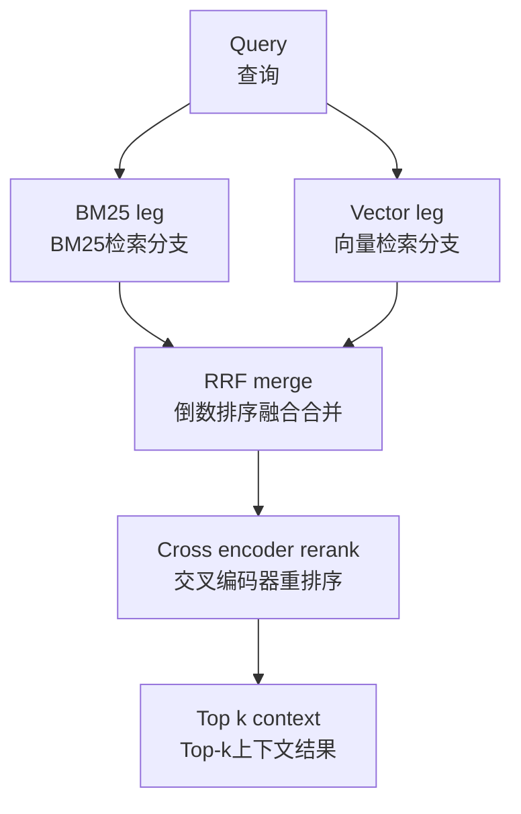

# 关键词搜索 vs 向量搜索：在RAG系统中二者究竟能带来什么？
纯向量搜索在企业用户最常提出的精确查询场景下会失效：比如ID、错误码、产品名称。下面将从失效模式角度，把概念辨析类问题转化为工程设计层面的解答。

## 03 关键词搜索 vs 向量搜索：在RAG系统中二者究竟能带来什么？

> **TL;DR（一句话总结）**：二者在不同类型查询上会分别失效，因此生产环境会同时使用两者：**BM25处理精确标识符（ID、错误码、名称），向量处理复述改写类问题；再通过倒数排序融合（Reciprocal Rank Fusion）合并结果，顶层搭配交叉编码器重排序器**。

### 答题思路
这看似是一道概念解释题，但要从**失效模式**角度作答。面试官希望确认你见过真实查询产生的故障。答题开篇：“二者会在互补的查询场景下失效，这就是生产系统同时运行两种检索的原因。”

---

## 高质量参考答案
**关键词搜索（BM25 / 词法检索）**：依据词项重合度结合逆文档频率（IDF）权重打分。擅长精确匹配：能够精准命中包含标识符（`INV‑20419`、错误码`0x80070057`）、产品与人名、生僻专业术语、带引号短语的查询。
它的缺陷是无法处理词汇不匹配：例如查询“我该如何退款”，若文档标题写的是“退款政策”，没有重合词汇就匹配失败；它完全不理解语义含义。

**向量搜索**：将查询和文本块映射至同一个向量空间，依靠余弦相似度排序。擅长处理复述改写、同义词、跨语言匹配，实现语义召回。
它的失效模式更隐蔽，危害也更大：会返回“主题相关但内容错误”的结果。比如查询2024定价，却拿到2023定价的文本块；或是拿到其他客户合同里的相关主题片段。这是因为向量嵌入会压缩丢失那些关键区分信息：数字、版本号、实体名称，而这些恰恰是词法检索会保留的内容。当遇到嵌入模型训练集从未见过的生僻术语，向量检索效果也会大幅衰减。

两种失效模式都源于自身工作机制，并不是可以修复的程序bug，恰恰是这套机制本身的固有特性。这也论证了同时部署两套检索不是“赌运气”，而是架构层面的必然选择。

因此工程上采用混合检索方案：并行运行BM25稠密向量检索，使用**倒数排序融合(RRF)**或者加权分数合并两套结果；理想情况下，把合并后的Top‑k结果送入交叉编码器做重排序。两套检索互相弥补短板：BM25搞定向量会模糊掉的精确匹配查询；向量检索处理BM25无法应对的自然语言改写查询。

> 流程图逻辑：
> 查询 → 分两路并行：BM25分支、向量检索分支 → RRF结果合并 → 交叉编码器重排序 → 输出Top‑k上下文

Elasticsearch、OpenSearch、Vespa、Qdrant这类引擎原生同时支持两种检索，混合检索的落地成本很低。企业真实部署经验参考：单独使用任意一种，混合查询日志下的`recall@10`召回率大约只有60‑75%；开启混合检索+重排序器后，召回率通常可达85‑90%。

如果企业业务语料库只能选一种检索方式，要明确说明：优先词法检索，再补充向量检索会更稳妥。企业查询大量包含人名、ID、错误码。这也是Glean公开表达的企业搜索立场。

### 不同查询类型，两种检索的表现对比

| 查询类型 | BM25（关键词检索） | 向量检索（语义检索） |
|---|---|---|
| 精确ID/错误码 | 依靠精确词项重合，精准命中 | 会模糊掉具备区分度的数字、版本号 |
| 复述改写类查询 | 词汇不匹配时会漏召回 | 支持同义词、跨语言匹配 |
| 生僻专业术语 | 实现精确匹配 | 遇到模型从未见过的术语，效果衰减 |
| 分布外术语 | 完整保留原文字面词 | 模型训练集之外的术语，效果衰减 |

### 面试官后续追问方向
1. **“你如何融合两套检索的分数？”**
倒数排序融合RRF无需调参标定，是默认方案；加权融合需要标注数据集训练权重。
2. **“什么场景只用纯向量检索就够用？”**
内容同质化的FAQ知识库，大量查询都是同义改写的场景。
3. **“那过滤条件怎么处理？”**
元数据过滤（时间、来源、访问控制ACL）对两套检索同时生效，往往才是解决问题的关键。
4. **“如何证明混合检索对业务有收益？”**
把测试集按查询类型拆分，看每一类查询下的召回指标，不要只输出一个笼统混合指标。

### 常见答题误区
只讲两套检索的工作原理，完全不提失效模式：这就是纸上谈兵和真正做过检索系统的人的区别。
宣称向量检索全面优于关键词检索（鼓吹“嵌入理解语义”）；做搜索业务的面试官，会直接拿一个ID查询来考你。
忽略重排序器：重排序是整套检索链路里，性价比最高的质量提升手段。

### 核心要点总结
- BM25擅长精确词项匹配；向量检索擅长复述改写；二者失效场景互补，因此两套都要部署。
- 使用RRF做结果融合（不需要分数标定），再接入交叉编码器重排序，用最低成本换取显著质量提升。
- 验证收益时，拆分不同查询类型分别统计指标，不要只用单一笼统召回率。

---

### 编者按
高质量回答几乎一定会落到“两套都要用”；真正区分候选人的是后续问题：两套完全不同打分体系的排序列表，该如何合并？优先选倒数排序融合，而不是强行把余弦相似度和BM25分数做归一化。这个选择能证明你真正上线过混合检索，而不是只看过相关资料。

> 高质量答案就是做混合检索，两者一起用。向量检索抓语义；关键词检索抓嵌入会模糊掉的精确词项：人名、错误码、商品SKU。理解二者互相弥补的缺陷，才是问题的核心。

