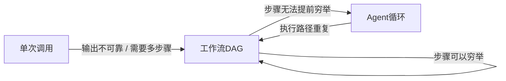

# 什么时候不该用智能Agent？论述反对构建Agent的理由
> 反对Agent的观点会体现工程师资历；这是AI实验室里明确的面试评分标准。了解从单次调用到自主循环的成本阶梯，以及真正适合使用Agent的3个必要条件。

## 04 什么时候不该用智能Agent？论述反对构建Agent的理由

> **一句话摘要：只要任务步骤是可预测的，Agent就是错误方案。沿着技术阶梯选型：优先单次调用 → 固定工作流 → Agent循环；只有同时满足：任务结构不可预测、模型拥有工具反馈用于自检、自主能力带来的收益足以覆盖失败带来的代价，才选择Agent。**

### 解题思路
这个问题披着概念考题的外衣，实际考察工程师的经验层级。面试官考察的是**简单方案优先的思维偏见**：那些踩过生产环境Agent坑的工程师，会默认优先拒绝Agent方案。
答题时，先定义完整的技术选型谱系，再论证绝大多数企业业务问题，都落在低成本简单方案一侧。

### 高分参考答案
定义选型阶梯：
1. **单次大模型调用**：依靠高质量提示词直接完成任务
2. **工作流**：开发者编排的固定DAG有向无环图调用序列（分类、检索、撰写、校验）
3. **智能Agent**：由模型自己决定调用哪些工具、调用顺序，循环迭代直到任务完成。

这和Anthropic官方《构建高效Agent》指导思想完全一致：**选用能解决问题的最简单方案**。

每向阶梯上攀升一级，就要承担对应的代价：
1. **可靠性连锁衰减**：假设每一步成功率95%，5步串联之后整体端到端成功率仅约77%
2. **延迟暴涨**：从单次往返2秒，变成多次循环，耗时可达30秒甚至更久
3. **成本放大**：每一轮循环迭代，都要重复发送完整上下文，Token开销成倍增加
4. **可调试性崩坏**：失败来自模型涌现出的执行路径，而非固定代码逻辑，问题难以复现定位
5. **评估难度陡增**：模型可能的执行路径空间爆炸，测试覆盖几乎做不全。

这种连锁衰减不能靠直觉，需要计算。下表假设每一步必须全部成功、步骤相互独立，不包含重试与故障恢复逻辑。现实中的故障恢复、错误耦合会改变计算结果，**一定要在真实业务上实测端到端成功率**。

|循环步数|单步成功率95%|单步成功率99%|
| ---- | ---- | ---- |
|5|77%|95%|
|10|60%|90%|
|20|36%|82%|

有两点关键理解：
1. 如果单步95%可靠，20步Agent任务，接近2/3概率失败。没有人会上线一个失败率这么高的定时任务；即便每一步看起来表现尚可，组合起来就是无法上线的产品。
2. 表格也指明优化重心：**把单步可靠性从95%提升至99%（收紧工具能力、步骤之间增加校验、缩小可执行动作范围）带来的收益，远比减少一两个循环步骤更大**。
生产环境的Agent，核心工程工作是围绕循环做防护，而不是在提示词上做文章。

### 那什么时候才适合Agent？需要同时大致满足下面3个条件
1. **任务结构不可预测**：无法提前穷举所有步骤，例如开放式调研、跨多系统排错；
2. **模型具备工具与反馈能力**：可以核验自己输出，运行查询，看到报错；
3. **自主能力带来的价值超过失败的代价，或者失败成本很低**（人工复核、沙箱环境、可回滚操作）。

✅ **适合Agent的经典案例**：跨5套系统排查客户发票错误原因
❌ **不适合Agent的经典案例**：工单总结、提取6个指定字段；固定工作流就可以做到成本更低、速度更快、方便测试。

> 顾问实战技巧：当客户说“我们要做Agent”，把需求翻译为业务产出。
> 举个真实需求翻译例子：“我们需要Agent处理退款申请”
> 拆解退款需要做什么：分类请求、查询订单、核对退款策略、撰写回复、边缘场景转人工。
> 每一步都可以明确枚举，这就是**工作流**。每个阶段都可以独立测试、评估、调试。
> 真正需要Agent的，只占5%的工单：政策定义模糊，或者多个系统数据冲突，而这类工单本来就要流转人工处理。
>
> 通常，一个路由组件+两套确定性工作流，就能实现95%业务价值，系统复杂度仅为Agent方案的十分之一。后续依然可以升级为Agent，把现有工作流当做兜底基线。客户拿到想要的业务结果，“Agent”本质上是对结果的诉求，而非强制指定技术架构。

### 面试官继续追问的高频问题
1. **客户坚持要用Agent，但你判断工作流更合适，你怎么做？**
把工作流包装为Agent V0版本上线，拿出评估指标，用真实数据说服对方。

2. **如何判断你的Agent属于过度设计？**
日志追踪发现90%场景下，Agent都在重复完全一样的工具调用序列——本质就是套了Agent外壳的固定工作流。

3. **现在Agent真正能发挥优势的场景？**
带测试反馈的代码编写、调研问题、故障排查、长尾支持；也就是中间结果可以被核验确认的领域。

### 常见错误
1. 只看好Agent酷炫，不做成本收益分析，业务本身并不需要自主决策能力却强行上Agent；
2. 概念模糊，对“Agent”没有明确定义，全凭感觉；
3. 完全不提连锁衰减的错误率、评估测试的困难；
4. 核心陷阱：Anthropic、Sierra、OpenAI面试打分看重：**优先选用最简单架构**，不是看你能堆砌多少Agent专业术语。

### 核心要点
- 默认选择选型阶梯最底层方案；每向上升级一级，成本、延迟、评估难度都会成倍上涨。
- 使用Agent的3个必要条件：任务结构不可预测、具备工具反馈、自主能力收益大于失败代价。
- 如果日志看到总是重复同一套工具调用序列，那只是伪装成Agent的工作流，降级为普通工作流。

> Anthropic官方文档明确：优先固定工作流，万不得已才上自主循环；只有任务需要动态决策时，才引入Agent能力。这道面试题就是考察你是否内化这套理念。不要把Agent当成高大上架构。优秀候选人可以把同一个功能，分别描述为单次提示词、链式调用、循环Agent，并且清晰讲出每一步升级的触发条件。

---

## 讨论区

> 95%的5次方这个可靠性计算还低估真实问题，因为各步骤的故障并不是互相独立。
> 如果前期检索步骤出错，后续全部步骤都会被污染；错误会互相耦合，实际可靠性比简单相乘计算的结果更差。实际现象就是Agent故障集中爆发：一旦执行路径出错，就会错得很离谱，而不是仅仅错5%。

> 参考答案里有一个值得补充的注意点：“工具反馈，让模型自检”的前提是反馈信息真实可信。
> 如果是Agent自己写的测试用例，或者工具返回200状态码，但逻辑结果本身错误；循环会拿到虚假信号，并且向着错误方向持续优化。
> 可核验的反馈，必须由不受Agent控制的外部实体提供。

