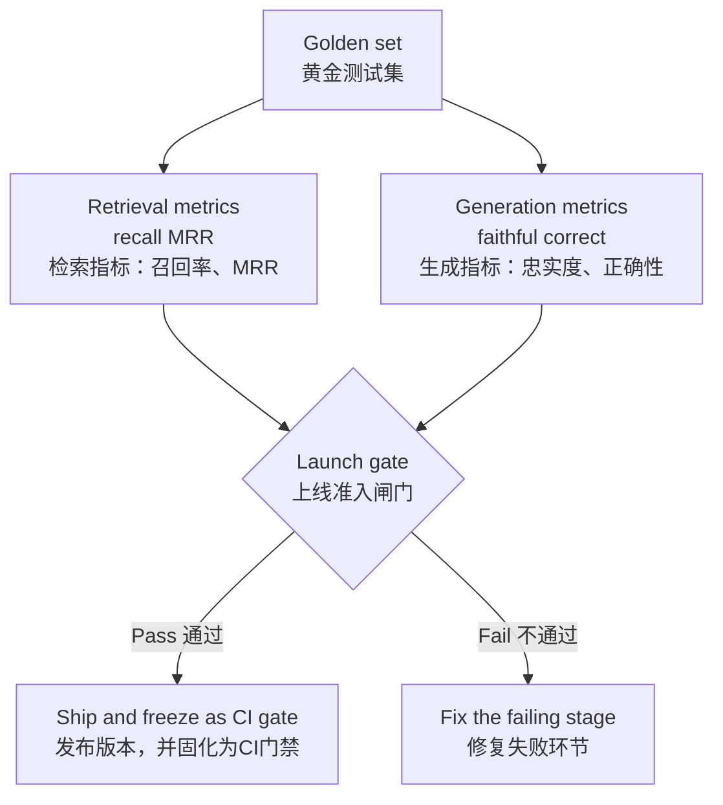

# 在让客户上线RAG系统之前，你会如何对它做评估？
“评估优先”是FDE（Forward Deployed Engineer，前线部署工程师）设计面试环节的头号考察要点。本题是基础必考题。


**要点速览**：基于真实用户问题搭建50‑100条的黄金测试集，每条标注对应原文片段；把检索与生成环节拆分成两套独立指标，这样上线准入关卡可以捕获其中某一环节的失败，而不会被另一环节掩盖；最后将这套测试集固化，作为CI持续集成的回归测试套件。

## 解题思路
有一种听上去很严谨但实则无效的做法：直接输出一个未经过校准的大模型打分。
回答要分为三层：构建黄金测试集；将检索与生成分开度量；与客户共同定义上线准入标准。


**那些听上去严谨，实际却不堪一击的做法，往往只靠一个未经校准的评判者给出的单一数字：“我们测试集得分87%。”** 只要追问这套测试集是谁构建的、评判标准本身经过了怎样的校验，这个数字往往当场就站不住脚了。这是潜藏在所有其他设计问题背后的核心问题：在AI实验室里，主动提出评估这件事，是整个工作链路中最有力的信号。
分三层落地：构建黄金测试集；将检索与生成分开评估；和客户共同定义上线准入门槛。


## 高分回答
首先搭建黄金测试集：从真实用户处收集50‑100道问题（来源：试点项目日志、客服工单、领域专家访谈），**不能由开发人员自己编造题目**。开发写出来的问题措辞往往过于规整，缺少真实流量里的行话、输入错别字、语义模糊的情况。
每一条样本包含：用户问题、标准答案、来源文档/片段。
样本里必须加入对抗测试子集：答案不在知识库内的问题（系统应当拒绝作答）、语义模糊问题、跨多文档问题、过时数据陷阱。

> 单条标注样例可以让抽象的“黄金测试集”变得具象，在见过一条完整样例之前，“黄金测试集”只是一个模糊概念。
```
问题："wat is teh SLA if lakehouse ingest is delayed?" ←示例，模仿真实工单，保留全部错别字
标准答案："4 business hours for P1 sources, next day otherwise (Ops Runbook 3.2)"
来源：ops‑runbook.pdf，3.2节，块ID 8841
分类切片：可回答 / 单文档
---
问题："can we terminate the Danube contract early?"
标准答案：拒绝作答，该合同不在知识库内
来源：无
分类切片：知识库不存在内容（对抗样本）
```

第二种样本是开发人员自制测试集几乎不会主动覆盖的场景，但恰恰是企业上线时实际翻车的地方。第一条样例要保留原始错别字；悄悄把错别字修正，只会让你的系统去适配根本不存在的用户输入。

接下来分两个阶段度量。一个混合的“综合准确率”数值，无法告诉你到底该修复哪一部分。
1. **检索环节**：使用Recall@k、MRR指标，对照标注好的原文片段，判断正确的文本块是否被送入上下文。
2. **生成环节**：给定正确的上下文，评估回答是否忠实（不出现上下文没有支撑的断言）、回答是否正确。

忠实度与正确性可以用大模型充当评判器打分，但必须配套严谨的评判标准，并且用大约50条人工标注样本完成校准；目标是评判器和人工标注达成**85‑90%以上的一致率**，之后才能信任该评判器输出。
这个目标有文献参考依据：郑等人2023年《基于MT‑Bench与Chatbot Arena评判大模型》一文指出，效果优秀的评判大模型与人类偏好的一致率超过80%，该水平等同于两个人类标注员之间的意见一致率。
你的业务领域评判标准比通用对话场景更严格；因此你可以期待拿到略高的一致率。
如果一致率低于人与人之间的基线，说明评判标准本身有问题，而不是模型的问题。

校准工作是流程化的，不是玄学：让大模型评判器与领域专家独立评判同样的50条样本，统计两者一致的比例，重点研究意见不一致的样本。分歧往往集中出现：评判模型经常对“行文流畅、但没有原文支撑”的回答手下留情——而这恰恰就是这套评估要捕获的错误。
如果一致率很低，就要收紧评判标准重新跑；如果持续偏低，说明该维度不适合自动化，必须保留人工审核流程。

分开度量的价值在于故障定位：比如端到端整体准确率60%，可以拆解为“检索召回率70%，给定正确上下文时生成正确率85%”，你就知道问题根源在检索。





流程图的两条箭头指向上线准入关卡是核心：检索、生成分别独立考核。一个模块失败不会被另一个模块的好结果掩盖，你能明确该修复哪一侧。

同时要评估**拒绝作答行为**：知识库不存在内容的对抗样本上的“虚假回答率”，往往是企业客户的上线否决指标。一次言之凿凿的幻觉错误，造成的信任损失远大于十次诚实的“我不知道”。

最后，和客户共同敲定上线准入门槛。举例：黄金测试集整体正确率≥85%；对抗样本虚假作答率≤2%；p95延迟小于5秒；同时定义故障升级流程。
注意：小样本集得到的指标只能作为观测，不能当成绝对保证。50条独立样本全部没有出现虚假作答，统计学上95%置信区间的上限依然接近6%。随着项目推进，要持续扩充对抗样本集。
所有标准必须白纸黑字写下来，把“演示效果不错”转化成一套可复现、可执行的正式约定。

|阶段|指标|低分代表含义|
| ---- | ---- | ---- |
|检索|Recall@k，MRR|正确的文本块没有被送入上下文|
|生成|忠实度，正确性|上下文明明正确，但回答新增无依据断言，或者答案错误|

> 注意：两个阶段的效果是相乘关系。70%检索召回 × 85%生成正确 = 约60%端到端准确率，这告诉你优先修复检索模块。

## 面试官后续追问方向
**黄金测试集需要多大规模？**


> “黄金测试集需要多大规模？”50条用例足以发现大幅效果退化；200条以上可覆盖更细分场景；每周从线上真实故障案例持续扩充数据集。
> “可以信赖大模型充当评判器（LLM‑as‑judge）吗？”若配有评分细则并完成校准，在评估内容忠实度上可用；但针对开放式输出质量，可信度较低。
> “上线之后该怎么做？”抽取线上真实流量样本做打分评估，把用户差评案例补充进测试集，持续监控检索得分的分布变化，识别模型漂移。


|大家常踩坑的做法|失败根源|正确回答|
| ---- | ---- | ---- |
|单一混合“准确率”分数|分不清是检索还是生成出问题，无法定位故障|分开统计检索、生成两套指标|
|测试题全部由开发人员编写|措辞过于理想化，缺少真实用户的错别字、行业黑话、歧义|来自工单、试点日志，由领域专家标注标准答案|
|完全未经过人工校准的大模型评判器|对流畅但虚假的回答过度宽容，评估本身不可信|拿50条样本做人工‑评判器一致性校验，复盘所有分歧案例|
|完全没有“拒绝作答”测试样本|无法衡量幻觉风险，企业场景致命|加入知识库不存在内容切片，标准答案设为拒绝作答|

## 常见错误
只说“我们做过测试”，但不说明使用什么指标、测试集规模、题目来源。
只输出一个混合后的端到端准确率，无法定位故障。
全部评估样例都由开发人员编写。
跳过“拒绝作答”对抗样本。面试官扮演企业客户时一定会问：**如果文档里根本没有答案，系统会如何表现？** 答不上来直接扣分。

## 正确实操步骤
1. 从真实业务流量提取50‑100条问题，领域专家标注标准答案和对应原文片段。加入知识库无答案的对抗样本，标准答案设为拒绝作答。
2. 检索环节计算Recall@k、MRR；生成环节评估忠实度、正确性，**不要把两者合并成一个总分数**。
3. 挑选50条样本，同时交给人工专家与大模型评判器打分，统计一致率，逐条复盘分歧。
4. 和客户书面敲定上线准入标准，包含各项阈值、p95延迟指标。后续每一次修改提示词、切换模型，都跑整套评估，接入CI持续集成流程做回归测试。

### 核心要点
- 黄金测试集素材来自真实用户、领域专家，而非开发团队；每条样本标注对应的原文片段。
- **检索、生成环节必须拆分成两套独立指标**，故障可以被定位，而不是被合并分数掩盖。
- 使用大模型评判器时，必须拿约50条人工标注样本完成校准。将上线准入标准固化，作为CI回归测试套件。

> **编者注**：接下来会延伸一个面试问题：黄金测试集由谁编写，如何保证评估客观公正？高分回答要点：由领域专家标注，不是工程师；检索、生成分开度量，这样上线关卡能捕获单环节故障而不被掩盖。
> 听上去很严谨实则无效的回答：只给出未经人工校准的大模型评判分数；没有人工校验的评判器，只是套上小数的主观感觉。

---
### 评论区

拒绝作答这一条确实是关键上线关卡，但打分时要小心区分：“系统选择不回答”和“系统出于正确理由选择不回答”不是一回事。
有的问题明明知识库可以回答，但因为检索效果差，系统直接拒绝作答。这种情况虽然在拒绝指标上是“通过”，但本质属于故障。
拒绝行为本身也要拆分，单独统计拒绝的精确率、召回率，就像我们拆分检索与生成指标一样。

