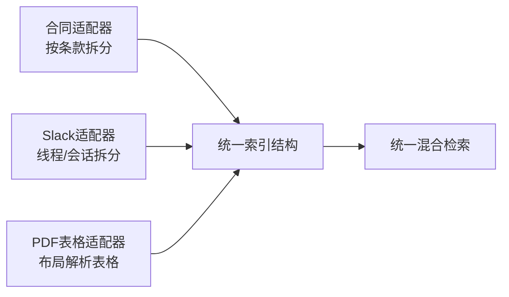

# 你会如何对合同、Slack会话线程、满是表格的PDF做文本分块：同一套流水线，还是多套不同流水线？
这是一道FDE（前沿部署工程师）的面试设计题，专门惩罚“一刀切”式的答案。每一类语料都有各自不同的**语义单元**：需要给出三套设计方案、对应的解析工具，以及一套评估方案，证明做拆分是值得的。

> **06 你会如何对合同、Slack会话线程、满是表格的PDF做文本分块：同一套流水线，还是多套不同流水线？**
>

>
> TL;DR（一句话总结）：**多套不同的摄取流水线，最终汇入同一个索引。每类语料有专属语义单元（合同条款、会话线程、表格），因此要构建按数据源区分的摄取适配器，输出统一通用数据结构；使用每类语料独立的recall@10（前10检索召回率）指标，来验证这套拆分设计的价值。**

## 解题思路
题目陷阱：直接提出使用一套通用分块器。需要先确立核心原则：**按照用户问题实际指向的语义单元做分块，不同语料的语义单元各不相同，分别是合同条款、对话、表格。**
方案思路：构建多个数据源专属的摄取适配器，输出统一的索引结构。

### 高分参考答案
#### 合同
用户的问题瞄准的语义单元是**条款**（例如“ACME主服务协议里的终止通知期限是多少？”）。
依据编号层级（11、11.1、11.2这类编号）按条款/章节分块。每个分块必须完整自包含，附带元数据头部：文档名称、签约各方、生效日期、章节路径。
使用父子检索：在条款粒度生成向量嵌入，同时能够返回完整章节内容，因为条款之间会互相引用（“详见第3章节定义”）。

定义章节需要特殊处理：要么在检索到引用该定义的条款时，同步附带对应定义内容；要么直接把定义内联展开。
**绝对不要把一个条款从中间切开**；法律场景下，如果返回的分块是一句话的半截，会直接让法务用户失去对系统的信任。

#### Slack会话线程

Slack会话线程：单条消息的体量过小（脱离上下文，像“好的，这样可行”这类句子做向量嵌入只会生成噪声），而整个频道的数据量又过大。它的语义单元是**线程**或者**一段对话会话**：
- 有线程的消息，直接按线程分块；
- 对于没有线程功能的普通频道，则按时间间隔做会话切分（静默超过30分钟，就视作开启一段新会话）。

在文本中保留发言人姓名与时间戳；在内容开头追加频道名称和话题。
会话内容质量参差不齐，因此可以考虑用大模型做一轮处理：为每一个线程生成标题或者摘要，**用这份摘要做向量嵌入，但是检索返回结果时，仍然返回原始完整线程内容**。

注意访问控制列表（ACL）：私有频道带有权限信息，权限必须跟随分块一同携带传递。


#### 包含大量表格的PDF
风险点：无视排版布局的纯文本提取，会把表格的行列拆解成一堆杂乱文字。
使用**布局感知解析工具**（Docling、unstructured.io、Azure Document Intelligence，或是多模态大模型）识别表格。
把每张表格独立作为一个分块，序列化为Markdown格式，附带表格标题以及表格前后关联段落。
对于超宽、超长表格，额外生成按行整理的文本描述（例如“地区：欧洲、中东与非洲；第三季度营收：420万美元”），实现单行级别的精准检索匹配。

针对表格数字类问题，很多场景下不要用向量检索，改用**Text‑to‑SQL（文本转SQL）**，直接对提取出的表格做查询，效果优于向量嵌入检索。

> 表格处理失败案例（直观示例）：一份两行营收表格，布局盲解析输出一团乱文本
> ```
> Region Q2 Q3 EMEA $3.8M $4.2M APAC $2.1M $2.6M
> ```
> 提问：“欧洲中东非洲地区第三季度营收是多少？”
> 这一串文本中，没有把`420万美元`、`EMEA（欧非中东）`、`Q3（第三季度）`做绑定。大模型拿到这一坨文本只能猜数字对应关系。
> 如果改成一行一条记录的格式，各个字段绑定关系明确，检索就不会歧义。
> 面试中不能只罗列工具名字，要讲清楚这种格式转换逻辑，才能证明真正理解问题。

```
Region: EMEA | Q2 revenue: $3.8M | Q3 revenue: $4.2M
Region: APAC | Q2 revenue: $2.1M | Q3 revenue: $2.6M
```




三类数据源最终输出同一套索引结构：
`{文本内容,向量嵌入,数据源类型,文档ID,章节路径,访问控制列表ACL,时间戳}`
检索逻辑统一，但是摄取处理逻辑各有不同。

用每类语料独立的**黄金测试集**做验证：分别统计合同类问题、Slack会话问题、表格类问题的recall@10（前10召回率）。
朴素一刀切基线方案，在表格场景召回率通常会跌到40%以下；经过定制化流水线之后，表格场景召回率可以提升30个百分点以上，以此证明复杂度增加是有收益的。

|语料|语义单元|分块策略|解析要点|
| ---- | ---- | ---- | ---- |
|合同|条款|按条款/章节编号分块，父子检索，不截断条款|禁止条款中间切分；定义特殊处理；带上签约方、生效日期元数据|
|Slack会话线程|线程/对话片段|按完整线程；无线程频道按时间间隔切分会话；可大模型生成会话摘要|保留发言人、时间戳；携带ACL权限；时间切分有局限，可以改用话题分割|
|带表格PDF|单张表格（可细化到行）|布局感知解析，表格转Markdown；超长表增加行级描述；数值查询优先Text‑to‑SQL|避免行列结构被破坏；保留标题与周边上下文|

## 面试官后续追问（高频）
> Q：三类流水线，优先开发哪一个？
A：看试点项目真实用户提问分布，查看查询日志，或者直接询问客户。

> Q：扫描版PDF怎么处理？
A：先做OCR；多模态视觉模型处理布局，但成本大约高10倍，所以要根据文档类型路由选择解析方案。

> Q：400页的合同修订增补链条怎么处理？
A：增加修订版本感知元数据，增加生效日期过滤；否则检索会取出已经被废止的旧条款。

## 常见错误
1. 一套分块器处理全部类型文档。
2. 忽视表格问题，直到客户演示现场问“第三季度营收多少”，系统返回一堆乱序数字。
3. Slack处理丢弃发言人、时间戳元数据，回答无法溯源。
4. **没有分语料独立做评估**：只输出一个整体召回指标，无法证明定制流水线的额外复杂度是值得的。

## 核心要点
- **一套索引结构，三套摄取适配器**：三类语料的语义单元分别是合同条款、会话线程、表格。
- 表格是面试考察重点：布局感知解析，转Markdown+行级记录，数值场景优先Text‑to‑SQL。
- 元数据带上ACL权限、生效日期；**按不同语料单独评估召回率，不要用混合整体指标**。

---

### 编者注
表格是很多面试者一笔带过的部分，而恰恰是面试官重点考察点。PDF表格当做普通纯文本分块，行列关系直接丢失。当用户问“X地区Q3营收多少”，返回一堆没有关联的数字。
能说出布局感知解析工具，并且讲清把表格转为Markdown或者行记录之后再向量化，这是区分纸上谈兵和真正处理过企业真实合同文档候选人的关键点。

### 评论区

> 专门针对Slack补充：基于时间间隔切分会话，在最重要的频道场景会失效。
> 例如故障突发频道，连续数小时消息不断，根本没有30分钟静默间隔；而架构决策类慢频道，同一个逻辑话题中间会隔好几天才继续聊。
> 如果有原生线程元数据，优先使用线程；无原生线程的普通频道，用大模型做话题分割，往往比反复调时间间隔阈值效果更好，成本开销也划算。


