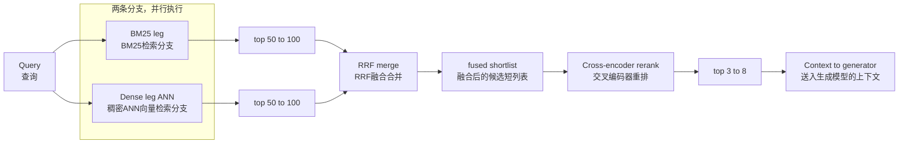

# 设计一套混合检索栈：BM25、向量检索，以及重排器。每个阶段分别补救/解决什么问题？
一道带精确评分标准的检索设计面试题：候选人要能讲清楚每个阶段解决什么问题，以及该阶段在延迟上的代价，把这些讲明白。内容包含倒数排名融合（RRF）细节，还有面试官会问到的延迟预算。

**简言之：** 并行运行BM25与稠密检索以最大化召回率，使用倒数排名融合（RRF）融合两份排序列表，随后用交叉编码器对融合后的候选短列表做重排，以此提升精度。通过消融实验表格以及明确给出的延迟预算，论证每一个阶段存在的必要性。

---
## 答题思路
把整体构造成一个漏斗，每个阶段各司其职：召回阶段（BM25 + 稠密检索，并行运行，广泛获取候选），之后进入精度阶段（重排器，对获取到的候选内容重新排序）。对于每一个阶段，要准备好回答：它解决什么问题、它的代价是什么，以及如何衡量它带来的贡献。

## 高质量参考答案
**阶段1a：基于倒排索引的BM25**
解决的问题：精确标识符（SKU‑88210）、错误码、名称、缩写词、嵌入模型从未见过的领域内罕见专业术语。
代价：在企业规模下，运行于Elasticsearch/OpenSearch，开销几乎可以忽略（小于10毫秒）。
失效场景：词汇不匹配，经过复述改写的查询会搜不到目标。

**阶段1b：稠密检索（基于ANN的嵌入检索，HNSW索引）**
解决的问题：复述改写、同义词、概念类查询、多语言匹配。
代价：一次嵌入调用外加约10‑50毫秒的ANN查找。
失效场景：“看似相关实则错误”，语义相近的文本块，但关键细节不对（错误的年份、错误的客户、错误的版本）。

---
## 融合：分别取出两路检索的前50‑100条结果，使用倒数排名融合（RRF）进行合并
打分公式：文档得分 = $\sum 1/(60 + 排名)$。
RRF不需要做分数校准（BM25分数与余弦相似度分属于两套完全不可对比的量纲），这就是在生产环境中，它优于需要针对每个语料库调参的加权求和方案的原因。

[混合检索](./huanhejiansuo.png)

> 图示：混合检索：每个阶段解决什么问题
1. 查询（一段文本，包含多个意图）
2. 两条检索分支并行执行：BM25、稠密ANN检索
> 注释：BM25解决精确词元；稠密检索解决复述改写问题。两者各自的失效场景恰好是对方的强项。
3. 两路各取前50‑100条结果，先召回，再做精度优化
4. 使用RRF做融合：基于排名，无需校准
> 分数示例：仅BM25第一名：约0.0164；仅稠密检索第三名：约0.0313。两路同时命中的结果得分几乎翻倍；两路检索同时认可的文本块，几乎不会是无效内容。
5. 交叉编码器重排：同时读取查询与文档

> 流程图文字说明
步骤2画成一个方框，是因为两条分支是同时运行，而不是串行。前面步骤全部优化召回，步骤4之后开始优化精度。

### RRF工作细节
拿标准常数k=60举例，看RRF的实际表现：
某文档在BM25排第1名，但在稠密检索结果里不存在，得分就是 $1/(60+1)≈0.0164$。
某文档在BM25排第3，同时在稠密检索排第5，得分 $1/(60+3)+1/(60+5)≈0.0313$，得分几乎翻倍。
这就是你实际想要的效果：两路检索算法同时认可的文本块，几乎不会是垃圾结果；而单路第一名，有可能只是BM25关键词巧合命中，或是嵌入向量接近但实际不匹配。
公式中的60是阻尼常数，不是什么魔法数字：它抹平相邻排名之间得分差距（第1名得分0.0164，第10名得分0.0143，两者只差约15%），这样单条分支给出的高置信但错误的头部结果，就无法在合并结果里一家独大。整套计算只依赖排名，完全不需要原始分数，因此不会出现因语料库变化，校准参数失效的问题。

**阶段2：交叉编码器重排器（Cohere重排、BGE‑reranker或同类模型）**

它不对比预先计算好的向量，而是对每一组（查询，文本块）配对，采用**完整注意力机制做联合打分**。
解决的问题：修复双编码器模型因自身瓶颈而丢失的细粒度相关性。
它能够识别出：查询里的“为方便起见而终止”和文本块中的“因客观原因而终止”二者并不匹配。
开销：该阶段成本很高，对50‑100个候选文档处理约耗时50‑300毫秒。因此它只处理经过融合得到的候选短列表，**绝不会直接作用于全部语料库**。
典型收益：相比仅做融合的结果，NDCG、top‑5召回指标可提升5‑15个点；在整套检索架构里，它通常是单位研发工时下收益最高的组件。

随后将重排后得分最高的3‑8个文本块送入生成模型。
检索总延迟预算：约100‑400毫秒，绝大部分耗时来自重排器。这个延迟对于聊天场景是可接受的；如果有更严苛的服务延迟等级协议（SLA），就需要缩减规模（减少参与重排的候选数量）。

在黄金测试集上通过消融实验衡量每个阶段的贡献：分别统计仅BM25、仅稠密检索、混合检索、混合检索+重排这几种配置下的recall@10指标，并按查询类型（标识符查找类 vs 自然语言类）拆分对比。这份消融实验表格，同时也可以对外向客户解释每个组件存在的价值。

本文给出的延迟与收益仅为典型区间，并非绝对保证：指标会随语料库规模、硬件、候选数量、查询组合而变化，因此你应当把自己实测得到的消融实验数据展示给客户。

消融实验的大致形式：

> 消融实验样例表
|配置|Recall@10|NDCG@5|总延迟|
| ---- | ---- | ---- | ---- |
|仅BM25|0.61|0.48|<10ms|
|仅稠密检索|0.66|0.52|40ms|
|BM25 + 稠密检索 + RRF|0.73|0.57|60ms|
|BM25 + 稠密检索 + RRF + 交叉编码器重排|0.74|0.68|180ms|

> 要点：RRF把召回率拉高；重排几乎不再提升召回，但是大幅提升排序质量。总延迟预算：聊天类应用，端到端检索建议控制在200‑400毫秒。

---
## 面试官接下来会追问的问题
**“元数据过滤器放在哪一步？”**
在索引阶段就做过滤（查询时直接在BM25/ANN检索阶段过滤），而不是检索完再丢弃结果。如果你先取出100条，再过滤，很容易把正确答案过滤掉，导致候选池枯竭。

**“什么时候可以删掉其中某一个组件？”**
- 如果你的查询几乎全部都是自然语言概念查询，几乎没有专有名词、标识符，那可以去掉BM25；
- 如果你的延迟约束极其严苛，不允许重排带来的额外开销，可以去掉重排器，但NDCG指标会明显下降。

**“RRF常数60如何选择？”**
这是一个可调参数。常数越大，越弱化头部排名的权重，代表你不信任任意单条分支的排序；常数越小，单路的第一名就越容易主导最终结果。对于标识符查询表现极好的数据集，可以调小该常数。拿测试集扫一遍参数就可以完成调参，大多数团队直接使用默认60。

**“为什么不用加权求和做分数融合？”**
BM25分数、余弦相似度分数的分布随语料库、查询变化而漂移。今天调好的权重，当文档集合发生变化，权重就失效了。RRF只使用排名，完全不受分数分布漂移影响。生产环境中维护成本更低。

>“元数据过滤器应该放在哪里？”
要在索引内部对两条检索分支（BM25、稠密检索）做前置过滤（日期、来源、访问控制列表ACL），**不要做后置过滤**，否则你的top‑k候选集会被大量消耗损耗。

>“什么情况下可以舍弃重排器？”
延迟预算极其紧张，或是小型语料库，此时取k=5就已经能拿到很高召回率。

>“那查询改写呢？”
属于第0阶段：对缩写做扩展、拆解多部分复合问题；成本低廉，可以作为补充增强手段。

>“长上下文大模型能不能把整套检索全部替代掉？”
把100个文本块全部塞进上下文，token开销会暴涨至原来的10‑50倍，还会重新出现**中间信息丢失**问题，因此检索带来的精度提升依旧很有价值。

## 常见错误答案
1. 串行运行：先跑BM25，再把BM25输出送入向量检索。❌
> 正确：两路并行检索，之后融合。串行会直接丢掉另一路的优势。
2. 直接相加原始BM25分数与余弦相似度。❌
> 两套分数量纲完全不一样，无法直接相加。
3. 把重排器作用于全部文档库，而不是短候选列表。❌
> 重排器计算开销巨大，只能用于召回得到的小候选集。

## 核心要点
- 每个阶段分工明确：BM25解决精确词元匹配；稠密检索解决复述改写、概念匹配；重排器解决细粒度相关性排序。
- RRF可以融合两套量纲完全不同的排序结果，不需要针对语料库调参，这就是生产环境中它优于加权求和的原因。
- **广召回，窄重排**；必须通过消融实验，结合不同查询类型，说明你设置top‑k取值与延迟的理由。

---
### 编者备注
重排器是延迟‑收益比最差的环节，因此关于预算的追问才真正考验候选人。对100个候选文档跑交叉编码器，会增加几十到几百毫秒延迟。面试官期望听到的回答就是“广召回，窄重排”，并且能讲清楚top‑k为什么取这个数值。如果只是简单加上重排器，却完全不提它带来的开销，那你描述的只是演示demo，不是生产可用的系统。

> 讨论区评论

> 文中把RRF常数（也就是公式 $1/(60+排名)$ 里的60）当作给定值，但它确实是可调节旋钮：更大的常数会削弱头部排名的权重，相当于不太信任任意一路的排序；更小的常数会让任意一路的第一名占据主导。对于BM25在标识符查询上精度极高的语料库，调小常数会有收益；在黄金测试集上遍历参数做测试成本很低，不过绝大多数团队不会改动这个参数。

