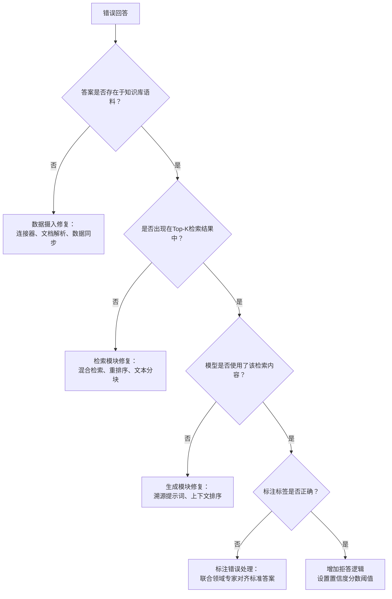

# 客户试点RAG系统仅能正确回答60%的问题，请排查问题根源
这是过去两年FDE（前线部署工程师）面试的经典设计题。答题头60秒就有一个得分陷阱：大部分候选人急于给出修复方案，然后就失分了。下文是能拿下这道题的问题诊断树。

---

## 客户试点RAG系统仅能正确回答60%的问题，请排查问题根源

> **要点总结：克制住直接给出修复方案的冲动。基于失败请求构建评估数据集，按照问题树对每一例失败做归类（答案不在知识库、检索未命中、检索到但模型未采纳、回答错误、标注错误），统计每一类占比，优先级就可以量化得出。**

### 解题思路
这道题的陷阱：还没做任何测量就抛出解决方案（“用重排序器试试！优化分块！”）。面试官希望听到的第一句话：**“在改动任何组件之前，我要基于失败流量构建一套评估集，找出60%正确率背后问题到底出在哪。”**
不做诊断直接调参，是很多RAG试点项目失败的原因。明明是数据接入环节的问题，却去改检索模块，白白耗费两周时间，还丧失客户信任。

### 高分作答
**步骤1：收集失败案例**
调取试点系统日志：用户查询、检索到的文本块、模型输出答案。标注50‑100个样本，明确正确答案以及正确答案的来源位置。如果系统没有留存日志，那就是首要发现：需要先埋点采集日志。

**步骤2：按照问题树拆分每一例失败，不同分支对应完全不同的修复手段**

（流程图逻辑）
输出错误答案
↓
正确答案是否存在于知识库？
├─否 → 数据接入环节修复：连接器、文档解析、数据同步
└─是 → 正确答案是否出现在Top‑k检索结果内？
  ├─否 → 检索环节修复：混合检索、重排序、分块策略
  └─是 → 大模型是否用到了该片段？
    ├─否 → 生成环节修复：约束事实的提示词、上下文排布
    └─是 → 标注是否正确？
      ├─否 → 标注错误：和行业专家对齐标准答案
      └─是 → 增加拒答逻辑与检索分数阈值

#### 五类失败场景说明
1. **答案完全不在知识库内：覆盖度/数据接入问题**
连接器缺失、PDF解析失败、数据同步滞后。解决：审计数据接入链路。（该问题十分常见，占所谓“模型很笨”投诉的10‑20%）

2. **知识库有答案，但检索没有命中（不在Top‑k）：检索漏召回**
词汇不匹配、文本块边界不合理、Top‑k取值不对、缺少BM25混合检索。修复方案根据漏召回根因选择：混合检索、重排序器、分块优化、查询改写。

3. **已经检索出来，但模型忽略/篡改了信息：生成/事实一致性问题**
提示词没有强制引用检索内容、上下文过长（中间信息丢失）、检索片段互相冲突。修复：改写提示词、上下文组装逻辑、调整片段排序。

4. **本不该作答却强行输出答案：缺少拒答逻辑**
修复：在提示词增加事实约束，加入“我不知道”拒答分支，设置检索得分阈值。

5. **输出看似“错误”，实际输出是对的：预期不匹配**
标注人员或者客户本身的前提认知有误。修复：和客户对齐标准答案与评判标准。

**步骤3：量化各类失败占比**
举例：80个失败案例中，15%属于知识库覆盖问题，50%属于检索问题，25%属于生成问题，10%属于标注错误。
此时优先级就可以用数字计算：检索类占比最高，优先做混合检索+重排序；同时从数据中算出，就算检索模块做到完美，系统正确率的理论上限。

统计得到的占比，也可以直接用于客户汇报。每一类失败都可以换算成能提升多少正确率。总失败占比40%流量，50%的失败属于检索问题 → 最多可以带来 `0.5 × 40 = 20` 个百分点的正确率提升；15%数据接入问题对应6个百分点；25%生成问题对应10个百分点；标注错误占4%。
这时你就可以向客户表述：**“就算检索做到完美，正确率最多从60%提升至80%；本周迭代计划优先解决检索问题，同时做数据接入审计，整体理论上限86%。”**
这和一句“我们试试重排序器看看效果”有本质区别。
“上限”这个概念非常关键：如实管理客户预期（重排序器也拿不到全部20个点的提升），并且提前和双方确认好成功指标，第二周的迭代效果就有客观数字来衡量，而不是靠主观感受。

**步骤4：修复、重新跑评估集、循环迭代**
每一次改动都在同一套评估集重新打分，客户能直观看到数字变化（60%→74%→85%），这套评估集后续也作为回归测试关卡。

补充一个核心认知：没有评估体系的60%正确率，本质上是流程问题。最终交付物不只是一套调优后的流水线，更是一套客户可以持续运行的测量迭代闭环。

### 面试官后续追问方向
- “假设70%失败都来自检索模块，接下来怎么做？”（进一步细分：词汇不匹配 / 分块问题 / 排序问题，针对性选型技术）
- “谁来标注标准答案？”（客户方行业专家；专家之间的意见分歧本身也是重要问题）
- “客户要求本周就修好。”（基于评估集优先处理占比最高的故障类别）

### 常见错误
不做分类，像自助餐一样罗列一堆修复手段，这是本题最高频挂科原因。
没有对失败做分类梳理；不去确认“正确”如何定义、谁给出的60%这个指标；忽略拒答场景——40%错误里面，一部分就应该诚实回复“我不知道”，而不是强行编造答案。

### 核心要点
- **先测量，再修复。第一步是基于真实失败流量搭建评估集，而不是直接上重排序器。**
- 通过“是否检索到正确片段”，区分问题属于检索还是生成，避免在错误模块上浪费大量调参时间。
- 量化统计各类失败占比，让优先级可以通过数字计算，每一轮迭代给客户可见的数据指标。

---

## 编者按
这道题的扣分陷阱：面试官想看你**先测量再修复**。哪怕重排序器确实是最终解决方案，如果你第一分钟就直接抛出，直接失分。最高效的排查动作就是确认正确片段到底有没有被检索返回，这一步直接区分故障在检索还是生成，避免在错误模块浪费大量时间。

### 评论区

> “标注错误”分类里面还有一个值得留意的坑：客户内部不同行业专家本身意见就不一致，而60%正确率只是按照其中一位专家的答案算出来的。改动任何东西之前，先抽样看标注者之间的一致性。如果两位专家的答案一致率只有80%，你的系统理论上限就不可能到100%，追逐最后20个百分点本质是在追逐标签噪声。”