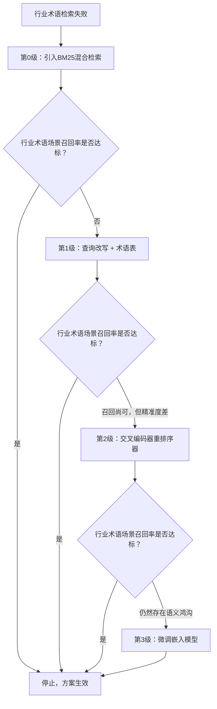

# 客户内部行业术语导致检索失败。微调嵌入模型、增加重排序器，还是改写查询？
三种可行的修复方案，一套决策框架。面试官会考察方案排序（优先选择成本最低、可回退的方案），以及你是否能讲清楚每种方案在数据、时间、运维负担方面的成本。


> **第09题：客户内部行业术语导致检索失败。微调嵌入模型、增加重排序器，还是改写查询？**


> **简而言之：不要直接选一个最喜欢的方案，要按照成本由低到高逐级尝试。先确认系统中已经接入BM25，之后结合术语表做查询改写，再使用重排序器；只有当评估结果显示行业术语场景效果依旧很差时，才把嵌入模型微调作为最后的手段。**

## 解题思路
不要直接挑选一个偏好方案；给出一套按成本分级的阶梯方案，同时给出问题诊断方法，判断问题出在哪一级。首先定位故障根源：行业术语的问题是出在**查询侧**（用户输入“TPS报告”，而索引文档里写的是“交易处理摘要”），还是**文档侧**（嵌入模型把内部缩写映射成无意义噪声），或是两者兼有。抽取20条失败查询样本进行分析，通常就能定位问题。

## 高质量回答


**第0级：务必在系统中加入BM25。**
行业术语与缩写，正是词法检索原生擅长处理的对象；如果你的系统是纯向量检索，混合检索可能一天之内就能解决大部分问题。优先讲这一步，这是高级工程师的思考方式。

**第1级：查询改写/查询扩展。**成本最低的语义修复方案：由大模型做前置处理，基于整理好的术语表对缩写进行扩写（把“TPS”扩展为“交易处理摘要”），生成2‑3条释义复述，或是拆解复杂复合问题；之后用全部变体执行检索，再使用RRF算法融合结果。
开销：一次额外大模型调用（约100‑300毫秒），成本极低；**不需要训练数据**，几天就可以上线，并且可以轻松回退。由客户领域专家整理出一份200条术语的术语表，往往是整个项目投入产出比最高的产出物。
文档侧配套方案：索引阶段做上下文增强，在分块头部添加摘要，把缩写全称写在文档块开头。

术语表是这一环节最核心的工作，看下面的实际样例更直观。“一份200条术语的术语表”听起来工作量很大，但实际每一条只需要和领域专家沟通就能产出。下面是5条真实业务格式：
```
TPS     → 交易处理摘要
P45     → 员工离职流程（不是英国税务表单）
red route → 一级紧急升级通道（运维内部黑话，文档标题不会出现）
Falcon → 供应商付款系统内部代号
comp check → 销售场景：费率竞争力比对 | HR场景：薪酬复盘
```

每一行都来自一次和领域专家的沟通。最后两行就能说明：这份文件不能交给大模型直接生成。“Falcon”在公司外部没有业务含义；而“comp check”会根据部门语境有两种含义，改写步骤需要识别用户所处工作空间，完成对应扩写。
查询时的改写逻辑示例：“为什么我的Falcon批处理任务卡住了？”。
> ⚠️ 维护提醒：当销售团队修改业务流程名称，术语表过时就会错误改写查询。因此术语表需要指定负责人，设置定期复核机制，否则会悄悄破坏检索效果。

**第2级：重排序器。**
交叉编码器重排序器依靠完整查询‑文档对注意力机制，做精细相关性打分。但有一个关键局限：**重排序器只能对上游已经召回的候选集做重排。** 如果包含行业术语的正确文档根本没有进入候选集合，重排序器完全无法补救。
适用场景：`recall@50`召回指标尚可，但是`precision@5`精准度差。可以直接使用现成模型（Cohere Rerank、BGE重排序），几天即可上线；即便用几千条标注样本微调重排序器，成本依然低于嵌入模型微调。

**第3级：微调嵌入模型。** 成本最高的最终修复手段。
使用（查询‑相关文档块）样本对做对比学习训练，样本数量通常1000‑10000对，可以从点击日志、评估标注数据、大模型生成合成数据中提取。训练目标：教会模型理解“P45流程”等价于客户的员工离职流程。
成本开销：需要数周时间，不再是几天；会产生独立模型产物；每当语料库更新、或是模型版本变更，都需要对全部文档重新向量化；会带来普通查询效果退化风险；同时会给客户侧增加机器学习运维负担。
**只有当0‑2级方案收益到达瓶颈，评估报告持续出现语义鸿沟类失败案例时，才启用本方案。同时保留一套普通查询测试集，监控效果退化。**

### 使用数据做决策
准备一套标准测试集，把查询拆分为「大量使用行业术语」和「普通查询」两组。每做完一级优化，就测量`recall@10`指标。当行业术语查询集指标和普通查询集指标基本对齐，就停止继续升级方案。

## 面试官接下来可能追问的问题
1. **微调的样本对从哪里获取？**
> 挖掘出来的困难负样本比正样本更加重要；用大模型为每个文档块生成合成查询，实际效果非常好。
2. **术语表如何维护？**
> 需要客户侧指定维护负责人；过时的术语表会悄无声息毁掉检索质量。
3. **如果延迟预算不允许做查询改写怎么办？**
> 缓存扩写结果，改为在文档侧做预处理增强，查询阶段就不会增加耗时。

## 常见错误
1. 一上来就直接做嵌入模型微调，这会暴露你没有评估过实际运维成本。
2. 不理解重排序器的局限性：无法召回上游完全没拿到的文档。
3. 跳过BM25混合检索的验证步骤。
4. 每一步优化都没有配套评估方案，把清晰的阶梯排查变成盲猜试错。

## 核心要点
- 修复方案按照成本、可回退性排序；成本很低的术语表+查询改写，往往一个下午就能解决绝大多数术语带来的效果缺口。
- 重排序器仅能重排已经召回的内容，如果正确文档根本没有进入候选集合，它无能为力。
- 嵌入模型微调放在最后：耗时数周，并且每当语料库、模型变更，都要执行全量文档重新向量化。

> **编者注**
> 嵌入模型微调听起来技术感很强，但往往是最差选择。它成本最高、最难回退；每当语料库或者模型变动，客户就要承担全量重向量化的迁移工作。很多人会跳过低成本方案：查询阶段的术语表、缩写同义词扩展，而这些往往一个下午就能填平大部分行业术语带来的检索鸿沟。优先选择低成本方案，代表你站在客户运维负担角度思考，而不是只追求简历上亮眼的技术名词。


> 术语表方案有一种维护隐患，往往几个月之后才爆发：缩写冲突。例如“TPS”在财务代表交易处理摘要，在运维领域含义完全不同。一份扁平的全局扩写术语表会同时输出两种释义，污染所有人的检索结果。当术语数量达到几百条，扩写逻辑就需要结合查询所属部门、来源做范围限定，实际工作量会远超“一个下午就能做完”的预估。