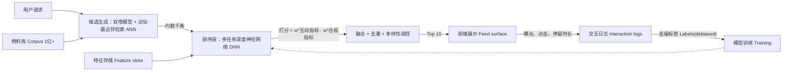

# 为个性化信息流（Instagram风格）设计排序模型

> 一句话总结：整体拆分为低成本候选集生成模块（基于近似最近邻ANN索引的双塔检索，召回数千条候选内容）与高算力精排模型，对数百条候选打分。精排模型基于隐式反馈训练，预测多种用户行为（点击、停留、点赞、关注，外加内容合规信号），将多个预测结果加权融合；校正标签中的位置偏差，所有上线决策都由A/B实验判定，同时设置用户互动、内容合规的保护阈值。

## 解题思路
先明确约束条件：你无法在30~50毫秒内，为十亿级内容库的全部内容逐条打分。因此，在选定具体模型之前，架构就必须采用两阶段设计。先要定义这个产品里“效果好”的标准——是单纯总使用时长，还是有意义的用户互动，或是创作者生态健康度，目标决定优化方向，而非损失函数。再梳理实际可采集的反馈数据：模型训练依赖隐式反馈，但这类反馈本身就被旧模型曝光过的内容所影响。需要覆盖检索、标签与特征设计、多目标精排模型，以及线上评估方案。

## 高分回答

**第一阶段：候选集生成**

面对数亿规模的内容库，需要在个位数毫秒内，将候选范围缩小至几千条。一般融合多路召回来源：双塔模型（用户塔+物品塔，训练目标为两者点积近似用户互动概率，依托HNSW、ScaNN这类近似最近邻ANN索引对外提供服务），再叠加关注关系图谱内容、最新内容池与热门内容池。双塔模型是核心组件：物品塔向量可以离线预计算，用户向量仅需在请求时执行一次前向推理；检索本质是近似最近邻查找，而不是给数十亿条数据逐条跑模型打分。

采用两阶段架构不是主观偏好，而是算力限制带来的必然结果，这点必须明确说明。我们给精排模型按宽松批量成本估算：假设单条内容消耗50微秒。如果给1亿条内容全量打分，单次请求需要5000秒算力，比50ms时延预算高出约5个数量级。如果仅对500条候选打分，相同模型只需要25ms，刚好满足要求。这两个数字之间，就是整套设计所有架构决策的核心逻辑：漏斗设计的意义，是用低成本点积运算处理海量内容，让高成本的交叉特征模型仅处理几百条候选。开场讲清算力约束，面试官就知道你是在设计工程方案，而非背诵知识点。

**第二阶段：精排模型**
精排模块消耗算力具备合理性，因为它只处理几百条候选。这里使用表达能力更强的模型（小场景可用梯度提升树；该规模场景一般采用带完整交叉特征的多任务深度神经网络）：输入用户历史、物品内容嵌入、创作者偏好、新鲜度，最关键的是用户-物品交互特征——双塔模型无法做到这一点，双塔的用户向量与物品向量只有在做点积时才会产生交互。

难点在于标签。我们没有显式评分，只有隐式反馈，并且隐式反馈自带噪声。点击信号参考价值有限（标题党内容也能拿到点击），因此我们做多任务头预测：p(点击)、p(长停留)、p(点赞)、p(关注作者)、p(隐藏/举报)。停留时长需要设置阈值，否则模型会奖励加载缓慢、容易造成用户困惑的内容。负样本是一大陷阱：没有点击不等于真负例，用户可能根本没有看到屏幕下方这条内容。所以**被展示但无互动**视作软负例；检索阶段采样那些从未被曝光的内容作为简易负样本。

接下来是多目标优化。只优化单个预测头会损害产品体验：单纯优化点击概率会催生标题党；单纯优化停留时长会造成无意义的无限下滑，导致次日留存下跌。因此线上服务分数采用加权组合，公式大致为：
`分数 = w1*p(点击)+w2*p(停留)+w3*p(点赞)+w4*p(关注)-w5*p(举报)`

其中合规相关项做减法。

权重不是端到端针对单一指标学习得到；而是通过线上实验，围绕一组指标（包含留存）调参。只有这样，才能判断我们是不是牺牲了健康的信息流，换取虚假的点击上涨。

然后是**位置偏差**，这个隐患会悄悄污染全部训练数据。排在顶部的内容，无论相关性高低，都更容易获得点击。如果直接拿原始日志训练，模型会学到“排在前面就是优质”，不断强化旧模型已经排到高位的内容。两个标准解法：

1. 训练时把位置作为特征输入，线上推理时将该特征置0（或固定值），让模型把点击归因于内容相关性，而非展示槽位；

2. 逆倾向加权：用预估的、该内容在当前位置被用户看到的概率，对标签做除法加权。

同一套逻辑也适用于**选择偏差**：日志里只包含上一版模型挑选出来展示的内容。所以我们需要持续注入一小部分随机/探索流量，收集无偏数据，防止反馈循环坍缩成单一同质化内容池。

离线阶段依靠排序指标调参；上线决策依靠因果实验。

| 层级 | 评估目标 | 指标 | 决策用途 |
| ---- | ---- | ---- | ---- |
| 检索层 | 优质内容能否进入精排候选池 | recall@k，覆盖率 | 调整多路召回源配比 |
| 精排（离线） | 排序顺序、概率质量 | NDCG，AUC，预期校准误差ECE，对数损失 | 判定是否进入A/B实验 |
| 线上（因果） | 真实用户效果、创作者侧影响 | A/B实验：互动指标、次日留存、举报率 | 决定是否全量上线/回滚 |

校准的重要性远超普遍认知：分数会用来做多目标加权融合，还会供给下游广告/通知逻辑。如果p(点击)不是真实概率，各个任务头之间的权重就失去意义。因此要检查预期校准误差，而不只看AUC。

收尾要点：离线指标不能作为上线依据。NDCG更高的模型，A/B实验里反而可能失败：它拉高了点击率，但靠博眼球的内容，导致28天留存下滑。所以A/B实验必须设置明确保护阈值：内容合规举报率、会话时长、留存、创作者触达量。只要保护阈值出现恶化，就算核心指标上涨，也必须阻断上线。

## 面试官后续常追问问题

1. **“点击率上涨，但用户会话变短，要不要上线？”**

不可以。只要预设的保护阈值出现恶化，就不能上线。点击率只是代理指标，标题党是其中一种可能原因。暂停上线，查看本次A/B实验里留存、停留时长的保护阈值；如果这些指标变差，那么核心指标上涨本质是负收益。这才是面试官真正想问的核心。

2. **“新用户或者全新内容怎么做冷启动？”**

新用户：依赖上下文和流行度先验，加大探索力度；随着用户前几次会话积累信号，逐步完成个性化。

新内容：使用内容嵌入（图像/文本/音频），物品塔不需要交互历史就能为它生成向量；再加一小部分探索流量预算，让新内容获得曝光机会。

3. **“你的训练数据来自模型自己生成的结果，怎么避免系统坍缩？”**

承认存在反馈循环。然后注入随机/探索曝光流量；对日志数据使用逆倾向加权；持续监控多样性、内容库覆盖率，设置漂移告警。

## 常见错误
- 提出一个超大单模型，给全量内容库打分。这在信息流时延约束下不可行，说明你没理解两阶段架构的核心。
- 只优化单一互动目标（通常是点击），忽略这会损害产品整体体验。
- 把所有未点击样本都当成硬负样本，用用户根本没见过的内容污染训练集。
- 完全忽略位置偏差，导致模型只信任过去的排序结果。
- 拿NDCG、AUC当作上线决策标准，信息流项目上线与否，最终看A/B实验里留存和合规保护阈值。
- 缺少探索机制，反馈循环不断缩小内容池，最后形成自我强化的同质化内容生态。

## 核心要点总结
1. 两阶段架构：基于ANN索引的双塔检索，再用强能力多任务精排模型对几百条候选打分。
2. 隐式标签自带偏差；校正位置偏差（训练带位置特征，推理置0，或IPS逆倾向加权）、选择偏差（探索流量切片）。
3. 优化带合规惩罚项的加权多目标，不是原始点击；权重在线上调。
4. 上线决策依靠带留存、合规保护阈值的A/B实验，不是离线NDCG；保证校准可靠，因为多任务头会融合计算。

---

### 编者按
资深面试官视角：要把这个当成一套系统，而不是单个模型。两阶段检索，保证昂贵精排模型只给几百条内容打分；当原始互动指标损害产品体验时，显式定义多目标；诚实看待标签里的位置偏差与选择偏差。优秀候选人会主动指出训练数据由旧模型生成，并且解释如何打破这个闭环。面试官会追问“点击率涨了但会话变短”，看你是否会启用保护阈值与对照组，而不是只看表面指标。

> 面试者容易踩坑的地方，是分不清位置偏差和选择偏差：两者的解决手段不一样。训练时加位置特征、推理置0这个方案，只能修正“在某个槽位拿到点击”的偏差，解决不了旧模型从来没有曝光过的物品带来的偏差。只有探索流量切片、倾向性日志才能处理选择偏差。面试官听到你混淆两者，一定会深挖这个点。