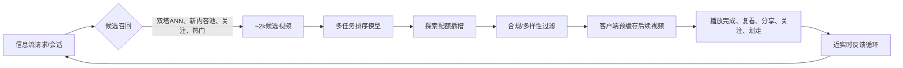

# 为短视频“为你推荐（For You）”信息流设计排序系统
整个产品的成败取决于一个以秒为单位的反馈循环：一次划动就是一条标注样本，下一条视频的推荐结果必须据此调整。难点在于：要充分探索用户喜好，同时不能让用户困在信息茧房里，也不能把低质内容越推越多。

> 一句话摘要：用一个多任务模型对候选视频打分，模型预测播放完成率、复看、分享、关注行为，同时对快速划走进行负向惩罚；系统由近实时反馈链路驱动，每次划动会在数秒内影响下一次推荐请求。预留固定的探索流量配额，持续挖掘用户潜在兴趣，避免陷入信息茧房；同时设置内容合规与多样性防护约束，防止模型为了流量放大标题党内容。

### 解题思路
这个系统最核心的特点是反馈链路极快：几秒前产生的一次划动行为就是一条标注样本，下一条推送的视频必须体现这个信号。因此它既是建模问题，也是在线学习与服务延迟问题。
核心矛盾是**探索（Exploration） vs 利用（Exploitation）**：一味利用已知偏好，会把用户困在狭窄的兴趣茧房，永远发现不了新喜好；探索占比太高，信息流又会显得杂乱无章。
你要先明确核心北极星指标（应该是长期留存，而不是单次观看时长）、每次推荐请求的延迟上限、内容新鲜度要求；之后依次设计候选召回、多任务排序模型、反馈链路、合规防护机制。

---

### 高分回答
采用经典的两段式架构，但针对速度和新鲜度做定制优化。
**候选召回阶段**：每次请求从多个池子召回几千条候选视频：
- 双塔协同过滤模型（用户、视频Embedding，ANN向量检索服务）
- 新内容池（几分钟前刚上传的视频有机会曝光）
- 关注关系图召回
- 热门/爆款内容池

**排序阶段**：用复杂度更高的模型给这些候选打分，输出有序视频批次；客户端预缓存后面几条视频，保证滑动丝滑无卡顿。

排序模型是多任务架构，任务目标的选择是重中之重。点赞是弱信号、带有偏差（很多深度使用用户从来不点赞），更可靠的是隐式行为信号：
- 播放完成率（视频观看占比、循环复看）：最密集、最真实的信号，代表内容留住了用户
- 复看、分享、看完后关注：高价值正向信号，和长期价值强相关
- 快速划走（2秒内上滑跳过）：明确负样本；如果只当成“没有正向反馈”，会丢失大量有效信号
- “不感兴趣”/举报：强负样本，同时是内容合规信号

[生成图片](./生成图片.png)

在共享底层的模型上，每个行为对应一个预测头；之后用调优权重合并成最终打分，示例公式：
$$\boldsymbol{score = w_1*P(完成播放)+w_2*P(分享)+w_3*P(关注)-w_4*P(快速划走)}$$
这些权重不是单纯建模细节，而是产品决策，需要通过A/B测试调参——权重定义了我们对一次分享、一次完整观看的价值取舍。

> 流程图Mermaid：

标签工程需要仔细打磨：观看时长会“造假”。长时间播放有可能是“内容吸引人”，也可能是“内容看不懂，反复看字幕”；而且总观看时长天然偏向长视频。所以要用**播放完成率（按视频时长归一化）**，融合多种信号，而不是单一依赖观看时长。
位置偏差同样重要：排在最上面的视频天然更容易被看完，和内容质量无关。训练时必须记录展示位置并做去偏，否则模型只会学到“排在前面的视频效果好”。

**探索流量是硬性要求，不是可选项**。纯“利用型”排序只会在已知喜好里最大化互动，永远不会给用户推送全新品类，信息流会越来越陈旧，这是产品缓慢死亡的根源。
预留明确的探索配额（大约5%~15%的曝光位），可以用上下文老虎机/汤普森采样，在内容聚类、新创作者之间分配探索流量。
这个机制同时承担冷启动能力：
- 新用户：大范围探索，直到在一次会话内挖掘出用户偏好
- 新视频：给每一条新上传视频分配可控的初始曝光量；优质内容可以借此爆火，模型也能从真实互动中学习这条视频的Embedding

短视频场景的标注样本密度，和其他推荐系统完全不在一个量级，可以简单算一笔账：
假设单次会话30分钟，平均每条视频20秒，一共大约90条视频，每条视频都会产生【看完/划走】标注。一次会话就能产出约90条标签；而电商一次会话可能只有2次点击，影视网站可能只有1条评分。
如果日活1亿，每天可以产生接近90亿条全新标注（仅用于举例，不是行业基准）。
正是这种超高样本密度，让近在线学习在这里可行：新用户在一次会话内（第30分钟左右）就可以被有效排序；快速划走样本占绝大多数，绝对不能丢弃。

反馈循环就是这套系统的骨架。每次播放完成或者划走，都要在数秒内更新用户的近期交互特征，最好还能更新模型，依靠流式特征、高频刷新（近在线）模型更新，而不是只做夜间批量训练。这就是为什么用户划两三下，信息流就像“懂自己”。
延迟要严格管控：候选召回通过ANN检索控制在几毫秒；给几千条候选排序控制在几十毫秒；客户端预缓存视频，避免用户每次滑动都等待网络往返。排序批次的服务端P99延迟目标控制在100ms左右。

合规与多样性防护层放在排序之后，省略这一步就是系统公开翻车的根源。
如果不加约束，优化器会发现：争议内容、标题党、擦边内容更容易拿到互动。所以需要一个分类器层，提前降权、过滤违规、误导、低质内容；同时设置创作者、主题多样性上限（不要连续推送5条同一个博主、同一个主题的视频），增加防茧房约束，强制注入题材多样性。
这些都是显式硬约束，模型自己不会主动学到；互动收益和内容合规本身存在冲突，这个取舍必须由业务侧定义。

**线上评估是最终关卡**：离线指标看NDCG、人均AUC，但它们只能衡量和历史偏置日志的拟合程度。真正的检验是A/B实验：
主指标是**长期留存（7日、30日活跃）**，而不是单次会话观看时长；同时设置护栏指标：违规内容曝光量、创作者多样性、“不感兴趣”/投诉率、延迟。

| 指标 | 为什么看起来很有吸引力 | 为什么会误导你 | 定位 |
| ---- | ---- | ---- | ---- |
| 单次会话观看时长 | 样本密集，指标变化快 | 会奖励“一次性刷爆然后流失”的内容、标题党 | 短期诊断指标，不是最终目标 |
| 播放完成率 | 单条视频质量的真实信号 | 忽略内容多样性、长期影响 | 排序核心标签 |
| 30日留存 | 代表真实业务价值 | 指标反馈很慢，需要等数周才能拿到结果 | A/B实验核心主指标 |
| 违规内容曝光 | 捕捉垃圾内容被放大的问题 | 需要可靠的内容分类器 | 上线拦截类护栏指标 |

### 面试官接下来常追问的问题
- ✅ “A/B实验里观看时长上涨了，但30日留存下降，是什么原因？”
模型在优化短期代理指标，放大了标题党内容，或者把用户推入狭窄茧房，用户刷爽之后很快厌倦流失。这就是为什么留存是主指标，观看时长仅作诊断；解决方案是收紧合规权重、提高探索流量占比，再重新实验。
- ✅ “怎么防止信息流变成信息茧房？”
依靠探索配额 + 题材多样性上限；没有专门的探索插槽，纯利用型排序一定会不断收窄推荐范围。监控**单用户题材熵值**作为护栏指标。
- ✅ “一条全新视频怎么拿到第一批观众？”
新内容池 + 探索配额，给每一条上传视频分配可控的初始曝光；从这批小流量样本的完成/划走数据，在几小时内学到这条视频的Embedding，之后协同过滤就可以分发它。

### 常见踩坑
1. 把总观看时长、会话长度当成成功目标，奖励标题党，用户刷完即倦怠流失，留存暴跌
2. 训练时依赖点赞，忽略完成率和划走这些密度更高、更真实的信号
3. 把划走当成缺失数据，而不是明确负样本，浪费绝大多数标注
4. 忽略位置偏差，模型只会学到“排在前面的视频更容易被看完”
5. 没有探索配额，信息流逐渐陈旧、茧房固化，新内容很难曝光
6. 上线不带合规防护层，优化器自动发现争议、擦边内容更容易涨互动

### 核心要点总结
- 标签信号：播放完成率、复看、分享、关注，同时惩罚快速划走；点赞是弱信号，观看时长容易被刷指标
- 探索流量是硬性配额（5~15%，老虎机策略），同时承担新用户、新视频冷启动
- 反馈链路是近实时：每次划动几秒内就影响下一次推荐，客户端预缓存掩盖延迟
- A/B实验以30日留存为主指标；合规、多样性是上线强护栏，互动收益和合规本身存在冲突

---

资深候选人的答题关键点：抓住**探索vs利用**这个核心矛盾，把【完成播放 / 快速划走】作为真实标签，而不是点赞。高分方案要搭建多任务排序模型（完成、复看、分享、关注、划走惩罚）、搭建低延迟近实时反馈链路、增加合规与多样性防护，防止模型放大标题党或者困死在茧房。
面试官用“观看时长上涨、留存下跌”这个问题，考察候选人是否理解短期指标刷量、用户倦怠流失这种典型失败模式。

“观看时长涨但留存下跌”这一句话几乎就是这道面试题的缩影。陷阱在于：单条视频的完成率、会话观看时长虽然是单条内容的真实信号，但聚合起来依然会放大标题党、透支用户，所以留存必须作为A/B主指标，观看时长只用来辅助诊断。资深的解法是把**单用户题材熵**作为护栏指标——茧房收窄，是留存下跌的前兆，而留存指标要等几周才看得见。

