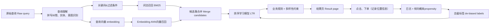

# 为商品/交易市场搜索设计排序学习（Learning-to-rank, LTR）

一句话简述：搜索框本质是一个带有强先验信号（用户查询词query）的推荐系统。难点在于理解模糊的用户意图、在严格时延限制下做两阶段召回、基于点击数据训练模型，同时不能让模型学到“排在前面的就是最好的”这个错误认知。

**一句话总结（TL;DR）**：先理解查询（意图、实体、拼写纠错）；两阶段召回（BM25/词法召回 + Embedding近邻检索做语义匹配）；合并候选集后送入排序学习模型打分；训练数据融合经过位置偏置校正的点击、购买日志，再搭配少量人工标注数据集；个性化仅作为同分兜底微调手段，**绝对不能覆盖用户明确的搜索意图**。

---

## 解题思路

搜索和信息流推荐不一样：用户已经主动输入查询，自带明确意图；搜索最严重的错误，就是返回和用户意图无关的商品。
两大硬性约束：

1. **严格时延限制**：搜索是交互式场景，端到端时延通常只有几百毫秒；
2. **训练标签噪声大**：点击数据量大但是存在位置、展示带来的偏置；购买标签更干净但是样本稀少；人工标注标签质量高，但是成本昂贵。

面试先确认几个前提：商品库规模、查询流量、转化目标（点击、下单、GMV，交易平台还要考虑卖家公平性）、时延上限。之后依次设计：查询理解、两阶段召回、LTR排序模型、标签去偏治理。

## 高分完整回答

[trade](./tradoe.png)

### 1. 查询理解（Query Understanding）

优先做查询理解，下游所有模块都会继承这一步的错误。
把原始查询解析成结构化意图：

- 拼写纠错（`ipone` → `iphone`）
- 实体&属性识别（`red running shoes size 10` 拆分为：颜色、品类、尺码）
- 意图分类：精确找单品 / 宽泛类目浏览 / 导航类查询
- 同义词扩展（`sneakers` 匹配 `trainers`）

这一步是精准召回的基础；如果直接把查询当成一堆无序单词，搜索`waterproof jacket（防水外套）`时，防水商品和不防水外套会被同等排序。

### 2. 两阶段召回（Retrieval，优先保证召回率Recall）

- **词法召回分支**：基于倒排索引跑BM25，搭配解析出来的属性做过滤。擅长精准查询、稀有词、编号类关键词匹配。
- **Embedding语义召回分支**：查询和商品文本用双塔编码器（dual-encoder）生成向量，基于HNSW的ANN近似最近邻检索。捕捉词法匹配漏掉的语义相似（例如`舒服居家办公椅`匹配人体工学办公椅）。

合并两路召回的候选集合，最终拿到几百到两千个候选商品。
两路召回互补：只用词法召回会丢同义词、语义意图；只用向量召回很难处理零件编号、小众品牌名；两者互补覆盖各自短板。

> 图中虚线反馈链路，决定系统是持续迭代优化，还是慢慢僵化固化。如果没有位置日志和倾向校正，排序模型只会不断复刻上一版的排序结果。

### 3. 排序模型（Learning-to-rank）

排序模型主流选择：

- 表格特征丰富：梯度提升树 **LambdaMART**
- 重度依赖向量特征：深度神经网络DNN

训练损失：成对损失（pairwise）或者列表损失（listwise），优化指标NDCG，而不是单点相关性——排序任务里，**商品的先后顺序才是核心**。

特征分为三大类：

1. 查询侧特征：意图类别、查询长度
2. 商品侧特征：价格、评分、评论数、图片质量、是否有货；交易平台额外加入卖家质量、发货速度；外卖平台（DoorDash）增加可售状态、配送预估时长、备餐时间；手作平台（Etsy）增加卖家可靠性、配送地区
3. 查询-商品匹配特征（核心相关性信号）：BM25分数、向量余弦相似度、属性重合度、该查询商品对历史CTR

匹配特征负责相关性；其余特征代表商品质量、业务目标。

### 4. 标签设计（核心难点）

标签来源、优缺点、使用方案：

| 标签来源 | 优点 | 缺点 | 使用方式 |
| ---- | ---- | ---- | ---- |
| 点击 Click | 样本量大、免费 | 严重位置偏置、容易被封面图吸引 | 用倾向概率去偏，作为弱信号 |
| 下单/转化 Purchase / conversions | 和业务目标对齐 | 样本稀疏、有延迟、受价格干扰 | 强正样本，核心优化目标 |
| 人工标注 Human judgments | 标签干净、贴合真实意图 | 成本高、数量少，会漏掉真实用户偏好 | 用于校准、处理对抗bad case |

**位置偏置陷阱**：排在越靠前的商品，不管是否相关，被点击概率天然更高。直接拿原始点击训练，模型会学到：“上一版排第一的就是最好的”，系统僵化锁死排序结果。

校正方案：
通过线上随机埋点/位置感知模型，估算每个位置的**曝光倾向概率（examination propensity）**，使用**逆倾向加权 IPS（Inverse Propensity Weighting）**。
举例：第1位曝光概率≈100%，第8位只有15%；那么第8位的一次点击权重 = 1 / 0.15 ≈ 6.7，等价于首页一次点击。用户划到很深才点击，说明这个信号的可信度远高于随手点首页第一个商品。
不去偏的后果：一个不相关商品长期霸占第1位，点击率天然更高，模型会持续把它置顶，形成恶性循环。

训练数据组合方案：
去偏后的点击+下单数据提供充足样本；搭配小规模人工标注黄金集做校准，专门处理对抗坏例（例如`防水`这个查询，即使非防水商品被点击，也不能排在前面）。
标签优先级：下单是最强正信号；点击是弱正信号；点击之后立刻退出页面，标记为负样本。

### 5. 个性化 Personalization

个性化只用来**同分兜底**，不能主导排序。
用户历史类目偏好、品牌偏好、价格区间，只能用来调整**已经满足查询意图的候选商品**顺序；**绝对不能覆盖用户明确的查询词意图**：比如用户平时总买平价商品，但这次精确搜索一款高端商品，依然要优先返回这款高端商品。

实现方式：把个性化特征送入同一个LTR排序模型；新用户没有历史行为，降级使用无个性化排序。

### 6. 时延约束（架构设计的核心）

- 查询理解：几毫秒（模型缓存、预构建同义词表）
- 词法召回 + 向量召回：并行执行，几十毫秒
- LTR给上千候选打分：几十毫秒
整体目标：P99端到端时延约200ms
降级策略：如果向量召回超时，优雅降级，只保留词法召回，而不是直接超时报错。

### 7. 评估体系（两层评估）

- **离线评估**：
NDCG@K（基于人工标注集、去偏点击）衡量排序质量；召回率Recall@K，确认目标商品有没有进入候选池。只看排序NDCG毫无意义——如果召回阶段漏掉很多相关商品，排序模型只是在一堆差候选里面重新排序。
- **线上A/B实验**：
核心指标：下单转化率、单次搜索GMV；
兜底监控指标（guardrails）：无结果率、查询改写率（用户反复重搜代表没找到想要的）、时延；交易平台额外监控卖家覆盖率、卖家公平性，避免流量集中到头部少数大卖家。
正式A/B之前，可以先做交织实验 interleaving，快速对比排序效果。

### 8. 反馈循环风险

系统僵化（ossification）：模型使用自己上一轮排序产出的点击数据训练。解决方法：持续记录位置倾向概率；保留一小部分流量做随机探索，给新品、长尾商品拿到曝光机会，保证标签真实可信。

---

## 面试官后续深挖问题&标准答案

1. 问：搜`防水`，返回了非防水商品，而且这个商品持续被点击，模型越训越把它排前面，哪里出问题？

> 答：模型在学习带偏的点击信号，没有绑定用户原始意图。上游查询理解模块要把`防水`属性设置为强过滤条件；同时加入人工标注对抗badcase集合，离线回归测试提前拦截这个问题。只靠点击去偏，解决不了这类问题。

2. 问：点击都有位置偏置，怎么还能用点击来训练？

> 答：估算每个位置的曝光倾向概率，逆倾向加权IPS校正；同时融合下单标签、人工标注黄金集。直接拿原始点击训练，只会复刻旧排序。

3. 问：为什么要两阶段召回，而不是只用一个向量召回模型？

> 答：词法召回擅长零件编号、小众品牌、精确过滤，向量召回很难做好；向量召回擅长同义词、语义意图，词法召回抓不到。两路互相弥补短板；召回阶段优先优化召回率，排序阶段优化精准度。

## 常见踩坑错误

- 跳过查询理解，直接把查询当成一堆单词，忽略属性和意图；
- 直接用原始点击训练，不做位置去偏，系统排序固化；
- 只优化点击，而不是下单、GMV这类真实业务价值；
- 只使用向量召回，导致精确编号、小众品牌的搜索全部失效；
- 个性化权重太高，覆盖用户明确输入的查询意图；
- 只汇报离线NDCG上涨，忽略召回率下跌——排序变好看，但候选池里相关商品变少。

## 核心要点总结

1. 优先做查询理解（拼写纠错、实体识别、意图分类），它决定整个搜索系统的上限；
2. 两阶段召回：词法分支处理精确词、稀有token，向量分支处理语义同义词，合并候选、优先保障召回率；
3. LTR训练：去偏点击 + 下单数据提供样本，人工标注集校准、拦截对抗坏例；下单信号权重最高；
4. 个性化仅作为同分微调兜底，不能覆盖明确查询意图；A/B实验核心看下单/GMV，同时监控无结果率、查询改写率、时延等兜底指标。

高级信号是查询理解驱动的两阶段检索（词汇加词嵌入）和清晰的相关性标签：点击和购买量丰富但存在位置偏差，人工判断清晰但成本高昂，而最佳答案则结合了两者，并明确地校正了位置偏差。优秀的候选模型会设定延迟预算，将检索召回率与排名精确率分开，并在不使个性化凌驾于用户明确意图之上的前提下进行个性化。例如，可以使用“搜索防水产品返回了点击量较高的非防水产品，因此模型将其排名更高”这样的示例来测试模型是否理解点击偏差和标签规范。

---

`防水`这个例子的根本问题：**无论怎么做位置去偏，点击数据本身都修复不了这个错误**。就算非防水商品持续被点击，IPS校正只是更精准估计这个错误偏好。根治方案在查询理解上游：把防水属性做强过滤；下游搭配人工对抗badcase，在A/B上线前，离线测试就拦截这个回归。

还要警惕召回陷阱：离线NDCG上涨，有可能是召回率悄悄下降。排序模型只是在变差的候选集里面重排。召回率Recall和排序NDCG要分开看；不然精度提升，召回下滑，面试一定会被揪出来。

