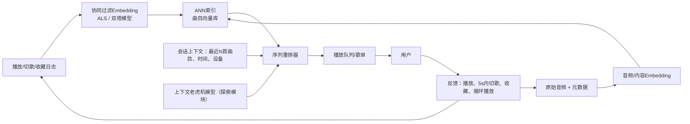

# 设计一个音乐推荐系统（Spotify风格）
一首曲目时长3分钟，一次听歌会话时长1小时，一首新歌上线当日播放量为0。这场面试的核心，是如何将协同过滤与音频内容Embedding融合、解决双向冷启动问题，以及把「切歌」视作强烈负反馈。

---
## 02 设计一个音乐推荐系统（Spotify风格）

> 一句话总结（TL;DR）：把协同过滤（对播放矩阵做矩阵分解，学习得到用户/曲目的Embedding）和从音频、元数据提取的内容Embedding融合，这样新曲目、新用户不会在系统里“隐身”；基于这些Embedding使用近似最近邻检索（ANN）召回候选集；再结合会话、序列上下文做重排；把早期切歌行为当作强负样本；同时使用上下文多臂老虎机模型做探索，避免推荐池最后只剩下头部1%的热门歌曲。

## 解题思路
首先要明确：音乐推荐和通用信息流推荐的区别：

音乐是在一个会话里按顺序消费内容；同一首歌可以被反复播放（重复播放是正向行为，而不是内容疲劳）；反馈几乎都是隐式反馈；**前5秒内切歌属于很强的负反馈，完整听完属于温和的正反馈**。

然后点出核心难点：**双向冷启动**。纯协同过滤在新用户注册、新音乐人上传歌曲时完全失效。
同时要确认业务场景：是精选歌单、电台/自动续播，还是首页推荐栏？不同场景下，序列依赖、探索多样性的权重完全不一样。
需要覆盖：Embedding融合方案、样本标签定义、会话建模、冷启动策略、探索机制。

## 一份高质量面试作答

核心是**双信号Embedding空间**。

协同过滤用来捕捉用户口味的相关性：对用户-曲目播放矩阵做矩阵分解（隐式样本加权ALS算法，或者双塔模型），让相似用户经常一起听的曲目在向量空间里靠近，哪怕这些曲目在声学特征上毫无共同点。对于已有行为的老用户、已有播放数据的老歌，协同过滤是效果最强的信号。

但协同过滤对零播放的内容完全失效，因此我们额外引入**内容Embedding**：

基于原始音频训练模型（在语谱图上使用CNN或者Transformer，输出向量，表征节奏、音色、能量、人声/纯器乐等属性），再加上元数据（艺人、曲风、发行时间、语言），有条件的话还可以引入乐评文本、官方编辑标签。

两种Embedding的融合方式有两种：拼接后送入重排模型；或者分开作为两路召回源，最后由重排模型合并两路候选结果。

### 标签定义（隐式反馈，需要区分权重）
反馈信号优先级排序：
收藏/加入歌单 > 完整播放（或收听>30s） > 重复循环播放（正向，不能像信息流那样打压重复） > 晚期切歌（弱负）
**前5~10s内切歌 = 强负样本**；从未被曝光过的曲目属于无标签样本，**不能当成负样本**。
一般会按照收听占比加权样本：一首听完90%的样本权重，高于只听了35%的样本。
和所有推荐系统一样，召回阶段会抽取未曝光曲目作为简单负样本，但是**绝对不能把它们当成用户明确讨厌的内容**。

### 会话与序列上下文：音乐推荐和信息流排序的分水岭
一个好的播放队列，高度依赖上一首播放的内容：你不会从一首静心钢琴曲，直接跳到激流金属。
因此重排模型会输入会话里最近N首曲目、时段、设备等特征；使用序列模型（基于会话的Transformer或者GRU），基于整条听歌轨迹预测下一首适合的曲目，而不是只依靠用户静态口味向量。这正是电台、自动续播功能听起来连贯顺滑的关键。

### 冷启动（面试官真正重点考察的问题，双向冷启动）
| 冷启动场景 | 协同过滤为什么失效 | 落地方案 |
| ---- | ---- | ---- |
| 新用户（无任何播放记录） | 在播放矩阵里没有对应的用户行 | 引导页选择种子艺人、使用人口统计学/上下文先验、热门内容兜底；在前几次会话中快速收集行为，完成个性化 |
| 新曲目（0播放） | 在播放矩阵里没有对应的曲目列 | 使用音频/内容Embedding，在向量空间中和声学相似的歌曲放在一起；分配少量探索流量预算，拿到第一批播放反馈 |
| 新音乐人 | 完全没有作品行为信号 | 依靠内容Embedding + 官方编辑/曲风标签；老虎机模型给它固定的探索曝光配额，才有机会被用户听到 |

新音乐人这个场景，是最硬核的考验。
只用协同过滤的话，一首零播放的歌曲会永远隐身，形成马太效应（富者愈富）的恶性循环。
内容Embedding解决了“怎么表示这首新歌”，而**显式的探索流量配额**保证它能拿到曝光。

我们用**上下文多臂老虎机**实现探索（汤普森采样、ε-贪心都可以）：拿出一小部分曝光坑位，分给不确定性高的内容，用来学习它真实的用户反馈，而不是永远只推当前最优结果。
如果没有探索模块，系统最后会收敛到头部热门曲库，永远发掘不出潜力新歌。

可以直接报数字，让老虎机方案不只是空泛名词：
假设平台每日1亿次播放，拿出1%作为探索流量：也就是每天100万次探索播放。
如果每天上新约5万首新歌，平均下来每首新歌可以分到大约20次播放（这个数字仅用于举例，不是生产基准）。这个量级足够拿到第一份有噪声的切歌率数据。
老虎机的作用就是动态重新分配流量：第一批播放反馈好的曲目，拿到更多曝光；前5秒高频被切的曲目，不再占用探索预算。

这里两个设计要点：
1. 探索预算是实实在在的业务成本：1%的播放量，刻意放弃当前最优推荐；你需要向业务方解释：这是保证两年后曲库活力必须付出的代价。
2. 不能均匀分配流量，那是资源浪费。老虎机的核心是**基于不确定性分配流量**：少量播放后已经确认不受欢迎的内容，及时从探索池淘汰。

### 效果评估
评估思路和信息流推荐大体一致，但需要适配音乐场景的指标。
离线指标：对预留的真实播放数据计算Recall@k、NDCG，同时校验预测播放概率的校准性。
线上A/B实验指标：优先看用户满意度信号，而不是单纯播放量：切歌率（越低越好）、会话时长、收藏率；以及长期指标：用户留存、发现度指标（用户有没有听到之前从未听过的艺人）。
同时设置曲库覆盖率、多样性指标作为兜底约束：模型可以短期拉高播放量（只推稳热门），但长期会耗尽长尾内容，要靠指标卡控。

> 总结收尾：这个推荐系统不是单一模型。协同过滤用来学习已知用户、曲目的口味；内容Embedding用来处理未知冷启动内容；序列上下文保证听歌队列连贯；老虎机探索机制让系统持续学习，而不是不断重复投喂同样的内容。

## 面试官后续常追问的问题
- 【提问】今天刚入驻的全新音乐人，他的歌要怎么才能获得播放？
> 回答：音频内容Embedding让这首零播放歌曲拥有可检索的向量；同时探索配额（老虎机）给它分配曝光机会，收集真实用户反馈。纯协同过滤会让它永远隐身。

- 【提问】怎么保证推荐一直新鲜，又不会风格跳脱、体验割裂？
> 回答：带序列感知的重排器维持播放队列的连贯性；音乐场景允许重复播放（和新闻信息流不一样）；多样性、新颖性约束加上探索模块，避免一直循环同一批20首歌。

- 【提问】只有隐式反馈，怎么信任“切歌”这个行为？
> 回答：5~10s内的早期切歌是强负样本；播放后半段切歌属于弱负；完整听完、循环播放是正向；按照收听比例加权样本；未曝光曲目不标记为负样本。

## 常见错误
1. 只说协同过滤是全部方案，完全没有应对新用户、零播放新歌的思路；
2. 把循环播放当成内容疲劳去打压——这个逻辑适合新闻信息流，放到音乐场景是错的；
3. 忽略会话顺序，导致播放列表曲风情绪疯狂跳跃；
4. 把所有没有播放的曲目都当成负样本，彻底埋葬长尾内容；
5. 完全不考虑探索机制，模型只会挖掘头部热门，形成强者恒强的闭环，这是面试官一眼就能识别的硬伤。

## 核心要点总结
- 融合协同过滤Embedding（成熟用户/曲目）+音频内容Embedding（冷启动内容），两路都通过ANN检索召回；
- 冷启动是双向的：内容Embedding定位新歌，新用户靠引导偏好+先验信息，老虎机模型给新音乐人曝光机会；
- 区分隐式反馈强弱优先级：收藏>完整播放>循环播放>弱切歌；早期快速切歌是强负样本，未曝光≠负样本；
- 建模会话序列，保证播放队列流畅；线上评估看切歌率、收藏、留存、新歌发现，而不是只看播放次数。

---

> 这里考察的核心，是能否实实在在地处理**双向冷启动**问题：仅靠协同过滤，无法给没有行为历史的新用户、或是零播放量的新歌做向量定位。优秀的候选人会选择使用内容/音频嵌入向量，再搭配上下文老虎机做探索，而不是轻飘飘一句“我们用热门排行榜兜底”就糊弄过去。
> 同时还要做到：把前几秒内的切歌判定为强负反馈，并且纳入会话、序列上下文建模。
> 面试官会抛出这个追问：**“一位全新音乐人今天刚上传作品，这首歌要怎么才能获得播放？”**，用来区分两类候选人：一类是真的落地搭建过这套系统的人，另一类只是读过矩阵分解理论的人。

面试官在“新音乐人怎么拿到播放”这个问题上，真正想听的深层逻辑：**只用内容Embedding是不够的**。
音频Embedding确实让一首零播放歌曲可以被检索到，但如果没有专门预留的探索流量，它依然拿不到曝光，永远停留在0播放，陷入马太效应循环。

两个模块缺一不可：内容Embedding解决“怎么表征这首歌”，老虎机负责给它拿到真实用户反馈。
如果你只答出其中一半，面试官会认为你只是读过矩阵分解的理论，而没有上线过真实推荐系统。

